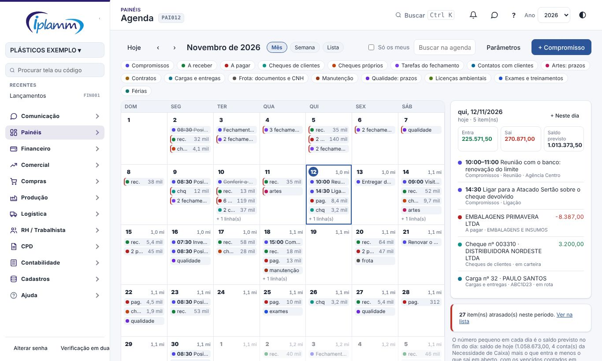
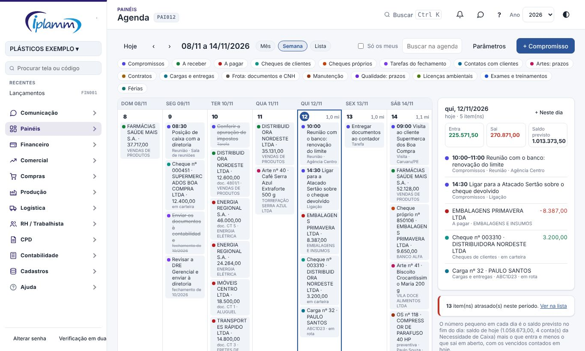
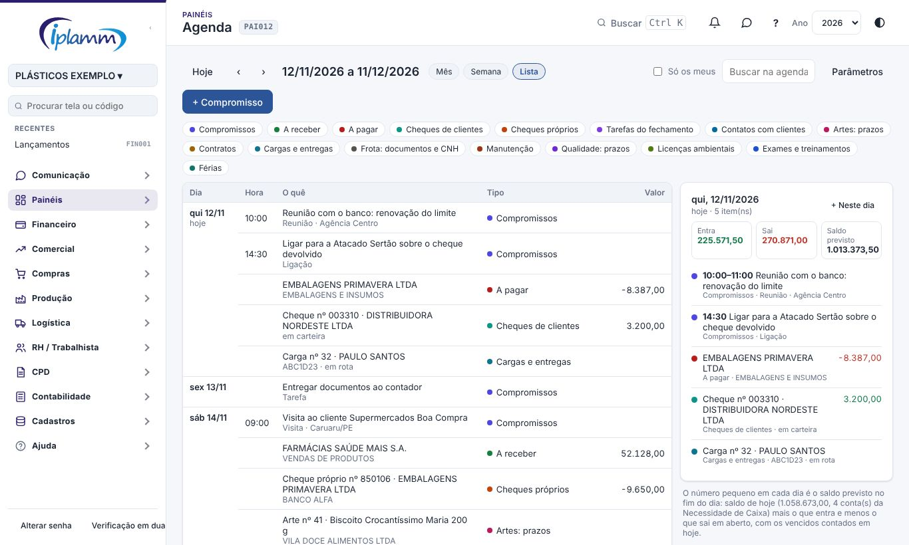
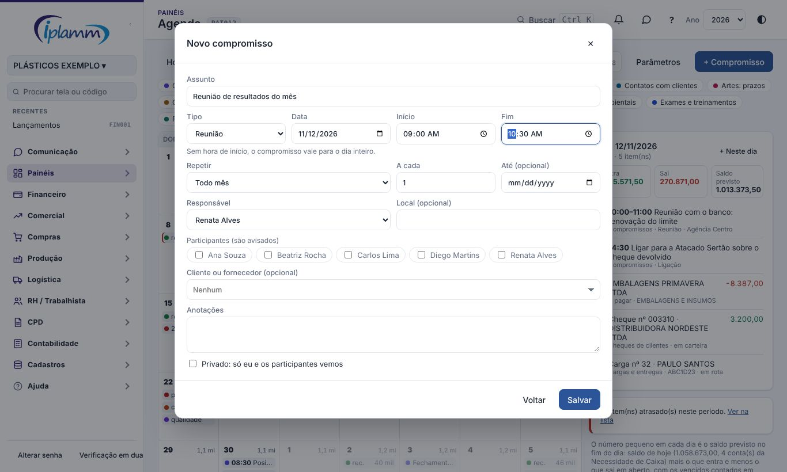
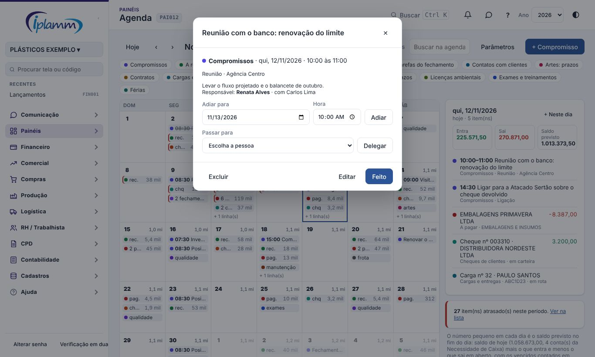
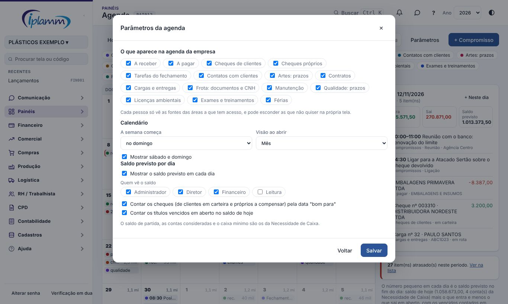

## 1. Para que serve

A Agenda reúne em um calendário tudo o que tem data na plataforma, junto com os compromissos que você mesmo marca. Em vez de procurar em cada tela o que vence, você vê o dia, a semana ou o mês de uma vez:

- **compromissos próprios**: reunião, ligação, visita, tarefa ou lembrete, com hora, repetição, responsável e participantes;
- **itens das outras telas**: títulos a receber e a pagar, cheques, contatos com clientes, tarefas do fechamento, contratos, cargas, documentos da frota, manutenção, prazos da qualidade e das artes, licenças, exames e treinamentos, e férias;
- **saldo previsto** no fim de cada dia, para ver quando o caixa aperta;
- **ações na própria agenda**: marcar feito, adiar (inclusive arrastando) e passar para outra pessoa.

As agendas que já existiam continuam nas telas delas (Minha Manhã, Carteira e Agenda do Comercial, Agenda de compensação dos Cheques). Esta tela junta todas.

## 2. Quem tem acesso

Toda a equipe abre a Agenda, mas cada pessoa vê só o que o perfil dela alcança:

| O que aparece | Quem vê |
|---|---|
| Compromissos | Toda a equipe (os privados, só quem participa) |
| A receber, a pagar, cheques, tarefas do fechamento | Quem tem a área Financeiro |
| Contatos com clientes e prazos das artes | Quem tem a área Comercial |
| Contratos | Administrador, diretor e financeiro |
| Cargas e frota | Quem tem a área Logística |
| Manutenção, qualidade e licenças | Quem tem a área Produção |
| Exames, treinamentos e férias | Administrador e quem tem a área RH |
| Saldo previsto por dia | Os perfis escolhidos nos Parâmetros (padrão: administrador, diretor e financeiro) |

Os Parâmetros são alterados pelo administrador e pelo diretor.

## 3. Visão geral da tela

1. **Hoje, ‹ e ›**: voltam para hoje ou andam um período.
2. **Mês, Semana e Lista**: as três visões. A escolha fica guardada no seu navegador.
3. **Só os meus**: esconde os compromissos, contatos e tarefas que são de outras pessoas. Títulos, cheques e vencimentos continuam aparecendo.
4. **Buscar na agenda**: por assunto, nome ou valor.
5. **Etiquetas coloridas**: cada tipo de item tem uma cor. Clique em uma etiqueta para esconder ou mostrar aquele tipo na sua tela.
6. **Painel do dia** (à direita): tudo do dia selecionado, com o que entra, o que sai e o saldo previsto.

### 3.1 Como ler um dia no mês

- O **número pequeno** ao lado do dia é o saldo previsto no fim do dia (item 6). Dia com o fundo avermelhado está abaixo do caixa mínimo.
- Os **compromissos** aparecem um a um, com a hora.
- Os demais itens aparecem **somados por tipo**: "3 pag. 140 mil" são três títulos a pagar que somam R$ 140 mil. Abreviações: rec. (a receber), pag. (a pagar), chq (cheques de clientes), chq pr. (cheques próprios).
- A **barra vermelha** à esquerda indica item atrasado naquele dia.
- Clique no dia para ver tudo no painel à direita. Dois cliques criam um compromisso naquele dia.

### 3.2 Semana

Mostra cada item separado, com valor e detalhe. É a melhor visão para arrastar itens de um dia para outro.

### 3.3 Lista

Mostra 30 dias em ordem de data, a partir do dia escolhido. O aviso de itens atrasados leva para esta visão.

## 4. Compromissos

1. Clique em **+ Compromisso** (ou em **+ Neste dia**, no painel do dia).
2. Informe o **assunto**, o **tipo** e a **data**. Sem hora de início, o compromisso vale para o dia inteiro.
3. Em **Repetir**, escolha todo dia, toda semana, todo mês ou todo ano. "A cada 2" com "toda semana" significa de 15 em 15 dias. Na repetição semanal, marque os dias da semana. "Até" encerra a repetição.
4. Escolha o **responsável** (quem vai fazer) e marque os **participantes**. Quem for incluído recebe um aviso no sino e nos canais que tiver ligado em Meus avisos.
5. Opcionais: local, cliente ou fornecedor ligado ao compromisso e anotações.
6. **Privado**: só você e os participantes veem. Sem marcar, toda a equipe vê.

Quem pode alterar um compromisso: quem criou, o responsável, os participantes e o administrador. Só quem criou e o administrador podem excluir.

Ao excluir um compromisso que se repete, a tela pergunta: só esta data, esta e as próximas, ou todas.

## 5. Resolver, adiar e delegar

Clique em qualquer item para abrir o detalhe.

| Ação | Compromisso | Título a receber ou a pagar | Contato com cliente | Demais itens |
|---|---|---|---|---|
| **Feito** | Marca como feito (pode reabrir) | Pela tela de origem (a baixa é em Lançamentos) | Marca o contato como feito | Pela tela de origem |
| **Adiar** | Muda a data e, se quiser, a hora | Muda o vencimento, com confirmação (administrador e financeiro) | Muda a data do próximo contato | Pela tela de origem |
| **Delegar** | Passa para outra pessoa, que é avisada | — | — | — |
| **Abrir na tela de origem** | — | Abre o lançamento | Abre a Carteira | Abre a tela do item |

**Arrastar** também adia: na visão Mês ou Semana, arraste o compromisso (ou, na Semana, o título e o contato) para outro dia.

Em um compromisso que se repete, Feito e Adiar valem só para aquela data; as outras continuam como estavam.

Ao delegar, quem passou continua como participante e segue vendo o compromisso.

## 6. Saldo previsto por dia

O número ao lado de cada dia responde: se tudo o que está em aberto for pago e recebido na data, quanto haverá em caixa no fim desse dia?

- **Ponto de partida**: o saldo de hoje nas contas consideradas na Necessidade de Caixa.
- **Entra**: títulos a receber em aberto e cheques de clientes em carteira, na data "bom para".
- **Sai**: títulos a pagar em aberto e cheques próprios a compensar.
- **Vencidos**: os títulos vencidos e ainda em aberto contam no saldo de hoje (pode ser desligado nos Parâmetros).
- **Caixa mínimo**: o da Necessidade de Caixa. Abaixo dele, o dia fica avermelhado e o painel do dia avisa.

O saldo aparece de hoje em diante. Dias passados não têm previsão.

A previsão considera 100% do que está em aberto. Para simular atrasos de clientes, cenários e a recuperação judicial, use a Necessidade de Caixa.

## 7. Parâmetros

| Parâmetro | Para que serve | Padrão |
|---|---|---|
| O que aparece na agenda da empresa | Desliga um tipo de item para todos | Tudo ligado |
| A semana começa | Domingo ou segunda | Domingo |
| Visão ao abrir | Mês, semana ou lista (cada pessoa pode trocar na tela) | Mês |
| Mostrar sábado e domingo | Esconde o fim de semana do calendário | Mostra |
| Mostrar o saldo previsto | Liga o saldo em cada dia | Ligado |
| Quem vê o saldo | Perfis que enxergam o saldo previsto | Administrador, diretor e financeiro |
| Contar os cheques | Inclui os cheques no saldo, pela data "bom para" | Ligado |
| Contar os vencidos em hoje | Soma os títulos vencidos em aberto ao saldo de hoje | Ligado |

O saldo de partida, as contas consideradas e o caixa mínimo vêm da Necessidade de Caixa.

## 8. Regras e travas

- Responsável e participantes precisam ser usuários da empresa.
- Um compromisso privado não aparece para quem não participa, nem para o administrador pela Agenda.
- Mudar o vencimento de um título pela Agenda exige o mesmo perfil de Lançamentos (administrador ou financeiro), pede confirmação e fica na Auditoria.
- Cheques, tarefas do fechamento, contratos e os demais vencimentos não são alterados pela Agenda: o detalhe leva para a tela de origem.
- Na Minha Manhã, o bloco Agenda de hoje mostra os seus compromissos de hoje e de amanhã e o link para esta tela.

## 9. Perguntas frequentes e erros comuns

**Não vejo os títulos a pagar.** Eles aparecem só para quem tem a área Financeiro. Confira também se a etiqueta "A pagar" não está riscada (escondida) e se a empresa não desligou o tipo nos Parâmetros.

**O saldo não aparece nos dias.** O seu perfil não está entre os que veem o saldo, ou o saldo está desligado nos Parâmetros. Ele também só aparece de hoje em diante.

**O saldo previsto está diferente da Necessidade de Caixa.** A Agenda soma tudo o que está em aberto, na data. A Necessidade de Caixa aplica o cenário escolhido (percentual de recebimento, atrasos, forecast). Os dois partem do mesmo saldo e das mesmas contas.

**Adiei um título sem querer.** Abra o item e adie de volta, ou corrija o vencimento em Lançamentos. A Auditoria guarda a data anterior.

**Marquei feito na data errada de um compromisso que se repete.** Abra aquela data e clique em Reabrir.

**"Responsável e participantes precisam ser usuários desta empresa".** A pessoa escolhida saiu da empresa ou teve o acesso suspenso. Escolha outra.

**O colega não recebeu o aviso.** O aviso sai quando a pessoa é incluída como responsável ou participante. Confira em Meus avisos se ela mantém ligado o tipo "Agenda: compromisso para você".

## 10. Histórico de alterações

| Versão | Data | O que mudou |
|---|---|---|
| 1.0 | 12/11/2026 | Primeira versão: calendário em mês, semana e lista; compromissos próprios com repetição, responsável, participantes e privado; itens das outras telas por perfil; saldo previsto por dia; feito, adiar (também arrastando) e delegar; parâmetros. |
