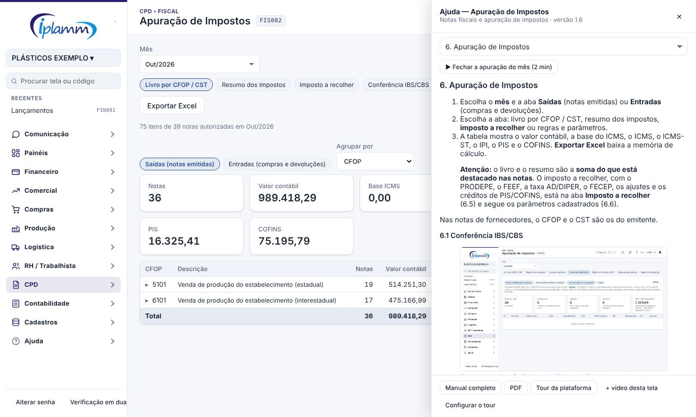
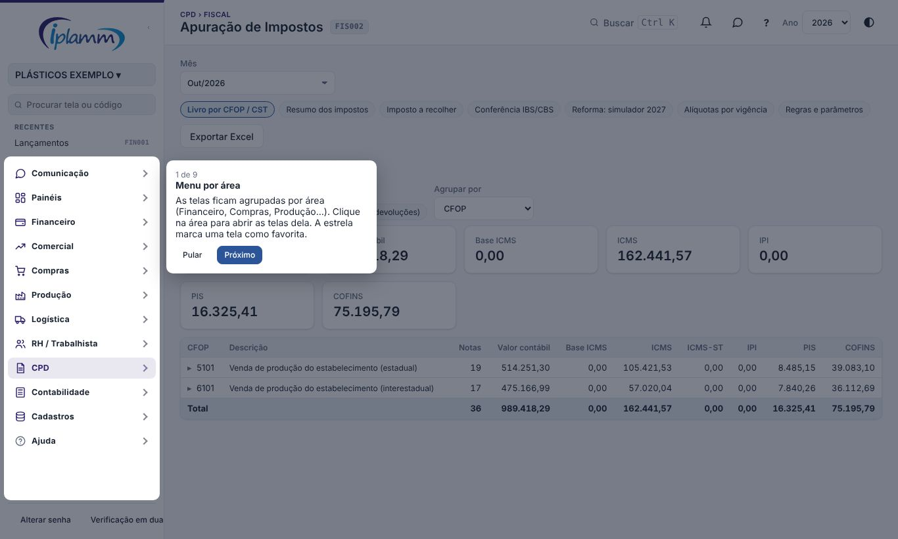

## 1. Para que serve

Ajuda sem sair da tela em que você está:

- o botão **?** no topo abre, ao lado, o **trecho do manual** da tela, com as figuras;
- os **vídeos curtos** que a empresa cadastrou para aquela tela;
- o **tour da plataforma**, que mostra o essencial para quem está chegando.

## 2. O botão "?"

Clique no **?** ao lado do sino. Abre um painel à direita, por cima da tela, com:

- o **trecho do manual** desta tela (a seção certa, achada pelo nome da tela);
- a lista das **seções** do manual, para ler outra parte sem fechar;
- os **vídeos** desta tela, se houver;
- **Manual completo**, **PDF** e **Tour da plataforma**.

**Esc** ou o **✕** fecham o painel. Com **Ctrl** (ou **⌘**) apertado, o **?** abre o manual completo, como antes.

## 3. Vídeos curtos

O administrador cadastra vídeos para cada tela pelo próprio painel de ajuda: **+ vídeo desta tela**, com o título e o link do **YouTube** ou do **Google Drive** (começando com https://). O vídeo toca dentro do painel; links de outros sites abrem numa aba nova. O administrador também exclui um vídeo pelo painel.

> Para o Google Drive, compartilhe o arquivo com "qualquer pessoa com o link" ou com as pessoas da empresa.

## 4. Tour da plataforma

Quem entra numa empresa pela primeira vez vê o **tour**: um passo de cada vez, com o ponto da tela em destaque (menu, procurar tela, busca, avisos, conversas, ajuda, código da tela, ano e empresa). **Próximo**, **Voltar** (ou as setas do teclado) e **Pular** (ou **Esc**).

O tour aparece uma vez por pessoa. Para ver de novo: **Ajuda › Tour da plataforma** no menu, ou **Tour da plataforma** no painel do **?**.

## 5. Parâmetros (administrador)

No painel do **?**, **Configurar o tour**: ligar ou desligar o tour para quem entra pela primeira vez e **mostrar de novo para todos** no próximo acesso (útil depois de uma mudança grande no menu). **+ vídeo desta tela** cadastra os vídeos (seção 3).

## 6. Histórico de alterações

| Versão | Data | O que mudou |
|---|---|---|
| 1.0 | 08/11/2026 | Primeira versão: painel de ajuda com o trecho do manual da tela, vídeos por tela e tour da plataforma (melhoria 10.5). |
