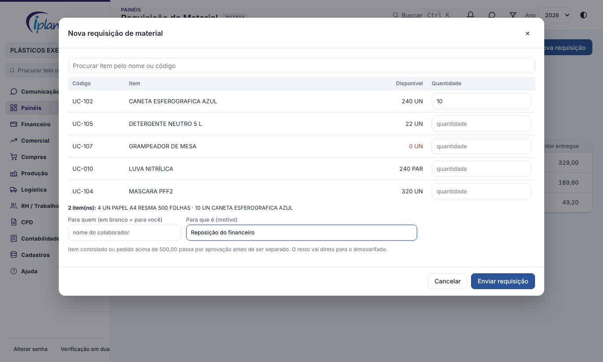
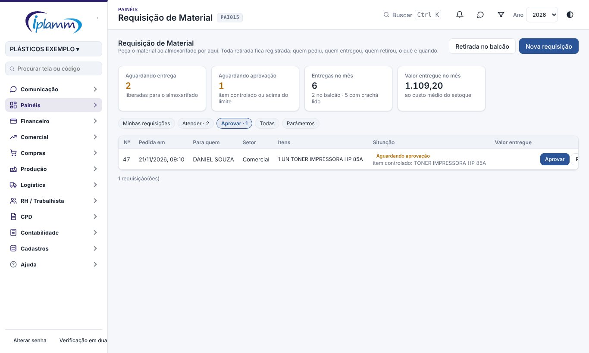
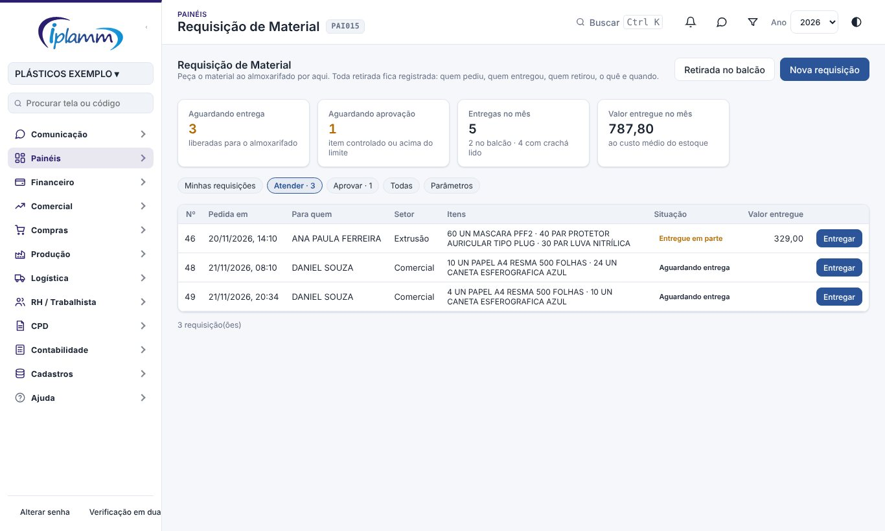
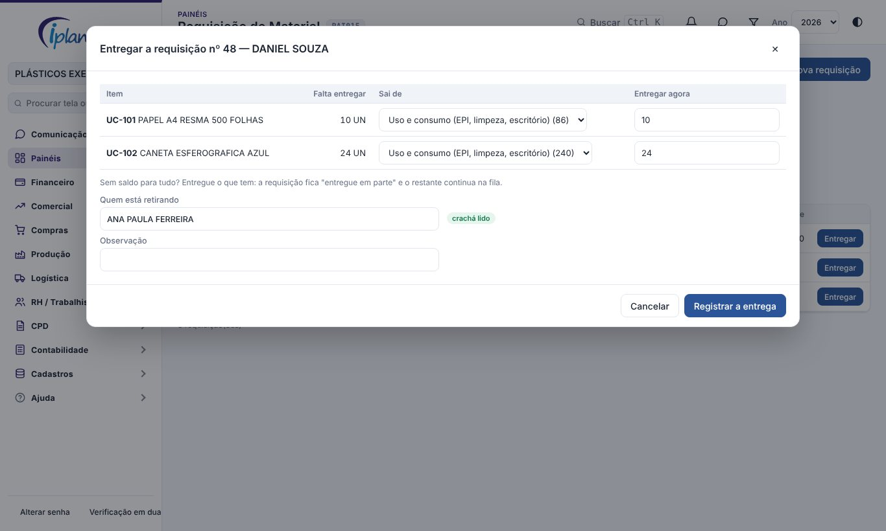
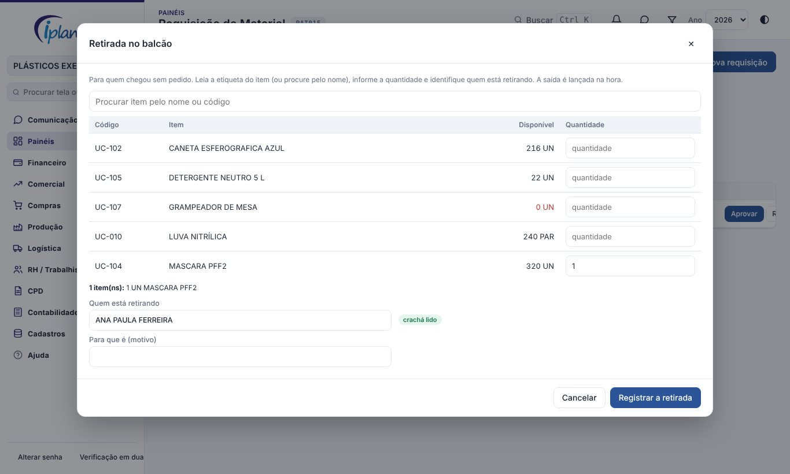
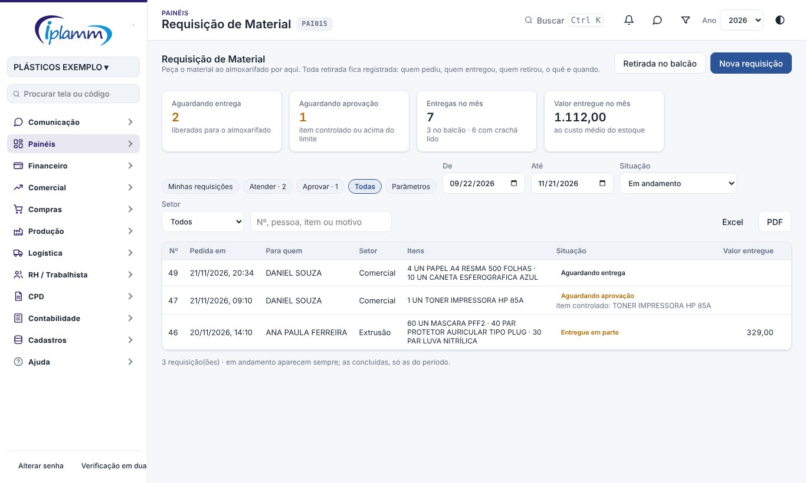
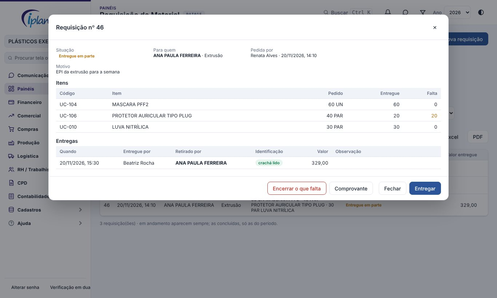
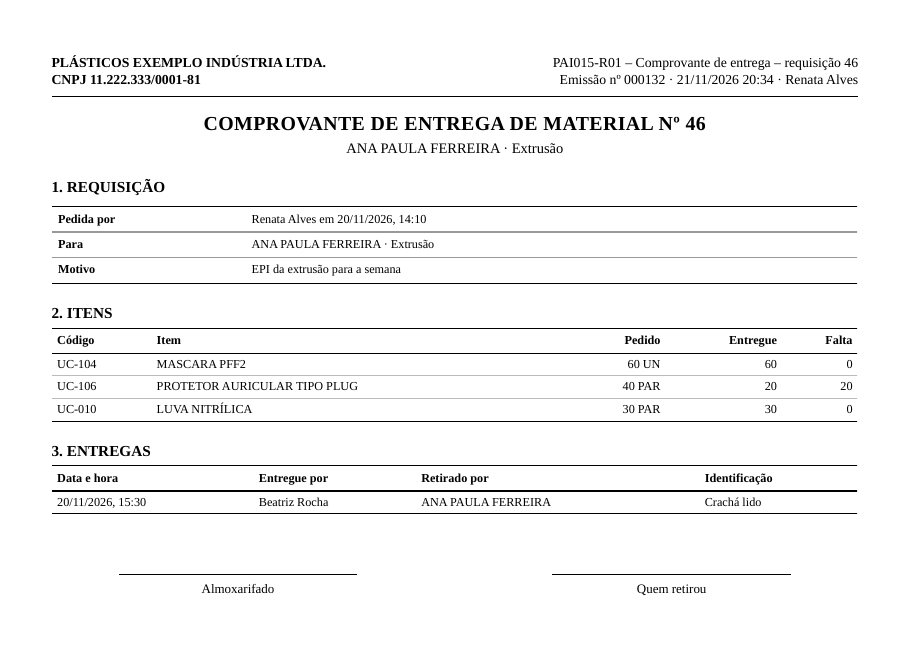
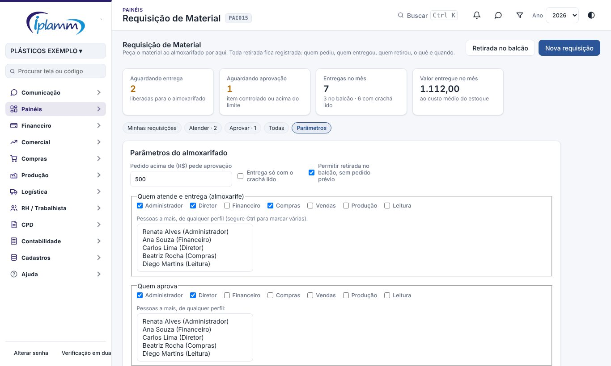

## 1. Para que serve

Padroniza a retirada de material do almoxarifado e registra tudo. Ninguém retira sem requisição, e cada requisição guarda quem pediu, quem aprovou, quem entregou, quem retirou, o quê, quanto e quando.

Vale para material de expediente, limpeza, EPI, peças e qualquer outro item que fique no almoxarifado.

| Etapa | Quem faz | O que acontece |
|---|---|---|
| Pedir | Qualquer pessoa | Escolhe os itens do catálogo e a quantidade |
| Aprovar | Aprovador | Só quando o pedido foge da regra: item controlado ou valor acima do limite |
| Entregar | Almoxarife | Separa, identifica quem está retirando e registra a entrega |
| Baixar o estoque | A plataforma | Lança a saída no Kardex, com o custo no centro de custo de quem recebeu |

## 2. Quem tem acesso

| Papel | Quem é, por padrão | O que faz |
|---|---|---|
| Solicitante | Qualquer pessoa com acesso à plataforma | Pede, acompanha e cancela as próprias requisições |
| Almoxarife | Administrador, Diretor e Compras | Vê a fila, entrega, registra retirada no balcão e pede em nome de outra pessoa |
| Aprovador | Administrador e Diretor | Aprova ou recusa o que foge da regra |
| Administrador e Diretor | — | Mudam os parâmetros e marcam os itens controlados |

Os papéis são parâmetros: dá para incluir perfis ou nomear pessoas específicas (seção 9). Quem só pede não vê custo nem as requisições dos outros.

## 3. Pedir material

1. Clique em **Nova requisição**.
2. Procure o item pelo nome ou pelo código e informe a quantidade. A coluna Disponível mostra o saldo do almoxarifado.
3. Escreva para que é o material.
4. Clique em **Enviar requisição**.

O setor e o centro de custo vêm do cadastro do colaborador. Se o pedido tiver item **controlado** ou passar do valor limite, ele vai antes para aprovação, e a plataforma diz o motivo. Os demais vão direto para o almoxarifado.

Só entram no pedido os itens do **catálogo do almoxarifado**: os que têm saldo num local do almoxarifado ou têm um desses locais como local padrão. Produto acabado e matéria-prima não se pedem por aqui.

Quem pede não vê valores: nem o custo dos itens, nem o valor do pedido, nem o valor entregue. Esses valores aparecem só para quem atende o almoxarifado e para quem aprova, e o relatório é emitido por eles.

O valor limite vale para **o dia**: os pedidos da mesma pessoa, ou para a mesma pessoa, somam. Dividir um pedido grande em vários pequenos não foge da aprovação.

O almoxarife pode pedir em nome de outra pessoa, pelo campo **Para quem**.

## 4. Acompanhar

A aba **Minhas requisições** mostra os seus pedidos e a situação de cada um. Clique na linha para ver os itens, o que já foi entregue e por quem foi retirado.

| Situação | Significado |
|---|---|
| Aguardando aprovação | Tem item controlado ou valor acima do limite |
| Aguardando entrega | Liberada para o almoxarifado separar |
| Entregue em parte | Parte saiu; o restante continua na fila |
| Entregue | Tudo entregue |
| Encerrada com pendência | O almoxarifado encerrou sem entregar o restante |
| Recusada | O aprovador recusou; o motivo fica registrado |
| Cancelada | Cancelada antes de qualquer entrega |

Você é avisado quando a requisição é aprovada, recusada, entregue ou encerrada.

## 5. Aprovar

Na aba **Aprovar**, cada requisição mostra o motivo da aprovação. **Aprovar** libera para o almoxarifado; **Recusar** pede o motivo, que vai para quem pediu.

**Quem pediu não aprova a própria requisição.** Se o aprovador for o próprio solicitante, outro aprovador precisa decidir. A exceção pode ser liberada em **Parâmetros**.

## 6. Entregar

A aba **Atender** é a fila do almoxarifado, da requisição mais antiga para a mais nova.

1. Clique em **Entregar**.
2. Confira a quantidade de cada item. A plataforma sugere o local com mais saldo e limita a entrega ao que existe.
3. **Identifique quem está retirando.** Leia o crachá com o leitor, escolha a pessoa na lista ou digite o nome.
4. Clique em **Registrar a entrega**.

Se não houver saldo para tudo, entregue o que tem. A requisição fica **entregue em parte** e o restante continua na fila. Para desistir do restante, abra a requisição e use **Encerrar o que falta**.

**Identificação de quem retira.** A entrega registra de que forma a pessoa foi identificada:

| Forma | Como aparece |
|---|---|
| Crachá lido pelo leitor | "crachá lido" |
| Pessoa escolhida na lista | "colaborador da lista" |
| Nome digitado (terceiro, visitante) | "nome digitado" |

Crachá vencido, cancelado ou de pessoa desligada não vale para retirada.

## 7. Retirada no balcão

Para quem chega ao almoxarifado sem pedido feito. O botão **Retirada no balcão** registra o pedido e a entrega de uma vez.

1. Leia a etiqueta do item com o leitor, ou procure pelo nome, e informe a quantidade.
2. Leia o crachá de quem está retirando, ou escolha a pessoa.
3. Clique em **Registrar a retirada**.

Ler um crachá em qualquer tela, fora de uma entrega, abre a retirada no balcão já com a pessoa identificada.

Item controlado ou valor acima do limite também pede aprovação no balcão: a requisição fica aguardando e nada é entregue.

## 8. Consultar e imprimir

A aba **Todas** (almoxarife e aprovador) lista as requisições com filtro por período, situação, setor e busca. Os botões **Excel** e **PDF** saem no padrão dos relatórios, com os filtros impressos e o consumo por setor.

Na ficha da requisição, o botão **Comprovante** imprime o comprovante de entrega, com espaço para a assinatura do almoxarifado e de quem retirou.

## 9. Parâmetros

Aba **Parâmetros** (administrador e diretor).

| Parâmetro | Padrão | Efeito |
|---|---|---|
| Pedido acima de (R$) pede aprovação | Em branco | Em branco, não há regra de valor. O valor do pedido é estimado pelo custo médio do estoque |
| Entrega só com o crachá lido | Desligado | Ligado, a entrega e o balcão só são registrados com o crachá lido pelo leitor. O banco confere o código lido: o crachá precisa existir, estar ativo e ser da pessoa que está retirando |
| Permitir retirada no balcão | Ligado | Desligado, é preciso pedir antes |
| Quem pediu pode aprovar a própria requisição | Desligado | Ligado, o aprovador pode aprovar o próprio pedido. Use só quando houver um único aprovador |
| Quem atende e entrega | Administrador, Diretor e Compras | Perfis e pessoas que veem a fila e entregam |
| Quem aprova | Administrador e Diretor | Perfis e pessoas que aprovam ou recusam |
| Locais do almoxarifado | Insumos, Manutenção e Uso e consumo | De quais locais de estoque o almoxarifado entrega |
| Itens controlados | Nenhum | Item marcado sempre pede aprovação, em qualquer quantidade |

**O que aparece no catálogo.** Os produtos ativos que têm saldo em um local do almoxarifado, ou cujo local de entrada é um desses locais. Para um material novo aparecer, cadastre o produto em Estoque › Produtos com o local de entrada no almoxarifado.

## 10. Como a entrega entra no estoque

Cada item entregue vira uma saída no Kardex, com o tipo **Requisição interna**, o documento "RM" e o número da requisição, o nome de quem retirou e o centro de custo. O valor é o custo médio do item no momento da entrega.

A entrega segue as regras do estoque: não deixa o saldo ficar negativo, não lança em mês fechado e respeita quem pode movimentar cada local. Uma entrega lançada por engano é corrigida por estorno, no Kardex, por quem atende o almoxarifado. O material volta para o saldo e a quantidade volta para a requisição, que deixa de constar como entregue; a entrega fica marcada como **estornada** na ficha.

## 11. Dúvidas comuns

| Situação | O que fazer |
|---|---|
| O item que preciso não está no catálogo | Peça ao almoxarifado. O item aparece quando o produto é cadastrado com local de entrada no almoxarifado |
| "Saldo insuficiente" | O saldo da plataforma é menor que a quantidade. Entregue o que existe ou confira o saldo no Kardex |
| "Seu perfil não movimenta o local" | O local de estoque restringe quem movimenta. Ajuste em Estoque › Parâmetros › Locais |
| Li o crachá e nada aconteceu | O cursor estava em outro campo. Clique fora dos campos, ou no campo Quem está retirando, e leia de novo |
| Não vejo as abas Atender e Aprovar | Você não está entre os almoxarifes ou aprovadores. Peça ao administrador |
| A pessoa não tem crachá | Escolha na lista ou digite o nome. A entrega fica marcada como identificada sem crachá |

## 12. Histórico de versões

| Versão | Data | O que mudou |
|---|---|---|
| 1.0 | 21/11/2026 | Primeira versão: requisição, aprovação na exceção, fila do almoxarifado, entrega com identificação por crachá, retirada no balcão, baixa automática no Kardex, comprovante, relatório e parâmetros (SQL 176) |
| 1.1 | 21/11/2026 | Quem pediu não aprova a própria requisição (exceção por parâmetro). Mudanças nos parâmetros e nos itens controlados ficam na trilha de auditoria. |
| 1.2 | 21/11/2026 | O crachá lido passa a ser conferido no banco na entrega e no balcão (existe, está ativo e é de quem retira). |
| 1.3 | 22/11/2026 | O valor limite passa a valer para o dia. O estorno de uma entrega devolve a quantidade à requisição e marca a entrega como estornada. |
| 1.4 | 22/11/2026 | Pedido só de itens do catálogo do almoxarifado. Valores (custo, valor do pedido e da entrega) só para quem atende e quem aprova. |
