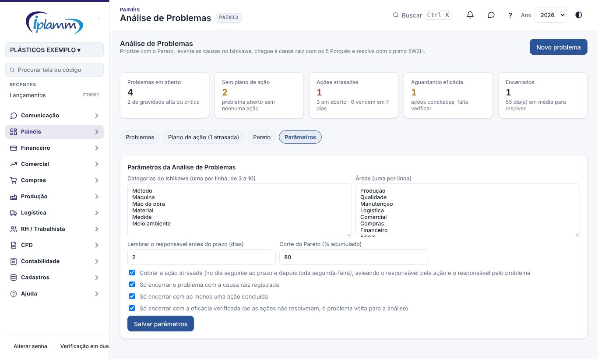
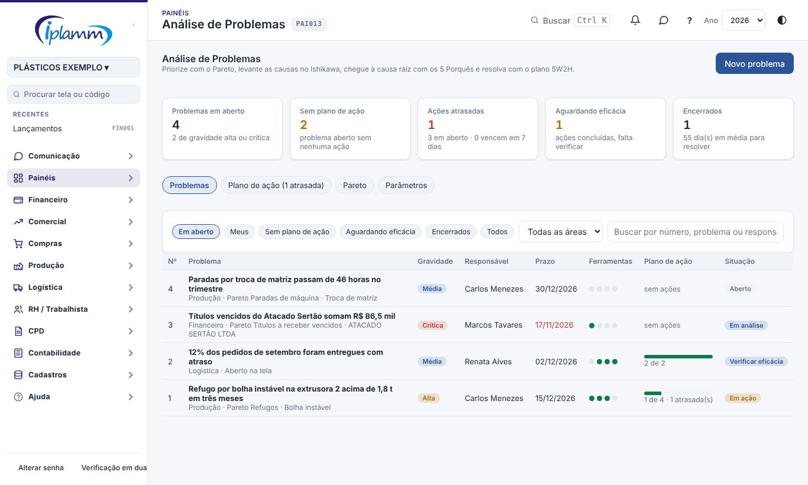
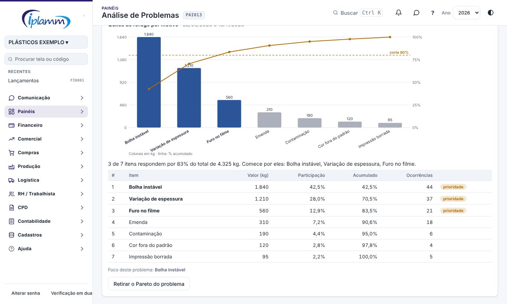
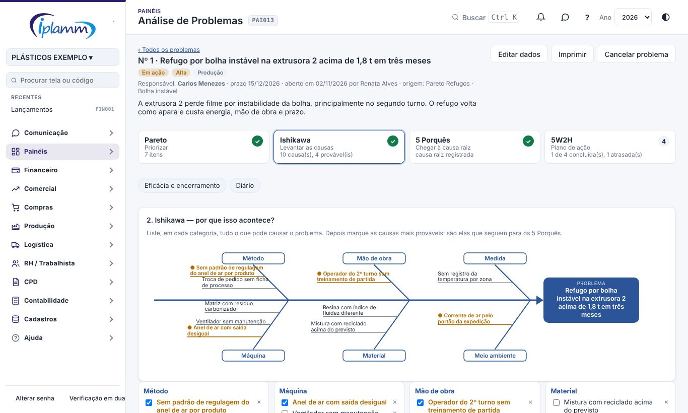
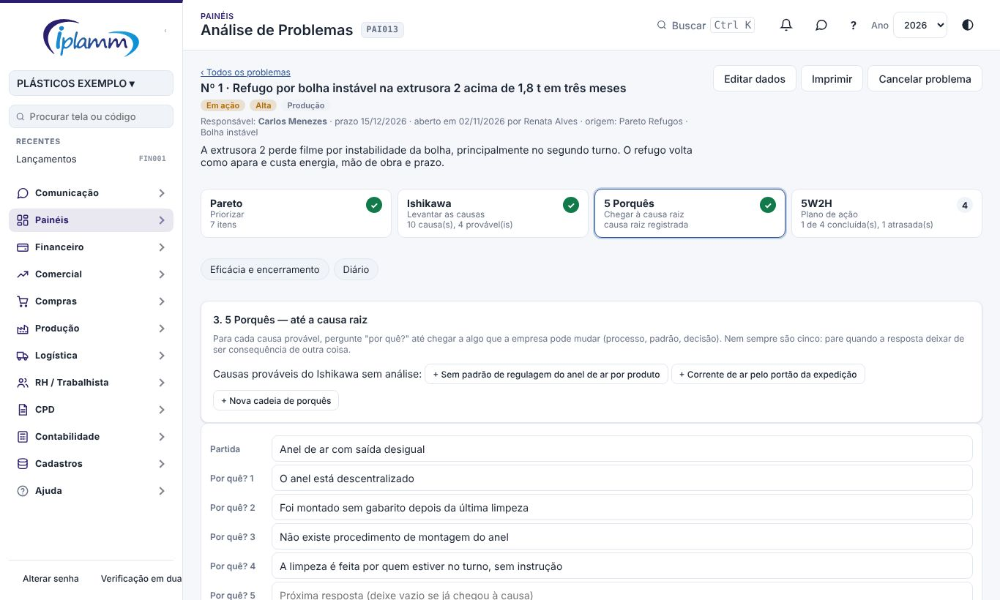
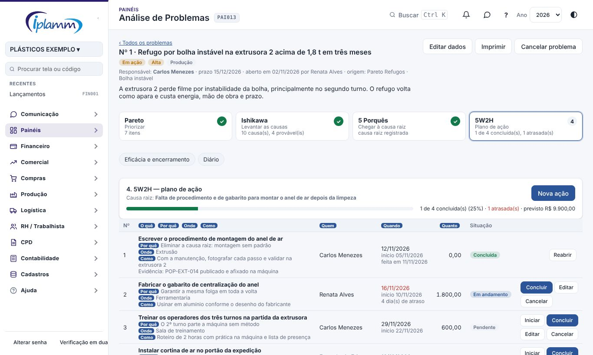
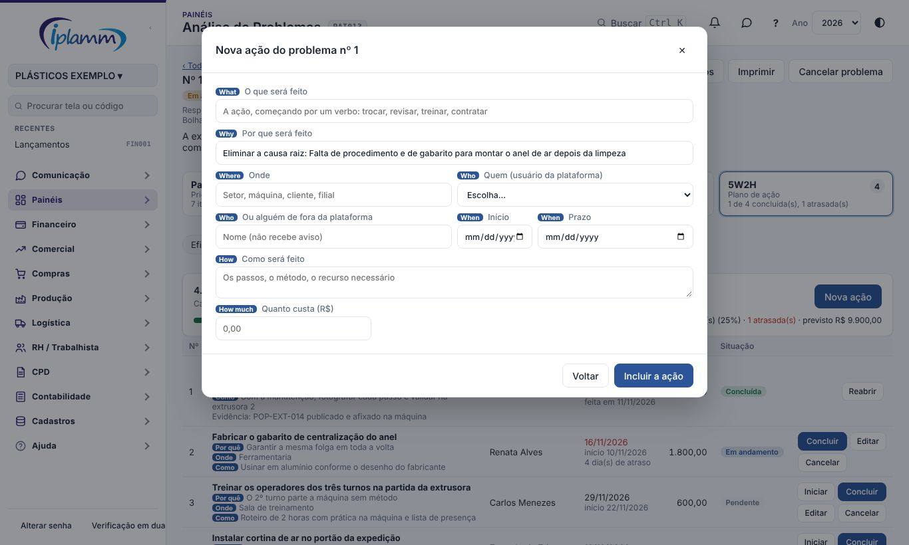
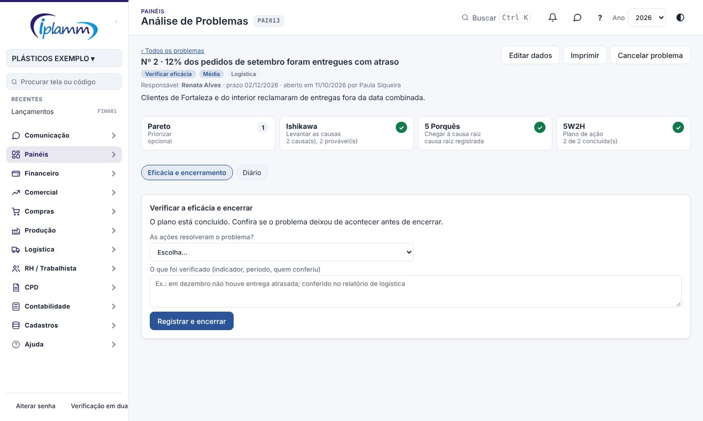
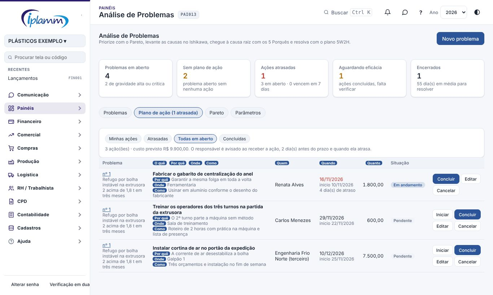
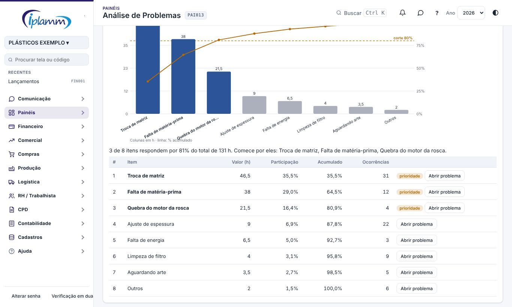

## 1. Para que serve

Reúne, em um só lugar e para qualquer área da empresa, as quatro ferramentas clássicas de solução de problemas:

| Ferramenta | Pergunta que responde | O que a plataforma faz |
|---|---|---|
| **Pareto** | O que resolver primeiro? | Monta o gráfico com o dado que a plataforma já tem (paradas, refugos, falhas, não conformidades, devoluções, títulos vencidos) ou com uma lista digitada, e destaca os poucos itens que respondem pela maior parte |
| **Ishikawa** | Por que isso acontece? | Organiza as causas por categoria no diagrama de espinha de peixe e marca as mais prováveis |
| **5 Porquês** | Qual é a causa raiz? | Guarda a sequência de perguntas de cada causa provável até a causa que a empresa pode eliminar |
| **5W2H** | O que será feito para resolver? | Plano de ação com o quê, por quê, onde, quando, quem, como e quanto; avisa o responsável, cobra o atraso e acompanha o custo |

As quatro ficam ligadas a um **problema**. O problema só é encerrado depois que as ações foram concluídas e alguém conferiu se elas resolveram.

## 2. Quem tem acesso

| Perfil | O que faz |
|---|---|
| Administrador e Diretor | Tudo: parâmetros, abrir, analisar, encerrar, cancelar e reabrir qualquer problema |
| Financeiro, Compras, Vendas e Produção | Abrem problemas, preenchem as análises, incluem ações e comentam. Encerram e cancelam os problemas que conduzem |
| Leitura | Consulta |
| Motorista e Colaborador (portais) | Sem acesso |

**Quem conduz um problema** é o responsável por ele, quem o abriu, o administrador ou o diretor. Só quem conduz troca o responsável, cancela ações, encerra e cancela o problema.

A situação de uma ação é alterada pelo **responsável pela ação** ou por quem conduz o problema.

A fonte **Títulos a receber vencidos** do Pareto só aparece para Administrador, Financeiro e Diretor.

## 3. Parâmetros

Aba **Parâmetros**, visível para Administrador e Diretor. A tela funciona sem nenhum ajuste, com os padrões abaixo.

| Parâmetro | Padrão | Para que serve |
|---|---|---|
| Categorias do Ishikawa | Método, Máquina, Mão de obra, Material, Medida, Meio ambiente | As espinhas do diagrama. De 3 a 10. Uma área administrativa pode preferir, por exemplo, Pessoas, Processo, Sistema, Política, Fornecedor |
| Áreas | Produção, Qualidade, Manutenção, Logística, Comercial, Compras, Financeiro, Fiscal, RH, Outra | Classificam e filtram os problemas |
| Lembrar o responsável antes do prazo | 2 dias | Aviso ao responsável pela ação |
| Cobrar a ação atrasada | Ligado | Aviso no dia seguinte ao prazo e depois toda segunda-feira |
| Corte do Pareto | 80% | Percentual acumulado que define os itens prioritários |
| Só encerrar com a causa raiz registrada | Ligado | Trava do encerramento |
| Só encerrar com ao menos uma ação concluída | Ligado | Trava do encerramento |
| Só encerrar com a eficácia verificada | Ligado | Trava do encerramento |

## 4. Visão geral da tela

No alto ficam cinco indicadores. Clicar em um deles filtra a lista:

- **Problemas em aberto**, com quantos são de gravidade alta ou crítica;
- **Sem plano de ação**: problema aberto sem nenhuma ação;
- **Ações atrasadas**, com o total em aberto e quantas vencem em 7 dias;
- **Aguardando eficácia**: ações concluídas, falta conferir o resultado;
- **Encerrados**, com o tempo médio para resolver.

Abaixo, quatro abas: **Problemas**, **Plano de ação**, **Pareto** e **Parâmetros**.

Na lista de problemas:

- a coluna **Ferramentas** mostra quatro pontos, na ordem Pareto, Ishikawa, 5 Porquês e 5W2H. Ponto verde é ferramenta concluída;
- a coluna **Plano de ação** mostra a barra de andamento e as ações atrasadas;
- o prazo vencido aparece em vermelho.

Para abrir um problema, clique em **Novo problema** e informe:

1. **Qual é o problema**: o fato, com número quando houver. "12% dos pedidos de outubro foram entregues com atraso" é melhor do que "problemas na entrega".
2. A descrição, a área, a gravidade e o prazo para resolver.
3. O **responsável por conduzir**. Se for outra pessoa, ela é avisada.

O problema também nasce de outros pontos da plataforma:

| De onde | Como |
|---|---|
| Aba Pareto | Botão **Abrir problema** ao lado do item. O gráfico vai junto |
| Não conformidade (Qualidade) | Botão **Analisar o problema** na ficha da RNC |
| Ordem de manutenção | Botão **Analisar o problema** na ficha da OS |

## 5. A ficha do problema

Clique em um problema para abrir a ficha. Os quatro quadros do alto são o roteiro: o número vira um sinal verde quando a ferramenta está concluída. Clique no quadro para trabalhar naquela ferramenta.

A ordem é uma sugestão. O Pareto é opcional, e um problema simples pode ir direto ao plano de ação.

### 5.1 Pareto: o que resolver primeiro

Use quando o problema tem várias ocorrências (motivos, defeitos, clientes) e é preciso escolher onde atacar.

1. Escolha **Dado da plataforma** ou **Digitar a lista**.
2. No dado da plataforma, escolha o que medir e o período, e clique em **Montar o Pareto**.
3. Na lista digitada, informe o que está sendo medido, a unidade e os itens com os valores.
4. Clique em **Guardar este Pareto no problema**. O gráfico fica registrado como estava naquele dia.

Como ler:

- as colunas vão do maior para o menor; a linha é o percentual acumulado;
- as colunas em destaque são os **itens prioritários**: os que, somados, chegam ao corte (80% por padrão);
- a frase abaixo do gráfico resume: quantos itens respondem por quanto do total.

O que cada fonte mede:

| Fonte | Medida |
|---|---|
| Paradas de máquina | Horas paradas por motivo (paradas planejadas ficam de fora) |
| Refugos | Quilos de refugo por motivo |
| Falhas de manutenção | Ordens corretivas por tipo de falha |
| Não conformidades por produto | Quantidade de RNC por produto |
| Custo da não qualidade | Custo das RNC por origem |
| Devoluções de clientes | Valor das notas de devolução por cliente |
| Títulos a receber vencidos | Valor vencido e em aberto por cliente |

### 5.2 Ishikawa: por que isso acontece

1. Em cada categoria, digite uma causa possível e aperte **Enter**. Liste tudo o que a equipe lembrar, sem julgar ainda.
2. Marque a caixa das causas **mais prováveis**. Elas ficam em destaque no diagrama.
3. Use o **×** para remover uma causa.

Cada alteração é gravada na hora, e o diagrama é redesenhado.

As causas prováveis seguem para os 5 Porquês.

### 5.3 5 Porquês: até a causa raiz

1. Clique no botão de uma **causa provável sem análise** (ou em **Nova cadeia de porquês**).
2. Responda "por quê?" em sequência. A cada resposta salva, aparece o campo da próxima. Cabem até sete.
3. Pare quando a resposta deixar de ser consequência de outra coisa e for algo que a empresa pode mudar: um processo, um padrão, uma decisão.
4. Escreva a **conclusão** da cadeia e clique em **Salvar cadeia**.
5. Clique em **Usar como causa raiz** na cadeia que chegou à causa principal, ou escreva a causa raiz no campo de baixo.

Dica: se a resposta for uma pessoa ("o operador errou"), pergunte mais uma vez. Quase sempre há um método, um treinamento ou um controle que faltou.

### 5.4 5W2H: o plano de ação

Clique em **Nova ação** e responda às sete perguntas:

| Pergunta | Campo | Exemplo |
|---|---|---|
| What | O que será feito | Fabricar o gabarito de centralização do anel |
| Why | Por que será feito | Garantir a mesma folga em toda a volta |
| Where | Onde | Ferramentaria |
| When | Início e prazo | 10/11 a 16/11 |
| Who | Quem | Um usuário da plataforma, ou o nome de alguém de fora |
| How | Como será feito | Usinar em alumínio conforme o desenho do fabricante |
| How much | Quanto custa | R$ 1.800,00 |

- O prazo e o responsável são obrigatórios.
- O responsável que é usuário da plataforma **recebe aviso**. Quem é de fora não recebe.
- A linha mostra "Falta no 5W2H" quando alguma das sete perguntas ficou sem resposta.

Andamento de cada ação:

| Botão | Quem usa | Efeito |
|---|---|---|
| **Iniciar** | Responsável pela ação ou quem conduz | Ação em andamento |
| **Concluir** | Responsável pela ação ou quem conduz | Pede a data, a evidência do que foi feito e o custo real |
| **Editar** | Quem participa | Altera a ação em aberto. Mudança de prazo fica no diário |
| **Cancelar** | Quem conduz | Pede o motivo |
| **Reabrir** | Quem conduz | Ação concluída ou cancelada volta para pendente |

A barra no alto mostra quantas ações foram concluídas, quantas estão atrasadas e o custo previsto e real.

Quando a última ação é concluída, o problema passa para **Verificar eficácia**, e quem conduz é avisado.

## 6. Verificar a eficácia e encerrar

Aba **Eficácia e encerramento** da ficha.

1. A tela lista o que ainda impede o encerramento: ação em aberto, causa raiz não registrada ou nenhuma ação concluída.
2. Com o plano concluído, confira se o problema deixou de acontecer. Vale olhar de novo o indicador que mostrou o problema.
3. Responda **As ações resolveram o problema?** e escreva o que foi verificado.
4. Clique em **Registrar e encerrar**.

| Resposta | O que acontece |
|---|---|
| Sim, as ações foram eficazes | O problema é encerrado |
| Não: o problema continua | O problema **volta para a análise**, com o registro do que foi verificado. Revise as causas e inclua novas ações |

O administrador e o diretor podem **reabrir** um problema encerrado ou cancelado, informando o motivo.

**Imprimir**, no alto da ficha, gera o relatório do problema com o Pareto, o Ishikawa, os 5 Porquês, o plano 5W2H e a eficácia.

A aba **Diário** guarda os comentários da equipe e tudo o que a plataforma registrou: abertura, ações incluídas, mudanças de prazo, conclusões e a verificação.

## 7. Plano de ação de todos os problemas

A aba **Plano de ação** junta as ações de todos os problemas em aberto.

| Filtro | O que mostra |
|---|---|
| Minhas ações | As ações em aberto sob a sua responsabilidade |
| Atrasadas | As ações com o prazo vencido |
| Todas em aberto | Todas as ações pendentes ou em andamento |
| Concluídas | O que já foi feito |

Os botões são os mesmos da ficha. O número do problema leva à ficha dele.

## 8. Pareto fora de um problema

A aba **Pareto** serve para descobrir onde está a maior perda antes de abrir qualquer problema.

1. Escolha a fonte e o período, ou digite a lista, e clique em **Montar o Pareto**.
2. Clique em **Abrir problema** ao lado do item que será tratado.

O problema é aberto com o título sugerido, a área da fonte e o gráfico guardado, tendo aquele item como foco.

## 9. Avisos

Os avisos chegam no sino da plataforma e, conforme a configuração de cada usuário em **Meus avisos**, por e-mail, WhatsApp ou no celular (tipo "Análise de problemas").

| Quando | Quem recebe |
|---|---|
| Problema aberto ou passado para outra pessoa | O responsável pelo problema |
| Ação incluída ou passada para outra pessoa | O responsável pela ação |
| Faltam os dias do parâmetro para o prazo (2 por padrão) | O responsável pela ação |
| Ação atrasada: no dia seguinte ao prazo e depois toda segunda-feira | O responsável pela ação e o responsável pelo problema |
| Todas as ações concluídas | Quem conduz o problema |
| Comentário no diário | O responsável pelo problema e quem abriu |

Quem faz a alteração não recebe o aviso da própria alteração. Os avisos de prazo saem uma vez por dia, de manhã.

## 10. Regras e travas

- Problema **encerrado** ou **cancelado** não aceita alteração nem ação nova. É preciso reabrir.
- Ação **concluída** ou **cancelada** não é alterada. É preciso reabrir a ação.
- Cancelar o problema cancela as ações em aberto.
- O encerramento respeita os três parâmetros: causa raiz, ação concluída e eficácia.
- A numeração dos problemas é sequencial por empresa e não é reaproveitada.
- O Pareto guardado no problema não muda quando os dados da plataforma mudam: é o retrato do dia.
- Cada empresa só vê os seus problemas.

## 11. Perguntas frequentes

**Preciso usar as quatro ferramentas em todo problema?**
Não. O Pareto é opcional. Para encerrar, o padrão exige a causa raiz, ao menos uma ação concluída e a eficácia. Os três podem ser desligados nos Parâmetros.

**O Pareto veio vazio.**
Não há registro daquela fonte no período. Aumente o período, escolha outra fonte ou digite a lista.

**Não vejo "Títulos a receber vencidos" no Pareto.**
Essa fonte é do financeiro e só aparece para Administrador, Financeiro e Diretor.

**O responsável pela ação é de fora da empresa.**
Deixe "Quem (usuário da plataforma)" sem escolha e escreva o nome no campo ao lado. Ele não recebe aviso; quem conduz o problema acompanha o prazo.

**As ações foram feitas, mas o problema voltou.**
Na verificação, responda que as ações não foram eficazes. O problema volta para a análise com o histórico preservado.

**Qual a diferença para os 5 porquês da RNC?**
A RNC da Qualidade trata o material não conforme e continua com os seus 5 porquês. Use **Analisar o problema** na RNC quando o caso pedir o Ishikawa e um plano de ação com vários responsáveis.

**Posso mudar as categorias do Ishikawa?**
Sim, nos Parâmetros. As causas já lançadas em uma categoria que deixou de existir continuam aparecendo no problema.

## 12. Histórico de alterações

| Versão | Data | O que mudou |
|---|---|---|
| 1.0 | 20/11/2026 | Primeira versão: problemas com Pareto (dado da plataforma ou lista digitada), Ishikawa, 5 Porquês e plano de ação 5W2H, avisos de prazo, verificação da eficácia, impressão e parâmetros. |
