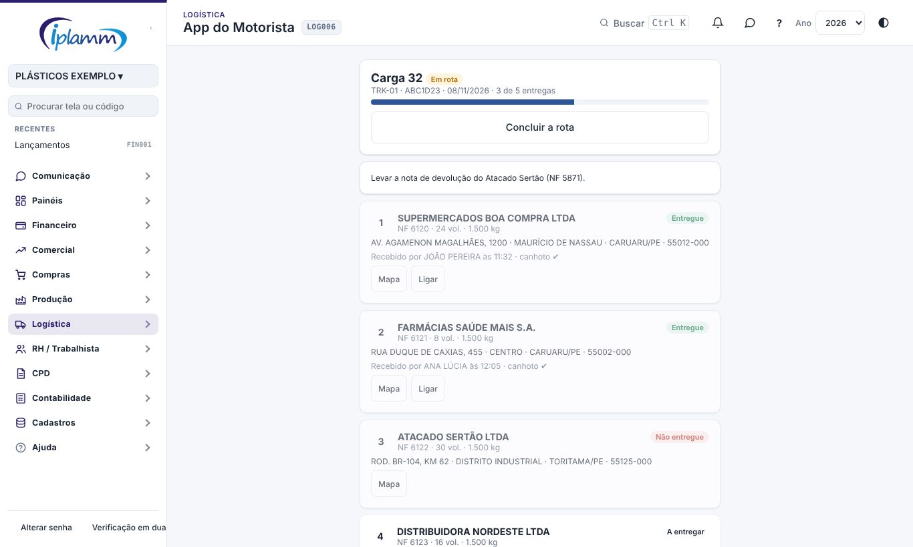
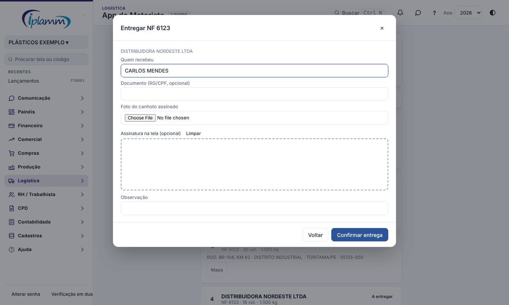
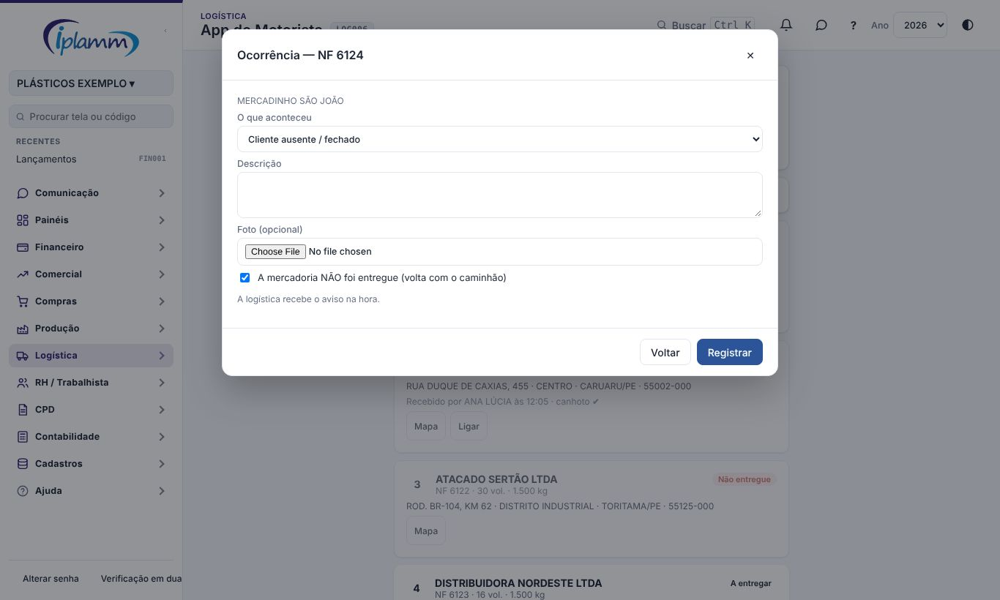
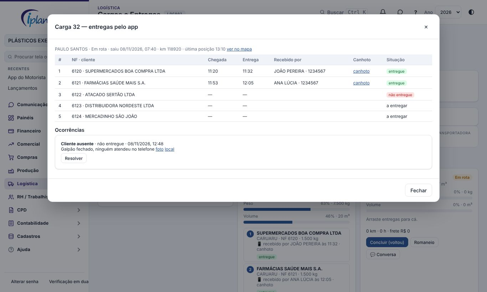
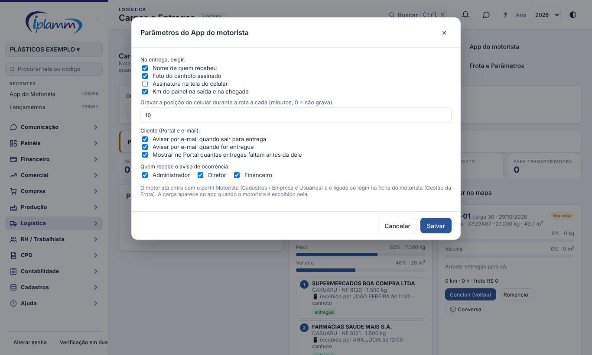

## 1. Para que serve

O motorista registra a entrega pelo próprio celular, no momento em que ela acontece:

- vê a **rota do dia** na ordem de entrega, com endereço, telefone, volumes e o mapa;
- **inicia a rota** com o km do painel;
- marca a **chegada**;
- registra a **entrega** com o nome de quem recebeu, a **foto do canhoto** assinado e, se quiser, a **assinatura na tela**;
- registra a **ocorrência**: cliente ausente, recusa, avaria, endereço, atraso ou problema no veículo, com foto;
- **conclui a rota** com o km de chegada.

No escritório, a carga mostra na hora o que foi entregue, os canhotos e as ocorrências. O cliente vê no **Portal** que a mercadoria saiu para entrega e, depois, o canhoto, e recebe e-mail nos dois momentos.

O app funciona **sem internet** (veja o manual **Modo sem internet**): o registro e as fotos ficam no celular e sobem quando o sinal voltar.

## 2. Quem tem acesso

| Perfil | O que faz |
|---|---|
| Motorista | Entra só no App do Motorista e vê só as cargas em que foi escolhido. Não vê financeiro, cadastros nem relatórios. |
| Administrador, diretor e financeiro | Escolhem o motorista da carga, acompanham as entregas, resolvem as ocorrências e alteram os parâmetros. |
| Cliente (Portal) | Vê a situação da entrega das notas dele e o canhoto. |

### 2.1 Preparar o motorista (uma vez)

1. Em **Cadastros › Empresa e Usuários**, convide o motorista com o perfil **Motorista**.
2. Em **Logística › Gestão da Frota › Motoristas**, abra a ficha dele e escolha o **Login do App do Motorista**.
3. No celular do motorista, abra a plataforma e use **Adicionar à tela inicial**. O ícone abre direto no app.

## 3. A rota do dia

A carga aparece no app quando a logística escolhe o motorista nela (seção 6). O app mostra as cargas de ontem a amanhã e as que ainda estão em rota.

No topo ficam o número da carga, o veículo, a placa e quantas entregas já foram feitas. A observação da carga aparece logo abaixo, por exemplo "levar a nota de devolução".

Cada entrega mostra o cliente, a nota, os volumes e o peso, o endereço da nota e a restrição de recebimento do cliente, se houver. A próxima entrega fica com a borda em destaque.

- **Mapa** abre o endereço no aplicativo de mapas do celular.
- **Ligar** liga para o telefone da nota.

## 4. Durante a rota

### 4.1 Iniciar e chegar

1. Toque em **Iniciar a rota** e digite o km do painel.
2. Ao chegar no cliente, toque em **Cheguei**. A hora e a posição do celular ficam registradas.

Ao iniciar, o cliente recebe o e-mail "Seu pedido saiu para entrega" e o Portal passa a mostrar quantas entregas faltam antes da dele.

### 4.2 Entregar

1. Toque em **Entregar**.
2. Digite o nome de quem recebeu e, se quiser, o documento.
3. Tire a **foto do canhoto** assinado. A foto é reduzida para subir rápido, mas continua legível.
4. Se a empresa pedir, colha a **assinatura** com o dedo na tela.
5. Toque em **Confirmar entrega**.

O cliente recebe o e-mail "Pedido entregue", e o canhoto fica disponível no Portal.

### 4.3 Ocorrência

Toque em **Ocorrência** na entrega. Escolha o que aconteceu, descreva e, se ajudar, tire uma foto.

Se a mercadoria **não foi entregue**, deixe marcada a opção. A nota volta para as **pendentes de carga** quando a carga for concluída.

Para um problema que não é de uma entrega (veículo, atraso), use **Ocorrência sem entrega** no fim da lista. A logística recebe o aviso na hora; problema no veículo chega como urgente.

### 4.4 Concluir

Com todas as entregas com baixa (entregue ou não entregue), toque em **Concluir a rota** e digite o km de chegada. A plataforma calcula os km rodados da carga.

## 5. Sem internet

Tudo o que foi descrito acima funciona sem sinal. A mensagem diz "sem internet: guardado no aparelho", e o selo no topo mostra quantos registros esperam o envio. Quando a internet volta, os registros sobem na ordem em que foram feitos, com as fotos. Mandar duas vezes não duplica a entrega nem a ocorrência.

A rota precisa ter sido aberta uma vez com internet no celular, de preferência antes de sair.

## 6. No escritório

Em **Logística › Cargas e Entregas**:

- escolha o **motorista** da carga na lista. O ícone 📱 indica que ele tem login no app;
- cada entrega mostra quem recebeu e a hora, e as ocorrências aparecem em vermelho;
- o botão **Entregas do app** abre a carga com a chegada e a entrega de cada nota, quem recebeu, o canhoto e a assinatura, as ocorrências com foto e local e a última posição do caminhão.

Para **resolver** uma ocorrência, toque em **Resolver** e escreva o que foi feito, por exemplo "reentrega amanhã" ou "nota de devolução emitida".

As baixas manuais da tela (Entregue / Não entregue) continuam valendo para quem não usa o app.

## 7. Parâmetros

Em **Cargas e Entregas › App do motorista** (administrador, diretor e financeiro):

| Parâmetro | Padrão | O que faz |
|---|---|---|
| Nome de quem recebeu | Exigido | Sem o nome, a entrega não é registrada. |
| Foto do canhoto | Exigida | Sem a foto, a entrega não é registrada. |
| Assinatura na tela | Opcional | Quando exigida, o motorista colhe a assinatura no celular. |
| Km na saída e na chegada | Exigido | Calcula os km rodados da carga. |
| Posição durante a rota | Não grava | De 1 a 60 minutos: grava a posição do celular durante a rota. |
| E-mail de saída e de entrega | Ligados | Avisam o cliente que tem acesso ao Portal. |
| Fila no Portal | Ligada | Mostra ao cliente quantas entregas faltam antes da dele. |
| Aviso de ocorrência | Administrador, diretor e financeiro | Quem recebe o aviso. |

## 8. Regras e travas

- O motorista só vê e só mexe nas cargas em que foi escolhido. Outro motorista, outra empresa ou o perfil leitura não conseguem.
- Entregar e registrar chegada só depois de iniciar a rota.
- Concluir só com todas as entregas com baixa. O km de chegada não pode ser menor que o de saída.
- As fotos ficam na pasta da carga. O cliente do Portal só vê o canhoto das notas dele.
- A posição do celular é gravada só com a rota iniciada, no intervalo do parâmetro, e só se o motorista permitir a localização no celular.

## 9. Perguntas frequentes e erros comuns

**A carga não aparece no app.** Confira se o motorista foi escolhido na carga e se a ficha dele em Gestão da Frota tem o login do app.

**"Esta carga não é sua."** A carga foi trocada de motorista. Atualize a tela.

**O cliente não recebeu o e-mail.** O cliente precisa ter acesso ao Portal (convite) e o e-mail da plataforma precisa estar ligado (Cadastros › E-mail).

**O motorista ficou sem sinal no cliente.** Pode registrar normalmente: o registro sobe quando o sinal voltar.

## 10. Histórico de alterações

| Versão | Data | O que mudou |
|---|---|---|
| 1.0 | 08/11/2026 | Primeira versão: perfil Motorista, rota do dia, iniciar, chegada, entrega com canhoto e assinatura, ocorrência com foto, concluir com km, posição opcional, sem internet, acompanhamento no escritório, Portal com a situação da entrega e e-mails ao cliente. |
