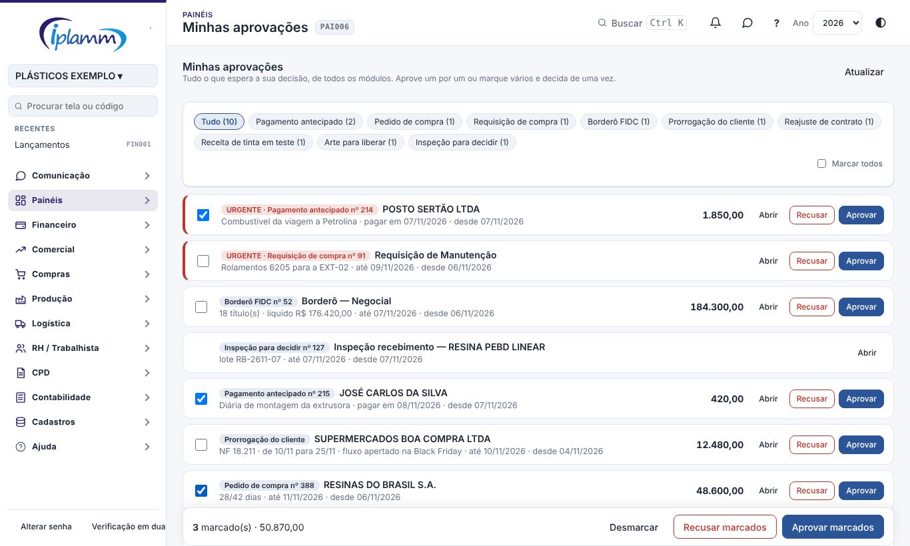

## 1. Para que serve

Juntar numa lista só **tudo o que espera a sua decisão**, de todos os módulos. Não é preciso procurar tela por tela.

| Tipo | Vem de | Quem decide |
|---|---|---|
| Pagamento antecipado | Financeiro › Pagamentos Antecipados | Administrador, diretor e financeiro |
| Pedido de compra e requisição | Compras | Administrador e diretor |
| Borderô FIDC | Crédito / FIDC › Propostas de Borderô | Diretor |
| Decisão do dia | Painéis › Decisão do Dia | Diretor e administrador |
| Prorrogação do cliente | Portal do Cliente | Administrador e financeiro |
| Reajuste de contrato | Cadastros › Contratos | Administrador |
| Receita de tinta em teste | Casa de Tintas › Cores e Receitas | Quem aprova receita (Parâmetros da casa de tintas) |
| Arte para liberar | Pré-impressão › Artes e Aprovações | Quem libera (Parâmetros da pré-impressão) |
| Inspeção para decidir | Qualidade › Inspeções | Quem decide a qualidade (Planos e Parâmetros) |

Cada pessoa vê só o que **ela** pode decidir. A decisão segue as mesmas regras da tela de origem: o que lá exige motivo ou classificação também exige aqui.

## 2. Quem tem acesso

Todos os perfis que decidem alguma coisa. O número de pendências aparece ao lado de **Minhas aprovações** no menu e é atualizado a cada 5 minutos.

## 3. Passo a passo

**Ordem da lista:**

1. **Urgente** primeiro, com a faixa vermelha.
2. Depois, pelo **prazo**: data de pagamento, entrega, vencimento ou necessidade. Prazo vencido fica com a faixa amarela.
3. Por fim, pelo mais antigo.

Use os filtros por tipo no topo.

**Decidir um item.** Na linha do item:

- **Aprovar** decide na hora. Na arte, o botão se chama **Liberar para produção**; na receita, **Aprovar a versão**.
- **Recusar** pede o motivo, que volta para quem pediu.
- **Abrir** leva à tela de origem, para ver os detalhes antes de decidir.

**Decidir vários de uma vez:**

1. Marque os itens, ou use **Marcar todos** (respeita o filtro).
2. A barra de baixo mostra quantos itens estão marcados e o total em R$.
3. Clique em **Aprovar marcados** ou **Recusar marcados**.

A janela de confirmação lista tudo o que vai ser decidido. Se algum item não puder ser decidido, aparece a lista dos que ficaram e o motivo de cada um. Os demais são decididos normalmente.

**Itens que só se decidem na tela de origem** (aparecem sem caixa de marcar):

- **inspeção da qualidade**: a decisão depende dos resultados;
- **pedido de compra sem classificação** (plano de contas): classifique na tela de compras;
- **receita de tinta e arte**: não têm "recusar" aqui. Para mudar, abra na tela de origem.

## 4. Regras e travas

- A lista só lê: quem decide é a regra de cada módulo (as mesmas funções do banco das telas de origem).
- Depois de decidir, quem pediu recebe o aviso (sino e celular, conforme Meus avisos).
- Pedido de compra recusado volta para **rascunho**, com o motivo.

## 5. Perguntas frequentes e erros comuns

**Um item que eu esperava não aparece.** Confira se o seu perfil decide aquele tipo (tabela da seção 1) e se o item já está aguardando aprovação. Um pedido em rascunho, por exemplo, ainda não foi enviado.

**"Decida na tela de origem".** O item precisa de informação que só a tela dele mostra. Use **Abrir**.

## 6. Histórico de alterações

| Versão | Data | O que mudou |
|---|---|---|
| 1.0 | 07/11/2026 | Primeira versão: nove tipos de aprovação numa lista só, ordem por urgência e prazo, decisão individual e em lote, número de pendências no menu. |
