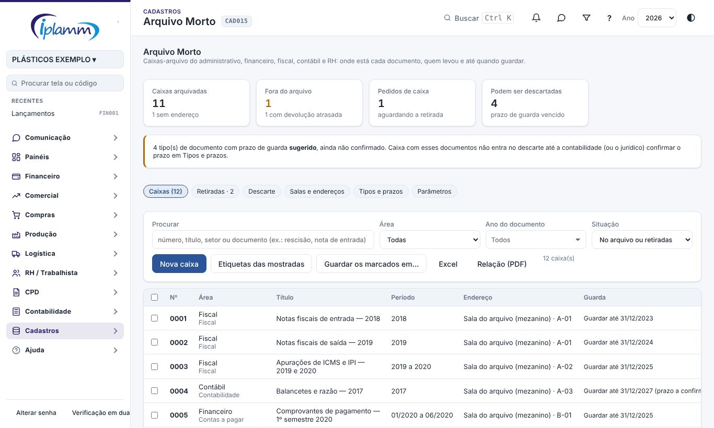
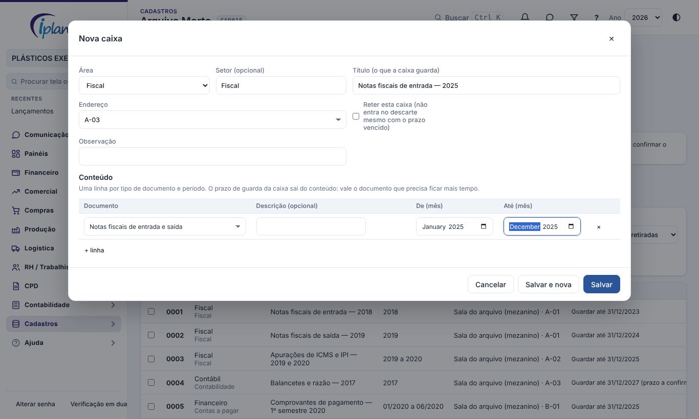
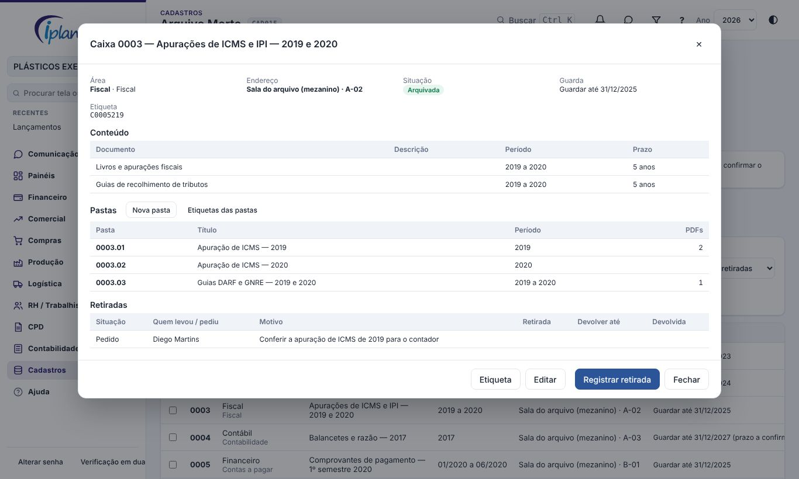
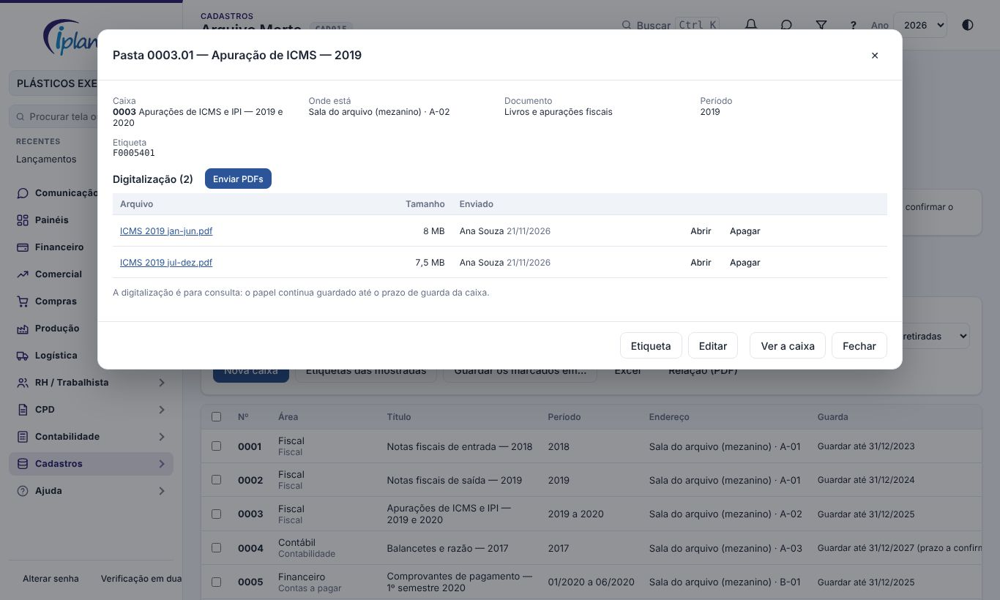
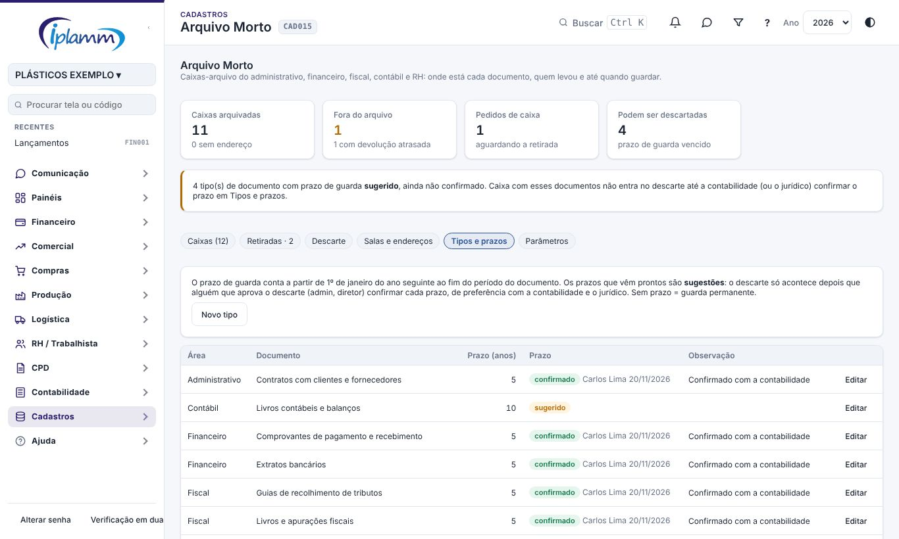
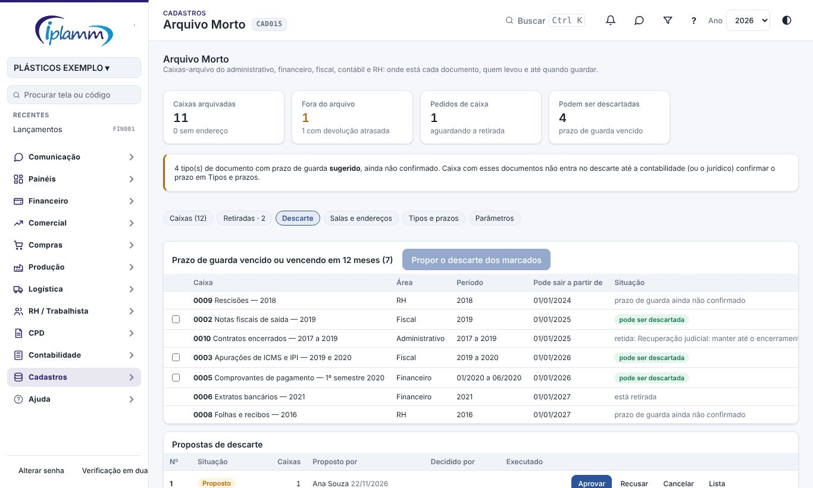
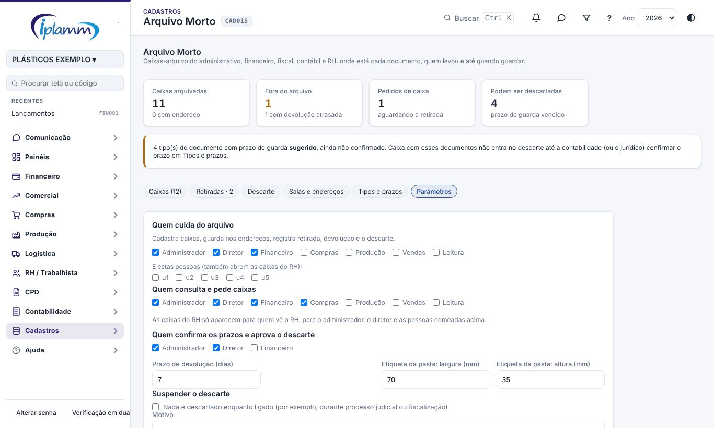

## 1. Para que serve

Organiza os documentos em papel que já não estão em uso: administrativo, financeiro, fiscal, contábil, RH e jurídico.

- Cada **caixa-arquivo** tem um número, uma etiqueta com código de barras e QR, e um **endereço** na estante.
- A plataforma registra **o que tem dentro**: o tipo de documento e o período.
- Quem precisa de um documento **procura** e acha a caixa e a prateleira.
- A **retirada** registra quem levou e até quando devolve.
- O **prazo de guarda** de cada tipo de documento diz quando a caixa pode ser descartada. O **descarte** tem proposta, aprovação por outra pessoa e termo.

> Exemplo: a caixa 0003 guarda as apurações de ICMS e IPI de 2019 e 2020, fica na Sala do arquivo, prateleira A-02, e pode ser descartada a partir de 01/01/2026 (prazo de 5 anos, confirmado).

## 2. Quem tem acesso

| O que | Quem (padrão, muda em Parâmetros) |
|---|---|
| Consultar e pedir caixas | Administrador, Financeiro, Diretor e Compras |
| Cadastrar caixas, guardar, registrar retirada, devolução e descarte | Administrador, Financeiro, Diretor e as pessoas nomeadas |
| Confirmar o prazo de guarda e aprovar o descarte | Administrador e Diretor |
| Mudar os parâmetros | Administrador |

**Caixas do RH.** Só aparecem para quem vê o RH, para o administrador, o diretor e as pessoas nomeadas para cuidar do arquivo. O perfil Financeiro, sozinho, não abre as caixas do RH.

## 3. A tela

O menu é **Cadastros › Arquivo Morto**.

No alto, os números do arquivo: caixas arquivadas (e quantas estão sem endereço), caixas fora do arquivo (e as atrasadas), pedidos de caixa e caixas que já podem ser descartadas.

**Procurar.** Digite o número da caixa, uma palavra do título ou do setor, ou o documento ("rescisão", "nota de entrada"). Filtre pela área, pelo **ano do documento** e pela situação. Exemplo: área Fiscal e ano 2019 mostram as caixas com documentos fiscais de 2019.

**Relação (PDF)** e **Excel** saem com os filtros da tela.

## 4. Cadastrar uma caixa

Use **Nova caixa**.

| Campo | Como preencher |
|---|---|
| Área | Administrativo, Financeiro, Fiscal, Contábil, RH, Jurídico, Comercial, Compras ou Outro |
| Setor | Opcional (ex.: Departamento Pessoal, Contas a pagar) |
| Título | O que a caixa guarda, em poucas palavras. É o que sai grande na etiqueta |
| Endereço | Sala e prateleira. Pode ficar vazio e ser preenchido depois, com o leitor (seção 8) |
| Conteúdo | Uma linha por tipo de documento: o documento, uma descrição opcional e os meses de início e fim |
| Reter esta caixa | Tira a caixa do descarte mesmo com o prazo vencido. Exige o motivo (processo, fiscalização) |

O número da caixa é dado pela plataforma, em sequência. **Salvar e nova** grava e abre outra caixa já com a mesma área, setor e endereço, para cadastrar uma estante inteira em sequência.

**Etiqueta da caixa.** Traz o número grande, a área, o título, o período, o endereço, até quando guardar e o código C… em barras e QR. Imprima na ficha da caixa (**Etiqueta**) ou várias de uma vez na lista (**Etiquetas**). O tamanho é o da etiqueta de mercadoria (Estoque › Parâmetros › Etiquetas).

## 5. A ficha da caixa

Clique na caixa na lista, ou leia a etiqueta da caixa com o leitor em qualquer tela.

A ficha mostra o endereço, a situação, até quando guardar, o conteúdo com o prazo de cada documento (confirmado ou **sugerido**) e o histórico de retiradas.

Caixa descartada não pode ser alterada. Caixa que está numa proposta de descarte também não, até a proposta ser recusada ou cancelada.

## 6. Pastas e digitalização

Dentro da caixa, cada **pasta** pode ter a sua etiqueta e os seus **PDFs digitalizados**. Quem lê a etiqueta da pasta com o leitor (ou a câmera) abre os PDFs dela na hora, sem ir até o arquivo.

1. Na ficha da caixa, use **Nova pasta**: título (ex.: "Apuração de ICMS — 2019"), documento e período, todos opcionais menos o título. **Salvar e nova** cria a próxima pasta da mesma caixa.
2. A pasta ganha um número dentro da caixa (**0003.02** = caixa 3, pasta 2) e uma etiqueta F…. Imprima em **Etiquetas das pastas** (todas da caixa) ou na própria pasta (**Etiqueta**) e cole na aba da pasta.
3. Digitalize as folhas da pasta no scanner, em PDF, e use **Enviar PDFs** na pasta. Dá para escolher vários arquivos de uma vez, até 50 MB cada. Para arquivos menores, digitalize em 200 dpi, preto e branco.
4. Para consultar, leia a etiqueta da pasta em qualquer tela, ou abra a caixa e a pasta. **Abrir** mostra o PDF.

**Etiqueta da pasta.** Traz o número (0003.02), o título, o período e o código F… em barras e QR. O tamanho padrão é 70 × 35 mm e muda em Parâmetros.

**Quem vê e quem envia.** Vê os PDFs quem vê a caixa (as do RH continuam restritas). Envia e apaga quem cuida do arquivo. Os arquivos ficam num armazenamento privado: o link de abertura vale por 10 minutos.

**O papel continua guardado.** A digitalização é para consulta e não libera o descarte antes do prazo. Quando a caixa é descartada, a aba Descarte avisa que as cópias digitais continuam guardadas e oferece **Apagar as cópias digitais**.

A busca da aba Caixas também procura pelo título das pastas. Uma pasta só pode ser excluída depois de apagados os PDFs dela.

## 7. Pedir, retirar e devolver

**Quem consulta** abre a caixa e usa **Pedir esta caixa**, dizendo para que precisa.

**Quem cuida do arquivo** vê os pedidos na aba **Retiradas** e registra a retirada: quem está levando (pessoa da empresa ou um nome, como o escritório de contabilidade), o motivo e a data de devolução. O prazo sugerido é o dos parâmetros (7 dias).

Caixa com devolução vencida aparece **atrasada**. Na volta, use **Registrar devolução** e guarde a caixa no endereço dela.

Uma caixa só sai uma vez: enquanto está fora, não pode ser retirada de novo nem descartada.

## 8. Salas, endereços e o leitor

Na aba **Salas e endereços**:

1. **Nova sala**: o lugar do arquivo (ex.: Sala do arquivo, Mezanino).
2. **Gerar endereços**: estantes (A-D), prateleiras por estante e níveis, como no almoxarifado.
3. **Etiquetas de prateleira**: uma tira por prateleira, com o código S….

**Guardar com o leitor.** Leia a etiqueta da prateleira e depois a de cada caixa que está nela (ou digite o número da caixa). A caixa passa a ter aquele endereço. A lista abaixo do campo mostra onde cada caixa estava antes.

Para guardar várias caixas de uma vez sem o leitor, marque-as na lista e use **Guardar os marcados em…**.

## 9. Tipos de documento e prazo de guarda

A aba **Tipos e prazos** lista os documentos e o prazo de guarda de cada um. Na primeira vez, use **Preparar os tipos sugeridos**: a plataforma cria 20 tipos comuns com um prazo **sugerido**.

- O prazo conta a partir de **1º de janeiro do ano seguinte** ao fim do período do documento. Nota de dezembro de 2019 com 5 anos de prazo: pode sair a partir de 01/01/2025.
- Sem prazo = **guarda permanente**. A caixa que tem um documento permanente nunca entra no descarte.
- O prazo sugerido **não libera o descarte**. Ele só vale depois que alguém que aprova o descarte marcar **Prazo confirmado**, de preferência depois de ouvir a contabilidade e o jurídico. Registre na observação quem orientou.
- Mudar o prazo faz ele voltar a ser sugestão até nova confirmação, e as caixas com aquele documento são recalculadas.

Na caixa, vale o documento que precisa ficar mais tempo.

## 10. Descarte

A aba **Descarte** lista as caixas com o prazo vencido ou vencendo em 12 meses e diz o que ainda impede cada uma: prazo não confirmado, caixa retida, caixa fora do arquivo, documento permanente.

1. **Propor**: quem cuida do arquivo marca as caixas que podem ser descartadas e usa **Propor o descarte dos marcados**.
2. **Aprovar**: outra pessoa, entre quem aprova o descarte (administrador ou diretor), aprova ou recusa com o motivo. Quem propôs não aprova a própria proposta.
3. **Descartar**: o descarte físico acontece (fragmentação, reciclagem, incineração ou empresa especializada).
4. **Registrar**: quem cuida do arquivo registra a data, a forma, o responsável e a testemunha. As caixas saem do arquivo, com a situação Descartada.
5. **Termo de descarte**: imprima, com a lista das caixas, o conteúdo, o prazo e os campos de assinatura. Guarde o termo assinado.

A cada passo a plataforma confere de novo se a caixa ainda pode sair.

## 11. Parâmetros

Só o administrador muda.

| Parâmetro | Padrão | O que faz |
|---|---|---|
| Quem cuida do arquivo | Administrador, Financeiro, Diretor | Cadastra caixas, guarda, registra retirada, devolução e descarte |
| Pessoas nomeadas | Nenhuma | Cuidam do arquivo e abrem também as caixas do RH |
| Quem consulta e pede caixas | Administrador, Financeiro, Diretor, Compras | Veem as caixas (as do RH, só com a regra da seção 2) |
| Quem confirma prazos e aprova o descarte | Administrador, Diretor | Precisa incluir o administrador ou o diretor |
| Prazo de devolução | 7 dias | Sugerido na retirada |
| Etiqueta da pasta | 70 × 35 mm | Largura e altura da etiqueta da pasta |
| Suspender o descarte | Desligado | Ligado, nada é descartado (processo judicial, fiscalização). Exige o motivo |

**Recuperação judicial.** Enquanto houver processo em andamento, avalie com o jurídico ligar a suspensão do descarte, ou reter as caixas que interessam ao processo.

## 12. Roteiro sugerido para 01/12

1. Cadastre a sala, gere os endereços e cole as etiquetas de prateleira.
2. Em **Tipos e prazos**, prepare os tipos sugeridos. Peça à contabilidade e ao jurídico que revisem os prazos, e confirme cada um.
3. Monte as caixas por área e período. Cadastre cada uma (Salvar e nova ajuda) e cole a etiqueta.
4. Crie as pastas de cada caixa e cole as etiquetas delas. Digitalize primeiro o que é mais consultado.
5. Guarde as caixas com o leitor: prateleira, depois as caixas.
6. Ao final, filtre **Sem endereço** para achar o que ficou sem lugar.

## 13. Regras

- O número da caixa é único na empresa e não se repete. A etiqueta (C…) não muda.
- Até 200 linhas de conteúdo por caixa. Período: mês de início não pode ser depois do mês de fim.
- Caixa descartada não volta, não é pedida nem alterada.
- Pasta: número único dentro da caixa, etiqueta F… que não muda. Só PDF, até 50 MB por arquivo.
- Uma caixa só pode estar numa proposta de descarte por vez.
- O descarte só acontece com o prazo confirmado e vencido, sem retenção, com a caixa no arquivo e com a aprovação de outra pessoa.

## 14. Dúvidas comuns

**A caixa tem notas de 2019 e folha de pagamento de 2019. Qual prazo vale?** O maior. Se a folha tiver prazo de 10 anos, a caixa inteira fica até o fim de 2029. Para descartar as notas antes, separe-as numa caixa própria.

**Os prazos sugeridos estão certos?** São um ponto de partida. A regra muda com o tipo de documento e com a situação da empresa (processos, fiscalizações, recuperação judicial). Por isso eles só valem depois de confirmados.

**Preciso de um documento, mas não sei a caixa.** Procure pela palavra do documento e filtre a área e o ano.

**Levaram a caixa e não devolveram.** Ela aparece como atrasada em Retiradas, com o nome de quem levou.

## 15. Histórico de versões

| Versão | Data | O que mudou |
|---|---|---|
| 1.0 | 22/11/2026 | Primeira versão: salas e endereços com etiqueta de prateleira, caixa-arquivo numerada com etiqueta e conteúdo por tipo de documento e período, busca, pedido, retirada e devolução, prazo de guarda sugerido e confirmado, descarte com proposta, aprovação por outra pessoa, registro e termo, suspensão do descarte e acesso restrito às caixas do RH (SQL 194). |
| 1.1 | 23/11/2026 | Pastas dentro da caixa, com etiqueta própria (70 × 35 mm), e digitalização em PDF por pasta: enviar, abrir pela etiqueta e apagar; aviso para apagar as cópias digitais das caixas descartadas (SQL 195). |
