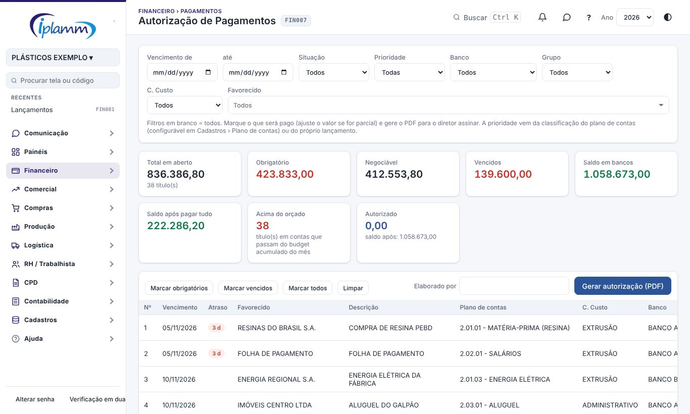
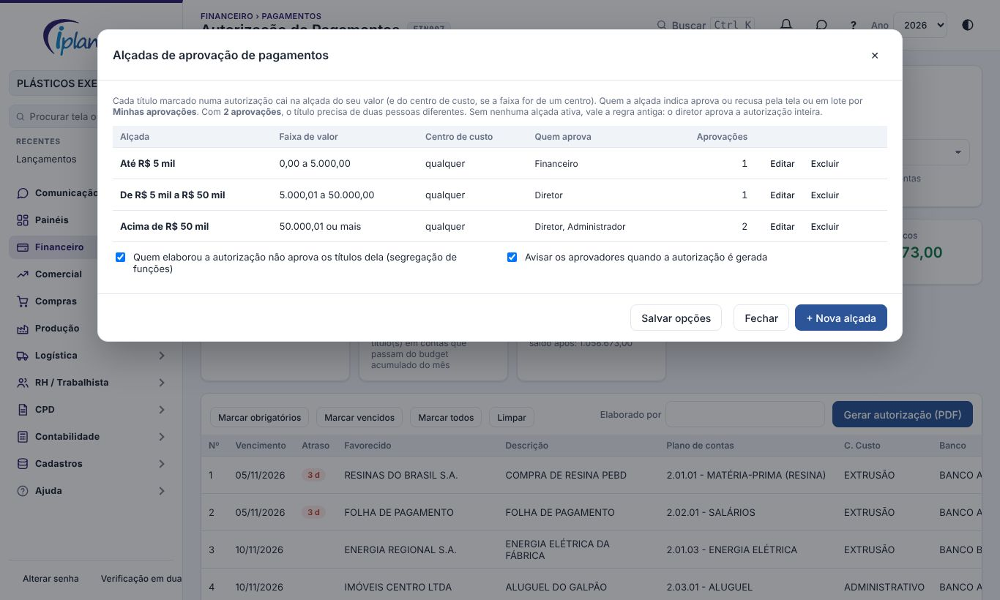
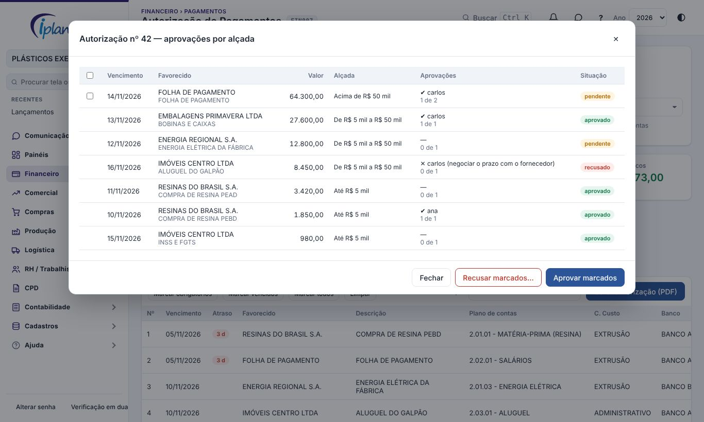
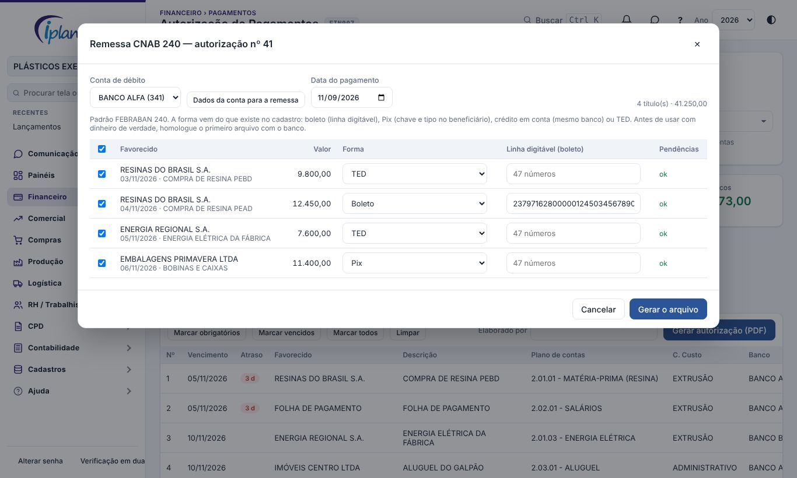

## 1. Para que serve

A **Autorização de Pagamentos** monta a lista do que será pago e gera o **PDF para o diretor assinar**. Com as **alçadas**, cada título é aprovado por quem a faixa de valor indica, também em lote pelo celular. Depois de aprovada, a autorização vira o **arquivo de remessa CNAB 240** para o banco.

A lista mostra os títulos a pagar em aberto com a prioridade, o banco e o orçamento de cada um. Junto vêm o saldo em bancos e quanto sobra depois de pagar. Cada autorização recebe um número e fica no histórico, onde o diretor aprova ou rejeita.

## 2. Quem tem acesso

| Perfil | O que faz |
|---|---|
| Administrador e financeiro | Marcam os títulos e geram a autorização. |
| Administrador e diretor | Aprovam ou rejeitam as autorizações emitidas, quando não há alçadas. |
| Quem a alçada indica (perfis ou pessoas) | Aprova ou recusa os títulos da sua faixa de valor, na tela ou em **Minhas aprovações**. |
| Administrador | Cadastra as **alçadas** e as opções de segregação de funções. |
| Administrador e financeiro | Geram e cancelam a **remessa CNAB**, cadastram os dados da conta para a remessa. |
| Leitura | Consulta. |

## 3. Passo a passo

### 3.1 Filtrar os títulos

Use os filtros: vencimento de / até, situação (vencidos ou a vencer), prioridade, banco, grupo, centro de custo e favorecido. Filtro em branco quer dizer todos.

Os indicadores mostram:

- o total em aberto;
- quanto é **obrigatório** e quanto é **negociável**;
- os vencidos;
- o **saldo em bancos** (contas com recursos disponíveis);
- o **saldo após pagar tudo**;
- o que está **acima do orçado**;
- o total **autorizado**.

### 3.2 Marcar o que será pago

- Use os atalhos **Marcar obrigatórios**, **Marcar vencidos**, **Marcar todos** e **Limpar**, ou marque um a um na coluna **Autoriza**.
- Para pagar só parte de um título, ajuste o **Valor autorizado**.
- Escreva uma **observação** quando precisar.

A **prioridade** (Obrigatório ou Negociável) vem da classificação do plano de contas (**Cadastros › Plano de Contas**) ou do próprio lançamento.

### 3.3 Gerar a autorização

1. Confira o **Elaborado por**.
2. Clique em **Gerar autorização (PDF)**.
3. Se algum título marcado estiver numa conta **acima do orçado**, a plataforma pede a **justificativa de cada conta**. O pagamento não é bloqueado; a justificativa fica registrada no controle orçamentário e no PDF. Clique em **Continuar e gerar**.

O PDF sai no padrão IPLAMM, com:

- o nº da autorização;
- o total listado, o saldo em bancos, o total autorizado e o saldo após os pagamentos;
- a lista com SIM ou NÃO em cada título;
- os campos de assinatura do elaborador e do diretor.

### 3.4 Aprovar ou rejeitar (sem alçadas)

Sem nenhuma alçada ativa, vale a regra de antes. Em **Autorizações emitidas**, o diretor ou o administrador clica em **Aprovar** ou **Rejeitar** na autorização pendente. O botão **PDF** gera de novo o documento de qualquer autorização.

### 3.5 Alçadas de aprovação

Em **Alçadas**, só o administrador, você cadastra as faixas. Cada faixa tem:

- o **valor de** e o **valor até**. Deixe o valor até vazio para uma faixa sem teto.
- um **centro de custo**, se a faixa valer só para ele. Sem centro, ela vale para qualquer um.
- **quem aprova**: perfis (administrador, diretor, financeiro) e/ou pessoas.
- **quantas aprovações** são precisas: 1, 2 (dupla aprovação) ou 3, sempre de pessoas diferentes.

Exemplo:

| Faixa | Quem aprova | Aprovações |
|---|---|---|
| Até R$ 5 mil | Financeiro | 1 |
| De R$ 5 mil a R$ 50 mil | Diretor | 1 |
| Acima de R$ 50 mil | Diretor e administrador | 2 |

Quando a autorização é gerada:

1. Cada título marcado vai para a alçada do seu valor. Se duas faixas cobrirem o mesmo valor, vale a do centro de custo do título e, depois, a de menor ordem.
2. Os aprovadores de cada alçada recebem o aviso **"Pagamentos na sua alçada"**.
3. Cada aprovador vê os seus títulos em **Minhas aprovações** e aprova ou recusa a autorização de uma vez, também pelo celular. Na tela, o botão **Aprovações** abre o detalhe: quem já aprovou, quantas aprovações faltam e a situação de cada título. Ali dá para aprovar ou recusar só os títulos marcados. A recusa exige o motivo.
4. Quando todos os títulos foram decididos, a autorização fica **Aprovada**. Se todos foram recusados, ela fica **Rejeitada**. Quem elaborou recebe o aviso.

Opções:

- **Segregação de funções** (ligada por padrão): quem elaborou a autorização não aprova os títulos dela.
- **Avisar os aprovadores** quando a autorização é gerada.

### 3.6 Remessa CNAB 240 para o banco

Na autorização **Aprovada**, clique em **Remessa CNAB**.

1. Escolha a **conta de débito**. Na primeira vez, preencha em **Dados da conta para a remessa**:
   - o código do banco (ex.: 341);
   - o convênio;
   - a agência e a conta, com os dígitos;
   - as versões do layout e a finalidade da TED.

   Esses dados variam por banco: confirme com o gerente ou com o manual CNAB 240 do banco.
2. Escolha a **data do pagamento**. Vem o próximo dia útil.
3. Confira a **forma** de cada título. A plataforma sugere, nesta ordem:
   - **boleto**, se houver linha digitável;
   - **Pix**, se o beneficiário tiver a chave e o tipo da chave;
   - **crédito em conta**, se o banco do beneficiário for o mesmo da conta de débito;
   - **TED**.
4. Para boleto, cole a **linha digitável** (47 números) na coluna. Ela fica gravada no lançamento, e a plataforma confere o dígito, o valor e o vencimento.
5. A coluna **Pendências** mostra o que falta no cadastro, como o CPF/CNPJ, o banco, a agência, a conta ou a chave Pix. Título com pendência sai desmarcado.
6. Clique em **Gerar o arquivo**. O arquivo **.REM** é baixado. Envie-o pelo internet banking do banco.

O arquivo segue o padrão FEBRABAN 240:

- crédito em conta, TED e Pix vão nos segmentos A e B;
- boletos vão no segmento J, com o J-52;
- cada forma vai num lote, com o número sequencial (NSA) da conta.

> **Homologue com o banco antes do primeiro pagamento real.** Cada banco tem particularidades no CNAB 240. Gere um arquivo de teste e peça ao banco para validar.

Em **Remessas** ficam os arquivos gerados, que podem ser **baixados de novo**. **Cancelar** uma remessa (ex.: o banco recusou) libera os títulos para outra remessa. O número sequencial não volta.

## 4. Regras e travas

- Só entram títulos **a pagar em aberto**.
- Pagamento acima do orçamento **não é bloqueado**, mas exige justificativa por conta.
- A autorização não baixa os títulos: depois de pagos, eles são baixados em Contas a pagar / receber ou pela Conciliação.
- Com alçadas ativas, a autorização não pode ser aprovada "inteira": ela só fica Aprovada quando todos os títulos marcados foram decididos nas alçadas.
- A remessa só leva títulos aprovados. Um título não entra em duas remessas geradas.
- Os dados para a remessa ficam no cadastro: no beneficiário, a conta para pagamento e a chave e o tipo do Pix; na conta, o código do banco e o convênio.

## 5. Perguntas frequentes e erros comuns

**A mensagem diz "Nenhum título listado".** Os filtros não trouxeram nada. Limpe os filtros.

**A mensagem diz "Escreva a justificativa de cada conta".** Há título marcado em conta acima do orçado. Preencha o motivo de cada conta da lista.

**"Fora da sua alçada".** O valor do título está numa faixa que o seu perfil não aprova. Ele aparece para quem a faixa indica.

**"Quem elaborou a autorização não aprova os títulos dela".** É a segregação de funções. Outra pessoa da alçada aprova; o administrador pode desligar a opção em Alçadas.

**"Código de barras com dígito verificador errado".** Confira a linha digitável. Contas de consumo e tributos (começam com 8) não são pagas por esta remessa.

**O saldo em bancos parece baixo.** Só entram as contas marcadas como "Conta com recursos disponíveis" em **Cadastros › Contas Bancárias**. Com filtro de banco, entra só o saldo dele.

## 6. Histórico de alterações

| Versão | Data | O que mudou |
|---|---|---|
| 1.0 | 28/10/2026 | Primeira versão do manual: filtros, marcação, valor parcial, justificativa de orçamento, PDF para assinatura e aprovação. |
| 1.1 | 29/10/2026 | Imagens das telas, com dados fictícios. |
| 1.2 | 05/11/2026 | Nomes das telas iguais aos do menu, com o código da tela no cabeçalho. |
| 1.3 | 08/11/2026 | Alçadas de aprovação por valor e centro de custo, dupla aprovação, segregação de funções e aprovação em lote em Minhas aprovações. Remessa CNAB 240 (FEBRABAN) com crédito em conta, TED, Pix e boletos, dados da conta para a remessa e histórico de remessas. |
