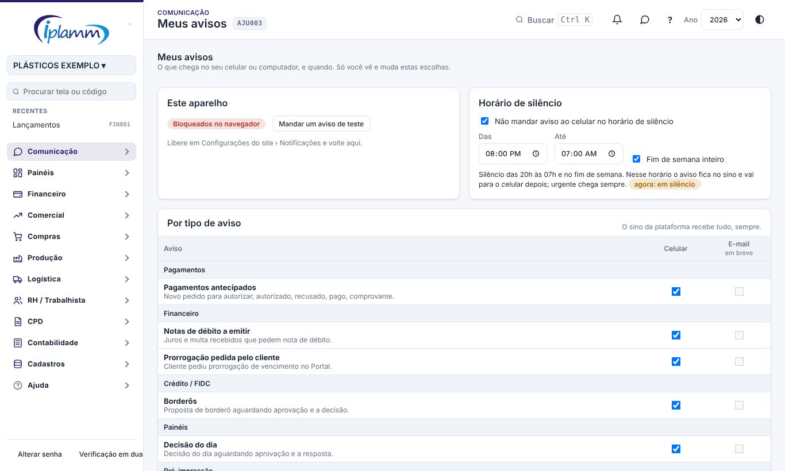
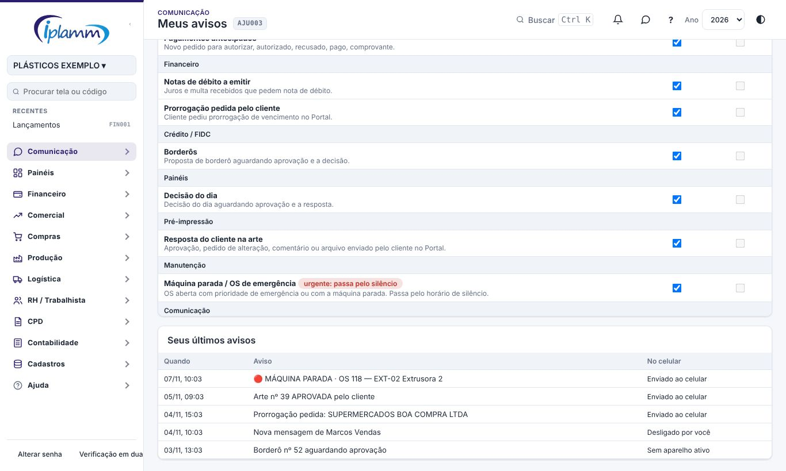

## 1. Para que serve

A plataforma avisa quando algo espera por você, por exemplo:

- um pagamento para autorizar;
- um borderô;
- o cliente que respondeu uma arte no Portal;
- uma prorrogação pedida;
- uma máquina parada.

O aviso aparece em dois lugares:

- no **sino**, dentro da plataforma: recebe sempre tudo;
- no **celular ou computador**, como notificação do aparelho, mesmo com a plataforma fechada.

Em **Meus avisos** cada pessoa escolhe:

- em quais aparelhos recebe;
- o **horário de silêncio**;
- quais **tipos de aviso** vão para o celular.

## 2. Quem tem acesso

Todos os perfis. Cada pessoa vê e muda **só as próprias escolhas**.

## 3. Passo a passo

### 3.1 Ativar no aparelho

1. Abra **Comunicação › Meus avisos** no aparelho em que quer receber.
2. Clique em **Ativar avisos neste aparelho** e permita as notificações no navegador.
3. Clique em **Mandar um aviso de teste**. Ele chega em até 1 minuto.

Ative em cada aparelho que você usa: o computador do escritório e o celular são aparelhos diferentes.

No **iPhone**, a plataforma precisa estar instalada: Compartilhar › **Adicionar à Tela de Início**. Depois abra pelo ícone e ative.

O mesmo botão também aparece no sino (🔔), com o atalho **Meus avisos**.

### 3.2 Horário de silêncio

O padrão é **das 20h às 7h e o fim de semana inteiro**. Nesse horário:

- o aviso entra no sino na hora;
- no celular, ele chega quando o silêncio acabar (por exemplo, às 7h).

Avisos **urgentes** chegam sempre, mesmo no silêncio. Hoje é urgente a **OS de emergência ou com a máquina parada**.

Mude o horário, desligue o fim de semana ou desmarque o silêncio. Cada mudança é salva na hora.

### 3.3 Por tipo de aviso

Para cada tipo, marque ou desmarque **Celular**. Desmarcado, o aviso fica só no sino.

Marque **E-mail** para receber também por e-mail, no endereço do seu login. A coluna funciona depois que o administrador ligar o envio em Cadastros › E-mails da Plataforma. As Conversas não vão por e-mail.

| Grupo | Aviso | Quem recebe |
|---|---|---|
| Pagamentos | Pagamentos antecipados | Quem autoriza; quem lançou recebe a resposta. |
| Financeiro | Notas de débito a emitir | Financeiro. |
| Financeiro | Prorrogação pedida pelo cliente | Administrador e financeiro. |
| Crédito / FIDC | Borderôs | Administrador e diretor (aguardando); quem montou (decisão). |
| Painéis | Decisão do dia | Diretoria; quem montou recebe a resposta. |
| Pré-impressão | Resposta do cliente na arte | Administrador, diretor e quem criou a arte. |
| Manutenção | Máquina parada / OS de emergência (**urgente**) | Administrador, diretor e produção. |
| Comunicação | Mensagens nas Conversas | Quem está na conversa (respeita o silenciar). |

Quem faz a ação não recebe o aviso dela.

**Seus últimos avisos** mostra o que aconteceu com cada aviso no celular:

- enviado;
- sem aparelho ativo;
- desligado por você;
- aguardando o fim do silêncio.

### 3.4 WhatsApp

Cadastre o celular com DDD, aceite receber e marque a coluna **WhatsApp** nos avisos que quer receber também pelo WhatsApp. Veja o manual **WhatsApp da Plataforma**.

## 4. Regras e travas

- O envio para o celular é feito logo depois da ação. O banco também confere a fila **a cada minuto**, para os avisos que nascem fora da plataforma (Portal do Cliente).
- Um aviso espera no máximo 4 dias na fila; depois disso, ele fica só no sino.
- Quando um aparelho deixa de aceitar os avisos (desinstalado, permissão retirada), ele sai da lista sozinho.

## 5. Perguntas frequentes e erros comuns

**O teste não chegou.** Siga esta ordem:

1. Confira se a página mostra **Ativos neste aparelho**.
2. Veja se o aparelho não está em modo **Não perturbe**.
3. No Android, confira se o navegador tem permissão de notificação.

**"Bloqueados no navegador".** Libere em Configurações do site › Notificações e volte à tela.

**Eu tinha ativado antes e parou.** A chave dos avisos foi trocada em 07/11/2026. Ao entrar na plataforma, o aparelho se inscreve de novo sozinho. Se não voltar, clique em **Desligar aqui** e depois em **Ativar**.

## 6. Histórico de alterações

| Versão | Data | O que mudou |
|---|---|---|
| 1.1 | 07/11/2026 | Coluna E-mail ligada ao envio de e-mail da plataforma. |
| 1.0 | 07/11/2026 | Primeira versão: ativar e testar por aparelho, horário de silêncio, tipos de aviso com o celular ligado ou desligado, urgente passando pelo silêncio, avisos novos (prorrogação, arte, borderô, máquina parada), envio a cada minuto e histórico dos últimos avisos. |
| 1.2 | 08/11/2026 | Coluna WhatsApp e cadastro do celular com aceite. |
