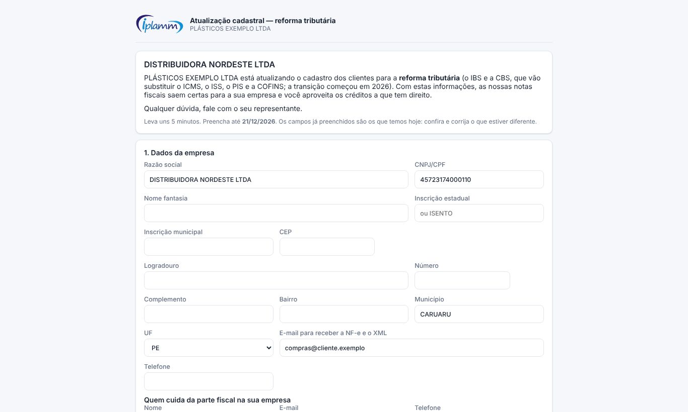
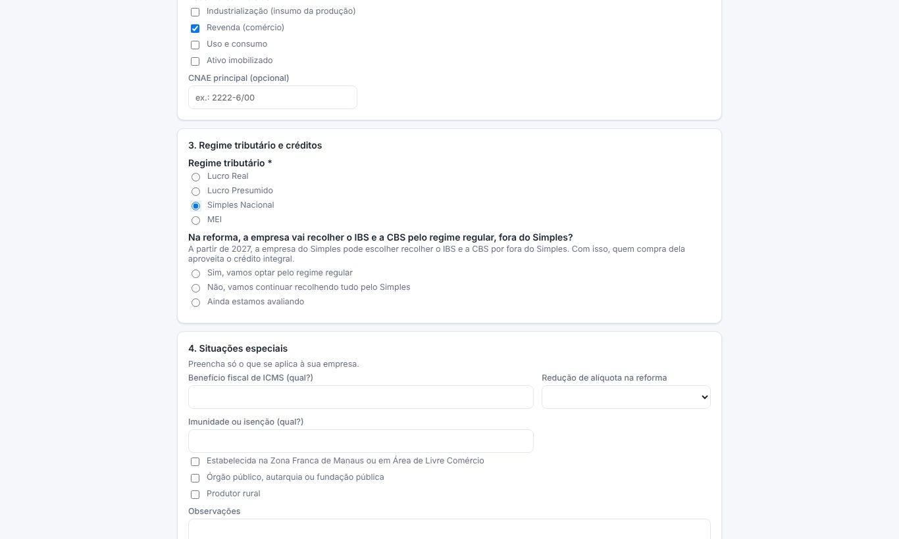
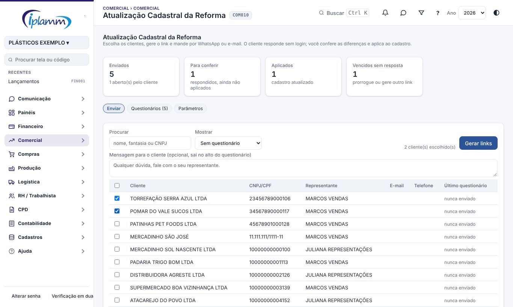
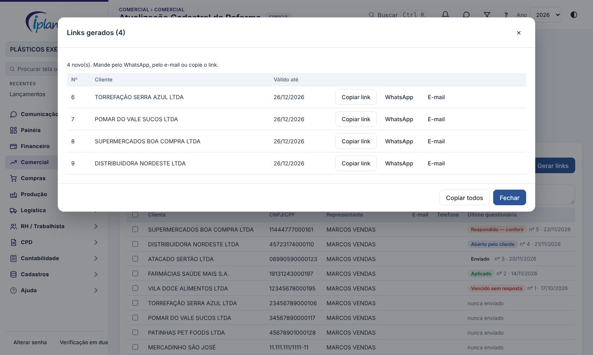
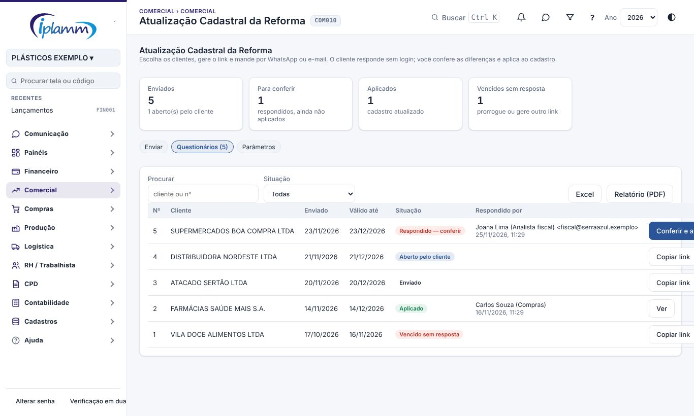
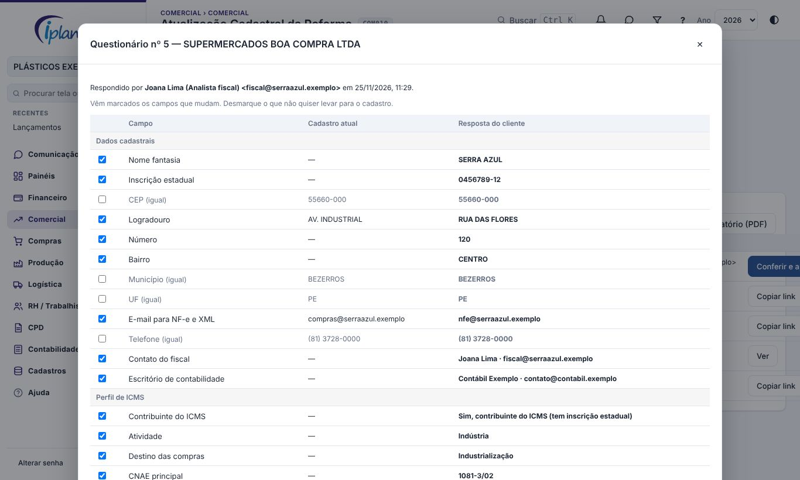
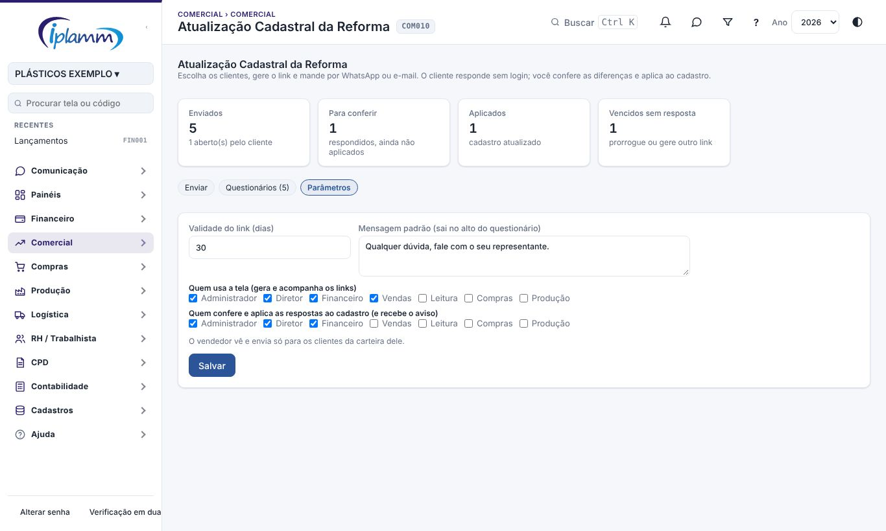

## 1. Para que serve

Com a reforma tributária, a nota fiscal precisa sair certa para cada cliente, e a Análise de Competitividade precisa saber se ele aproveita os créditos. Esta tela pede essas informações ao próprio cliente:

1. Você escolhe os clientes e a plataforma gera um **link único** para cada um.
2. Você manda o link por **WhatsApp**, por **e-mail** ou copia e cola onde quiser.
3. O cliente abre o link, **sem login e sem senha**, confere os dados que já temos, responde o questionário e clica em **Enviar**.
4. A resposta chega com um aviso. Quem tem o papel de aplicar **compara com o cadastro** e **aplica** só o que escolher.

Nada muda no cadastro sem essa conferência.

## 2. O que o cliente responde

| Bloco | Perguntas |
|---|---|
| 1. Dados da empresa | Razão social e CNPJ (só para conferir), nome fantasia, inscrição estadual e municipal, endereço, e-mail para a NF-e e o XML, telefone, quem cuida da parte fiscal, escritório de contabilidade |
| 2. ICMS | É contribuinte do ICMS (contribuinte, isento de inscrição ou não contribuinte)? Para que usa o que compra de nós (industrialização, revenda, uso e consumo, ativo imobilizado)? CNAE principal |
| 3. Regime e créditos | Regime tributário (Lucro Real, Lucro Presumido, Simples, MEI). Aproveita o crédito do ICMS? Aproveita o crédito de PIS/COFINS (só no Lucro Real)? No Simples ou MEI: vai recolher o IBS e a CBS pelo regime regular, fora do Simples, a partir de 2027? |
| 4. Situações especiais | Benefício fiscal de ICMS, redução de alíquota na reforma, imunidade ou isenção, Zona Franca/Área de Livre Comércio, órgão público, produtor rural, observações |
| 5. Quem responde | Nome, cargo, e-mail e a declaração de que as informações são verdadeiras |

As perguntas que não se aplicam somem: a do PIS/COFINS só aparece no Lucro Real, e a da opção pelo regime regular só no Simples e no MEI.

## 3. Enviar os links

O menu é **Comercial › Atualização Cadastral da Reforma**, aba **Enviar**.

1. Filtre os clientes: **Sem questionário** (padrão), **Enviado, sem resposta**, **Já atualizados** ou **Todos**. Procure por nome, nome fantasia ou CNPJ.
2. Marque os clientes. A caixa do cabeçalho marca todos os que estão na lista.
3. Se quiser, escreva uma **mensagem**. Ela aparece no alto do questionário. Sem mensagem, vale a mensagem padrão de Parâmetros.
4. Clique em **Gerar links**.

Para cada cliente:
- **Copiar link** copia só o link.
- **WhatsApp** abre a conversa com o número do cadastro e o texto pronto.
- **E-mail** abre o seu programa de e-mail com o assunto e o texto prontos.

**Copiar todos** copia a lista "cliente: link" de uma vez.

Se o cliente já tem um link válido e ainda não respondido, a plataforma **reaproveita** esse link em vez de criar outro.

## 4. Validade do link

O link vale **30 dias** (muda em Parâmetros). Depois disso, a página avisa que o prazo terminou. Na aba Questionários você pode:
- **Prorrogar**: soma mais um período de validade;
- **Cancelar**: o link para de funcionar; depois é só gerar um novo na aba Enviar.

Enquanto o link vale e a resposta não foi aplicada, o cliente pode abrir de novo, corrigir e reenviar.

## 5. Acompanhar

| Situação | O que significa |
|---|---|
| Enviado | Link gerado, ainda não aberto |
| Aberto pelo link | O cliente abriu a página, mas não enviou |
| Respondido — conferir | Resposta recebida, aguardando a conferência |
| Aplicado | Conferido e levado ao cadastro |
| Descartado | Conferido e não aproveitado (com o motivo) |
| Vencido sem resposta | Passou a validade sem resposta |
| Cancelado | Link cancelado |

No alto ficam os números: enviados, para conferir, aplicados e vencidos sem resposta. A aba tem **Excel** e **Relatório (PDF)** da lista filtrada.

## 6. Conferir e aplicar

Quando o cliente envia, quem tem o papel de aplicar recebe um aviso no sino. O aviso abre direto a conferência.

- Cada linha mostra o **cadastro atual** e a **resposta do cliente**.
- Vêm **marcados** os campos que mudam. O que já é igual aparece em cinza.
  - Na comparação, CEP e telefone com ou sem traço contam como iguais.
- Desmarque o que não quiser levar e clique em **Aplicar ao cadastro**.
- **Descartar** pede o motivo, por exemplo "respondido pela empresa errada".
- **PDF da resposta** mostra, para cada campo, o cadastro antes, a resposta e se foi aplicado.

**Para onde vai cada informação:**
- **Cadastro do cliente** (Cadastros › Favorecidos): nome fantasia, inscrições, endereço, e-mail da NF-e, telefone, contribuinte do ICMS e regime tributário.
- **Perfil fiscal do cliente:** atividade, destino das compras, CNAE, créditos de ICMS e PIS/COFINS, opção do Simples, situações especiais, contato fiscal e contabilidade.

## 7. Ligação com a Análise de Competitividade

Na **Análise de Competitividade de Preço**, ao escolher um cliente que já tem o perfil fiscal aplicado, a tela preenche sozinha o tipo, o regime e os créditos de ICMS e PIS/COFINS, e avisa que vieram da atualização cadastral. As respostas "não sei" não mudam a marca de crédito, que continua com o padrão do perfil.

## 8. Parâmetros

| Parâmetro | Padrão | Para que serve |
|---|---|---|
| Validade do link | 30 dias | Prazo para o cliente responder |
| Mensagem padrão | vazia | Texto no alto do questionário |
| Quem usa a tela | Administrador, Diretor, Financeiro e Vendas | Gerar links e acompanhar |
| Quem confere e aplica | Administrador, Diretor e Financeiro | Aplicar ao cadastro; recebe o aviso de resposta |

O vendedor vê e envia só para os clientes da carteira dele. Só o administrador muda os parâmetros.

## 9. Segurança

- O link tem 64 caracteres aleatórios e abre **só o questionário daquele cliente**. Ele não dá acesso a nada mais da plataforma.
- A página pública não lê as tabelas. Ela só chama duas funções do banco, que exigem o link: abrir e responder.
- Cada aplicação fica na auditoria da plataforma, com quem aplicou, quando e quais campos.

## 10. Dúvidas comuns

**O cliente diz que o link não abre.** Confira se ele copiou o link inteiro. Se venceu, prorrogue; se foi cancelado, gere um novo.

**O cliente respondeu errado depois de aplicado.** Gere um novo link para ele (aba Enviar, filtro "Já atualizados") e aplique a nova resposta.

**Posso mandar para um possível cliente que não está no cadastro?** Ainda não: o link é sempre de um cliente do cadastro. Cadastre o cliente antes.

## 11. Versão para fornecedores

A mesma ferramenta existe em **Compras › Atualização Cadastral de Fornecedores** (CMP006), para quem compra. O questionário do fornecedor pergunta a atividade (fabricante, importador, distribuidor, prestador) no lugar do destino das compras e, no Simples, o percentual de crédito de ICMS que vai na nota. O regime, o crédito do Simples e a opção pelo IBS/CBS regular entram no perfil do fornecedor e já vêm preenchidos nas próximas cotações por link. Detalhes no manual **Compra inteligente**.

## 12. Histórico de versões

| Versão | Data | O que mudou |
|---|---|---|
| 1.0 | 26/11/2026 | Primeira versão. O questionário tem dados cadastrais e contato, perfil de ICMS, regime e créditos (com a opção do Simples pelo IBS/CBS regular), situações especiais e a declaração de quem responde. Link único por cliente, sem login, válido por 30 dias, com reaproveitamento, prorrogação e cancelamento; envio por WhatsApp, e-mail ou cópia; aviso de resposta. A conferência compara a resposta com o cadastro e aplica os campos escolhidos ao cadastro e ao perfil fiscal, que passa a alimentar a Análise de Competitividade. Tem PDF da resposta e da lista e parâmetros de validade, mensagem e papéis (SQL 198). |
| 1.1 | 26/11/2026 | Versão para fornecedores em Compras (CMP006), com atividade e crédito do Simples; a situação "Aberto pelo cliente" passa a se chamar "Aberto pelo link" (SQL 199). |
