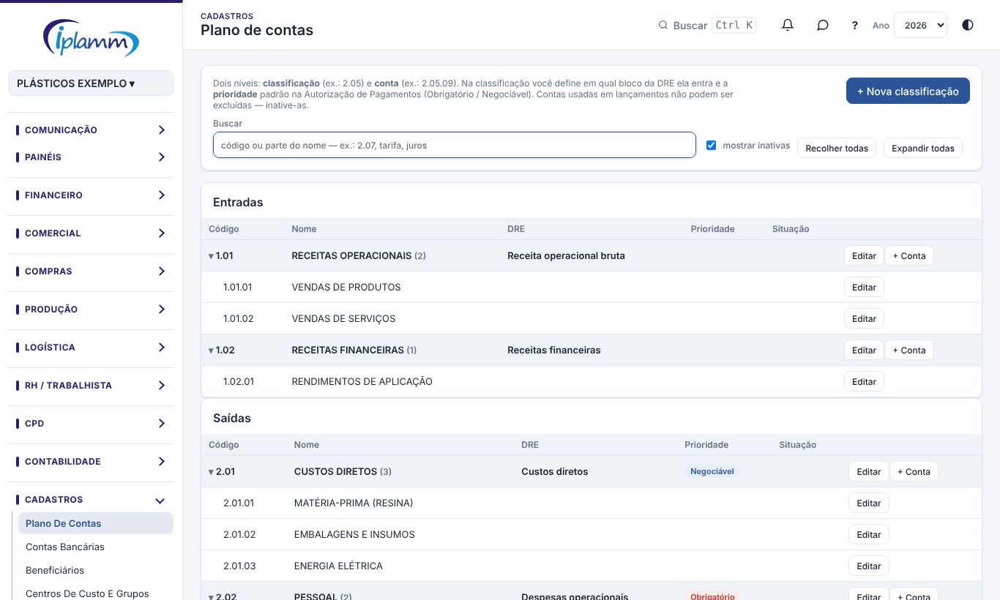
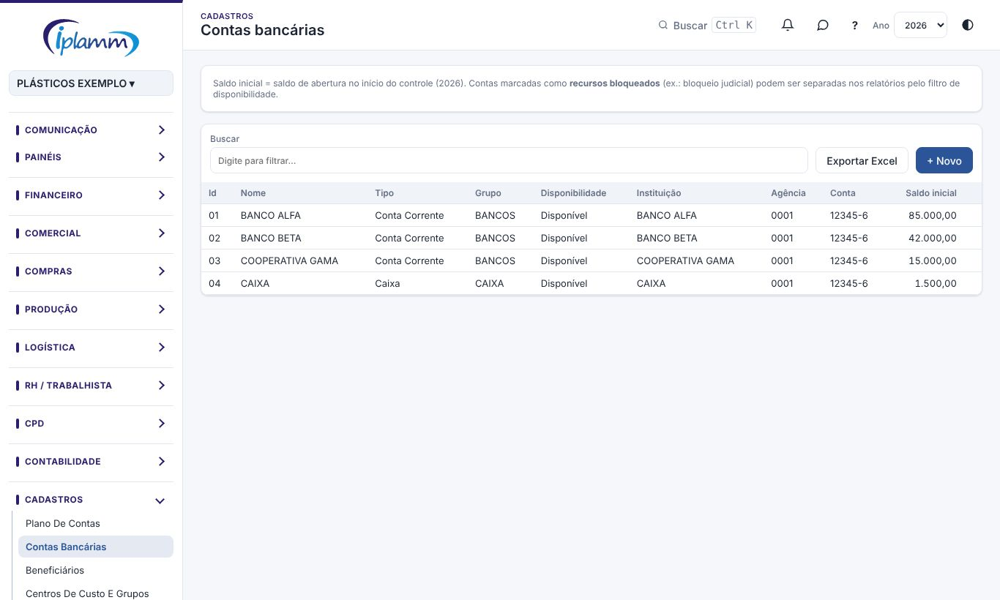

## 1. Para que serve

Os cadastros são a base de toda a plataforma:

- **Plano de contas**: as classificações e as contas que dão o sinal (entrada ou saída) e o lugar de cada lançamento na DRE.
- **Contas bancárias**: bancos, caixas, FIDC, cartões e demais contas onde o dinheiro está.
- **Beneficiários**: clientes, fornecedores, fundos (FIDC), representantes, funcionários e sócios.
- **Centros de custo e grupos**: os setores para análise de custo e os grupos empresariais.

## 2. Quem tem acesso

Os cadastros aparecem para todos. O administrador e o financeiro incluem e alteram; os demais perfis consultam.

## 3. Plano de contas

### 3.1 Estrutura

O plano tem **dois níveis**:

- a **classificação** (por exemplo, 2.05);
- a **conta** (por exemplo, 2.05.09).

As classificações são do tipo entrada, saída ou transferência.

Na **classificação** você define:

- o **bloco da DRE**: receita operacional bruta, custos diretos, despesas operacionais, receitas financeiras, despesas financeiras, tributos, movimentos não operacionais ou capital de giro (adiantamentos);
- a **prioridade padrão** das saídas na Autorização de pagamentos: **Obrigatório** ou **Negociável**.

### 3.2 Incluir e alterar

- **+ Nova classificação** cria uma classificação. **+ Conta**, dentro dela, cria uma conta.
- **Editar** muda o código, o nome, o tipo, a natureza (nas transferências), o bloco da DRE e a prioridade.
- **Recolher todas** e **Expandir todas** facilitam a leitura; a busca acha pelo código ou pelo nome.

Conta usada em lançamentos **não pode ser excluída**: inative-a.

## 4. Contas bancárias

Para cada conta, informe:

- o código e o **nome de identificação**;
- o **tipo**: conta corrente, caixa, poupança, investimento, escrow, FIDC, cheques, cartão de crédito, vale combustível ou digital;
- o grupo empresarial;
- a **disponibilidade**: conta com recursos **disponíveis** ou **bloqueados** (por exemplo, bloqueio judicial);
- a instituição, a agência e o número;
- o **banco e a conta no OFX** (BANKID e ACCTID), que ligam o extrato importado à conta;
- os **saldos iniciais**: real, em aberto, de budget e de forecast. O saldo inicial é o saldo de abertura no início do controle.

As contas bloqueadas podem ser separadas nos relatórios pelo filtro de **disponibilidade**. Conta sem uso deve ser **inativada**.

> **Caixa Carteira** (tipo Caixa) é dinheiro em espécie e não pode terminar o dia negativa.

## 5. Beneficiários

### 5.1 As abas

**Clientes**, **Fornecedores**, **Fundos (FIDC)**, **Representantes**, **Funcionários e sócios** e **Outros**.

Os indicadores mostram quantos estão ativos, com cadastro completo, com pendência e com CNPJ/CPF válido. Use a busca, o filtro de pendências e a opção de ver os inativos.

### 5.2 Incluir e completar

Clique em **+ Novo** e preencha:

- o tipo e a pessoa (física ou jurídica);
- o **CNPJ / CPF** e o **nome / razão social**;
- o nome fantasia, as inscrições estadual e municipal e o segmento;
- o endereço completo, o e-mail e o telefone;
- o **regime tributário** e o **indicador de ICMS** (NF-e);
- o **prazo padrão**, os **planos de contas padrão** (receita e despesa), o centro de custo padrão e a prioridade de pagamento;
- as **retenções** (IRRF, PIS/COFINS/CSLL, INSS, ISS);
- o representante;
- a forma de pagamento, a periodicidade, a **chave PIX** e os dados bancários;
- uma observação.

Clique em **Salvar**. Se o CNPJ/CPF parecer inválido, a plataforma pergunta antes de salvar.

**Cadastrar pelas NF-e (XML)** cria e completa os cadastros a partir dos XML das notas:

- **NF de saída**: o destinatário vira **cliente**;
- **NF de entrada**: o emitente vira **fornecedor** (a devolução inverte).

Cadastros novos e diferenças aparecem para aprovação; nada muda sem marcar.

Para tirar um beneficiário de uso, clique em **Inativar** (e em **Reativar** para voltar).

### 5.3 Fundos (FIDC)

Na aba **Fundos (FIDC)** ficam juntos:

- os **dados cadastrais** usados no endosso: razão social, CNPJ, endereço e praça de pagamento;
- as **condições da operação** usadas na simulação das propostas de borderô: conta do fundo, conta de crédito do líquido, cálculo do deságio, taxa a.m., ad valorem, tarifas, IOF, dias de compensação, prazos e limites.

## 6. Centros de custo e grupos

- **Centros de custo**: os setores para análise (o nome é gravado em maiúsculas).
- **Grupos empresariais**: matriz, filiais e empresas do grupo.

Inative o que não estiver mais em uso.

## 7. Regras e travas

- Conta do plano, conta bancária ou beneficiário **com lançamentos** não pode ser excluído: inative.
- O sinal do lançamento vem da natureza do plano de contas.
- Os relatórios de caixa só contam lançamentos com conta bancária.

## 8. Perguntas frequentes e erros comuns

**O extrato OFX não reconhece a conta.** Preencha o banco e a conta no OFX (BANKID e ACCTID) no cadastro da conta bancária.

**O cliente apareceu duas vezes.** Um dos cadastros foi criado ao digitar um nome novo num lançamento. Use **Inativar** no repetido e corrija os lançamentos dele.

**A Autorização de pagamentos mostra a prioridade errada.** Ajuste a prioridade na classificação do plano de contas, ou no próprio lançamento.

## 9. Histórico de alterações

| Versão | Data | O que mudou |
|---|---|---|
| 1.0 | 28/10/2026 | Primeira versão do manual: plano de contas, contas bancárias, beneficiários por aba (inclusive pelas NF-e e fundos FIDC) e centros de custo e grupos. |
| 1.1 | 29/10/2026 | Imagens das telas, com dados fictícios. |
