## 1. Para que serve

Preparar a tinta certa, na quantidade certa e pelo custo conhecido, com tudo registrado:

- **cores**: Pantone, padrão do cliente ou padrão instrumental (L* a* b*), com o sistema de tinta e o cliente, quando a cor é exclusiva;
- **receitas com versões**:
  - a versão passa por rascunho, em teste, aprovada, bloqueada e obsoleta;
  - só a versão aprovada vai para a bancada;
  - a versão aprovada não muda: para corrigir, cria-se outra versão, e a anterior fica no histórico;
- **ordem de preparação** ligada à OP da impressão, com a pesagem item a item contra a receita:
  - tolerância por item;
  - leitura da balança;
  - **correção de proporção** quando um componente passa do previsto;
- **medições** de viscosidade, densidade e ΔE contra o padrão da versão. O ΔE pode ser calculado (CIEDE2000) pelo L* a* b* do espectrofotômetro;
- **lote da tinta pronta** com etiqueta (QR), validade e **custo real**;
- **entrega à máquina**, **retorno da sobra** e o **aproveitamento da sobra** numa ordem nova;
- **estoque oficial**: a pesagem baixa os insumos pelo custo médio, e a tinta aprovada entra como lote no local Casa de tintas. Não há estoque paralelo.

## 2. Quem tem acesso

- **Ver**: quem tem acesso à área Produção.
- **Cores, receitas, ordens, pesagem, medições, entrega e retorno**: administrador, financeiro, diretor e produção (o tinteiro).
- **Aprovar receita, bloquear receita e aprovar tinta com concessão**: administrador, diretor e financeiro. A lista de quem aprova muda em Cores e Receitas › Parâmetros. O administrador sempre aprova.
- **Configurar a casa de tintas e os parâmetros**: administrador, financeiro e diretor.

## 3. Primeiros passos

1. Abra **Produção › Casa de Tintas › Cores e Receitas** e clique em **Configurar a casa de tintas**. A plataforma faz três coisas:
   - cria o local **TIN — Casa de tintas** no estoque, para a tinta pronta e as sobras;
   - liga o local da impressão (em processo);
   - cria os **sistemas** de partida: nitrocelulose, poliuretano, base água e UV.
2. Cadastre os insumos em Estoque › Produtos, como produtos de tipo tinta/solvente:
   - tintas base;
   - pigmentos concentrados;
   - vernizes;
   - solventes;
   - retardadores.
3. Cadastre as **cores** (seção 6.1).
4. Cadastre as **receitas** e aprove a primeira versão de cada uma (seção 6.2).
5. Confira os **parâmetros** (seção 7).

## 4. Painel da Casa de Tintas

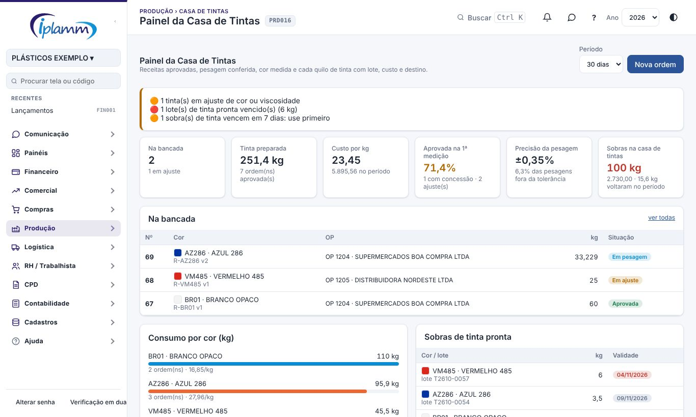

- **Alertas**:
  - ordem parada há mais de 24 h;
  - tinta em ajuste;
  - sobra vencida ou vencendo em 7 dias;
  - receita em teste há mais de 15 dias.
- **Indicadores** do período:
  - **Na bancada**: ordens em preparação.
  - **Tinta preparada**: kg das ordens aprovadas.
  - **Custo por kg**: custo real médio.
  - **Aprovada na 1ª medição**.
  - **Precisão da pesagem**: desvio médio e quanto ficou fora da tolerância.
  - **Sobras**: kg e valor na casa de tintas.
- **Na bancada**: clique numa ordem para abrir a pesagem.
- **Consumo por cor**: kg, ordens e custo por kg de cada cor.
- **Sobras de tinta pronta**: lote por lote, com a validade. A vencida aparece em vermelho.

## 5. Ordens de Preparação

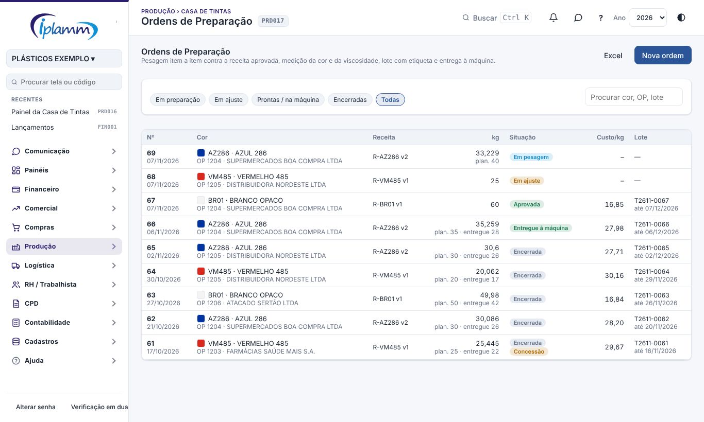

Filtros:

- Em preparação;
- Em ajuste;
- Prontas / na máquina;
- Encerradas;
- Todas.

A lista mostra a cor, a receita, os kg (o real e o planejado), a situação, o custo por kg e o lote com a validade.

### 5.1 Nova ordem

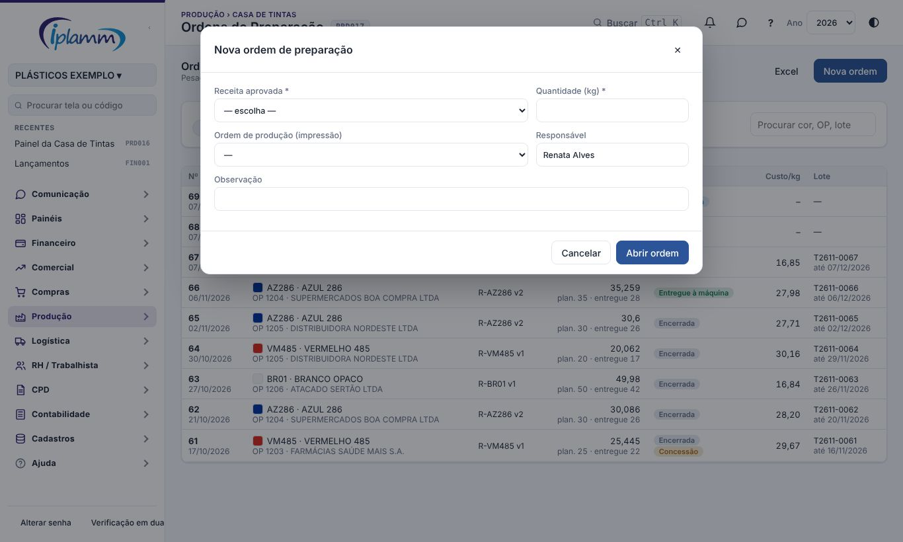

1. Clique em **Nova ordem**.
2. Escolha a **receita**. Só aparecem as receitas com versão aprovada.
3. Informe a **quantidade (kg)**. A janela mostra:
   - o custo teórico;
   - quanto vai de cada insumo;
   - a **sobra desta cor** que já está na casa de tintas. Aproveite a sobra e reduza a quantidade nova.
4. Ligue a ordem à **OP da impressão** e informe o responsável.
5. Clique em **Abrir ordem**.

### 5.2 Pesagem

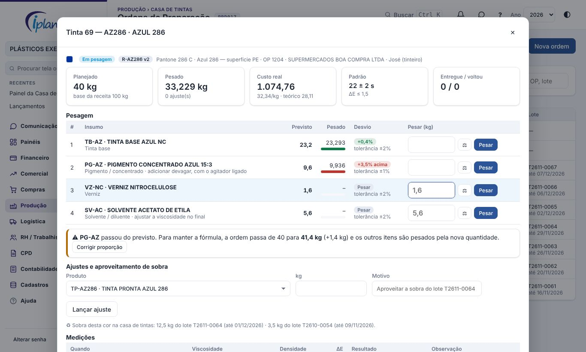

1. Os itens aparecem na **ordem de adição** da receita. A linha destacada é a próxima a pesar.
2. Pese e digite o peso no campo **Pesar (kg)**, ou clique em **⚖** para ler da balança. Clique em **Pesar** ou tecle Enter.
3. Cada pesagem sai do estoque na hora, pelo custo médio.
4. A barra e o **Desvio** mostram o andamento de cada item:
   - **verde**: dentro da tolerância;
   - **amarelo**: falta completar;
   - **vermelho**: passou do previsto.
5. Peso acima da tolerância pede **justificativa**.

**Balança:** no Chrome ou no Edge do computador, o botão ⚖ lê a balança ligada na porta USB/serial, em modo contínuo ou por pedido. Na primeira vez, o navegador pede para escolher a porta. A velocidade (baud) fica nos Parâmetros. No celular e nos outros navegadores, o peso é digitado. O histórico marca com ⚖ as pesagens lidas da balança.

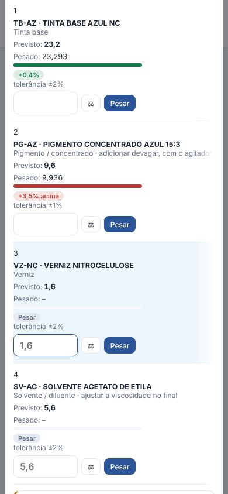

### 5.3 Correção de proporção e ajustes

- **Corrigir proporção**: quando um item passa do previsto, a ficha mostra a nova quantidade da ordem que mantém a fórmula. Por exemplo: o pigmento passou 3,5%, então a ordem vai de 40 para 41,4 kg.
  - Clique em **Corrigir proporção**. A ordem cresce na mesma proporção, e os demais itens passam a ser pesados pela nova quantidade.
  - Assim a cor não sai do tom, e não é preciso jogar tinta fora.
- **Lançar ajuste**: é a adição fora da receita, por exemplo mais solvente para baixar a viscosidade. Informe o produto, os kg e o motivo.
- **Aproveitar sobra**: no ajuste, escolha a **tinta pronta** da mesma cor, por exemplo TP-AZ286. A sobra sai do lote da casa de tintas.

### 5.4 Medições e aprovação

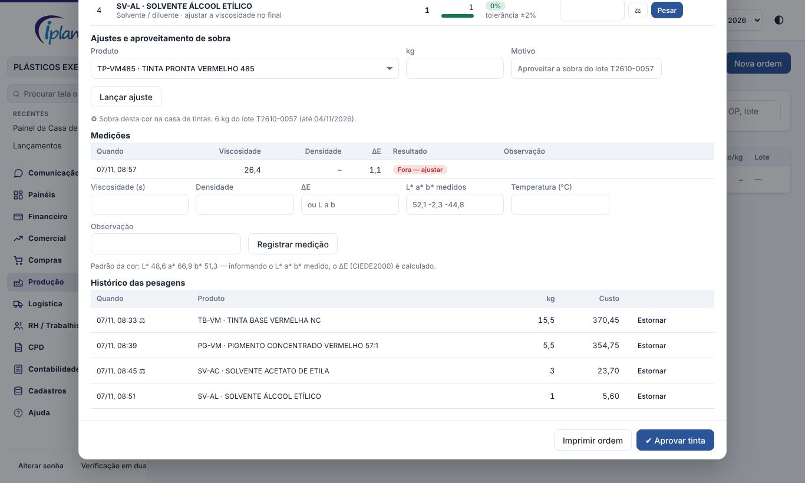

1. Meça e registre a **viscosidade** (s, pelo método da receita), a **densidade** e o **ΔE**.
   - Quando a cor tem o L* a* b* do padrão, informe o **L* a* b* medido** no espectrofotômetro. O ΔE (CIEDE2000) é calculado.
2. A medição é comparada com a versão:
   - viscosidade alvo ± tolerância;
   - densidade alvo ± tolerância;
   - ΔE máximo.

   Medição fora deixa a ordem **Em ajuste**: faça o ajuste e meça de novo.
3. Clique em **Aprovar tinta**. A plataforma confere duas coisas:
   - todos os itens pesados e nenhum abaixo da tolerância;
   - a **última medição** dentro do padrão.

   Fora disso, só quem aprova receitas aprova, **com concessão** e o motivo registrado.
4. Na aprovação, a plataforma:
   - grava o **lote** (T + ano/mês + nº da ordem);
   - calcula a **validade**;
   - calcula o **custo real** (soma das pesagens);
   - com o estoque implantado, dá **entrada da tinta pronta no local Casa de tintas**, pelo custo real.

### 5.5 Lote, etiqueta, entrega e retorno

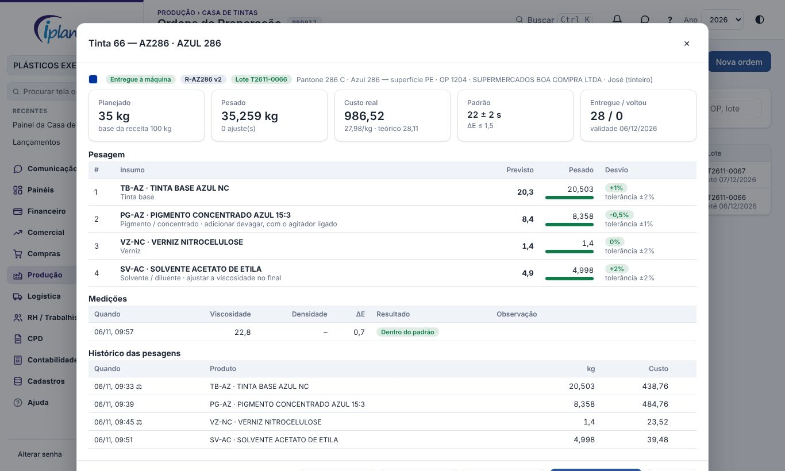

- **Etiqueta do lote**: 10 × 7 cm, com a cor, o lote, o peso, a validade, a receita, a OP, a viscosidade e o ΔE. O **QR** abre a ordem na plataforma.
- **Entregar à máquina**: informe os kg. A tinta vai da Casa de tintas para o "em processo" da impressão.
- **Retorno de sobra**: pese o balde que voltou e informe os kg. A tinta volta para a Casa de tintas e fica disponível para outras ordens.
- **Encerrar**: fecha a ordem. A sobra continua no estoque.
- **Estornar** uma pesagem, antes da aprovação, devolve o insumo ao estoque.
- **Cancelar** só é possível sem pesagens.

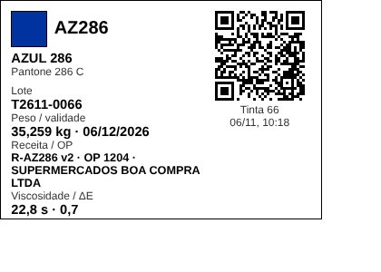

### 5.6 Ordem impressa

**Imprimir ordem** gera a ficha para a bancada:

- identificação;
- pesagem na ordem de adição, com previsto, tolerância, pesado e visto;
- medições;
- as assinaturas do tinteiro e da aprovação da cor.

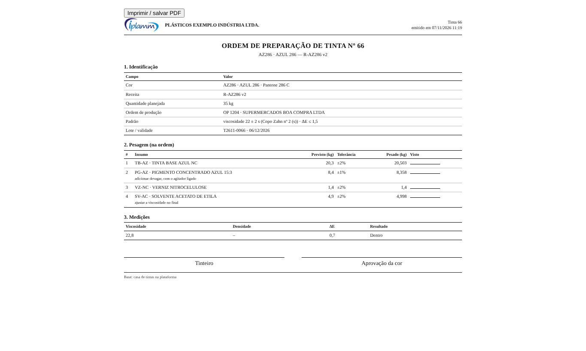

## 6. Cores e Receitas

### 6.1 Cores

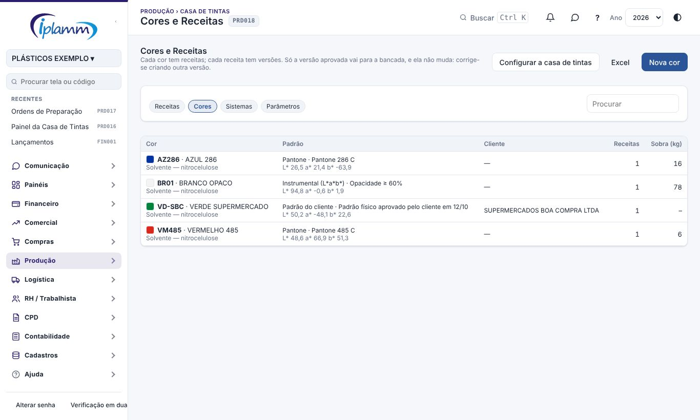

| Campo | Para que serve |
|---|---|
| Código e nome | Identificação, por exemplo AZ286 · AZUL 286. |
| Padrão | Pantone, padrão do cliente ou instrumental. |
| Referência | "Pantone 286 C", "padrão físico aprovado pelo cliente em 12/10". |
| L* a* b* | Coordenadas do padrão. Com elas, o ΔE é calculado pela medição do espectrofotômetro. |
| Cor na tela | A amostra que aparece nas listas e na etiqueta. |
| Sistema | Nitrocelulose, poliuretano, base água, UV… |
| Cliente | Para cor exclusiva de um cliente. |

O produto **tinta pronta** da cor (TP-código) é criado na primeira aprovação, se o parâmetro estiver ligado.

### 6.2 Receitas e versões

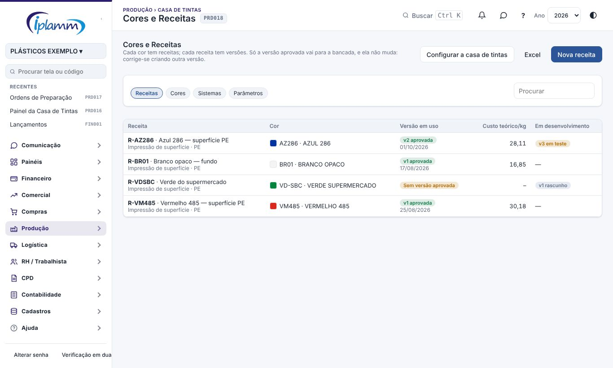

1. Clique em **Nova receita**: código, nome, cor, aplicação (superfície, laminação, verso) e substrato. A **versão 1** abre em rascunho.
2. Na versão, informe:
   - a **base (kg)**: as quantidades dos itens são para esta base, normalmente 100 kg;
   - o **padrão**: viscosidade alvo e tolerância, com o método (Copo Zahn, Ford), densidade e ΔE máximo.
3. Monte a **composição**. Para cada insumo, informe:
   - a função;
   - os kg na base;
   - a tolerância do item, por exemplo 1% para pigmento;
   - a instrução, por exemplo "adicionar devagar, com o agitador ligado".

   As setas mudam a **ordem de adição**.
4. A tela mostra o **%** de cada item, se a soma **fecha a base** e o **custo teórico por kg**, pelo custo médio do estoque ou pelo último preço de compra.
5. Os botões da versão são:
   - **Enviar para teste**: marca a versão que está sendo validada.
   - **Aprovar versão**: só quem aprova. A versão aprovada anterior fica **obsoleta**.
   - **Nova versão**: copia a versão atual, com o motivo, por exemplo troca do fornecedor do pigmento ou tom pedido pelo cliente.
   - **Comparar com a versão aprovada**: mostra, item a item, a diferença em pontos percentuais.
   - **Bloquear**: suspende a receita. Nenhuma ordem nova pode usá-la.

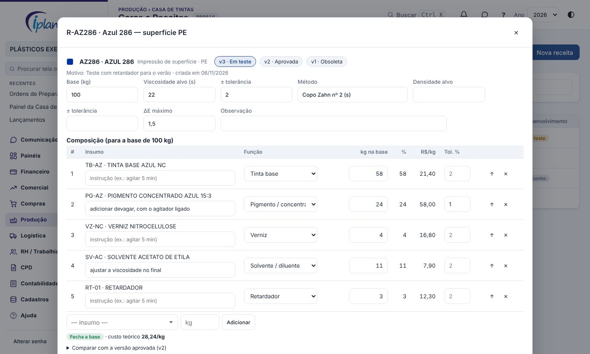

## 7. Parâmetros

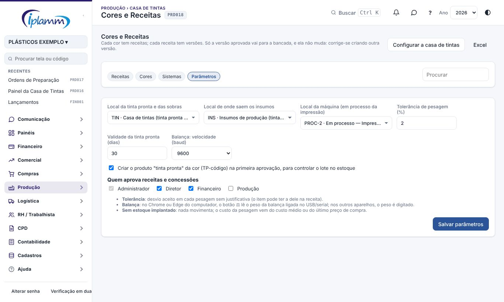

| Parâmetro | O que faz | Padrão |
|---|---|---|
| Local da tinta pronta e das sobras | Onde entram os lotes aprovados e as sobras | TIN |
| Local de onde saem os insumos | Vazio: o local padrão de cada produto | INS |
| Local da máquina | Para onde vai a tinta entregue (em processo da impressão) | Em processo — Impressão |
| Tolerância de pesagem | Desvio aceito sem justificativa. O item pode ter a dele. | 2% |
| Validade da tinta pronta | Dias a partir da aprovação | 30 |
| Balança: velocidade | Baud da porta serial | 9600 |
| Criar o produto "tinta pronta" | Cria TP-código da cor na primeira aprovação, para controlar o lote | Ligado |
| Quem aprova | Aprova receita, bloqueia e aprova tinta com concessão | Administrador, diretor e financeiro |

## 8. Estoque e custo

| Momento | No estoque (com o estoque implantado) |
|---|---|
| Pesagem de insumo | Requisição para a produção (REQPROD) do local dos insumos, pelo custo médio |
| Pesagem de sobra | Requisição do lote da tinta pronta, no local Casa de tintas |
| Estorno da pesagem | Estorno do movimento (o insumo volta pelo mesmo custo) |
| Aprovação | Entrada de produção (PROD) da tinta pronta, com lote e validade, pelo custo real |
| Entrega à máquina | Transferência da Casa de tintas para o em processo da impressão |
| Retorno da sobra | Transferência de volta para a Casa de tintas |
| Tinta vencida | Perda pelo Kardex (tipo PERDA) |

**Antes da implantação do estoque**, nada movimenta. O custo da pesagem sai do custo médio ou do último preço de compra, e a ordem guarda o lote, o custo e as quantidades.

## 9. Indicadores

| Indicador | Como é calculado |
|---|---|
| Tinta preparada | kg reais das ordens aprovadas no período |
| Custo por kg | Custo real ÷ kg reais das ordens aprovadas |
| Aprovada na 1ª medição | Ordens aprovadas com uma medição só, e dentro ÷ ordens aprovadas |
| Precisão da pesagem | Média do desvio absoluto das pesagens de receita e % fora da tolerância |
| Sobras | kg e valor dos lotes de tinta pronta na casa de tintas; kg que voltaram da máquina no período |
| Consumo por cor | kg, ordens e custo por kg por cor |

## 10. Regras e travas

- Ordem só de **versão aprovada**, e há uma versão aprovada por receita.
- A versão aprovada não muda: nem itens, nem base, nem padrão. Corrige-se criando outra versão.
- Uma versão em rascunho ou em teste por receita de cada vez.
- Peso acima da tolerância exige justificativa. O ajuste fora da receita exige motivo.
- Aprovação da tinta:
  - exige todos os itens pesados, nenhum abaixo da tolerância e a última medição dentro;
  - fora disso, só com concessão de quem aprova.
- Lote, custo, quantidades e situação mudam só pelos botões. A quantidade planejada muda só pela correção de proporção, depois da primeira pesagem.
- Pesagem não se estorna depois da aprovação, e a ordem com pesagem não se cancela.
- O retorno não pode ser maior que o entregue. A entrega não pode ser maior que o lote.
- Todas as alterações ficam na auditoria.

## 11. Perguntas frequentes

**Errei o peso.** Antes da aprovação, use **Estornar** no histórico das pesagens e pese de novo. O insumo volta ao estoque.

**O pigmento passou do previsto.** Use **Corrigir proporção**: a ordem cresce na mesma proporção e a cor fica no tom. Jogar tinta fora ou "compensar no olho" sai mais caro.

**A balança não lê.** Confira três coisas:

- o navegador é o Chrome ou o Edge do computador;
- o cabo está ligado;
- a velocidade (baud) dos Parâmetros é a da balança, e ela está em modo contínuo.

Se ainda não ler, digite o peso: a pesagem vale do mesmo jeito.

**Como uso a sobra?** Na ficha da ordem, em **Ajustes e aproveitamento de sobra**, escolha a tinta pronta da cor (TP-…), informe os kg e o motivo. Use a sobra mais antiga primeiro: o Painel avisa a que vence em 7 dias.

**Por que o custo real é diferente do teórico?** O teórico usa o custo médio de hoje e a receita exata. O real usa o que foi pesado (com os ajustes) pelo custo de cada saída.

## 12. Histórico de alterações

| Versão | Data | O que mudou |
|---|---|---|
| 1.0 | 07/11/2026 | Primeira versão. Inclui cores com L* a* b*, receitas com versões e aprovação, ordem de preparação com pesagem na ordem de adição, tolerância, leitura da balança, correção de proporção, ajustes e aproveitamento de sobra, medições com ΔE CIEDE2000, aprovação com concessão, lote com etiqueta e QR, entrega e retorno da sobra, ordem impressa, estoque oficial e Decision Center. |
