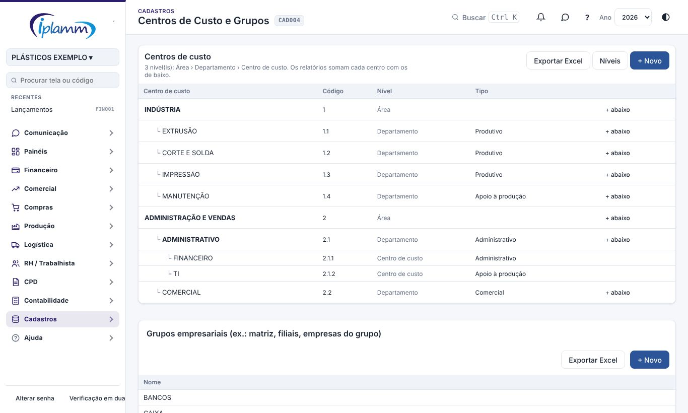
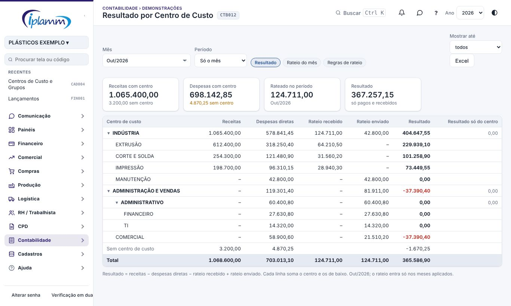
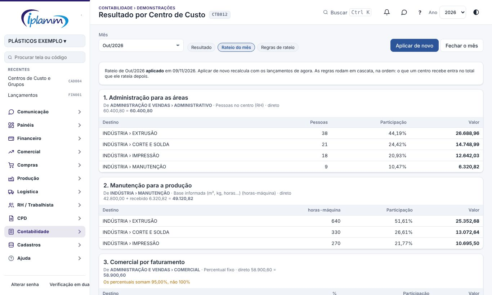
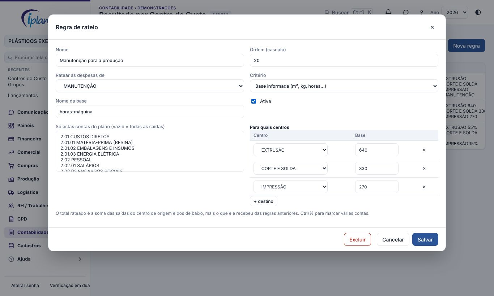

## 1. Para que serve

Organiza os centros de custo em **níveis** (padrão: **Área › Departamento › Centro de custo**) e mostra o **resultado de cada nível**. As despesas dos centros que não produzem (administração, manutenção, TI) podem ser **rateadas** para os que produzem, por regras cadastradas.

O rateio é **gerencial**: os lançamentos continuam no centro original; a distribuição fica gravada à parte, mês a mês.

Veem o resultado e o rateio o administrador, o diretor e o financeiro. Aplicam e fecham o rateio o administrador e o financeiro. Só o administrador cria as regras, muda os níveis e reabre um mês fechado.

## 2. Montar a árvore

Em **Cadastros › Centros de Custo**:

- **+ Novo** cria um centro no primeiro nível; **+ abaixo** cria um centro dentro de outro;
- clique no centro para mudar o nome, o **código** (opcional, ordena a lista), o centro de cima (**Fica abaixo de**), o **tipo** (produtivo, apoio, administrativo, comercial) e se está ativo;
- mover um centro leva junto os de baixo;
- um centro não pode ficar abaixo dele mesmo nem passar do último nível.

Os centros que já existiam ficam no primeiro nível até serem movidos.

## 3. Níveis (administrador)

Em **Níveis**: quantidade de níveis (1 a 5, padrão 3), o nome de cada nível, se os relatórios e o rateio usam **só os pagos e recebidos** ou também os **em aberto** (pela data), e o aviso para lançamentos em centros que têm centros abaixo.

## 4. Resultado por centro de custo

Em **Contabilidade › Resultado por Centro de Custo**, aba **Resultado**: escolha o **mês** e o **período** (só o mês ou o ano até o mês). Para cada centro:

| Coluna | O que mostra |
|---|---|
| Receitas | entradas lançadas no centro e nos de baixo |
| Despesas diretas | saídas lançadas no centro e nos de baixo |
| Rateio recebido | o que outros centros ratearam para ele |
| Rateio enviado | o que ele rateou para outros |
| Resultado | receitas − despesas − recebido + enviado |
| Resultado só do centro | o mesmo, sem os de baixo (nas linhas que têm centros abaixo) |

Clique numa área para abrir ou fechar os centros dela; **Mostrar até** limita o nível. Lançamentos sem centro aparecem numa linha própria. **Excel** baixa a tabela.

## 5. Rateio do mês

A aba **Rateio do mês** mostra a prévia de cada regra, **na ordem**: o total do centro de origem (o que foi lançado nele e nos de baixo, mais o que ele recebeu de regras anteriores) e a parte de cada destino.

- **Aplicar o rateio** grava a distribuição do mês. **Aplicar de novo** recalcula com os lançamentos de agora.
- Regras com aviso (percentuais que não somam 100%, sem pessoas, base zerada) ficam de fora; a tela pergunta antes.
- Os centavos de arredondamento vão para o destino de maior peso.
- **Fechar o mês** trava o rateio; só o administrador **reabre**.

## 6. Regras de rateio (administrador)

Na aba **Regras de rateio**, **Nova regra**:

| Campo | Para que serve |
|---|---|
| Ordem | a sequência da cascata (a manutenção que recebe da administração rateia depois dela) |
| Ratear as despesas de | o centro de origem (com os de baixo) |
| Critério | **percentual fixo** (somando 100%), **pessoas** no centro, **salários** do centro (de RH › Colaboradores) ou **base informada** (m², kg produzidos, horas-máquina…) |
| Só estas contas do plano | limita às contas marcadas (vazio = todas as saídas) |
| Destinos | os centros que recebem, com o percentual ou a base de cada um |

Pessoas e salários contam os colaboradores ativos no fim do mês ligados ao centro de destino ou aos de baixo dele.

## 7. Problemas comuns

**O resultado não mudou depois de cadastrar a regra.** O rateio só entra no resultado depois de **Aplicar o rateio** no mês.

**"Sem base para ratear".** Ninguém do RH está nos centros de destino (critério pessoas ou salários) ou as bases estão zeradas.

**Não consigo diminuir os níveis.** Há centros abaixo do novo limite: mova-os antes.

## 8. Histórico de alterações

| Versão | Data | O que mudou |
|---|---|---|
| 1.0 | 08/11/2026 | Primeira versão: centros em níveis com nomes configuráveis, resultado por nível, rateio em cascata (percentual, pessoas, salários ou base), aplicar e fechar o mês (melhoria 9.5). |
