## 1. Para que serve

A tela controla os dois tipos de cheque da empresa, do começo ao fim:

- **cheques de terceiros**, recebidos de clientes: ficam em carteira até a data "bom para", são depositados, compensam ou voltam; os devolvidos são reapresentados, pagos pelo cliente, cobrados ou baixados como perda. O cheque em carteira também pode ser **repassado a um fornecedor** ou **enviado ao FIDC** dentro de uma Proposta de Borderô;
- **cheques próprios**, emitidos pela empresa: talões, folhas usadas e livres, emissão ligada aos títulos a pagar, compensação, cancelamento e sustação.

Cada cheque tem histórico (quem fez o quê e quando), e a tela mostra o que precisa de ação hoje: cheque pronto para depositar, prazo de apresentação acabando, devolvido parado e cheque próprio que vai cair na conta.

## 2. Quem tem acesso

| Perfil | O que faz |
|---|---|
| Administrador e Financeiro | Recebem, depositam, baixam, emitem, cancelam e alteram os parâmetros |
| Demais perfis com acesso ao Financeiro | Consultam |

Toda movimentação fica na Auditoria. Receber cheque acima do limite do cliente é permitido só ao administrador.

## 3. Visão geral da tela

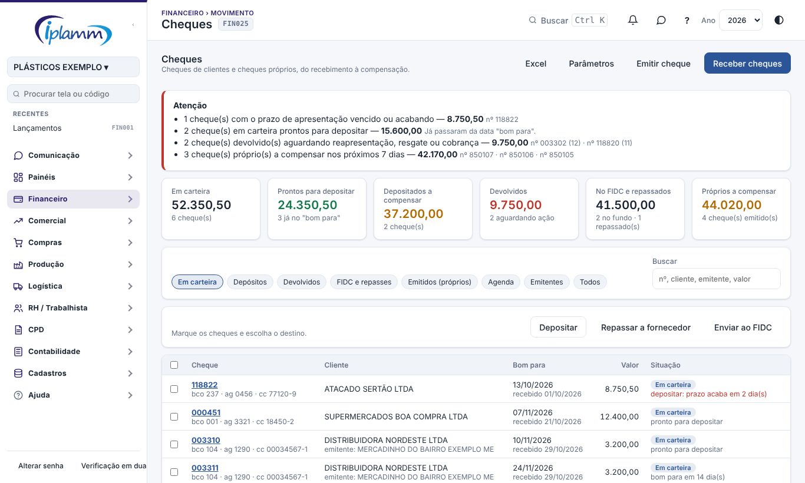

1. **Atenção**: o que precisa de ação. Os mesmos avisos aparecem na Central de Decisões (regra 28).
2. **Indicadores**: valor em carteira, pronto para depositar, depositado a compensar, devolvido, no FIDC e repassado, e cheques próprios a compensar. Clicar em um indicador abre a aba correspondente.
3. **Abas**: Em carteira, Depósitos, Devolvidos, FIDC e repasses, Emitidos (próprios), Agenda, Emitentes e Todos.
4. **Buscar**: por número, cliente, emitente ou valor. **Excel** exporta a tabela da aba aberta.

Na primeira vez a tela pede **Configurar padrão** (item 10).

Situações de um cheque de terceiros:

| Situação | Significado |
|---|---|
| Em carteira | Está com a empresa, aguardando depósito, repasse ou envio ao FIDC |
| Depositado | Entrou no banco e aguarda a compensação |
| Compensado | Compensou (ou o fundo ou o fornecedor recebeu). Encerrado |
| Devolvido | Voltou e aguarda uma decisão |
| No FIDC | Cedido a um fundo em uma proposta aprovada |
| Repassado | Entregue a um fornecedor como pagamento |
| Resgatado | O cliente pagou o cheque devolvido por outro meio. Encerrado |
| Em cobrança | Virou título a receber contra o cliente |
| Perda | Baixado sem receber. Encerrado |

## 4. Receber cheques

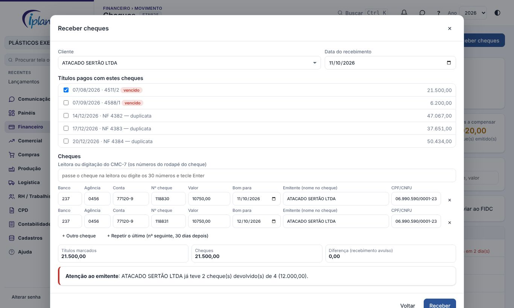

1. Clique em **Receber cheques** e escolha o **cliente** e a **data do recebimento**.
2. Marque os **títulos** que os cheques estão pagando. Sem título marcado, o valor entra como recebimento avulso na conta do plano escolhida.
3. Informe os cheques:
   - com **leitora**, passe o cheque no campo CMC-7 (ou digite os 30 números do rodapé e tecle Enter). Banco, agência, conta e número são preenchidos, e a tela avisa se os dígitos de conferência não batem;
   - sem leitora, digite banco, agência, conta e número;
   - informe o **valor** e a data **bom para** (a data em que o cheque pode ser depositado);
   - **Emitente** e **CPF/CNPJ** são de quem assinou o cheque, que pode não ser o cliente (cheque de terceiro endossado).
4. Para cheques em sequência, **Repetir o último** cria o próximo com o número seguinte e 30 dias a mais.
5. Confira as somas e clique em **Receber**.

Regras do recebimento:

- a soma dos cheques não pode ser **menor** que a dos títulos marcados. Se o cliente pagou só uma parte, divida o título antes ou receba a diferença de outra forma;
- se a soma for **maior**, a diferença entra como recebimento avulso;
- o mesmo cheque (banco, agência, conta e número) não entra duas vezes;
- se o emitente já teve cheque devolvido, aparece o aviso **Atenção ao emitente** com o histórico;
- com limite por cliente definido, a tela avisa quando ele é ultrapassado.

Clicar no número do cheque abre o **detalhe**: prazos, títulos do recebimento, histórico e imagem do cheque (foto ou PDF). Enquanto o cheque está em carteira, dá para corrigir os dados ou **cancelar o recebimento** (os títulos voltam a ficar em aberto no vencimento original). O valor não é editável: cancele e receba de novo.

## 5. Depósitos

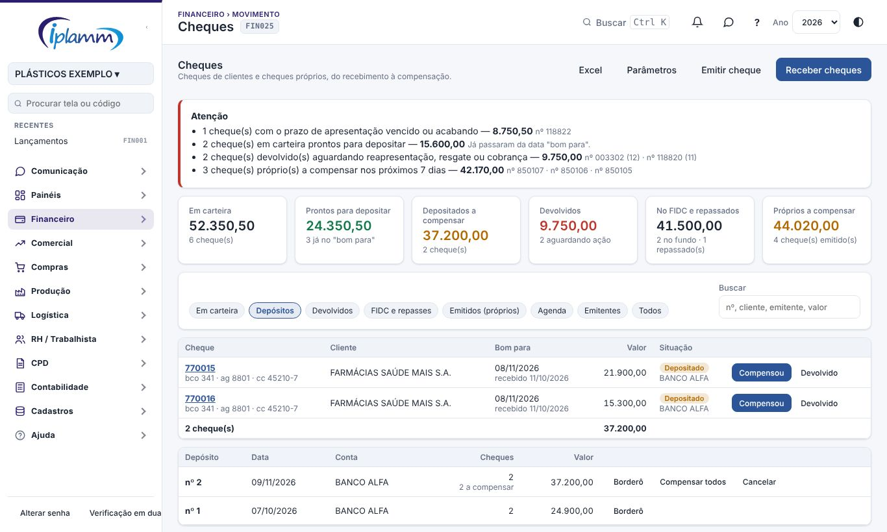

1. Na aba **Em carteira**, marque os cheques e clique em **Depositar**.
2. Escolha a **conta** e a **data**. A plataforma gera o **borderô de depósito** numerado.
3. Na aba **Depósitos**, o botão **Borderô** gera o PDF com a relação dos cheques para entregar ao banco.
4. Quando o cheque compensar, clique em **Compensou** (ou **Compensar todos** no depósito). Se voltar, clique em **Devolvido** e informe a alínea e, se houver, a tarifa cobrada pelo banco.

Um cheque só pode ser depositado a partir da data "bom para". O depósito pode ser **cancelado** enquanto nenhum cheque dele foi compensado ou devolvido.

## 6. Devolvidos

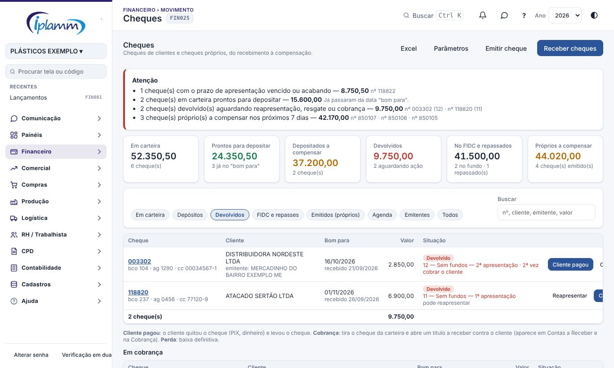

Para cada cheque devolvido, escolha um caminho:

| Botão | Quando usar | O que acontece |
|---|---|---|
| Reapresentar | Primeira devolução por falta de fundos (alínea 11) e outras que permitem nova apresentação | Novo depósito |
| Cliente pagou | O cliente quitou por PIX, dinheiro ou transferência e leva o cheque | O valor entra na conta informada; juros e multa são lançados à parte |
| Cobrança | O cheque não será reapresentado | Sai da carteira e abre um **título a receber** contra o cliente, que segue a régua da tela Cobrança |
| Perda | Não há mais como receber | Baixa definitiva, com motivo |

A tela indica o caminho sugerido em cada linha: "pode reapresentar", "cobrar o cliente" ou "prescrito para execução". O número de reapresentações permitidas fica nos Parâmetros.

## 7. FIDC e repasses

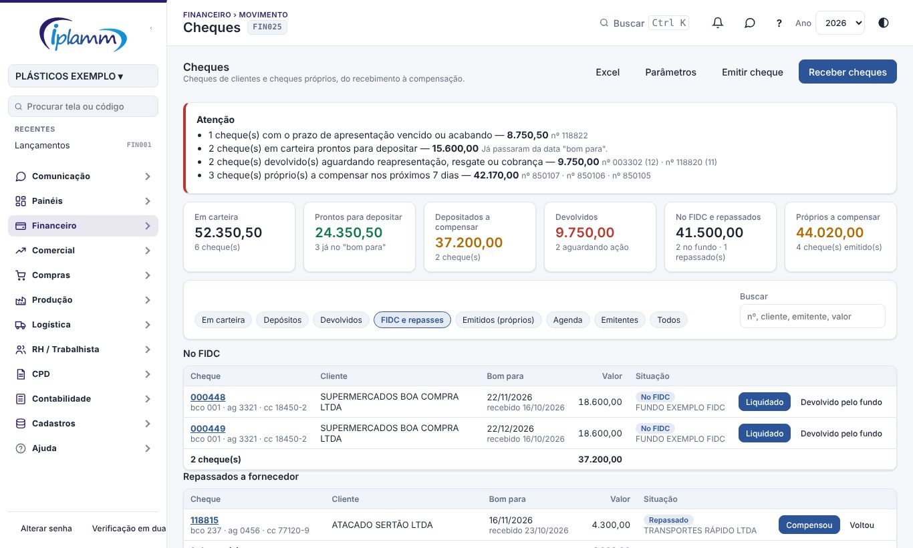

### 7.1 Enviar cheques ao FIDC

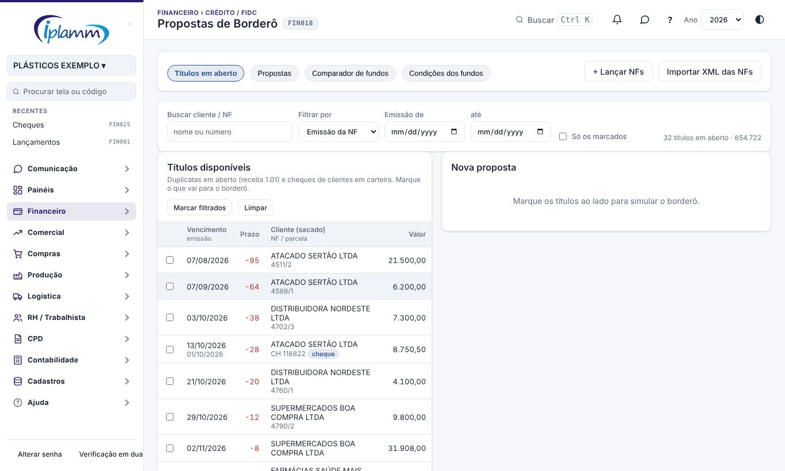

1. Na aba Em carteira, clique em **Enviar ao FIDC** (ou abra Crédito / FIDC › Propostas de Borderô).
2. Os cheques em carteira aparecem na lista de títulos, com a etiqueta **cheque**, o vencimento igual ao "bom para" e o documento "CH número".
3. Marque cheques e duplicatas na mesma proposta, simule e envie para aprovação como sempre.
4. Na **aprovação**, os cheques saem da carteira para a conta do fundo e passam para a situação **No FIDC**; deságio, tarifas e líquido são lançados como em qualquer borderô.

Depois:

- **Liquidado**: o fundo recebeu o cheque. Encerra o cheque;
- **Devolvido pelo fundo**: o cheque volta para a carteira como devolvido e segue o item 6. A recompra cobrada pelo fundo continua sendo registrada em Crédito / FIDC › Recompras.

Enquanto o cheque está em uma proposta em rascunho ou pendente, ele não pode ser depositado nem repassado.

### 7.2 Repassar a fornecedor

1. Na aba Em carteira, marque os cheques e clique em **Repassar a fornecedor**.
2. Escolha o fornecedor e marque os **títulos a pagar** quitados com os cheques. Se sobrar valor, escolha a conta do plano da diferença.
3. Quando o fornecedor confirmar, clique em **Compensou**. Se o cheque voltar, clique em **Voltou**: ele retorna à carteira como devolvido e a dívida com o fornecedor reabre como título a pagar.

## 8. Cheques próprios

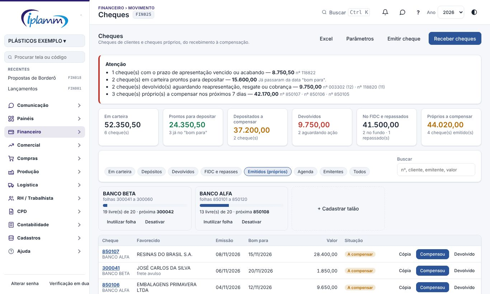

### 8.1 Talões

Cadastre o talão com a conta e a numeração (**+ Cadastrar talão**). A tela mostra as folhas livres e a próxima folha. **Inutilizar folha** registra folha rasurada ou extraviada, que não pode mais ser usada. Sem talão cadastrado, basta informar o número ao emitir.

### 8.2 Emitir

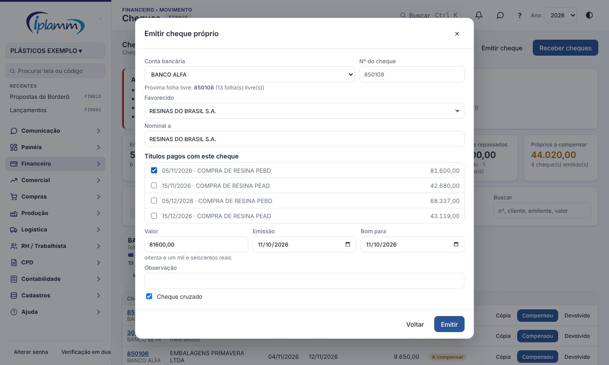

1. Clique em **Emitir cheque** e escolha a **conta**. O número sugerido é a próxima folha livre.
2. Escolha o **favorecido** e marque os **títulos** pagos. O valor do cheque passa a ser a soma dos títulos.
3. Sem título, informe o valor e a **conta do plano** do pagamento.
4. Informe a **emissão** e o **bom para** (para cheque pré-datado). A tela mostra o valor por extenso para conferência.
5. Clique em **Emitir**. A plataforma oferece a **cópia de cheque** em PDF, com os títulos pagos e o campo de recebimento para o favorecido assinar.

### 8.3 Depois da emissão

| Botão | O que acontece |
|---|---|
| Compensou | Informe a data do débito no extrato. O valor sai da conta bancária nesse dia |
| Devolvido | Registra a devolução com a alínea. O título continua baixado até você compensar ou cancelar |
| Cancelar | Os títulos voltam a ficar em aberto no vencimento original. Marque **sustado** se houve contraordem no banco |
| Cópia | Gera de novo a cópia de cheque |

Uma folha usada, cancelada ou sustada não pode ser emitida de novo.

## 9. Agenda de compensação

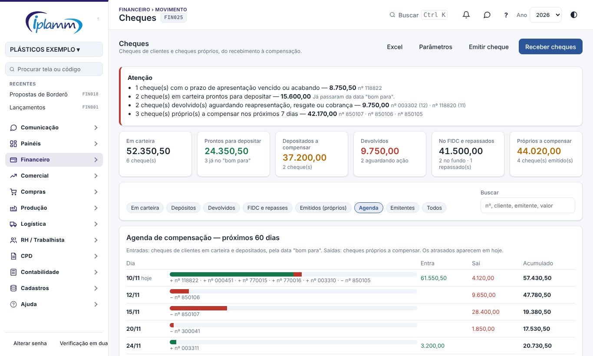

Mostra, para os próximos 60 dias, o que deve **entrar** (cheques de clientes em carteira e depositados, pela data "bom para") e o que deve **sair** (cheques próprios a compensar), com o saldo acumulado. Cheques atrasados aparecem em hoje.

Use a agenda junto com a Necessidade de Caixa: como o título é baixado no momento em que o cheque é recebido ou emitido, é na agenda que aparece o dia em que o dinheiro entra ou sai do banco.

### 9.1 Emitentes

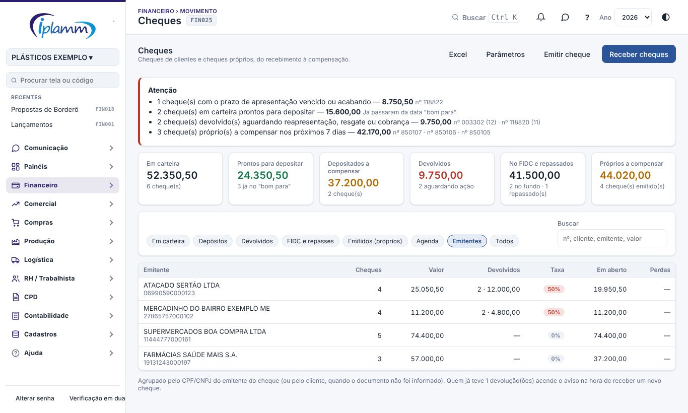

Lista quem emitiu os cheques recebidos, pelo CPF/CNPJ (ou pelo cliente, quando o documento não foi informado): quantidade, valor, devoluções, taxa de devolução, valor em aberto e perdas. É a base do aviso "Atenção ao emitente" no recebimento.

## 10. Parâmetros

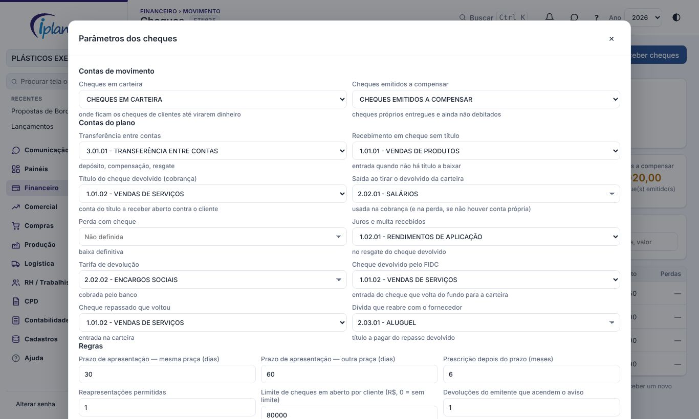

**Configurar padrão** cria as duas contas de movimento e sugere as contas do plano pelos nomes usuais. Pode ser usado de novo: só preenche o que falta. Confira e ajuste:

| Parâmetro | Para que serve | Padrão |
|---|---|---|
| Cheques em carteira | Conta onde ficam os cheques de clientes até virarem dinheiro | criada pelo botão |
| Cheques emitidos a compensar | Conta dos cheques próprios entregues e ainda não debitados | criada pelo botão |
| Contas do plano | Transferência, recebimento sem título, título do cheque devolvido, saída ao tirar o devolvido da carteira, perda, juros, tarifa, devolvido pelo FIDC e repasse devolvido | sugeridas |
| Prazo de apresentação | Dias a partir do "bom para", na mesma praça e em outra praça | 30 e 60 |
| Prescrição | Meses depois do prazo de apresentação | 6 |
| Reapresentações permitidas | Quantas vezes o devolvido pode ser depositado de novo | 1 |
| Limite por cliente | Valor máximo de cheques em aberto do cliente (0 = sem limite) | 0 |
| Devoluções que acendem o aviso | A partir de quantas devoluções o emitente gera aviso | 1 |

Os prazos são um controle gerencial para não perder a data de apresentação. Para decisões de cobrança judicial, confirme os prazos com o jurídico.

## 11. Como fica no caixa

| Evento | Lançamento |
|---|---|
| Receber cheque | O título do cliente é baixado na conta **Cheques em carteira**, na data do recebimento |
| Depositar | Transferência de Cheques em carteira para o banco |
| Compensar | Nenhum (só encerra o cheque) |
| Devolução do depósito | Transferência do banco de volta para a carteira; tarifa como despesa |
| Cliente pagou (resgate) | Transferência da carteira para a conta; juros como receita |
| Cobrança | Saída na carteira e título a receber em aberto contra o cliente |
| Perda | Saída na carteira |
| Repasse | O título do fornecedor é baixado na conta Cheques em carteira |
| Envio ao FIDC | Transferência da carteira para a conta do fundo, na aprovação da proposta |
| Devolvido pelo fundo | Entrada na carteira (a recompra do fundo é registrada em Recompras) |
| Emitir cheque próprio | O título do fornecedor é baixado na conta **Cheques emitidos a compensar** |
| Compensar cheque próprio | Transferência do banco para Cheques emitidos a compensar |

Consequências:

- o saldo da conta Cheques em carteira é sempre a soma dos cheques em carteira e devolvidos; o da conta Cheques emitidos a compensar é o negativo dos cheques próprios ainda não debitados;
- o saldo do banco só muda no depósito, na devolução, no resgate e na compensação, nas datas do extrato, o que mantém a Conciliação Bancária batendo;
- o título fica como pago assim que o cheque é recebido ou emitido. Por isso o cheque pré-datado sai de Contas a Receber e da Necessidade de Caixa; a previsão de entrada passa a ser a Agenda (item 9).

## 12. Perguntas frequentes e erros comuns

**"Configure o Controle de Cheques primeiro".** Falta o Configurar padrão ou a conta de transferência nos Parâmetros.

**"Os cheques somam menos que os títulos".** Marque menos títulos, divida o título em Lançamentos ou receba a diferença por outro meio antes.

**"Cheque ainda não chegou na data bom para".** O depósito só é aceito a partir dessa data. Se o cliente autorizou antecipar, corrija o "bom para" no detalhe do cheque.

**"Algum cheque está numa proposta de borderô".** Tire o cheque da proposta (ou exclua a proposta) antes de depositar, repassar ou cancelar o recebimento.

**"Falta definir uma conta do plano nos Parâmetros".** A ação precisa de uma conta do plano que ainda não foi escolhida (por exemplo, a de saída para a cobrança). Abra Parâmetros e defina.

**Recebi o cheque no título errado.** Abra o detalhe e use Cancelar o recebimento, enquanto os cheques ainda estão em carteira. Depois receba de novo.

**O cheque compensou e depois voltou.** Na aba **Todos**, o cheque compensado em depósito tem o botão **Voltou**, que registra a devolução normalmente.

**O cheque de terceiros não aparece na proposta de borderô.** Só entram cheques na situação Em carteira e fora de outra proposta em aberto.

**Emiti um cheque com o número errado.** Cancele o cheque (os títulos reabrem) e emita de novo. A folha cancelada fica registrada.

## 13. Histórico de alterações

| Versão | Data | O que mudou |
|---|---|---|
| 1.0 | 10/11/2026 | Primeira versão: cheques de terceiros (carteira, depósito com borderô, compensação, devolução, reapresentação, resgate, cobrança, perda, repasse e FIDC), cheques próprios (talões, emissão, cópia, compensação, cancelamento e sustação), agenda, emitentes e parâmetros. |
