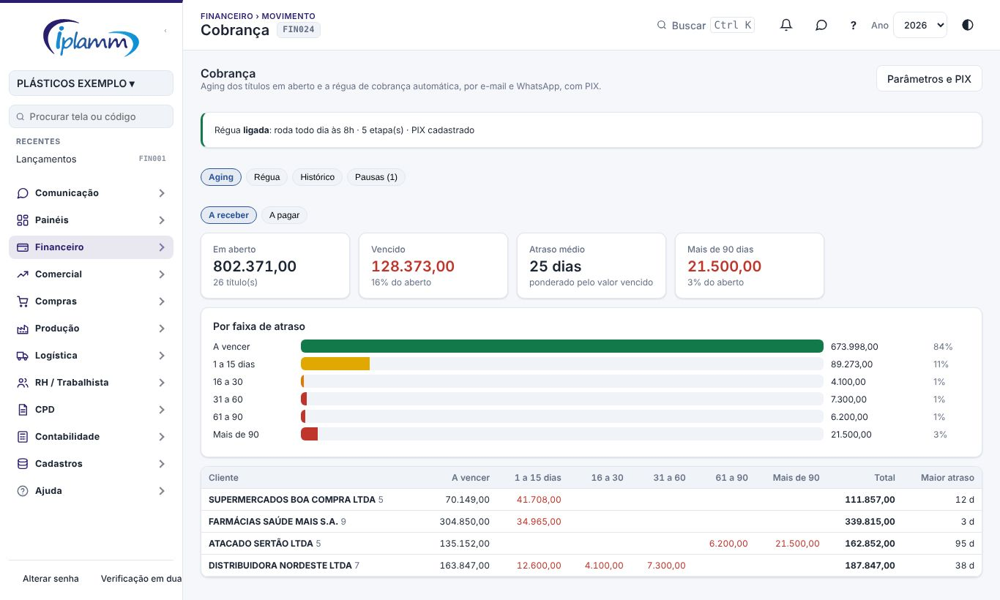
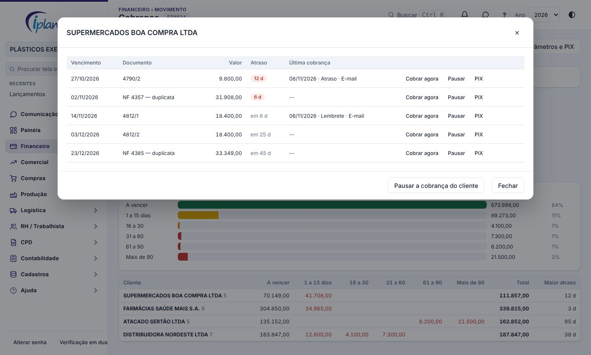
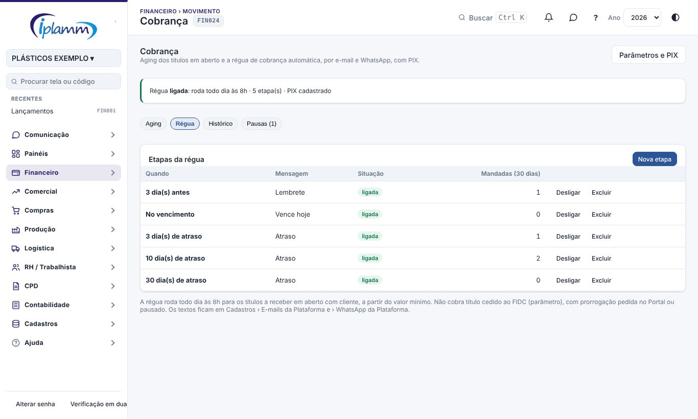
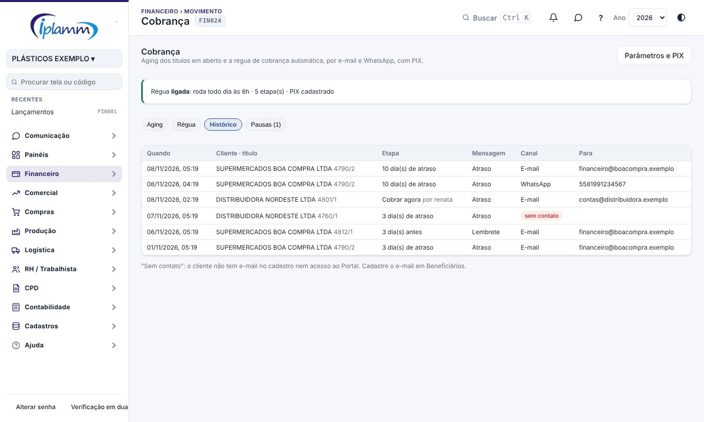
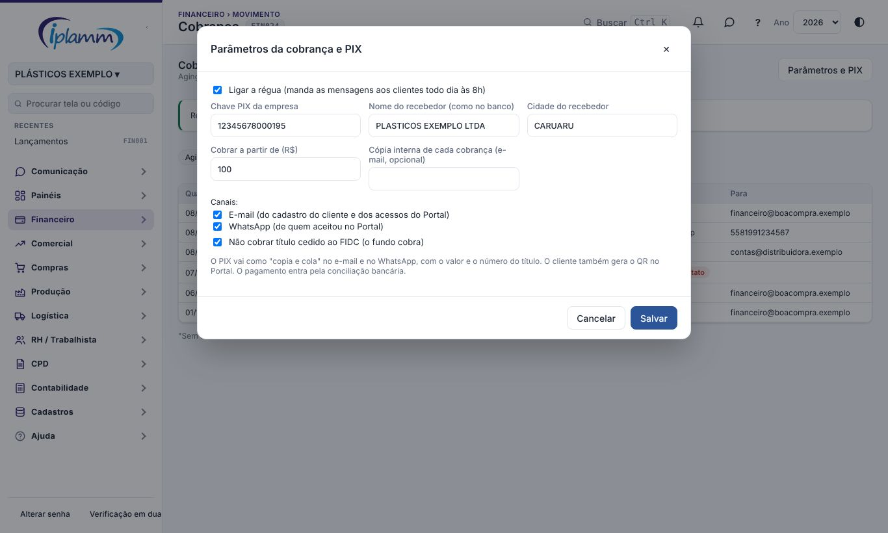

## 1. Para que serve

A tela reúne a cobrança dos clientes:

- o **aging**, que mostra o que está em aberto por faixa de atraso e por cliente (e também o a pagar, por fornecedor);
- a **régua de cobrança**, que manda sozinha um lembrete antes do vencimento, um aviso no dia e a cobrança depois do vencimento, por **e-mail** e **WhatsApp**, com o **PIX copia e cola** do título;
- as **pausas**, o **histórico** do que foi mandado e o botão **Cobrar agora**.

No **Portal do Cliente**, cada título em aberto tem o botão **Pagar com PIX**, com o QR e o copia e cola.

## 2. Quem tem acesso

| Perfil | O que faz |
|---|---|
| Administrador e financeiro | Montam a régua, ligam, pausam, cobram na hora e cadastram o PIX. |
| Diretor e leitura | Consultam o aging e o histórico. |
| Cliente do Portal | Paga com PIX o título dele. |

## 3. Aging

Escolha **A receber** ou **A pagar**. A tela mostra:

- **indicadores**: total em aberto, quanto está vencido, o atraso médio (ponderado pelo valor) e o que passou de 90 dias;
- **por faixa de atraso**: a vencer, 1 a 15 dias, 16 a 30, 31 a 60, 61 a 90 e mais de 90;
- **por cliente** (ou fornecedor): as faixas, o total e o maior atraso, do maior vencido para o menor.

### 3.2 Os títulos de um cliente

Clique no cliente para ver os títulos dele, com a última cobrança mandada. Em cada título:

- **Cobrar agora** manda a cobrança na hora: atraso, vence hoje ou lembrete, conforme o vencimento. Pode ser usado uma vez a cada 12 horas por título;
- **Pausar** suspende a régua daquele título até uma data, com o motivo;
- **PIX** copia o código copia e cola do título, para colar numa conversa com o cliente.

**Pausar a cobrança do cliente** suspende todos os títulos dele, por exemplo durante uma negociação. Título cedido ao FIDC aparece marcado e não é cobrado.

## 4. Régua

Na primeira vez, use **Usar a régua padrão**. Ela cria as etapas:

- 3 dias antes do vencimento;
- no vencimento;
- 3, 10 e 30 dias de atraso.

Inclua, desligue ou exclua etapas como preferir.

A régua roda **todo dia às 8h**. Para cada etapa, manda a mensagem aos títulos a receber que estão naquele ponto. As mensagens vão:

- por **e-mail** ao e-mail do cadastro do cliente e aos acessos dele no Portal;
- por **WhatsApp** a quem aceitou no Portal.

Cada mensagem leva o PIX copia e cola com o valor e o número do título.

A régua **não cobra**:

- título abaixo do valor mínimo;
- título cedido ao FIDC (parâmetro);
- título com prorrogação pedida no Portal e ainda não respondida;
- cliente ou título pausado.

A mesma etapa nunca sai duas vezes para o mesmo título. Se o agendamento falhar um dia, a etapa sai até 2 dias depois. Uma etapa antiga não sai depois de uma mais nova.

Os textos ficam em **Cadastros › E-mails da Plataforma** (Cobrança: lembrete, vence hoje e atraso) e **› WhatsApp da Plataforma**.

## 5. Histórico

O histórico mostra, para cada cobrança: quando, o cliente e o título, a etapa (ou "Cobrar agora", com quem mandou), a mensagem, o canal e o destino.

**Sem contato** quer dizer que o cliente não tem e-mail no cadastro nem acesso ao Portal. Cadastre o e-mail em Beneficiários.

## 6. Pausas

A aba **Pausas** lista as pausas ativas, com o cliente ou o título, a data final, o motivo e quem pausou. **Retomar** encerra a pausa antes da data.

## 7. Parâmetros e PIX

Em **Parâmetros e PIX** (administrador e financeiro):

| Parâmetro | O que faz |
|---|---|
| Ligar a régua | Começa a mandar as mensagens aos clientes. Monte as etapas antes. |
| Chave PIX, nome e cidade do recebedor | Formam o PIX copia e cola (BR Code do Banco Central). O nome deve ser o mesmo que aparece no banco. |
| Cobrar a partir de (R$) | Títulos menores não entram na régua. |
| Cópia interna | Um e-mail da empresa que recebe uma cópia de cada cobrança. |
| Canais | E-mail e/ou WhatsApp. |
| Não cobrar título cedido ao FIDC | O fundo cobra. Ligado por padrão. |

O PIX é **estático**: o banco não avisa a plataforma do pagamento. A baixa entra, como hoje, pela conciliação bancária. O número do título vai no identificador do PIX, o que ajuda a conciliar.

## 8. Regras e travas

- Só administrador e financeiro ligam a régua, mexem nas etapas, pausam e cobram na hora.
- A régua só cobra títulos a receber em aberto que têm cliente.
- "Cobrar agora" funciona uma vez a cada 12 horas por título, só a receber em aberto.
- O cliente do Portal só gera o PIX dos títulos dele, em aberto e não cedidos.
- Etapas de 30 dias antes até 180 dias depois do vencimento.

## 9. Perguntas frequentes e erros comuns

**O cliente diz que não recebeu.** Veja o histórico:

- **sem contato**: falta o e-mail no cadastro;
- e-mail mandado: confira em Cadastros › E-mails da Plataforma, Últimos e-mails.

**Um cliente pagou e continuou recebendo cobrança.** A baixa ainda não entrou. Concilie o extrato ou pause o título.

**O PIX não aparece no Portal.** Cadastre a chave PIX em Parâmetros e PIX.

## 10. Histórico de alterações

| Versão | Data | O que mudou |
|---|---|---|
| 1.0 | 08/11/2026 | Primeira versão: aging a receber e a pagar, régua automática por e-mail e WhatsApp com PIX copia e cola, pausas, histórico, Cobrar agora, parâmetros e PIX no Portal. |
