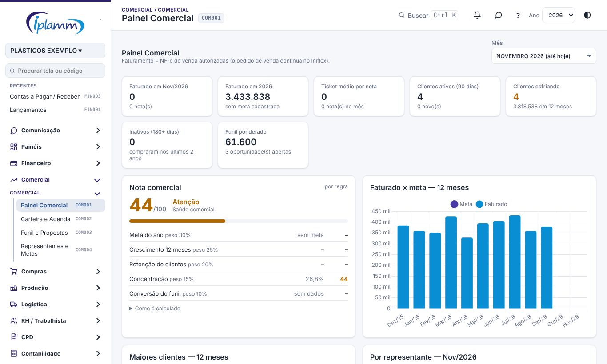
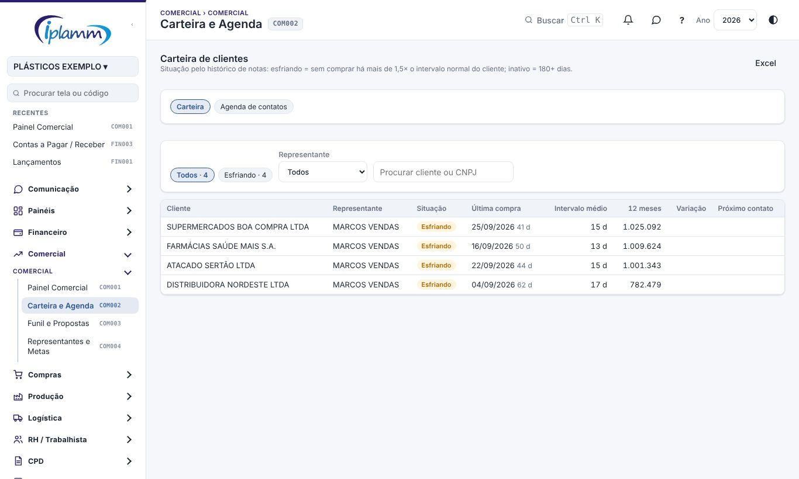
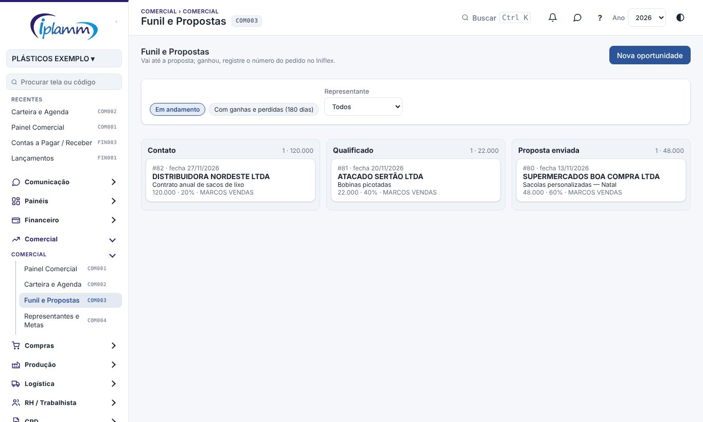
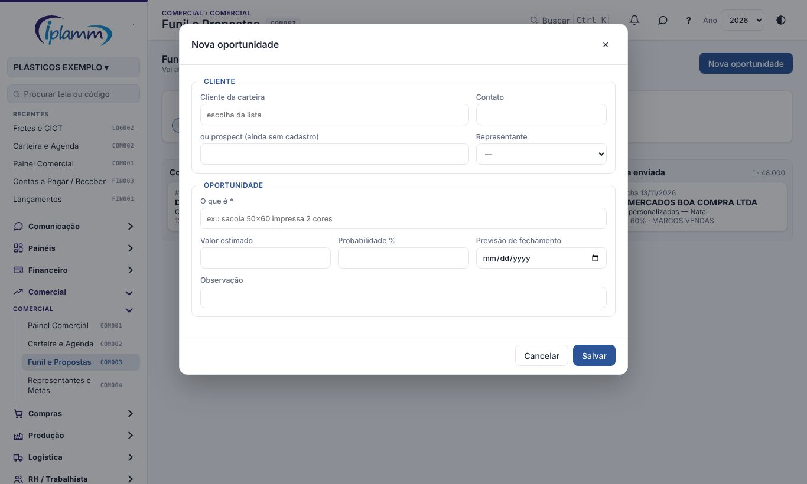
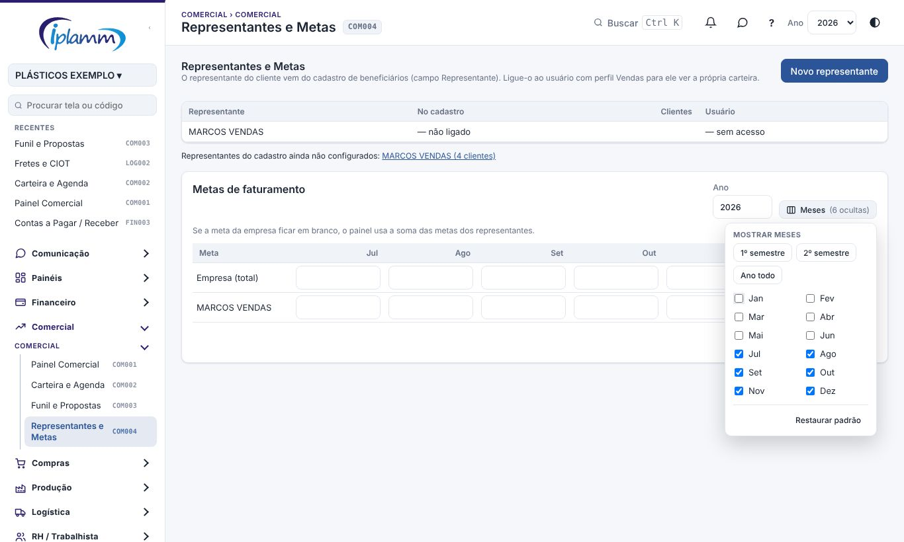

## 1. Para que serve

O módulo **Comercial** é o CRM de vendas da IPLAMM. Ele vai **até a proposta**; o pedido de venda continua no **Iniflex**.

- **Painel Comercial**: o faturamento pelas notas de venda, comparado com a meta. Mostra também a carteira, os representantes, os estados, os produtos com preço médio e o funil.
- **Carteira e Agenda**: os clientes com a situação de cada um, a ficha do cliente e a agenda de próximos contatos.
- **Funil e Propostas**: as oportunidades por etapa e as propostas, com especificação técnica, calculadora de preço e PDF.
- **Representantes e Metas**: liga cada representante a um usuário e define as metas mensais.

## 2. Quem tem acesso

| Perfil | O que faz |
|---|---|
| Vendas (representante) | Vê só a área Comercial e a **própria carteira**: registra contatos, oportunidades e propostas. Funciona no celular, em campo. |
| Administrador, diretor e financeiro | Veem todas as carteiras e configuram representantes e metas. |

## 3. Painel Comercial

Escolha o **mês**. O painel mostra:

- **Faturado** e **meta**, com o gráfico dos 12 meses;
- **Ticket médio por nota**: o faturado no mês dividido pelo número de notas de venda;
- clientes **ativos** (90 dias), **esfriando** e **inativos** (180 dias ou mais);
- o **funil ponderado** (valor das oportunidades × probabilidade);
- os maiores clientes, o faturamento por representante, os produtos (com preço médio) e o faturamento por estado;
- a **Nota comercial**.

## 4. Carteira e Agenda

### 4.1 A situação de cada cliente

| Situação | Quando |
|---|---|
| **Ativo** | Compra dentro do ritmo de costume. |
| **Novo** | A primeira compra foi há menos de 90 dias. |
| **Esfriando** | Está há mais tempo sem comprar do que o normal dele (mais de 1,5 vez o intervalo médio entre compras). |
| **Inativo** | Mais de 180 dias sem comprar. |

Filtre por representante e por situação. A lista mostra a última compra, o intervalo médio, as compras em 12 meses, a variação e o próximo contato.

### 4.2 A ficha do cliente

Clique no cliente para ver:

- o **financeiro**: títulos em aberto e vencidos;
- os **produtos comprados** em 12 meses, com o preço médio;
- as últimas notas;
- as oportunidades e os **contatos**.

### 4.3 Registrar um contato

1. Na ficha, escolha o **tipo** (ligação, visita, WhatsApp…) e escreva **o que foi tratado**.
2. Marque o **próximo contato** e o assunto.
3. Clique em **Registrar**.

A aba **Agenda de contatos** lista os próximos contatos. Clique em **Feito** quando o contato acontecer.

## 5. Funil e Propostas

### 5.1 Oportunidade

1. Clique em **Nova oportunidade**.
2. Em **Cliente**, escolha o **cliente da carteira**, ou escreva um **prospect** (quem ainda não tem cadastro), e informe o contato. Quem é da empresa escolhe também o **representante**.
3. Em **Oportunidade**, preencha **o que é** (obrigatório), o valor estimado, a **probabilidade %**, a previsão de fechamento e a observação.
4. Clique em **Salvar**.

As etapas são: **Contato → Qualificado → Proposta enviada → Ganha ou Perdida**. Ao marcar como perdida, informe o motivo (preço, prazo, qualidade, concorrente, desistência…). Ao marcar como ganha, informe o nº do pedido no Iniflex (pode ser depois).

### 5.2 Proposta

1. Na oportunidade, abra uma proposta.
2. Informe os **itens**: descrição, material, largura (mm), espessura (µm), comprimento (m), faces (2 = tubular ou saco), cores, quantidade, unidade e preço.
3. Use a **calculadora** (botão **calc** no item):
   - o peso teórico sai do material e das medidas;
   - informe o **custo do kg** (resina, aditivos, tinta e conversão) e a **margem desejada %**;
   - **preço = custo ÷ (1 − margem)**. Os impostos sobre a venda **não** estão no cálculo;
   - clique em **Usar o preço**.
4. Preencha a validade, o frete, a condição de pagamento, o prazo de entrega e a observação (que sai no PDF).
5. Clique em **Salvar**.

Depois:

- **PDF** gera a proposta no padrão IPLAMM, para mandar ao cliente.
- **Marcar enviada**, **Recusada** ou **Aceita** registra a resposta. A proposta aceita pergunta se a oportunidade vira ganha.

## 6. Representantes e Metas

1. Clique em **Novo representante**. Informe o **nome**, o **representante no cadastro** (que define a carteira dele) e o **usuário com perfil Vendas**. O usuário entra por convite em **Cadastros › Empresa e Usuários**.
2. Em **Metas de faturamento**, escolha o ano, preencha a meta de cada mês por representante e clique em **Salvar metas**.
3. A grade mostra **um semestre por vez** (o semestre atual), para os valores caberem na tela. O botão **Meses** troca: **1º semestre**, **2º semestre**, **Ano todo** (a grade rola para o lado, com o nome fixo) ou os meses que você marcar. A escolha fica guardada para você; **Restaurar padrão** volta ao semestre atual. O total do **Ano** e o **Salvar metas** consideram sempre os 12 meses, inclusive os ocultos.

Se a meta da empresa ficar em branco, o painel usa a soma das metas dos representantes.

## 7. Regras e travas

- O representante só vê os clientes da **própria carteira**.
- O faturamento vem das **NF-e de saída** importadas em Notas Fiscais.
- O pedido de venda continua no Iniflex: o Comercial vai até a proposta.

## 8. Perguntas frequentes e erros comuns

**A mensagem diz "Cliente fora da sua carteira".** O cliente pertence a outro representante. Fale com a direção.

**O faturamento do mês está baixo.** As notas de venda ainda não foram importadas. Veja em CPD › Notas Fiscais.

**A calculadora pede "Complete o cálculo".** Preencha o material, a largura e a espessura (e o comprimento, para saco ou sacola), o custo do kg e a margem.

## 9. Histórico de alterações

| Versão | Data | O que mudou |
|---|---|---|
| 1.0 | 28/10/2026 | Primeira versão do manual: painel, carteira com situação dos clientes, contatos e agenda, funil, propostas com calculadora e PDF, representantes e metas. |
| 1.1 | 29/10/2026 | Imagens das telas, com dados fictícios. |
| 1.2 | 05/11/2026 | Nomes das telas iguais aos do menu, com o código. Nova oportunidade em seções (Cliente e Oportunidade); metas um semestre por vez, com o seletor **Meses**. Figuras refeitas. |
