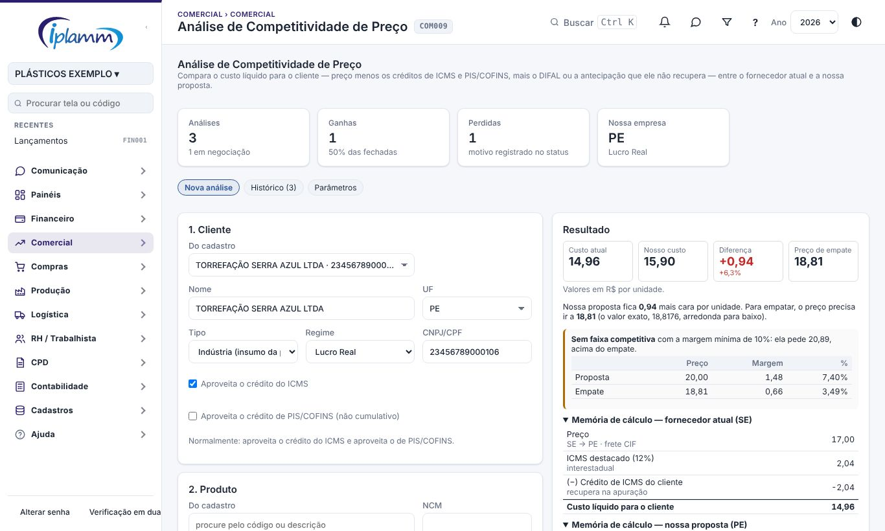
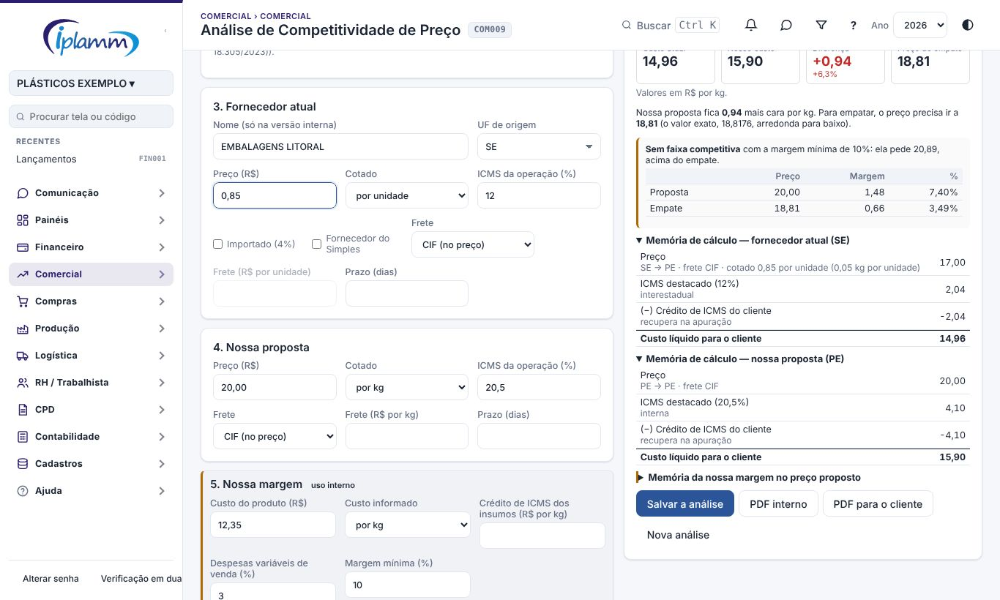
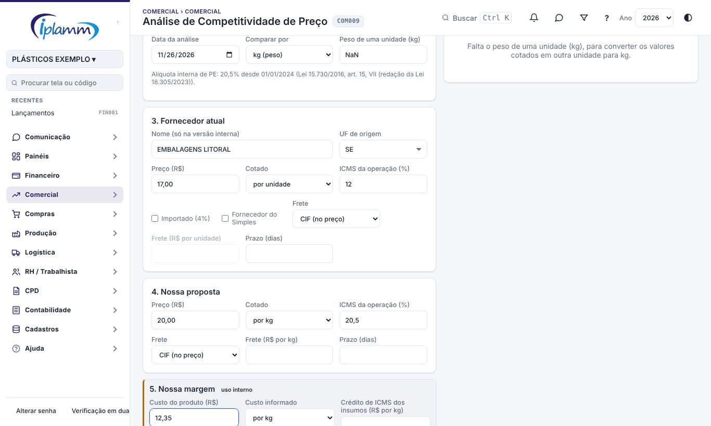
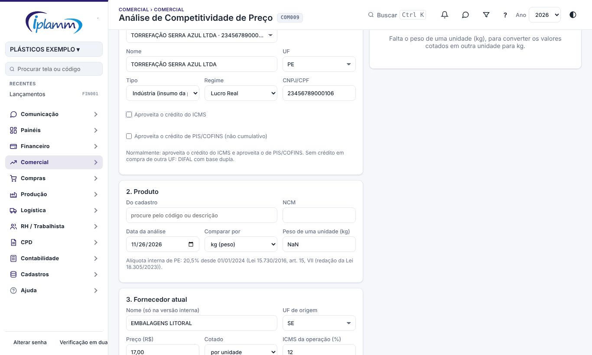
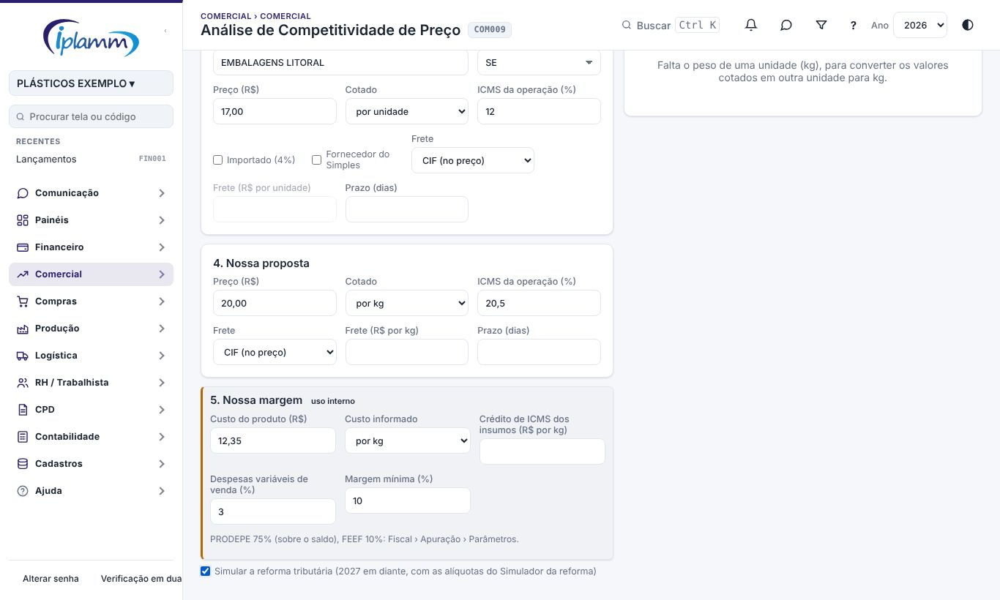
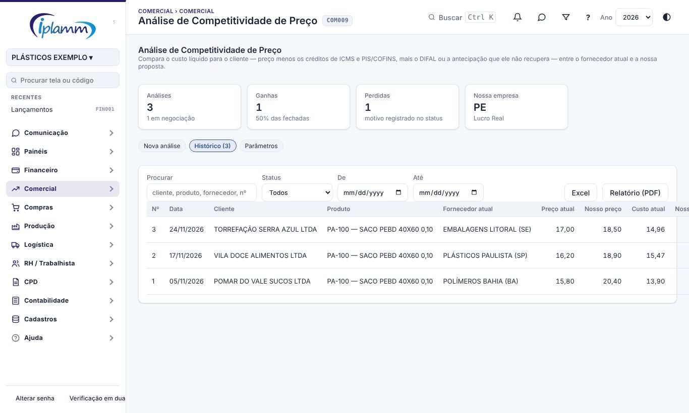

## 1. Para que serve

O cliente quase nunca compara só o preço da nota. Ele compara **quanto o produto custa para ele de verdade**, depois de recuperar os impostos que dão crédito e de pagar os que não dão. Esta tela faz essa conta para os dois caminhos:

- o **fornecedor atual**, que muitas vezes vende de outro estado com ICMS de 7% ou 12%;
- a **nossa proposta**, com o ICMS da nossa operação.

O resultado mostra:

- o custo líquido de cada caminho, por unidade;
- a diferença em R$ e em %;
- o **preço de empate**;
- a **faixa de negociação**;
- a **nossa margem** em cada ponto, na visão interna.

> Exemplo (dados fictícios): uma indústria de Pernambuco compra de Sergipe a R$ 17,00, com ICMS interestadual de 12%. Nossa proposta é R$ 20,00, venda interna com 20,5%. Como o cliente recupera o ICMS, o custo dele é 17,00 − 2,04 = **14,96** no fornecedor atual e 20,00 − 4,10 = **15,90** conosco. A diferença é de R$ 0,94 (6,3%), e não de R$ 3,00 como os preços sugerem. O preço de empate é **R$ 18,81**.

## 2. Como o custo líquido é calculado

**Custo líquido = preço + frete FOB − crédito de ICMS − crédito de PIS/COFINS + DIFAL + antecipação que não vira crédito.**

| Situação do cliente | O que entra na conta |
|---|---|
| Indústria ou comércio que aproveita o crédito do ICMS | O ICMS destacado na nota sai do custo |
| Contribuinte sem crédito (uso e consumo, ou a indústria sem crédito) comprando de outra UF | **DIFAL com base dupla**: base = (preço − ICMS da origem) ÷ (1 − alíquota interna); DIFAL = base × interna − ICMS da origem |
| Comércio comprando de outra UF | **Antecipação parcial** do estado (em PE, 8,34% da origem N/NE/CO/ES, 15,27% do Sul/Sudeste e 19,44% do importado). Com crédito, é só caixa: paga na entrada e credita na apuração. Sem crédito (Simples), é custo |
| Não contribuinte | O DIFAL é do fornecedor de fora. A tela avisa: ele pode repassar no preço |
| Lucro Real (não cumulativo) | Crédito de PIS/COFINS de 9,25% sobre o preço **sem o ICMS** (Lei 14.592/2023) |
| Fornecedor do Simples | Não destaca ICMS; o cliente credita só o percentual permitido que vem na nota |

**Controle (dados fictícios):** o mesmo cliente, sem crédito de ICMS, compra para uso e consumo. Fornecedor atual: base do DIFAL = (17,00 − 2,04) ÷ 0,795 = 18,82; DIFAL = 18,82 × 20,5% − 2,04 = 1,82; custo = **18,82**. Conosco não há DIFAL (venda interna): custo **20,00**. O empate continua em **18,81**.

**Preço de empate.** É o maior preço da nossa proposta que deixa o custo do cliente igual ou menor que o atual. O valor exato (14,96 ÷ 0,795 = 18,8176) é **arredondado para baixo**: a 18,82 o custo já seria 14,9619, maior que 14,96.

**Frete e prazo.** O frete CIF já está no preço. O frete FOB, pago pelo cliente, soma ao custo dele. O prazo só pesa se o valor presente estiver ligado em Parâmetros (taxa ao mês); vem desligado.

## 3. Fazer uma análise

O menu é **Comercial › Análise de Competitividade de Preço**. A tela tem três abas: **Nova análise**, **Histórico** e **Parâmetros**.

1. **Cliente.** Escolha do cadastro ou digite o nome de um possível cliente (avulso). Informe UF, tipo (indústria, comércio, consumidor final contribuinte, não contribuinte) e regime. A tela marca o normal para o perfil: aproveita ou não o crédito do ICMS e o de PIS/COFINS. Ajuste se o cliente for diferente. Para cliente que já teve análise, o perfil fiscal vem da última análise.
2. **Produto.** Procure pelo código ou pela descrição. O NCM vem do cadastro e decide a alíquota interna, que aparece logo abaixo com a norma e a vigência.
3. **Fornecedor atual.**
   - **Dados básicos:** UF de origem e preço. O nome é opcional e só sai na versão interna.
   - **Alíquota interestadual:** vem sugerida (4% importado, 7% do Sul/Sudeste para N/NE/CO/ES, 12% nos demais casos). Pode ser trocada à mão.
   - **Fornecedor do Simples:** marque e informe o crédito permitido que vem na nota.
   - **Frete e prazo:** frete CIF ou FOB, com o valor por unidade; prazo opcional.
4. **Nossa proposta.** Preço (por unidade ou por kg), frete e prazo. O ICMS vem da UF da nossa empresa e da UF do cliente.
5. **Nossa margem** (só para quem tem a liberação): custo do produto, que vem do Kardex quando há custo médio, crédito de ICMS dos insumos por unidade, despesas variáveis e margem mínima.

O resultado muda a cada campo preenchido.

### Venda por unidade ou por peso

Vendemos por unidade e por peso, e o fornecedor atual pode cotar de outro jeito. Por isso cada preço tem a sua unidade:

- **Comparar por** (bloco Produto): a base do resultado, **unidade** ou **kg**. Ao escolher o produto, a tela sugere a unidade do cadastro (KG → kg; as demais → unidade).
- **Cotado** (fornecedor atual e nossa proposta): por unidade ou por kg. O frete segue a mesma unidade do preço.
- **Peso de uma unidade (kg)**: obrigatório quando alguma cotação está numa unidade diferente da base. A tela converte (R$ por unidade ÷ kg = R$ por kg; R$ por kg × kg = R$ por unidade). O peso fica salvo na análise e volta sugerido na próxima do mesmo produto.
- **Custo informado** (nossa margem): o custo do Kardex vem na unidade do cadastro e também é convertido.

> Exemplo (dados fictícios): o fornecedor cobra R$ 0,85 o saco de 50 g e nós cotamos R$ 20,00 o kg. Com **Comparar por: kg** e peso de 0,05 kg, o preço dele vira R$ 17,00 por kg e o resultado é o mesmo do exemplo do item 1: 14,96 × 15,90 e empate em R$ 18,81 por kg. A memória de cálculo mostra o preço como foi cotado.

Todos os valores do resultado, do histórico e dos PDFs aparecem na base escolhida (R$ por kg ou R$ por unidade).

## 4. Ler o resultado

- **Custo atual × nosso custo**, a **diferença** (vermelha quando ficamos mais caros) e o **preço de empate**.
- **Faixa sugerida** (visão interna): vai do preço que ainda dá a **margem mínima** até o **empate**.
  - Abaixo do começo da faixa, a margem fica menor que a mínima.
  - Acima do empate, o cliente paga mais do que paga hoje.
  - Se o preço da margem mínima ficar acima do empate, a tela avisa **"Sem faixa competitiva"**: não dá para ganhar o cliente pelo preço sem abrir mão da margem mínima.
- **Nossa margem** no preço proposto, no empate e na margem mínima. A margem considera:
  - o ICMS da venda e o crédito presumido do PRODEPE, menos o FEEF, conforme os parâmetros da apuração;
  - PIS/COFINS;
  - o custo do produto, o frete CIF e as despesas variáveis.
- **Memória de cálculo**, linha a linha, de cada caminho e da nossa margem.

## 5. Cliente sem crédito de ICMS

Desmarque **Aproveita o crédito do ICMS**. Na compra de outra UF, a memória mostra a base dupla e o DIFAL que o cliente recolhe; na nossa venda interna não há DIFAL. É o caso em que a venda dentro do estado mais se aproxima do fornecedor de fora.

## 6. Cliente do comércio: antecipação parcial

Para o comércio que compra de outra UF, a tela calcula a antecipação parcial do estado de destino, pelo percentual cadastrado em Parâmetros.

- **Cliente com crédito:** a linha mostra o valor pago na entrada, mas o custo é zero, porque ele credita na apuração. O efeito é só no caixa.
- **Cliente do Simples:** a antecipação vira custo.

## 7. Simulação da reforma tributária

Marque **Simular a reforma tributária**. A mesma comparação é refeita ano a ano, com as alíquotas do Simulador da reforma (Fiscal › Apuração):

- o ICMS diminui na proporção da transição (100% até 2028, depois 90%, 80%, 70% e 60%, e zero em 2033);
- PIS/COFINS deixam de existir em 2027;
- a CBS e o IBS são cobrados por fora, sem o ICMS na base, com crédito integral para o contribuinte.

A vantagem de quem vende de fora com ICMS menor diminui a cada ano e some em 2033. É uma estimativa com os mesmos preços; as alíquotas de cada ano estão no simulador.

## 8. Salvar, histórico e status

Clique em **Salvar a análise**. Ela recebe um número e o status **Em negociação**. A gravação inclui:

- as entradas e o resultado;
- a cópia dos parâmetros usados (alíquota, norma e vigência).

Assim, a análise antiga continua mostrando a regra da época. A margem fica gravada à parte, só para quem tem a liberação.

Na aba **Histórico**:

- **Filtros:** procure por cliente, produto, fornecedor ou número; filtre por status e período.
- **Abrir:** traz a análise de volta para a tela.
- **⧉ (duplicar):** cria uma cópia para nova rodada de preço.
- **Status:** Em negociação, Ganha ou Perdida. A perda pede o motivo, por exemplo preço, prazo ou qualidade. Cada mudança fica no histórico da análise.
- **Excluir:** o administrador exclui a qualquer momento; o responsável, só enquanto a análise está em negociação.
- **Excel** e **Relatório (PDF)**: a lista filtrada com o resumo de ganhas, perdidas, taxa de êxito e os motivos das perdas.

## 9. PDF interno e PDF para o cliente

Os dois PDFs seguem o padrão de relatórios da plataforma, com os filtros e os parâmetros impressos.

| | Interno | Para o cliente |
|---|---|---|
| Identificação, perfil fiscal, comparação e memória de cálculo | Sim | Sim |
| Nome do fornecedor atual | Sim | Não ("Fornecedor atual (UF)") |
| Preço de empate e faixa de negociação | Sim | Não |
| Nossa margem e a memória dela | Sim | Não |
| Reforma tributária (se marcada) | Com empate e margem | Só o custo de cada caminho |

Quem não tem a liberação da margem só gera a versão para o cliente.

## 10. Parâmetros

| Parâmetro | Padrão | Para que serve |
|---|---|---|
| Quem usa a tela | Administrador, Diretor, Financeiro e Vendas | Perfis que fazem e consultam análises |
| Quem vê a margem | Administrador e Diretor | Custo, PRODEPE, margem e faixa |
| Liberação individual da margem | ninguém | Libera a margem para uma pessoa (ex.: o gerente comercial) sem liberar o perfil inteiro |
| Margem mínima da faixa | 10% | Começo da faixa sugerida |
| Despesas variáveis de venda | 0% | Comissão e outras despesas proporcionais ao preço |
| Valor presente do prazo | 0 (desligado) | Taxa ao mês para trazer o prazo a valor presente |
| Crédito de PIS/COFINS do cliente | 9,25% | Não cumulativo |
| ICMS fora da base do PIS/COFINS | ligado | Lei 14.592/2023 |
| PIS/COFINS cumulativo da nossa empresa | 3,65% | Margem de empresa do Presumido |
| Simples: alíquota efetiva do DAS | vazio | Margem de empresa do Simples |
| Simular a reforma por padrão | desligado | Já abre a análise com a reforma marcada |

**Alíquota interna por UF.**
- **Pré-carga:** a plataforma traz a alíquota geral das 27 UFs, com a norma e a data de início. Elas ficam **A conferir** até alguém confirmar com a contabilidade: clique em **Conferida**, ou em **Marcar todas como conferidas**.
- **Alíquota própria de produto:** use **+ Nova alíquota / vigência** com o prefixo do NCM.
- **Mudança de lei:** cadastre uma nova vigência. As análises antigas continuam com a regra da época.

**Alíquota interestadual.** São as origens com alíquota reduzida e os percentuais de 7%, 12% e 4%, com vigência.

**Antecipação parcial.** É o percentual por estado de destino, por alíquota da operação e por alíquota interna, para os tipos de cliente marcados. A pré-carga traz os de Pernambuco (Decreto 44.650/2017, na redação do Decreto 55.981/2023).

**O que vem de outras telas:**
- a UF e o regime da nossa empresa: Configurações › Empresa;
- PRODEPE, FEEF e PIS/COFINS: Fiscal › Apuração › Parâmetros, por vigência;
- CBS e IBS por ano: Simulador da reforma;
- custo do produto: Kardex (custo médio).

## 11. Quem tem acesso

| O que | Quem (padrão, muda em Parâmetros) |
|---|---|
| Fazer, salvar e consultar análises | Administrador, Diretor, Financeiro e Vendas |
| Ver custo, margem, faixa e o PDF interno | Administrador e Diretor, e as pessoas liberadas uma a uma |
| Alterar uma análise salva | O responsável por ela, o Administrador e o Diretor |
| Mudar parâmetros e alíquotas | Administrador |

Cada empresa da plataforma tem os próprios parâmetros, com a UF e o regime dela.

## 12. Dúvidas comuns

**Por que a diferença não é a diferença de preço?** Porque o cliente recupera o ICMS. Quem vende de fora destaca 12% e quem vende dentro destaca 20,5%: o crédito maior compensa parte do preço maior.

**O empate muda se o cliente aproveita o PIS/COFINS?** Não, no caso comum. O crédito é proporcional ao preço sem o ICMS nos dois caminhos, então os custos mudam na mesma proporção e o empate continua o mesmo.

**A alíquota sugerida está errada para esse fornecedor.** Digite a correta no campo **ICMS da operação**. Isso vale, por exemplo, para benefício na origem ou para produto com conteúdo importado acima de 40% (4%). A sugestão volta se você trocar a UF.

**A análise antiga mostra outra alíquota.** Ela guarda os parâmetros da data em que foi feita. Para refazer com a regra de hoje, duplique (⧉) e salve como nova.

**O vendedor precisa ver a margem.** O administrador o libera em Parâmetros › Liberação individual da margem.

## 13. Histórico de versões

| Versão | Data | O que mudou |
|---|---|---|
| 1.1 | 26/11/2026 | Venda por unidade ou por peso: base da comparação (unidade ou kg), unidade de cada cotação e do custo, peso de uma unidade para converter; resultado, histórico e PDFs na base escolhida. |
| 1.0 | 26/11/2026 | Primeira versão. Inclui: custo líquido para o cliente com crédito de ICMS conforme o perfil; DIFAL com base dupla; antecipação parcial do comércio (efeito no caixa); crédito de PIS/COFINS sem o ICMS na base; frete CIF/FOB; prazo a valor presente opcional; preço de empate arredondado para baixo; faixa da margem mínima ao empate; margem interna com PRODEPE, FEEF e PIS/COFINS; simulação da reforma 2027–2033; histórico com status e motivo da perda; PDF interno e para o cliente; parâmetros por vigência e por empresa, com a pré-carga das 27 UFs, da regra interestadual e da antecipação de PE; liberação da margem por perfil e por pessoa (SQL 197). |
