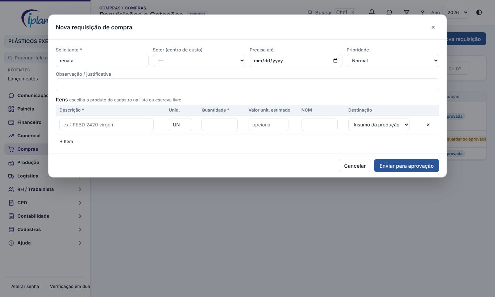
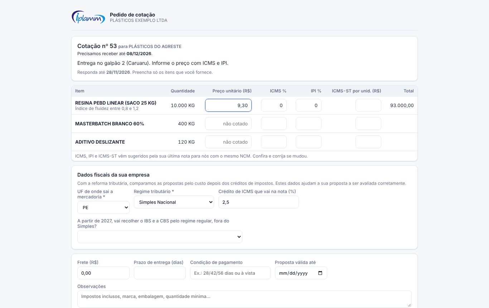
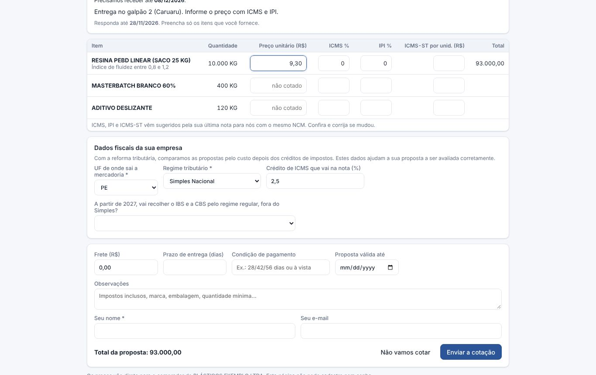
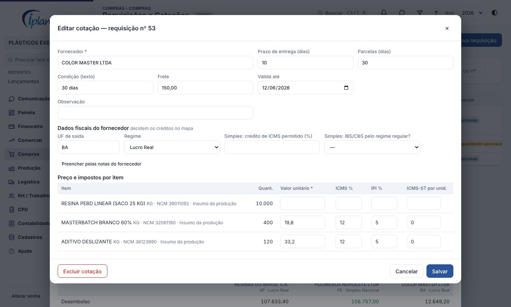
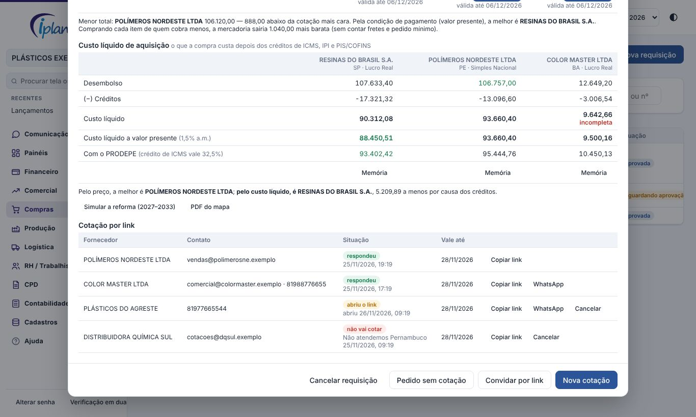
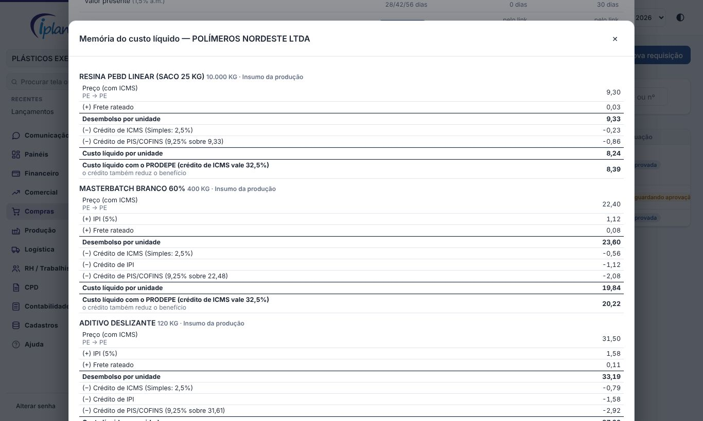
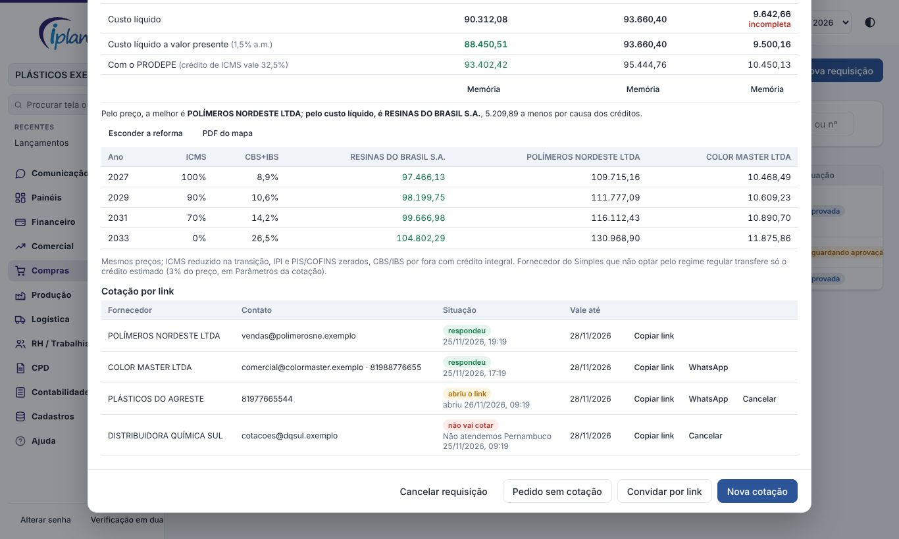
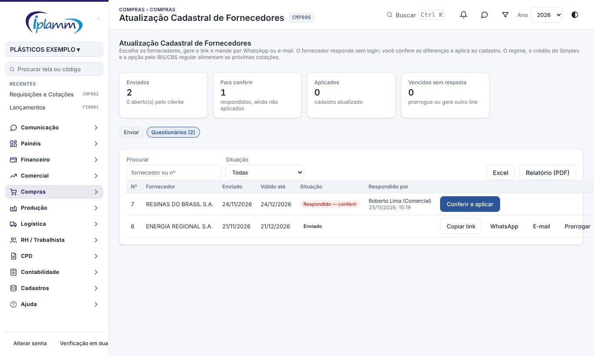
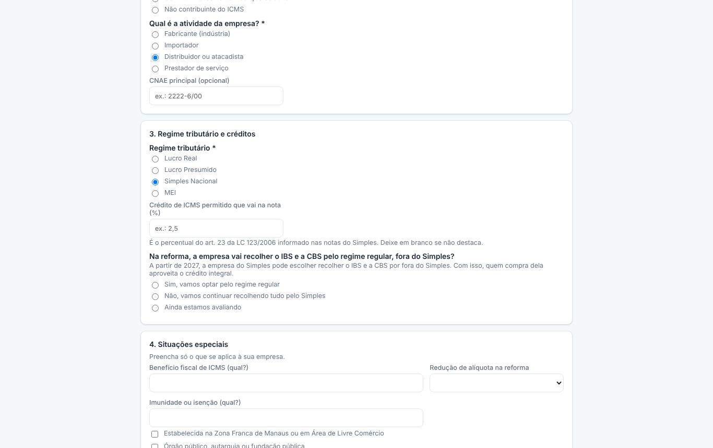
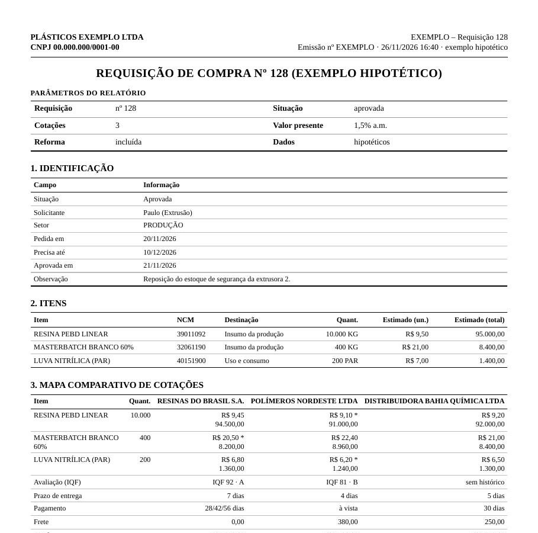

## 1. Para que serve

O menor preço nem sempre é a compra mais barata. O que a compra custa de verdade é o **custo líquido de aquisição**: o que se paga menos os impostos que voltam como crédito na apuração. Na reforma tributária isso pesa ainda mais, porque o crédito passa a ser a regra, e o fornecedor do Simples que não fizer a opção pelo regime regular transfere pouco crédito.

A compra inteligente junta três coisas:

1. **O fornecedor informa os dados fiscais na própria cotação por link**: UF de saída, regime e, por item, ICMS, IPI e ICMS-ST. Esses dados vêm sugeridos pelas notas dele que já estão na plataforma.
2. **O mapa compara pelo custo líquido.** Ele mostra os créditos de ICMS, IPI e PIS/COFINS, o efeito do PRODEPE e a simulação da reforma de 2027 a 2033.
3. **O questionário de fornecedores** guarda o regime, o crédito do Simples e a opção pelo IBS/CBS regular, para as próximas cotações.

## 2. Como o custo líquido é calculado

**Custo líquido = desembolso − créditos**, por unidade de cada item, depois somado pela quantidade.

| | Insumo | Revenda | Uso e consumo | Ativo imobilizado |
|---|---|---|---|---|
| Desembolso | preço + IPI + ICMS-ST + frete rateado | igual | igual + **DIFAL** (base dupla) se vier de outra UF | igual + **DIFAL** se vier de outra UF |
| Crédito de ICMS | na hora | na hora | não | em **48 meses** (CIAP), trazido a valor presente |
| Crédito de IPI | sim, se a empresa é contribuinte do IPI | não | não | não |
| Crédito de PIS/COFINS | sim (9,25%; base sem o ICMS) | sim | não | sim |

- **Fornecedor do Simples:** não destaca o ICMS. O crédito é o percentual permitido que ele informa na nota.
- **Base do PIS/COFINS:** tira ou não o ICMS e inclui ou não o frete e o IPI, como estiver em Fiscal › Apuração › Parâmetros.
- **Frete:** o frete da cotação é rateado pelos itens, na proporção do valor de cada um.
- **Prazo de pagamento:** o custo líquido é trazido a valor presente pela taxa dos Parâmetros da cotação, como já acontecia com o total.
- **Empresa compradora do Simples:** não credita ICMS, IPI nem PIS/COFINS, e a tela mostra isso.

> Exemplo (dados fictícios): a resina custa R$ 9,30 no fornecedor do Simples, com crédito de 2,5%, e R$ 9,45 no de São Paulo, com ICMS de 7%. Pelo preço, ganha o do Simples. Depois dos créditos, o de São Paulo sai **mais de R$ 5 mil mais barato** na compra toda.

## 3. Destinação de cada item

Na requisição, cada item tem a **Destinação**: insumo da produção (padrão), revenda, uso e consumo ou ativo imobilizado. É ela que decide os créditos. Escolha certo, principalmente para material de uso e consumo e para máquinas e equipamentos.

## 4. Dados fiscais na cotação

**Pelo link (o fornecedor preenche).** A página da cotação ganhou:
- **por item:** colunas de **ICMS %**, **IPI %** e **ICMS-ST por unidade**;
- **o bloco "Dados fiscais da sua empresa":** UF de onde sai a mercadoria e regime. No Simples, aparecem também o crédito de ICMS que vai na nota e a pergunta "a partir de 2027, vai recolher o IBS e a CBS pelo regime regular?".

Se o fornecedor já vendeu para nós, os percentuais vêm **sugeridos pela última nota dele com o mesmo NCM**, e ele só confirma. A UF e o regime vêm do cadastro, do questionário de fornecedores ou das notas. O fornecedor do regime normal precisa informar o ICMS de cada item cotado (0 se não houver).

**Na cotação digitada pelo comprador.** A tela da cotação tem os mesmos campos. O botão **Preencher pelas notas do fornecedor** busca as notas de entrada dele (pelo cadastro ou pelo CNPJ do emitente) e preenche o ICMS, o IPI e o ICMS-ST dos itens com o mesmo NCM, além da UF e do Simples, quando estão em branco.

## 5. O mapa pelo custo líquido

Abaixo do mapa comparativo de preços, a requisição mostra o **Custo líquido de aquisição** de cada cotação.

- **Desembolso:** preço, IPI, ICMS-ST, frete e DIFAL. Em verde, o menor.
- **(−) Créditos:** ICMS, IPI e PIS/COFINS que voltam. "Sem alíquota de ICMS" avisa a cotação de regime normal sem o percentual.
- **Custo líquido** e **custo líquido a valor presente:** em verde, a melhor compra.
- **Com o PRODEPE:** veja o item 7.
- **Memória:** abre a conta item a item, linha por linha.

A frase de baixo diz quem ganha pelo preço e quem ganha pelo custo líquido, e quanto a escolha certa economiza.

Se o fornecedor declarou um ICMS ou IPI diferente da última nota dele, aparece o quadro **Confira com o fornecedor**.

**PDF do mapa.** É o relatório para a direção, com:
- a requisição e os fornecedores com as condições de cada um;
- a comparação entre o preço e o custo líquido;
- os pontos a confirmar;
- a reforma, se estiver aberta na tela;
- a memória de cálculo.

## 6. Simulação da reforma

O botão **Simular a reforma (2027–2033)** refaz o mapa ano a ano, com as alíquotas do Simulador da reforma. A simulação considera:
- o ICMS reduzindo na proporção da transição;
- o IPI e o PIS/COFINS zerados;
- a CBS e o IBS por fora, sem o ICMS na base, com crédito integral.

O fornecedor do Simples que **não** optar pelo regime regular transfere só o crédito estimado em Parâmetros da cotação. É aqui que o fornecedor do Simples costuma ficar caro.

## 7. O PRODEPE: quanto o crédito de ICMS vale de fato

Quando o crédito presumido do PRODEPE é calculado sobre o **saldo devedor** do ICMS, cada R$ 1,00 de crédito na compra reduz o imposto, mas também reduz a base do benefício (e o FEEF). O valor efetivo do crédito é:

**1 − % do crédito presumido × % das saídas com PRODEPE × (1 − % do FEEF)**

Com presumido de 75%, todas as saídas incentivadas e FEEF de 10%, a conta fica 1 − 0,75 × 1 × 0,90 = **0,325**. Ou seja, cada R$ 1,00 de crédito de ICMS reduz o imposto em cerca de **R$ 0,33**.

A linha **Com o PRODEPE** mostra o custo por essa leitura. Ela só aparece quando o PRODEPE está ligado e calculado sobre o saldo em Fiscal › Apuração › Parâmetros. A parcela das saídas com PRODEPE fica em Parâmetros da cotação.

> As duas leituras ficam lado a lado para a contabilidade validar. Quando o fornecedor de outro estado tem ICMS menor, essa conta costuma favorecê-lo mais do que o preço sugere.

## 8. Parâmetros da cotação

Botão **Parâmetros da cotação**, na tela de Requisições (administrador e diretor):

| Parâmetro | Padrão | Para que serve |
|---|---|---|
| Parcela das saídas com PRODEPE | 100% | Leitura do PRODEPE (item 7) |
| Crédito de CBS/IBS do fornecedor do Simples, na reforma | 0% | Crédito que o Simples sem a opção pelo regular transfere; combine o número com a contabilidade |
| CIAP do ativo | 48 meses | Parcelas do crédito de ICMS do ativo |
| Contribuinte do IPI | ligado | Credita o IPI dos insumos |
| Mostrar a reforma no mapa | desligado | Já abre o mapa com a simulação |
| Taxa do valor presente | 1,5% a.m. | Prazo de pagamento e CIAP |

**O que vem de outras telas:**
- PIS/COFINS, PRODEPE e FEEF: Fiscal › Apuração › Parâmetros.
- UF e regime da empresa: Configurações › Empresa › Regime tributário.
- Alíquota interna por UF, para o DIFAL: Parâmetros da Análise de Competitividade de Preço.
- CBS/IBS por ano: Simulador da reforma.

## 9. Atualização Cadastral de Fornecedores

Em **Compras › Atualização Cadastral de Fornecedores** (CMP006) funciona a mesma ferramenta dos clientes:

1. Você escolhe os fornecedores e gera os links.
2. Envia por WhatsApp ou e-mail.
3. O fornecedor responde sem login.
4. Você confere e aplica.

O questionário do fornecedor pergunta:
- o regime;
- no Simples, o crédito de ICMS que vai na nota e se vai recolher o IBS e a CBS pelo regime regular;
- a atividade (fabricante, importador, distribuidor ou prestador);
- os dados cadastrais e as situações especiais.

O que for aplicado já vem preenchido nas próximas cotações por link.

Quem usa: Compras, Financeiro, Diretor e Administrador. O aviso de resposta vai para Compras e Administrador.

## 10. Relatório da requisição

No detalhe de qualquer requisição, o botão **Relatório da requisição** (rodapé da janela) gera o PDF completo, no padrão de relatórios da plataforma. Funciona em qualquer situação: aguardando aprovação, aprovada, atendida ou cancelada.

O relatório traz, em seções numeradas:

1. **Identificação:** situação, solicitante, setor, datas, observação e motivo.
2. **Itens:** NCM, destinação, quantidade e o valor estimado, se houver.
3. **Mapa comparativo de cotações:** preço por item de cada fornecedor (com o menor marcado), avaliação (IQF), prazo, pagamento, frete, total, valor presente, origem (pelo link ou digitada) e validade.
4. **Custo líquido:** fornecedores e condições fiscais, comparação entre preço e custo líquido, PRODEPE, pontos a confirmar e a memória de cálculo. A simulação da reforma entra se estiver aberta na tela.
5. **Cotação por link:** quem foi convidado, situação, data da resposta e validade do link.
6. **Pedidos de compra** gerados a partir da requisição.

Sem cotação, o relatório traz a identificação, os itens e a observação de que ainda não há cotação. O **PDF do mapa** (seção 5) continua disponível para quem quer só a comparação.

## 11. Relatório de compra inteligente (para a direção)

Na lista de requisições, o botão **Relatório de compra inteligente** gera o PDF do período, com:

- **Resumo:** desembolso, créditos e custo líquido das cotações escolhidas, e quantas escolhas foram pelo menor custo líquido (com a economia em relação ao menor preço).
- **Compras do período:** escolhida, menor preço e menor custo líquido de cada requisição.
- **Escolhas acima do menor custo líquido:** a diferença de cada uma. Pode haver motivo, como prazo, qualidade ou pedido mínimo.
- **Fornecedores do Simples:** crédito informado e a resposta sobre o regime regular. São os candidatos a uma conversa antes de 2027.

## 12. Dúvidas comuns

**O fornecedor não sabe a alíquota.** Ele pode deixar como está na sugestão, que vem da última nota dele. Se for o primeiro fornecimento, o comprador completa na cotação.

**A cotação mostra "sem alíquota de ICMS".** Edite a cotação e informe o ICMS dos itens, ou use **Preencher pelas notas do fornecedor**.

**O crédito de PIS/COFINS de compra do Simples entra?** Sim. O comprador do Lucro Real credita o PIS/COFINS sobre a compra de fornecedor do Simples, pela alíquota cheia.

**Os números da reforma são certos?** São uma estimativa com os mesmos preços e as alíquotas cadastradas por ano. Servem para ver a tendência e conversar com o fornecedor, não para fechar preço de 2033.

## 13. Histórico de versões

| Versão | Data | O que mudou |
|---|---|---|
| 1.0 | 26/11/2026 | Primeira versão. Inclui destinação por item; dados fiscais na cotação por link e na cotação digitada, com sugestão pelas notas de entrada do fornecedor e alerta de divergência; mapa pelo custo líquido (créditos de ICMS, IPI e PIS/COFINS, DIFAL, CIAP, valor presente), com a leitura do PRODEPE e a simulação da reforma; memória por item; PDF do mapa e relatório do período para a direção; Atualização Cadastral de Fornecedores (CMP006); parâmetros da compra inteligente (SQL 199). |
| 1.1 | 26/11/2026 | Botão **Relatório da requisição** no detalhe da requisição: PDF completo com identificação, itens, mapa comparativo, custo líquido, cotação por link e pedidos (seção 10). |
