## 1. Para que serve

O módulo **Compras** organiza o caminho de uma compra, do pedido de quem precisa até a mercadoria entregue e conferida com a nota:

1. **Requisição**: quem precisa pede.
2. **Aprovação** da requisição pela direção.
3. **Cotação**: Compras pede preços aos fornecedores e compara no mapa de cotações.
4. **Pedido de compra**: gerado da cotação escolhida, aprovado conforme a alçada.
5. **Recebimento**: a entrega é conferida com a nota fiscal, e as parcelas da nota entram no contas a pagar.

O pedido aprovado já vira **previsão no contas a pagar**. No recebimento, a previsão é trocada pelos títulos reais da nota.

## 2. Quem tem acesso

| Perfil | O que faz |
|---|---|
| Compras | Cria requisições, cotações e pedidos; aprova pedidos até a alçada; registra recebimentos. Também usa Pagamentos Antecipados. |
| Administrador e diretor | Aprovam requisições e pedidos de qualquer valor; definem a alçada e os parâmetros. |

A **alçada** é o valor até o qual o próprio Compras aprova o pedido. O padrão é R$ 5.000,00. Acima disso, a aprovação é da direção. A alçada é definida em **Painel de Compras › Parâmetros**.

## 3. Painel de Compras

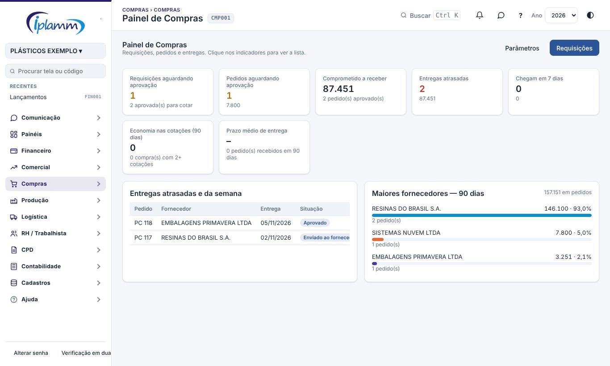

O painel mostra, em indicadores que podem ser clicados para ver a lista:

- requisições aguardando aprovação;
- pedidos aguardando aprovação;
- valor **comprometido a receber**;
- **entregas atrasadas** e as que **chegam em 7 dias**;
- **economia nas cotações** dos últimos 90 dias;
- **prazo médio de entrega**.

Embaixo ficam as entregas atrasadas e da semana e os **maiores fornecedores** dos últimos 90 dias.

## 4. Passo a passo

### 4.1 Fazer uma requisição

1. Em **Requisições e Cotações**, clique em **Nova requisição**.
2. Informe o **solicitante**, o **setor** (centro de custo), a data em **Precisa até**, a **prioridade** e uma justificativa.
3. Em **Itens**, escolha o produto do cadastro na lista ou escreva livre. Informe a unidade, a **quantidade** e, se souber, o valor unitário estimado e o NCM. Use **+ Item** para mais linhas.
4. Clique em **Enviar para aprovação**.

### 4.2 Aprovar ou rejeitar a requisição

Abra a requisição (filtro **Aguardando aprovação**) e clique em **Aprovar** ou **Rejeitar**. Na rejeição, escreva o motivo: a requisição volta para quem pediu, que pode **Editar** e salvar para reenviar.

### 4.3 Cotar com os fornecedores

1. Abra a requisição aprovada (filtro **Aprovadas (cotar)**) e clique em **Nova cotação**.
2. Informe o **fornecedor**, o prazo de entrega em dias, as **parcelas** (por exemplo `28/56/84`), a condição de pagamento, o **frete**, a validade e o **preço unitário de cada item**.
3. Clique em **Salvar**. Repita para cada fornecedor.

#### Cotação por link

Em vez de digitar, peça a cotação ao fornecedor por um **link**. Ele abre a página, sem cadastro nem senha, e preenche o preço de cada item, o frete, o prazo de entrega, a condição de pagamento e a validade.

1. Na requisição aprovada, clique em **Convidar por link**.
2. Informe cada fornecedor (da lista ou um nome novo), o **e-mail** e, se quiser, o **WhatsApp**. Sem e-mail, vale o do cadastro do fornecedor.
3. Escreva uma mensagem, se precisar (por exemplo: local de entrega, impostos inclusos).
4. Clique em **Gerar links e enviar e-mails**.

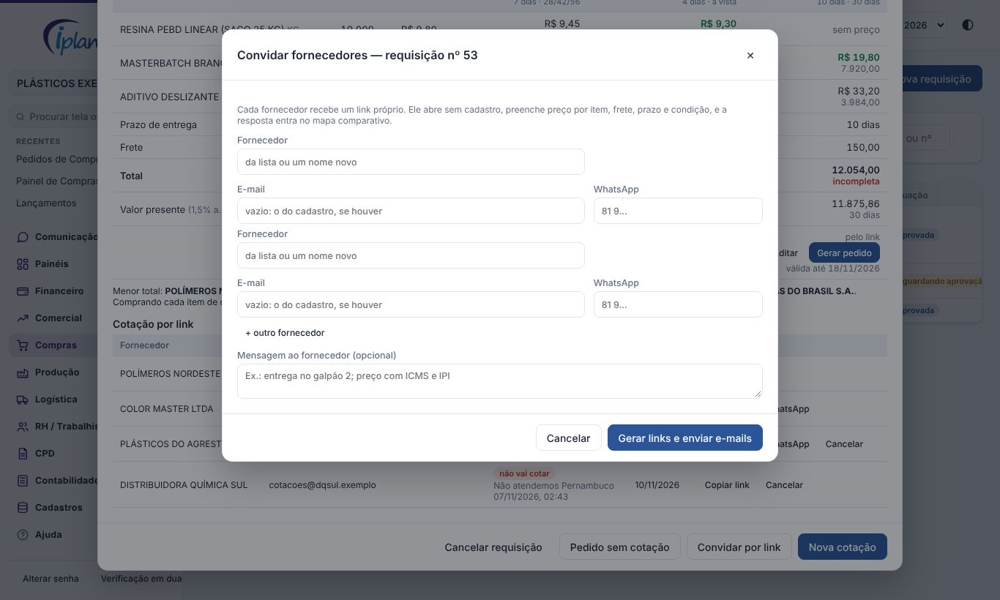

O fornecedor recebe o e-mail com o botão para preencher. Para mandar pelo WhatsApp, use **WhatsApp** ou **Copiar link** na lista de convites. O link vale 5 dias (parâmetro).

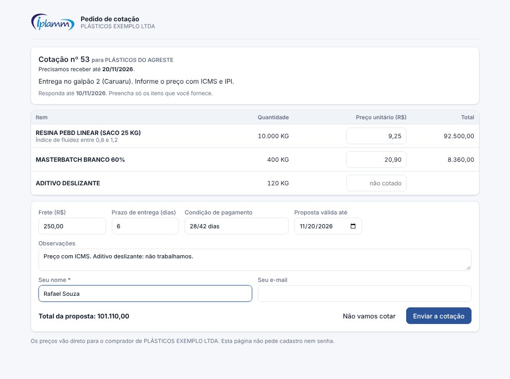

Quando o fornecedor responde, a cotação entra no mapa com a marca **pelo link** e o comprador recebe um aviso. Até o link vencer, o fornecedor pode corrigir a resposta. Ele também pode clicar em **Não vamos cotar**, com o motivo.

A lista **Cotação por link** mostra cada convite: enviado, abriu o link, respondeu, não vai cotar ou cancelado. **Cancelar** desativa o link.

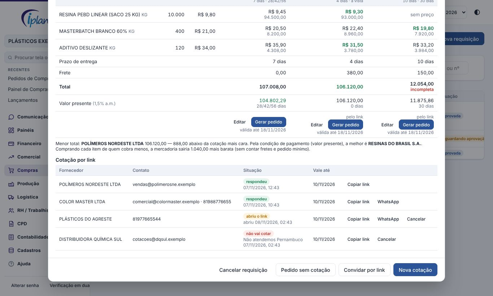

#### Mapa comparativo

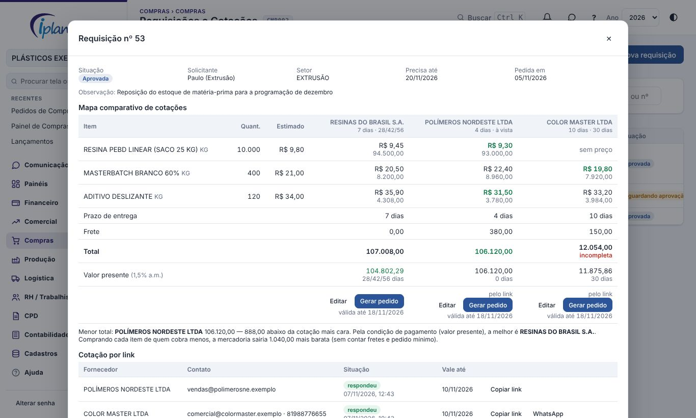

A requisição mostra o **mapa comparativo de cotações**:

- o menor preço de cada item fica em verde e em negrito;
- as linhas de **prazo de entrega**, **frete** e **total**, com o menor total em verde;
- o **valor presente**: o total trazido a hoje pela condição de pagamento, com a taxa dos parâmetros (padrão 1,5% ao mês). Assim, 28/42/56 dias e à vista podem ser comparados. O menor valor presente fica em verde;
- cotação sem preço em algum item aparece como **incompleta**.

Abaixo do mapa, a tela resume a melhor por total e, se for outra, a melhor pela condição de pagamento. Também mostra quanto a compra sairia mais barata se cada item fosse comprado de quem cobra menos, sem contar fretes e pedido mínimo.

Os **Parâmetros da cotação** (administrador e diretor) definem:

- por quantos dias vale o link;
- a taxa do valor presente;
- se o fornecedor vê o preço estimado da requisição;
- a mensagem padrão do convite.

### 4.4 Gerar o pedido de compra

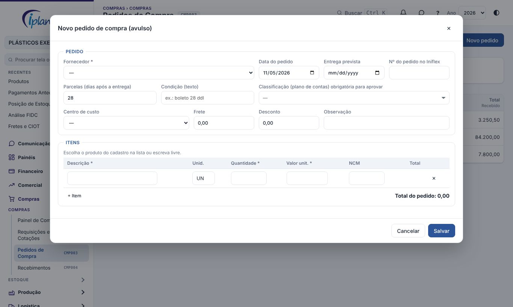

1. No mapa, clique em **Gerar pedido** na cotação escolhida. Se não houver cotação, use **Pedido sem cotação**: os preços estimados entram no pedido e podem ser ajustados no rascunho.
2. Confirme o **fornecedor do cadastro**. Se o fornecedor da cotação não estiver cadastrado, escolha o cadastro correspondente ou peça ao Financeiro para cadastrar.
3. O pedido nasce em **rascunho** e a requisição passa para **Virou pedido**.

Também dá para criar um pedido avulso, sem requisição, em **Pedidos de Compra › Novo pedido**. O formulário tem duas seções:

- **Pedido**: fornecedor (obrigatório), data do pedido, entrega prevista, nº do pedido no Iniflex, parcelas (dias após a entrega), condição em texto, classificação (plano de contas, obrigatória para aprovar), centro de custo, frete, desconto e observação.
- **Itens**: descrição, unidade, quantidade, valor unitário e NCM de cada item. Escolha o produto do cadastro na lista ou escreva livre.

### 4.5 Completar e aprovar o pedido

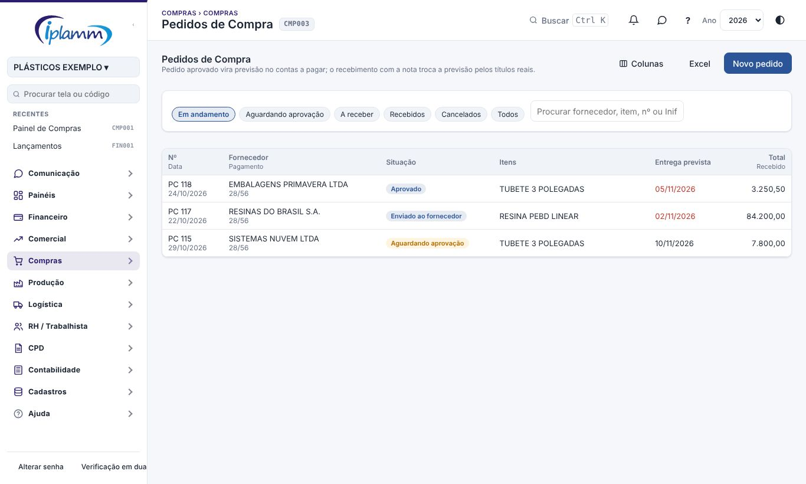

A lista mostra o **Nº** (com a data do pedido e o nº do Iniflex na 2ª linha), o **Fornecedor** (com a condição de pagamento na 2ª linha), a **Situação**, os **Itens**, a **Entrega prevista** (em vermelho se já passou) e o **Total** (com o quanto já foi recebido na 2ª linha). O botão **Colunas**, ao lado do Excel, mostra ou oculta cada uma dessas informações, e a escolha fica guardada para você. O **Excel** sai com todas as colunas.

1. Em **Pedidos de Compra**, abra o pedido e clique em **Editar**.
2. Confira o fornecedor, a entrega prevista, as **parcelas (dias após a entrega)**, o frete, o desconto e os itens. Preencha a **classificação (plano de contas)**, obrigatória para aprovar, o centro de custo e o **nº do pedido no Iniflex**.
3. Salve e clique em:
   - **Aprovar**, se o valor estiver dentro da sua alçada (ou se você for diretor ou administrador);
   - **Enviar para aprovação**, se estiver acima. A direção aprova.
4. Depois de aprovado, clique em **Imprimir** para gerar o pedido no padrão IPLAMM, com campos de assinatura, e mande ao fornecedor. Clique em **Marcar como enviado**.

> **Pagamento antes da entrega:** o pedido aprovado tem o botão **Pagamento antecipado**, que abre o pedido de pagamento já preenchido (veja o manual de Pagamentos Antecipados).

### 4.6 Receber a mercadoria

1. Importe o XML da nota em **CPD › Notas Fiscais** (entradas).
2. Em **Recebimentos**, na lista **A receber**, clique em **Receber** no pedido. O botão **Receber** também aparece dentro do pedido.
3. Escolha a **nota fiscal**. Se a nota ainda não chegou, escolha **Sem nota**: é um recebimento físico, e a nota vem depois.
4. Confira a tabela **pedido × nota**: cada item do pedido é ligado ao item da nota, e você informa a quantidade **recebida agora**. A coluna **Conferência** aponta, por item:
   - quantidade acima do pedido;
   - entrega parcial;
   - nota diferente do recebido;
   - preço diferente do pedido, com a porcentagem;
   - item que não está na nota.
5. Confira as **parcelas da nota** e deixe marcada a opção de **lançar as parcelas no contas a pagar**, com a classificação do pedido.
6. Leia o quadro do **confronto** abaixo da tabela. Ele é a mesma conferência que o sistema faz ao registrar e diz se o pagamento da nota vai ficar **bloqueado** (veja a seção 4.7).
7. Clique em **Registrar recebimento**.

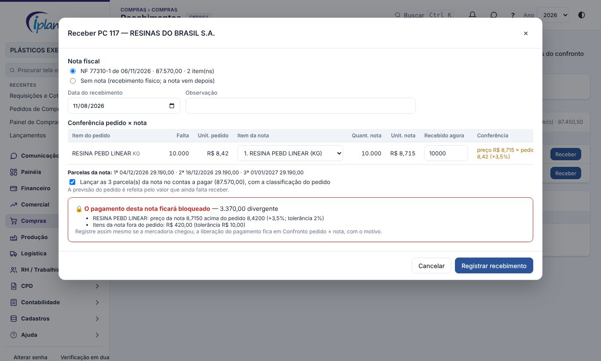

Os recebimentos ficam em **Últimos recebimentos**, com as divergências encontradas. Se faltou algo, o pedido fica como **Recebido em parte** e a previsão é refeita pelo que ainda falta.

### 4.7 Confronto pedido × nota e bloqueio do pagamento

Ao registrar o recebimento, o sistema compara a nota com o pedido e aplica as **tolerâncias** dos parâmetros:

| Conferência | Bloqueia o pagamento quando… |
|---|---|
| Quantidade | o total recebido do item passa do pedido além da tolerância (padrão 5%) |
| Preço | o preço unitário da nota passa do pedido além da tolerância (padrão 2%) |
| Item fora do pedido | os itens da nota que não entraram no recebimento (frete, palete, item trocado) somam mais que a tolerância em reais (padrão R$ 10,00) |
| Prazo de pagamento | uma parcela da nota vence antes do combinado no pedido, contando da emissão da nota, além da tolerância (padrão 3 dias) |
| Número de parcelas | só informa |
| Entrega atrasada | só informa (alimenta a avaliação do fornecedor) |

Preço **abaixo** do pedido e quantidade **menor** não bloqueiam.

Quando alguma conferência bloqueia:

- os títulos da nota no contas a pagar ficam com **🔒 bloqueado**: não entram na **Autorização de Pagamentos** e não podem ser baixados como pagos;
- um título ligado depois a essa nota (por exemplo, pela conciliação) já nasce bloqueado;
- quem libera e o comprador recebem o aviso **Pagamento bloqueado: nota diverge do pedido**.

A aba **Confronto pedido × nota**, em Recebimentos, lista as notas de entrada dos fornecedores com o pedido, as divergências, os títulos e a situação:

- **Pagamento bloqueado**;
- **Divergência sem bloqueio** (dentro da tolerância, ou só informativa);
- **Sem pedido**: nota de fornecedor que não passou por recebimento de pedido;
- **Liberada**;
- **Confere**.

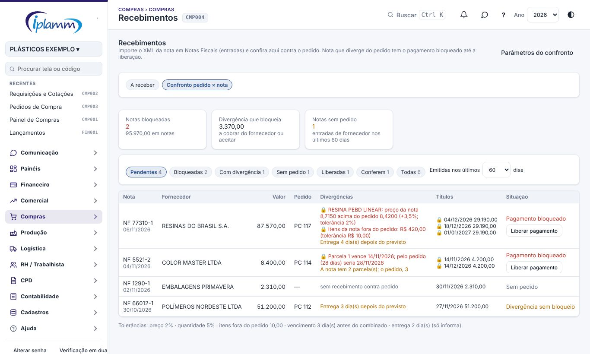

Para **liberar o pagamento**, quem tem permissão clica em **Liberar pagamento** e escreve o motivo, por exemplo "fornecedor emitiu nota de débito" ou "reajuste aprovado pela diretoria". Os títulos voltam a poder ser autorizados e pagos. A liberação fica registrada com o nome, a data e o motivo.

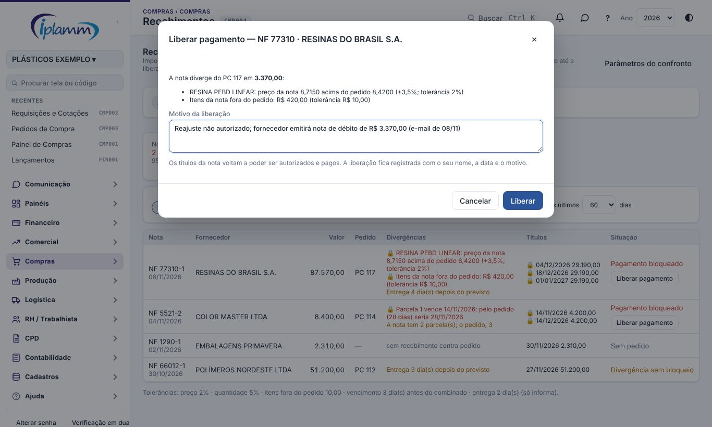

**Parâmetros do confronto** (botão no topo de Recebimentos, para administrador e diretor):

- ligar ou desligar o bloqueio;
- as tolerâncias de preço, quantidade, itens fora do pedido, vencimento e entrega;
- quem libera: diretor, financeiro e/ou compras. O administrador sempre libera.

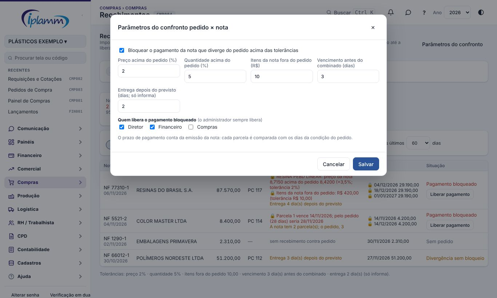

## 5. Regras e travas

- O pedido precisa de **classificação (plano de contas)** e valor para ser aprovado.
- Acima da **alçada**, só **diretor ou administrador** aprovam.
- Pedido aprovado **não muda** de fornecedor, frete ou desconto. Para mudar, use **Voltar para rascunho** (só sem recebimento) ou cancele.
- Cancelar exige **motivo**. Pedido já recebido não pode ser cancelado.
- Pedido com recebimento **não volta** para rascunho.
- A previsão no contas a pagar é refeita sempre que o pedido muda, e sai quando ele é recebido ou cancelado.
- Nota que diverge do pedido acima das tolerâncias tem o **pagamento bloqueado** até a liberação com motivo. Título bloqueado não é autorizado nem baixado, e o bloqueio não pode ser tirado na mão.
- O link de cotação é único por fornecedor e só serve para aquela requisição. Ele para de funcionar quando vence, quando é cancelado, quando a requisição sai de "aprovada" ou quando a cotação é escolhida para o pedido.

## 6. Perguntas frequentes e erros comuns

**A mensagem diz "acima da alçada: precisa de aprovação da direção".** Clique em **Enviar para aprovação** e avise o diretor.

**A mensagem diz "Defina a classificação (plano de contas)".** Edite o pedido e escolha o plano de contas antes de aprovar.

**A nota não aparece no recebimento.** Ela ainda não foi importada, ou foi emitida antes dos 30 dias anteriores ao pedido. Importe o XML em Notas Fiscais › Entradas.

**A nota veio em outra unidade (por exemplo, caixa em vez de unidade).** Cadastre o **de-para do fornecedor** em **Estoque › De-para de Fornecedores**, com o fator de conversão. Os próximos recebimentos já convertem sozinhos.

**O título aparece com 🔒 bloqueado na Autorização de Pagamentos.** A nota dele diverge do pedido. Veja o motivo em **Recebimentos › Confronto pedido × nota**. Cobre o fornecedor (nota de débito, carta de correção) ou peça a liberação a quem tem permissão.

**A baixa do título deu "Pagamento bloqueado".** É o mesmo caso: libere no confronto antes de baixar.

**A nota aparece como "Sem pedido".** A mercadoria entrou sem recebimento contra pedido de compra. Se havia pedido, registre o recebimento por ele. Se é uma compra sem pedido (serviço, despesa), não há o que fazer aqui.

**O fornecedor diz que o link não abre.** O link venceu ou foi cancelado. Gere outro convite na requisição.

**O fornecedor não recebeu o e-mail.** Confira o e-mail no convite, ou use **Copiar link** e mande pelo WhatsApp.

**Errei o fornecedor de um pedido aprovado.** Use **Voltar para rascunho**, corrija e aprove de novo. Se já houver recebimento, cancele e faça outro pedido.

## 7. Conversa sobre o registro

No topo da janela do pedido de compra ficam dois botões das **Conversas**:

- **💬 Conversa** abre o bate-papo da equipe sobre este registro. Cada registro tem uma conversa só, e só entra quem consegue ver o registro.
- **↗ Enviar no chat** manda o registro como cartão numa conversa. Quem recebe clica no cartão e abre o registro.

Veja o manual **Conversas** para os detalhes.

## 8. Histórico de alterações

| Versão | Data | O que mudou |
|---|---|---|
| 1.0 | 28/10/2026 | Primeira versão do manual: painel, requisição, cotação e mapa comparativo, pedido com alçada e impressão, recebimento conferido com a nota. |
| 1.1 | 29/10/2026 | Botões **💬 Conversa** e **↗ Enviar no chat** do pedido de compra (Conversas, etapa 2). |
| 1.2 | 29/10/2026 | Imagens das telas, com dados fictícios. |
| 1.3 | 05/11/2026 | Nomes das telas iguais aos do menu, com o código. Lista de Pedidos de Compra com as informações secundárias na 2ª linha e seletor **Colunas**; formulário do novo pedido em seções. Figuras refeitas. |
| 1.4 | 08/11/2026 | Cotação por link: convite por e-mail ou WhatsApp, página do fornecedor sem cadastro, resposta e recusa, lista de convites; mapa comparativo com o menor preço por item, prazo, valor presente e a compra dividida; parâmetros da cotação. |
| 1.5 | 08/11/2026 | Confronto pedido × nota: o sistema confere quantidade, preço, itens fora do pedido e prazo de pagamento com tolerâncias; nota divergente tem o pagamento bloqueado até a liberação com motivo; aba **Confronto pedido × nota** com as notas sem pedido; parâmetros do confronto. |
