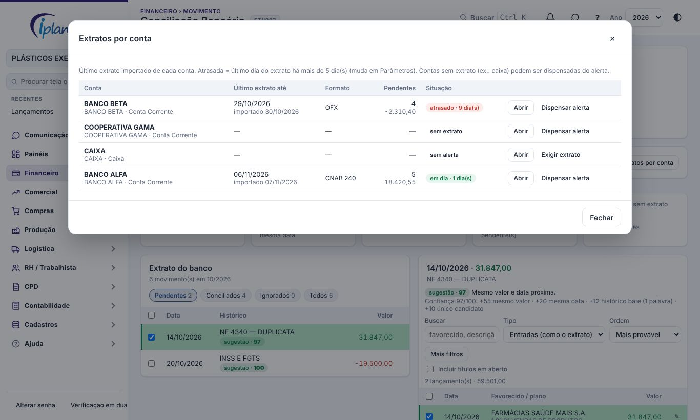
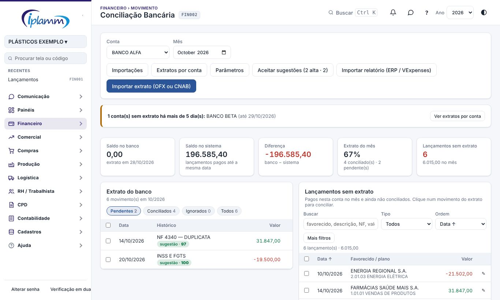
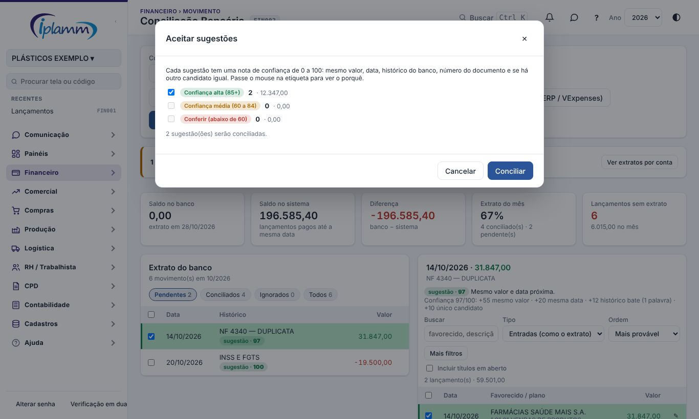
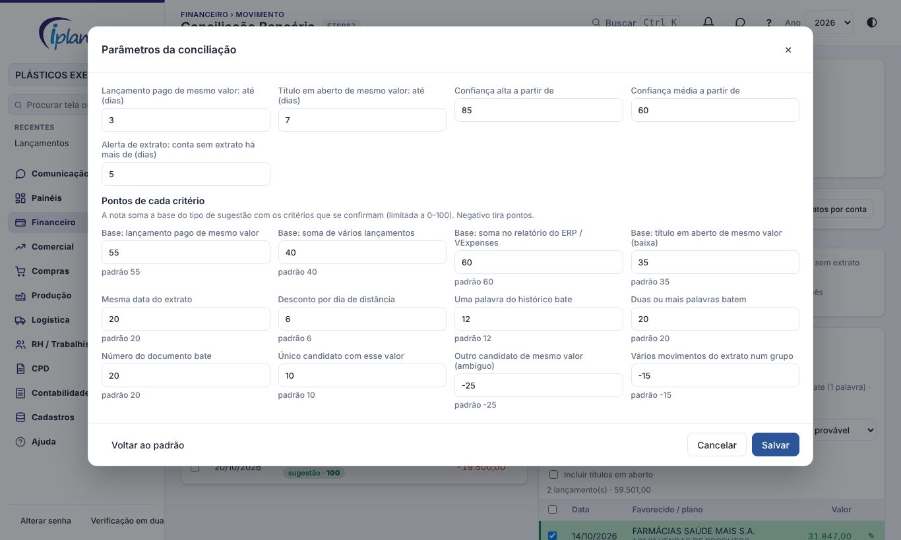
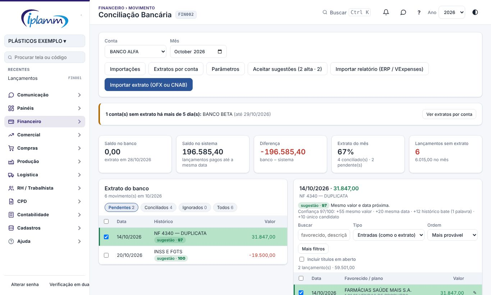

## 1. Para que serve

A **Conciliação Bancária** confere, movimento a movimento, o **extrato do banco** contra os **lançamentos da plataforma**. Cada movimento do extrato é ligado ao lançamento (ou aos lançamentos) que ele representa. O que sobra de um lado ou do outro mostra o que falta lançar ou o que foi lançado errado.

A tela tem dois lados:

- **Esquerda: Extrato do banco**, com os movimentos importados.
- **Direita: lançamentos da plataforma**, com os candidatos para o movimento escolhido.

## 2. Quem tem acesso

| Perfil | O que faz |
|---|---|
| Administrador e financeiro | Importam extratos, conciliam, ignoram, criam lançamentos e excluem importações. |
| Diretor e leitura | Consultam. |

## 3. Importar o extrato

Escolha a **conta** e o **mês** no topo. Depois:

- **Importar extrato (OFX ou CNAB)**: selecione um ou mais arquivos exportados do internet banking. Os formatos aceitos são:
  - **OFX**;
  - **CNAB 240 de extrato**, o "extrato para conciliação bancária" no padrão FEBRABAN, segmento E, que o banco envia em .ret ou .txt.

  A plataforma reconhece o formato pelo conteúdo. A conta é reconhecida pelo banco, pela agência e pelo número da conta do arquivo. Os movimentos que já foram importados não se repetem.
- **Importar relatório (ERP / VExpenses)**:
  - **Para contas sem OFX** (FS, Vortx, caixa, FIDCs…): no ERP, gere o **RFLX036 — Extrato de Contas por Quebra por Data Efetivação** e exporte em XLSX ou CSV. A plataforma reconhece a conta pelo nome do banco no relatório; confira na coluna **Conta no sistema**.
  - **Cartões**: da **VExpenses**, use o PDF do **Extrato de Pagamentos**. Os gastos e estornos dos cartões entram; as cargas e devoluções entre a carteira da empresa e os cartões são internas e ficam só no resumo.
  - Importar de novo o mesmo período **não duplica**. Se o relatório mudou, a plataforma oferece remover as linhas que saíram (só as não conciliadas).
- **Extratos por conta** mostra o último extrato de cada conta, o formato, os movimentos pendentes e a situação: **em dia**, **atrasado** ou **sem extrato**.
  - Uma conta fica **atrasada** quando o último extrato termina há mais dias que o parâmetro (padrão 5). As atrasadas aparecem numa faixa acima dos indicadores e na Central de Decisões.
  - **Dispensar alerta** serve para contas que não têm extrato, como o caixa.

- **Importações** mostra o histórico de arquivos importados. **Excluir** uma importação remove os movimentos dela que ainda não foram conciliados; use quando o arquivo entrou na conta errada.

> **Atenção:** não importe o relatório do ERP numa conta que já tem o extrato OFX do banco no mesmo período. A plataforma avisa, porque o extrato ficaria duplicado.

## 4. Conciliar

### 4.1 Pelas sugestões, com a nota de confiança

Depois da importação, a plataforma sugere os vínculos:

- **sugestão**: lançamento de mesmo valor e data próxima (até 3 dias, ajustável);
- **sugestão (vários)**: lançamentos do mesmo dia que somam o valor do movimento;
- **baixar título**: título em aberto de mesmo valor (até 7 dias, ajustável), que passa a **Pago** na data do extrato e nesta conta.

Cada sugestão tem uma **nota de confiança de 0 a 100**, que aparece na etiqueta embaixo do histórico. A nota soma:

- a base do tipo de sugestão;
- a **data**: mesma data soma mais, e cada dia de distância desconta;
- o **histórico do banco**: palavras que aparecem no favorecido, na descrição ou no plano do lançamento;
- o **número do documento**;
- se é o **único candidato** com aquele valor. Quando há outro de mesmo valor e nada distingue os dois, a nota cai.

Passe o mouse na etiqueta, ou clique no movimento, para ver o porquê de cada ponto.

| Faixa | Nota (padrão) | Cor |
|---|---|---|
| Confiança alta | 85 ou mais | verde |
| Confiança média | 60 a 84 | amarelo |
| Conferir | abaixo de 60 | vermelho |

**Aceitar sugestões** concilia de uma vez as sugestões das faixas escolhidas. Por padrão entram só as de **confiança alta**, e o botão mostra quantas são. Marque também a média se quiser. A faixa **conferir** é para olhar uma a uma: são casos como saques e PIX de mesmo valor no mesmo dia, ou datas distantes.

### 4.1.1 Parâmetros da conciliação

Em **Parâmetros** (administrador e financeiro) você ajusta:

- as **janelas de dias** do lançamento pago e do título em aberto;
- os limites das faixas **alta** e **média**;
- o **prazo do alerta de extrato**;
- os **pontos de cada critério**.

**Voltar ao padrão** restaura tudo. Ao salvar, as sugestões são recalculadas na hora.

### 4.2 Um a um

1. Clique num movimento do extrato (à esquerda). À direita aparecem os candidatos, com o mais provável no topo. Use os filtros (tipo, ordem, classificação, período, valor entre) para achar o lançamento.
2. Marque o lançamento, ou os lançamentos, que correspondem ao movimento. O rodapé mostra o valor do extrato, o selecionado e a **diferença**. Quando a diferença é zero, as linhas ficam verdes.
3. Clique em **Conciliar**.

Para juntar **vários movimentos com um ou vários lançamentos** (por exemplo, fomentos do dia), marque os movimentos à esquerda e os lançamentos à direita até a diferença zerar. Também dá para começar pelo outro lado: sem movimento escolhido, a direita mostra os **Lançamentos sem extrato** do mês; marque-os e depois os movimentos.

Se as datas estiverem a mais de 2 dias uma da outra, a plataforma pede confirmação.

**Recebimento com juros:** quando o extrato é maior que o título selecionado (um título a receber), aparece **Conciliar com R$ X de juros/multa**. O título é baixado pelo valor de face, a diferença vira lançamento em **1.02.17 JUROS E MULTAS RECEBIDOS** e a **nota de débito** entra na fila de **Fiscal › Notas de Débito** (reforma tributária).

### 4.3 Quando não há lançamento

- **Criar lançamento**: cria o lançamento a partir do movimento, já com a data, o valor e a conta.
- **Ignorar**: para movimentos que não devem virar lançamento. O motivo fica registrado.

### 4.4 Desfazer

Clique no movimento conciliado e em **Desfazer conciliação** (ou **Desfazer conciliação do grupo**). O movimento ignorado volta com **Voltar para pendente**.

## 5. Os indicadores

- **Saldo no banco**: o saldo do extrato.
- **Saldo no sistema**: o saldo dos lançamentos.
- **Diferença**: banco menos sistema; o objetivo é zero.
- **Extrato do mês**: quantos movimentos estão pendentes, conciliados e ignorados.
- **Lançamentos sem extrato**: pagos na conta e ainda não conciliados.

Use os filtros **Pendentes / Conciliados / Ignorados / Todos** na lista do extrato.

## 6. Regras e travas

- Nada é conciliado sem a sua confirmação.
- Um lançamento só pode estar conciliado com um movimento (ou com um grupo).
- **Lançamento conciliado** não pode ter valor, data, conta ou classificação alterados, nem ser excluído. Desfaça a conciliação antes.
- Ao conciliar um título **Em aberto**, ele vira **Pago** na data do extrato e na conta conciliada.
- Uma importação com movimentos já conciliados só pode ser excluída depois de desfazer essas conciliações.

## 7. Perguntas frequentes e erros comuns

**A mensagem diz "Algum lançamento já estava conciliado com outro movimento".** Outro usuário conciliou ao mesmo tempo. Atualize a página.

**O CNAB foi recusado com "não é de extrato".** O arquivo é um retorno de cobrança ou de pagamentos (segmentos T, U, J…). Peça ao banco o **extrato para conciliação bancária em CNAB 240**, que usa o segmento E. Se o seu banco mandar o extrato em CNAB 400, exporte em OFX.

**O relatório do ERP não foi reconhecido.** Ele precisa ser o RFLX036 exportado em XLSX ou CSV; PDF não é aceito.

**Criei o lançamento, mas ele não conciliou.** O valor, a natureza ou a conta não bateram com o movimento. Concilie à mão (item 4.2).

**Há diferença de saldo, mas tudo está conciliado.** Confira se o extrato foi importado até o fim do mês, ou se há lançamento pago nesta conta com data errada. A **Conferência do Dia** mostra em que dia a diferença começa.

## 8. Histórico de alterações

| Versão | Data | O que mudou |
|---|---|---|
| 1.0 | 28/10/2026 | Primeira versão do manual: importação OFX, ERP e VExpenses, sugestões, conciliação um a um e em grupo, ignorar, criar lançamento e desfazer. |
| 1.1 | 29/10/2026 | Imagens das telas, com dados fictícios. |
| 1.2 | 31/10/2026 | Conciliar recebimento com juros/multa: baixa pela face, lança a diferença em 1.02.17 e gera a nota de débito a emitir. |
| 1.3 | 31/10/2026 | Nova figura: movimento do extrato com os lançamentos candidatos. |
| 1.4 | 05/11/2026 | Nomes das telas iguais aos do menu, com o código da tela no cabeçalho. |
| 1.5 | 07/11/2026 | Conciliação sugerida: nota de confiança de 0 a 100 com os motivos, aceitar sugestões pela faixa (alta, média, conferir), parâmetros (janelas, faixas e pontos), importação do extrato CNAB 240 (segmento E) e Extratos por conta com alerta de extrato atrasado. |
