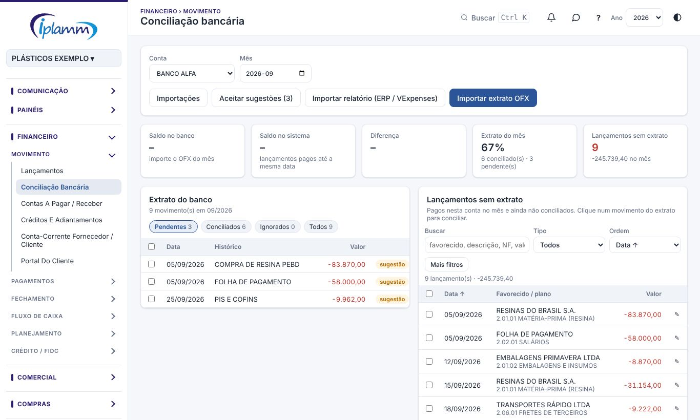

## 1. Para que serve

A **Conciliação bancária** confere, movimento a movimento, o **extrato do banco** contra os **lançamentos da plataforma**. Cada movimento do extrato é ligado ao lançamento (ou aos lançamentos) que ele representa. O que sobra de um lado ou do outro mostra o que falta lançar ou o que foi lançado errado.

A tela tem dois lados:

- **Esquerda: Extrato do banco**, com os movimentos importados.
- **Direita: lançamentos da plataforma**, com os candidatos para o movimento escolhido.

## 2. Quem tem acesso

| Perfil | O que faz |
|---|---|
| Administrador e financeiro | Importam extratos, conciliam, ignoram, criam lançamentos e excluem importações. |
| Diretor e leitura | Consultam. |

## 3. Importar o extrato

Escolha a **conta** e o **mês** no topo. Depois:

- **Importar extrato OFX**: selecione um ou mais arquivos .ofx exportados do internet banking. Os movimentos que já foram importados (mesmo identificador do banco) não se repetem.
- **Importar relatório (ERP / VExpenses)**:
  - **Para contas sem OFX** (FS, Vortx, caixa, FIDCs…): no ERP, gere o **RFLX036 — Extrato de Contas por Quebra por Data Efetivação** e exporte em XLSX ou CSV. A plataforma reconhece a conta pelo nome do banco no relatório; confira na coluna **Conta no sistema**.
  - **Cartões**: da **VExpenses**, use o PDF do **Extrato de Pagamentos**. Os gastos e estornos dos cartões entram; as cargas e devoluções entre a carteira da empresa e os cartões são internas e ficam só no resumo.
  - Importar de novo o mesmo período **não duplica**. Se o relatório mudou, a plataforma oferece remover as linhas que saíram (só as não conciliadas).
- **Importações** mostra o histórico de arquivos importados. **Excluir** uma importação remove os movimentos dela que ainda não foram conciliados; use quando o arquivo entrou na conta errada.

> **Atenção:** não importe o relatório do ERP numa conta que já tem o extrato OFX do banco no mesmo período. A plataforma avisa, porque o extrato ficaria duplicado.

## 4. Conciliar

### 4.1 Pelas sugestões

Depois da importação, a plataforma sugere os vínculos:

- **sugestão**: lançamento de mesmo valor e data próxima;
- **sugestão (vários)**: lançamentos do mesmo dia que somam o valor do movimento;
- **baixar título**: título em aberto de mesmo valor, que passa a **Pago** na data do extrato e nesta conta.

Clique em **Aceitar sugestões** para conciliar todas de uma vez. As marcadas **conferir** ficam de fora: há outro lançamento de mesmo valor e o histórico do banco não confirma qual é (por exemplo, saques e PIX de mesmo valor no mesmo dia). Confira essas uma a uma.

### 4.2 Um a um

1. Clique num movimento do extrato (à esquerda). À direita aparecem os candidatos, com o mais provável no topo. Use os filtros (tipo, ordem, classificação, período, valor entre) para achar o lançamento.
2. Marque o lançamento, ou os lançamentos, que correspondem ao movimento. O rodapé mostra o valor do extrato, o selecionado e a **diferença**. Quando a diferença é zero, as linhas ficam verdes.
3. Clique em **Conciliar**.

Para juntar **vários movimentos com um ou vários lançamentos** (por exemplo, fomentos do dia), marque os movimentos à esquerda e os lançamentos à direita até a diferença zerar. Também dá para começar pelo outro lado: sem movimento escolhido, a direita mostra os **Lançamentos sem extrato** do mês; marque-os e depois os movimentos.

Se as datas estiverem a mais de 2 dias uma da outra, a plataforma pede confirmação.

### 4.3 Quando não há lançamento

- **Criar lançamento**: cria o lançamento a partir do movimento, já com a data, o valor e a conta.
- **Ignorar**: para movimentos que não devem virar lançamento. O motivo fica registrado.

### 4.4 Desfazer

Clique no movimento conciliado e em **Desfazer conciliação** (ou **Desfazer conciliação do grupo**). O movimento ignorado volta com **Voltar para pendente**.

## 5. Os indicadores

- **Saldo no banco**: o saldo do extrato.
- **Saldo no sistema**: o saldo dos lançamentos.
- **Diferença**: banco menos sistema; o objetivo é zero.
- **Extrato do mês**: quantos movimentos estão pendentes, conciliados e ignorados.
- **Lançamentos sem extrato**: pagos na conta e ainda não conciliados.

Use os filtros **Pendentes / Conciliados / Ignorados / Todos** na lista do extrato.

## 6. Regras e travas

- Nada é conciliado sem a sua confirmação.
- Um lançamento só pode estar conciliado com um movimento (ou com um grupo).
- **Lançamento conciliado** não pode ter valor, data, conta ou classificação alterados, nem ser excluído. Desfaça a conciliação antes.
- Ao conciliar um título **Em aberto**, ele vira **Pago** na data do extrato e na conta conciliada.
- Uma importação com movimentos já conciliados só pode ser excluída depois de desfazer essas conciliações.

## 7. Perguntas frequentes e erros comuns

**A mensagem diz "Algum lançamento já estava conciliado com outro movimento".** Outro usuário conciliou ao mesmo tempo. Atualize a página.

**O relatório do ERP não foi reconhecido.** Ele precisa ser o RFLX036 exportado em XLSX ou CSV; PDF não é aceito.

**Criei o lançamento, mas ele não conciliou.** O valor, a natureza ou a conta não bateram com o movimento. Concilie à mão (item 4.2).

**Há diferença de saldo, mas tudo está conciliado.** Confira se o extrato foi importado até o fim do mês, ou se há lançamento pago nesta conta com data errada. A **Conferência do dia** mostra em que dia a diferença começa.

## 8. Histórico de alterações

| Versão | Data | O que mudou |
|---|---|---|
| 1.0 | 28/10/2026 | Primeira versão do manual: importação OFX, ERP e VExpenses, sugestões, conciliação um a um e em grupo, ignorar, criar lançamento e desfazer. |
| 1.1 | 29/10/2026 | Imagens das telas, com dados fictícios. |
