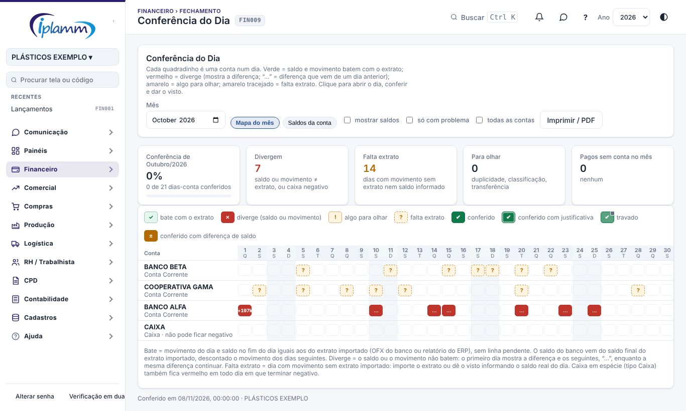
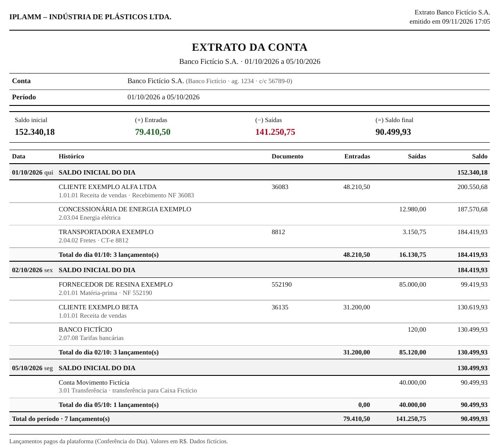
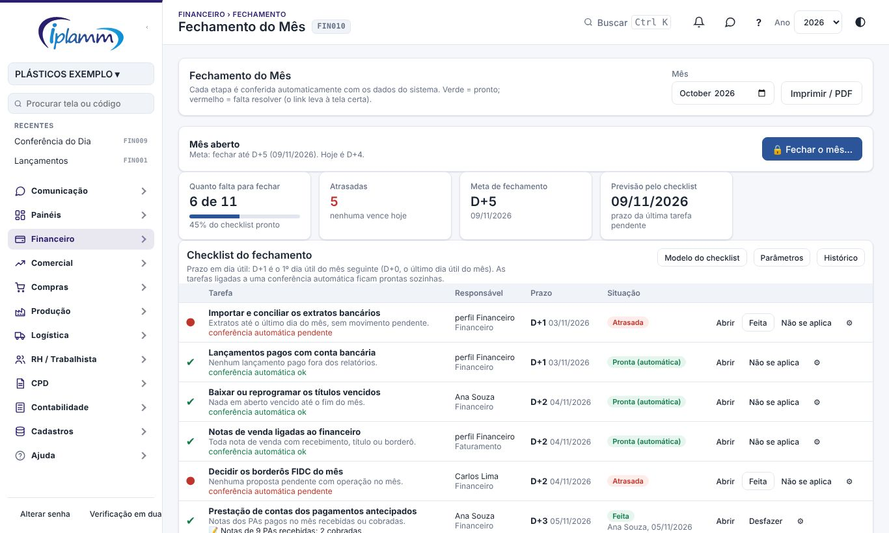
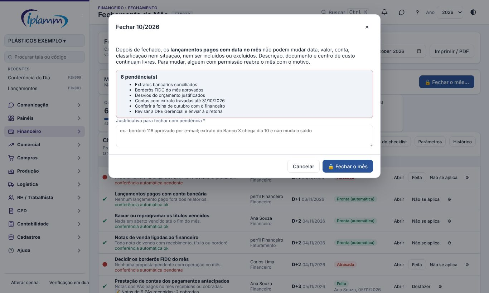

## 1. Para que serve

As duas telas ajudam a deixar o caixa certo todos os dias e a fechar o mês com segurança:

- **Conferência do Dia**: um mapa do mês com **uma linha por conta e uma coluna por dia**. Cada quadradinho diz se o dia bate com o extrato do banco. Clicando, você confere o dia e dá o **visto**.
- **Fechamento do Mês**:
  - o **checklist da equipe**, com responsáveis e prazos em dia útil;
  - o painel **quanto falta para fechar**;
  - as **conferências automáticas**;
  - o resumo do mês para a direção;
  - a **trava** de cada conta;
  - o **fechamento do mês**, que trava os lançamentos pagos, com reabertura justificada.

Nenhuma das duas altera lançamentos. As correções são feitas nas telas de sempre (Lançamentos e Conciliação). Fechar o mês só impede mudanças nos lançamentos pagos dele.

## 2. Quem tem acesso

| Perfil | O que faz |
|---|---|
| Administrador e financeiro | Dão e desfazem o visto na Conferência do dia. |
| Administrador | Fecha e destrava as contas no Fechamento do mês. |
| Administrador, diretor e financeiro | Montam o **modelo do checklist** e os **parâmetros**, marcam qualquer tarefa e ajustam o responsável e o prazo de uma tarefa no mês. |
| Responsável pela tarefa | Marca a própria tarefa como feita ou como "não se aplica". Vale para a pessoa escolhida ou, quando não há pessoa, para quem tem o perfil escolhido. |
| Administrador e diretor (padrão) | **Fecham e reabrem o mês**. Quem pode fazer isso é definido nos Parâmetros. |
| Diretor e leitura | Consultam e imprimem. |

## 3. Conferência do Dia

### 3.1 O mapa do mês

Escolha o **mês** no topo. As cores de cada quadradinho:

- **Verde**: o saldo e o movimento do dia batem com o extrato.
- **Vermelho**: diverge. O primeiro dia mostra a diferença; os dias seguintes mostram "…" enquanto a mesma diferença continuar.
- **Amarelo**: algo para olhar.
- **Amarelo tracejado**: falta extrato. A conta tem movimento no dia, mas o extrato não foi importado.

**"Bate"** quer dizer que o movimento do dia e o saldo no fim do dia são iguais aos do extrato importado (OFX do banco ou relatório do ERP) e que não há linha pendente no extrato.

O que deixa um dia **amarelo**:

- **Possível duplicidade**: lançamentos iguais (mesmo valor, favorecido e descrição) até 3 dias de distância, ou o mesmo título do Iniflex lançado duas vezes.
- **Classificação suspeita**: por exemplo, um título de venda lançado como saída, ou uma nota de compra lançada como entrada.
- **Transferência sem a outra ponta** em outra conta.
- **Adiantamento sem favorecido**: ele não aparece no conta-corrente do fornecedor.

Os indicadores mostram quantos dias **divergem**, quantos têm **falta extrato**, quantos estão **para olhar** e quantos lançamentos estão **pagos sem conta** no mês.

### 3.2 Conferir um dia

1. Clique no quadradinho. Abre o dia da conta com os **lançamentos no sistema** e o **extrato** lado a lado, e o saldo inicial, as entradas, as saídas, o saldo final da plataforma e o saldo no banco.
2. Corrija o que for preciso, nas telas de Lançamentos ou de Conciliação.
3. Dê o **visto**:
   - **Dia que bate**: o visto é direto.
   - **Dia sem extrato** (caixa, cofre…): informe o **saldo real do dia**, pelo extrato em papel ou pela contagem do caixa. Se o saldo for diferente do da plataforma, a plataforma pergunta se você quer registrar mesmo assim; o dia fica vermelho até ser corrigido.
   - **Dia com pendência**: escreva a explicação na observação antes de dar o visto.
4. Use **‹ dia / dia ›** e **↑ conta / ↓ conta** para andar pelo mapa sem fechar a janela.

**Dar visto nos dias que batem** registra o visto de uma vez em todos os dias sem nenhuma diferença nem aviso. Fica registrado quem conferiu e quando, e cada visto pode ser desfeito no detalhe do dia (**Desfazer visto**).

### 3.3 Saldos da conta

A aba **Saldos da conta** mostra uma linha por dia de uma conta: saldo inicial, entradas, saídas, saldo final da plataforma, saldo no banco, **diferença** (banco menos plataforma) e situação. Isso ajuda a achar em que dia uma diferença começou.

**Imprimir / PDF** gera a tela no padrão IPLAMM.

### 3.4 Extrato da conta em PDF

O botão **Extrato (PDF)**, no alto da tela, gera o movimento da conta no formato de um **extrato bancário**, no padrão dos relatórios IPLAMM.

Ao clicar, escolha:

| Opção | O que faz |
|---|---|
| Conta | Uma conta, ou **todas as contas com movimento** no mesmo PDF (uma seção por conta, cada uma começando numa página). |
| De / Até | O período dentro do mês aberto na tela. Para outro mês, troque o **Mês** no alto da tela antes. |
| Formato | **Detalhado**: cada lançamento com o saldo depois dele, agrupado por dia. **Resumido**: uma linha por dia. |
| Incluir os dias sem movimento | Mostra também os dias em que a conta não teve lançamento, com o saldo do dia. |

O extrato traz:

- **No alto**: a conta (com banco, agência e conta, quando cadastrados), o período e o quadro com **saldo inicial**, **(+) entradas**, **(−) saídas** e **(=) saldo final** do período.
- **Detalhado**: cada dia abre com o **saldo inicial do dia**, mostra os lançamentos (favorecido, classificação, descrição, documento, entrada ou saída e o saldo) e fecha com o **total do dia**: entradas, saídas e saldo final.
- **Resumido**: data, saldo inicial, entradas, saídas, saldo final e quantidade de lançamentos de cada dia.
- **No fim**: o total do período.

Os números são os mesmos da Conferência do Dia: lançamentos **pagos** da conta, com a transferência entrando nas duas contas. O saldo inicial é o saldo pago acumulado até o dia anterior ao período. Gerar o extrato não altera nada.

## 4. Fechamento do Mês

### 4.1 O checklist da equipe

Escolha o **mês**. O checklist do mês nasce do **modelo do checklist** da empresa. Cada tarefa tem:

- um **responsável**: uma pessoa, ou um perfil quando não há pessoa;
- um **prazo em dia útil**: **D+1** é o 1º dia útil do mês seguinte, **D+5** o 5º, e **D+0** o último dia útil do próprio mês. Fins de semana e feriados nacionais não contam, inclusive carnaval, Sexta-feira Santa e Corpus Christi;
- se é **obrigatória** para fechar;
- se está ligada a uma **conferência automática** (seção 4.2). Nesse caso, a tarefa fica **pronta sozinha** quando a conferência fica verde.

Em cada linha:

- **Abrir** leva à tela da tarefa.
- **Feita** marca a tarefa. **Desfazer** volta a deixá-la pendente.
- **Não se aplica** exige o motivo. Ex.: não houve borderô no mês.
- **⚙** muda o responsável e o prazo só neste mês. Fica com os gestores.

Na situação, a tarefa aparece como **Pendente**, **Vence hoje**, **Atrasada**, **Feita**, **Pronta (automática)** ou **Não se aplica**. Embaixo da tabela fica o resumo por responsável: quantas tarefas pendentes e quantas atrasadas.

**Modelo do checklist** inclui, edita ou exclui tarefas: título, descrição, área, prazo, responsável, conferência automática, link da tela, ordem, obrigatória e ativa. Mudanças no modelo valem para os meses que ainda não tinham a tarefa.

Na primeira vez, **Usar o modelo padrão** cria 10 tarefas:

1. extratos (D+1);
2. pagos com conta (D+1);
3. vencidos (D+2);
4. notas de venda (D+2);
5. borderôs (D+2);
6. prestação de contas dos PAs (D+3);
7. desvios do orçamento (D+4);
8. trava das contas (D+4);
9. DRE à diretoria (D+5);
10. documentos à contabilidade (D+5).

### 4.2 Quanto falta para fechar

Os quatro indicadores do topo mostram:

- **Quanto falta para fechar**: tarefas pendentes do total, com a barra de progresso;
- **Atrasadas**, e quantas vencem hoje;
- a **meta de fechamento**: padrão D+5, com a data;
- a **previsão pelo checklist**: o prazo da última tarefa pendente.

A faixa acima deles diz se o mês está **aberto**, **fechado** ou **reaberto** e em que D+ estamos hoje.

### 4.3 As conferências automáticas

Cada etapa é conferida sozinha:

1. **Extratos bancários conciliados**.
2. **Lançamentos pagos com conta bancária**: nenhum lançamento pago sem conta.
3. **Nada em aberto vencido** até o fim do mês.
4. **Notas de venda do mês ligadas ao financeiro**.
5. **Borderôs FIDC do mês aprovados**.
6. **Desvios do orçamento justificados**.
7. **Contas com extrato travadas** até o fim do mês.

Verde quer dizer pronto; vermelho, falta resolver. O botão leva à tela certa. Enquanto houver etapa pendente, os números do resumo ainda podem mudar.

### 4.4 O resumo para a direção

O topo mostra a receita bruta realizada, o **EBITDA gerencial**, o resultado gerencial e o **saldo disponível** no fim do mês. Embaixo ficam os saldos de cada conta. **Imprimir / PDF** gera o relatório.

### 4.5 Fechar e travar as contas

Na tabela **Contas: conciliação e trava**, cada conta mostra o saldo, o movimento no extrato, o movimento no sistema e a situação. **Batendo** quer dizer: extrato importado até o fim do mês, nenhum movimento pendente e o movimento do extrato igual ao do sistema.

- **Conta com extrato**: clique em **Fechar / travar** e escolha até que dia a conta está fechada.
- **Conta sem extrato** (caixa, cofre…): use **Fechar com saldo informado**. Informe o saldo conferido na data; se ele bater com o da plataforma, a conta é travada.
- **Destravar**: libera de novo os lançamentos até a data. Fica registrado quem destravou e quando.

Cada conta pode ser fechada numa data diferente.

### 4.6 Fechar o mês

Quando o mês terminou e o checklist está pronto, clique em **🔒 Fechar o mês**.

- A janela lista o que ainda está pendente: as conferências automáticas e as tarefas obrigatórias.
- Com pendência, é preciso escrever a **justificativa**, com pelo menos 15 letras. Dá para desligar essa exigência nos Parâmetros.
- Depois de fechado, os **lançamentos pagos com data no mês** não podem mudar data, valor, conta, classificação nem situação, nem ser incluídos ou excluídos. Descrição, documento e centro de custo continuam livres.
- O checklist do mês também fica travado.

**Reabrir o mês** exige o **motivo**, com pelo menos 15 letras. A equipe é avisada e o motivo fica no **Histórico**. O Histórico também guarda quem fechou, com quais pendências, e cada tarefa marcada.

### 4.7 Parâmetros, lembretes e cobrança

Em **Parâmetros** você define:

- a meta de fechamento (D+N);
- quem **fecha e reabre** o mês (padrão: administrador e diretor);
- se fechar com pendência exige justificativa;
- o lembrete antes do prazo, em dias;
- se cobra as tarefas atrasadas;
- quem é avisado quando o mês fecha ou reabre.

Todo dia às 8h, o responsável recebe o aviso **"Fechamento"**:

- quando uma tarefa está perto do prazo;
- quando está atrasada, com uma cobrança por dia útil.

As tarefas ligadas a uma conferência automática não são cobradas.

Na **Central de Decisões**, a regra 26 mostra as tarefas atrasadas do mês anterior enquanto ele não for fechado.

## 5. Regras e travas

- **Conta travada**: os lançamentos pagos dela até a data da trava não podem mudar data, valor, conta ou situação, nem ser incluídos ou excluídos. A classificação, a descrição e o centro de custo continuam livres.
- Só o **administrador** fecha e destrava as contas.
- **Mês fechado**: os lançamentos pagos com data no mês não mudam data, valor, conta, classificação nem situação, nem são incluídos ou excluídos, em qualquer conta. A trava vale no banco de dados, para todas as telas e importações.
- Não dá para fechar o mês corrente. Quem fecha e reabre segue os Parâmetros, e a reabertura sempre pede o motivo.
- **Caixa Carteira** (dinheiro em espécie) nunca pode terminar o dia negativa. As demais contas batem pelo extrato ou pelo visto.
- O visto não muda nenhum lançamento: só registra que o dia foi conferido, por quem e quando.

## 6. Perguntas frequentes e erros comuns

**O dia está vermelho, mas tudo parece certo.** Veja se a diferença vem de um dia anterior (mostrado como "…"). Abra **Saldos da conta** e procure o dia em que a diferença começa.

**Falta extrato num dia em que o banco não teve movimento.** Importe o extrato do período inteiro. Se a conta não tem extrato (caixa), informe o saldo real do dia para dar o visto.

**Não consigo alterar um lançamento antigo.** A conta está travada até aquela data. Peça ao administrador para destravar, corrija e trave de novo.

**"O mês está fechado" ao salvar um lançamento.** A data do lançamento pago cai num mês fechado. Peça a quem fecha o mês para reabrir com o motivo, corrija e feche de novo.

**Não recebi a cobrança da tarefa.** Confira se você é o responsável. Quando não há pessoa, o aviso vai para o perfil. Veja também se o lembrete e a cobrança estão ligados nos Parâmetros. As tarefas automáticas não são cobradas.

**A etapa "Notas de venda ligadas ao financeiro" está vermelha.** Abra Notas Fiscais e ligue as notas aos títulos, ou importe os XML em Lançamentos.

## 7. Histórico de alterações

| Versão | Data | O que mudou |
|---|---|---|
| 1.0 | 28/10/2026 | Primeira versão do manual: mapa do mês, visto por dia e em lote, saldos da conta, checklist do fechamento, resumo para a direção e trava por conta. |
| 1.1 | 29/10/2026 | Imagens das telas, com dados fictícios. |
| 1.2 | 05/11/2026 | Nomes das telas iguais aos do menu, com o código da tela no cabeçalho. |
| 1.3 | 08/11/2026 | Checklist da equipe com responsáveis e prazos em dia útil (modelo e modelo padrão), painel "quanto falta para fechar", conferência das contas travadas, fechar o mês com trava dos lançamentos pagos e reabertura com motivo, histórico, parâmetros, lembretes e cobrança, regra 26 da Central de Decisões. |
| 1.4 | 09/11/2026 | Extrato da conta em PDF (item 3.4): formato de extrato bancário, detalhado ou resumido por dia, de uma conta ou de todas, com o período escolhido. |
