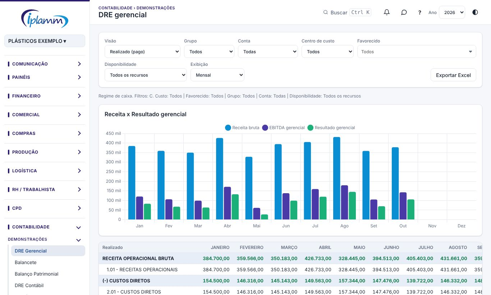

## 1. Para que serve

A área **Contabilidade** junta os demonstrativos:

- **DRE gerencial**: o resultado pelo **regime de caixa** (lançamentos pagos), em blocos configuráveis pelo plano de contas.
- **Balancete**: os balancetes oficiais da contabilidade, importados do PDF. Também o **balancete feito pela plataforma**: saldo de abertura + lançamentos contábeis gerados a partir dos lançamentos pagos.
- **Balanço Patrimonial** e **DRE Contábil** (competência), no formato da contabilidade, a partir de um dos dois balancetes.
- **DFC — Fluxo de caixa pelo método direto**, a partir dos lançamentos contábeis da plataforma.
- **De-para contábil**: liga a plataforma ao plano de contas da contabilidade.

> A contabilidade da IPLAMM usa o sistema **Domínio**. Os arquivos gerados aqui são, por enquanto, para **conferência**, não para importação.

## 2. Quem tem acesso

O administrador e o financeiro importam balancetes, geram os lançamentos contábeis e gravam o de-para. Quem tem a área Contabilidade consulta e exporta.

## 3. DRE gerencial

1. Use os filtros de sempre (visão, grupo, conta, centro de custo, favorecido e disponibilidade) e escolha a **exibição**: **Mensal** ou **Acumulado no ano**.
2. Os indicadores mostram a **receita bruta**, o **EBITDA gerencial** e o **resultado gerencial**. O gráfico compara a receita com o resultado.
3. A tabela tem os meses, o **ANO** e a **AV%** (análise vertical sobre a receita).

Os blocos da DRE são configurados em **Cadastros › Plano de contas**. **Exportar Excel** baixa a tabela.

## 4. Balancete

### 4.1 Importar o balancete da contabilidade

1. Clique em **Importar balancete (PDF)** e escolha o PDF do balancete de verificação (pode ser o assinado digitalmente).
2. A leitura acontece no navegador. A plataforma confere tudo: as somas, os débitos e créditos, o saldo anterior mais o movimento igual ao saldo atual.
3. Se tudo fechar, clique em **Gravar balancete**. O banco confere de novo antes de gravar.

### 4.2 Balancete da plataforma

Escolha o balancete "feito pela plataforma" do mês e clique em **Gerar lançamentos contábeis do mês**. Eles saem dos lançamentos pagos e do de-para contábil. Gerar de novo refaz o mês, sem duplicar. A lista de **pendências** mostra o que ficou sem conta contábil.

Filtre por **nível** e use a busca. **Exportar Excel** baixa o balancete.

## 5. Balanço Patrimonial e DRE Contábil

Escolha a **fonte**: um balancete importado da contabilidade ou o balancete da plataforma.

- **Balanço**: escolha o **detalhe** (grupos, subgrupos, contas ou analítico). O indicador **Ativo − (Passivo + PL)** precisa dar zero.
- **DRE Contábil**: sai no mesmo formato da DRE da contabilidade, com o % da receita bruta. Cada linha abre as contas que a compõem.

## 6. DFC (método direto)

Escolha o **mês**. Cada lançamento que mexe numa conta do **Disponível** (1.1.1) é classificado pela conta da contrapartida em atividades **operacionais**, de **investimento**, de **financiamento** ou **outros**. As transferências entre contas do Disponível se anulam e não aparecem.

O indicador **Início + variação = fim** confere o fechamento.

## 7. De-para contábil

Use as abas para ligar cada item ao plano de contas da contabilidade:

- **Classificações**: a conta contábil da contrapartida de cada classificação do plano da plataforma, e o **tratamento**: direto no resultado, baixa de fornecedor, baixa de cliente, baixa de obrigação, ativo, financiamento / FIDC ou transferência. Marque **Usa conta do beneficiário** quando a contabilidade tem conta própria por cliente ou fornecedor.
- **Contas bancárias**: a conta contábil de cada conta e a conta usada **se negativo** (por exemplo, cheque especial).
- **Beneficiários**: a conta própria do cliente, do fornecedor ou do adiantamento.

Preencha à mão (escolha a conta da lista) e clique em **Gravar de-para**. Ou use **Importar planilha revisada** (depara_contabil_sugestao.xlsx):

- em cada linha vale a coluna "Sua correção", quando preenchida; senão, a sugestão;
- na aba de clientes e fornecedores, apague as sugestões erradas antes de importar, porque toda célula preenchida é gravada;
- gravar substitui o de-para das linhas da planilha; o que não está nela não é apagado.

Use o filtro **Sem conta contábil** para ver o que falta.

## 8. Regras e travas

- O balancete importado só é gravado se todas as conferências fecharem.
- Os lançamentos contábeis da plataforma dependem do de-para: classificação sem conta contábil fica como pendência.
- A DRE gerencial é por caixa (pago). A DRE Contábil é por competência, conforme o balancete.

## 9. Perguntas frequentes e erros comuns

**O balancete não foi gravado.** Alguma conferência não fechou. O aviso diz qual; confira se o PDF está completo.

**O Balanço não fecha (Ativo − Passivo − PL diferente de zero).** No balancete da plataforma, falta de-para em alguma conta ou há pendências na geração. Veja a lista de pendências.

**A mensagem diz "Conta contábil não encontrada".** Escolha a conta na lista que aparece enquanto você digita, não digite livre.

## 10. Histórico de alterações

| Versão | Data | O que mudou |
|---|---|---|
| 1.0 | 28/10/2026 | Primeira versão do manual: DRE gerencial, balancete importado e da plataforma, balanço, DRE contábil, DFC e de-para contábil. |
| 1.1 | 29/10/2026 | Imagens das telas, com dados fictícios. |
