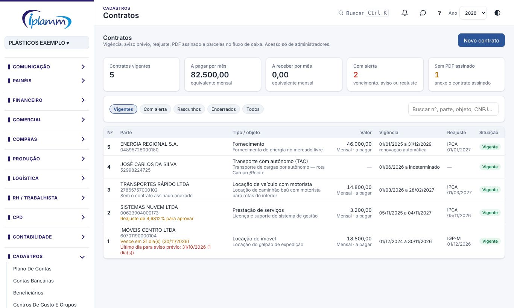
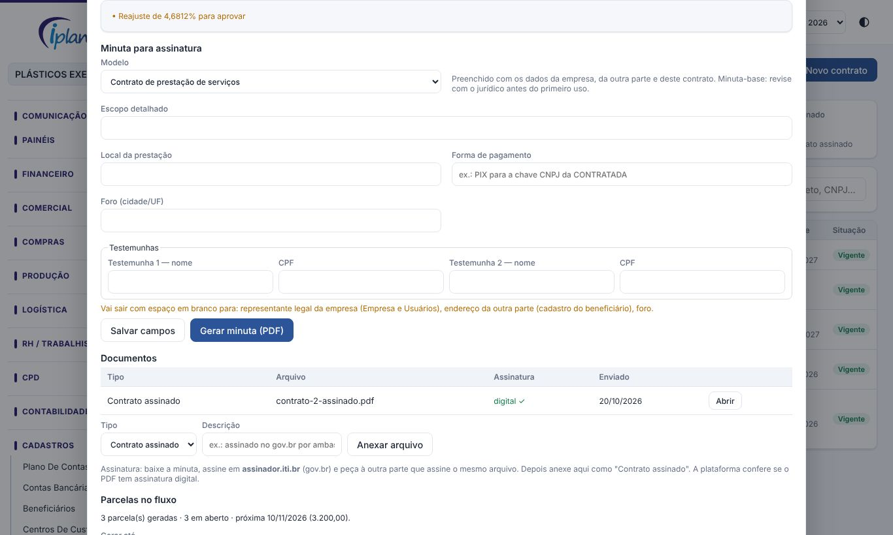
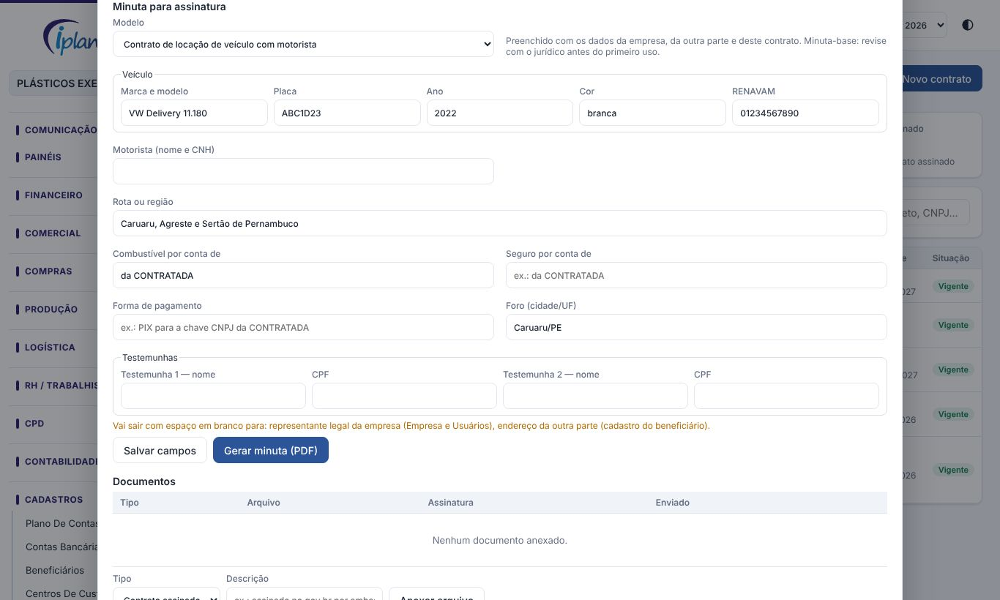

## 1. Para que serve

Guardar todos os contratos da empresa num só lugar e não perder nenhum prazo:

- **vigência** e **aviso prévio**: a plataforma avisa antes do fim do contrato e antes do último dia para avisar a outra parte;
- **reajuste**: na data-base, calcula o índice (IPCA, IGP-M ou INPC) e propõe o novo valor, que só vale depois de aprovado;
- **PDF assinado**: o contrato assinado no gov.br fica anexado, com os aditivos e termos;
- **fluxo de caixa**: as parcelas do contrato entram no fluxo como contas a pagar ou a receber.

## 2. Quem tem acesso

Só os **administradores** da empresa. Os outros perfis não veem o menu, os contratos, os valores nem os PDFs. As parcelas geradas aparecem no fluxo e nos lançamentos como qualquer conta em aberto.

## 3. Lista de contratos

1. Abra **Cadastros › Contratos**.
2. No topo: quantos contratos estão vigentes, quanto eles somam por mês a pagar e a receber, quantos têm alerta e quantos estão sem o PDF assinado.
3. Use os filtros **Vigentes**, **Com alerta**, **Rascunhos**, **Encerrados** e **Todos**, e a busca por número, parte, objeto ou CNPJ.
4. A coluna **Situação** mostra os alertas de cada contrato:

| Alerta | Quando aparece |
|---|---|
| Vence em X dias | Faltam 90 dias ou menos para o fim, sem renovação automática. |
| Último dia para aviso prévio | Faltam 30 dias ou menos para o limite do aviso prévio. |
| Reajuste em / pendente | A data-base está a 30 dias ou menos (ou já passou) e o reajuste não foi calculado. |
| Reajuste para aprovar | Há um reajuste proposto esperando decisão. |
| Venceu / renovado automaticamente | O prazo terminou: renove, atualize a vigência ou encerre. |
| Sem o contrato assinado | Nenhum PDF do tipo "Contrato assinado" foi anexado. |

Os mesmos alertas aparecem no **Decision Center** para os administradores.

## 4. Cadastrar um contrato

1. Clique em **Novo contrato**.
2. Escolha o **tipo** (locação de veículo, prestação de serviços, transporte com autônomo, agregado, locação de imóvel, fornecimento etc.) e a **natureza**: a pagar, a receber ou sem valor (ex.: confidencialidade).
3. Em **Outra parte vem de**, escolha de onde buscar a parte: beneficiários, transportadores ou colaboradores. O nome e o CPF/CNPJ são preenchidos. Se a parte não estiver cadastrada, escolha **Digitar nome e documento**.
4. Em **Valor e vigência**: valor, periodicidade, dia do vencimento, início e fim (vazio = prazo indeterminado), dias de aviso prévio e se renova sozinho.
5. Em **Índice de reajuste**, escolha o índice e a **próxima data-base** (ao informar o início, a plataforma sugere um ano depois). Para percentual fixo, informe o percentual.
6. Em **Fluxo de caixa**, escolha a **conta do plano** (obrigatória para gerar parcelas), o centro de custo e a conta bancária.
7. Clique em **Salvar**. O contrato recebe um número sequencial e a ficha abre com as partes de documentos, parcelas e reajuste.

## 5. Minuta para assinatura (modelos)

1. Na ficha do contrato, em **Minuta para assinatura**, escolha o **modelo**. A plataforma sugere o modelo pelo tipo do contrato:

| Modelo | Uso |
|---|---|
| Locação de veículo | Veículo de terceiro sem motorista. |
| Locação de veículo com motorista | Veículo com motorista da contratada (jornada e encargos por conta dela). |
| Prestação de serviços | Serviços em geral; também serve de base para fornecimento e locação de imóvel. |
| Transporte com autônomo (TAC) | Lei 11.442/2007: RNTRC, CIOT, pagamento pela IPEF, piso mínimo da ANTT e vale-pedágio. |
| Agregado (TAC-agregado) | Veículo à disposição com exclusividade e remuneração certa; plotagem e retirada. |
| Acordo de confidencialidade | Troca de informações sigilosas, com prazo de sigilo. |
| Termo de responsabilidade pelo uso de veículo | Motorista colaborador: CNH, multas e desconto de danos (art. 462, § 1º, da CLT). |
| Termo de autorização de uso de imagem | Foto do crachá e dos sistemas internos (LGPD). |
| Termo de vistoria de veículo | Lista de conferência na entrega e na devolução. |

2. Preencha os **campos do modelo** (veículo, RNTRC, rota, foro, testemunhas etc.). O RNTRC e a placa vêm do cadastro do transportador, quando houver.
3. A linha em amarelo mostra o que vai sair **em branco** (ex.: endereço da outra parte, representante legal da empresa). Complete os cadastros ou preencha à mão depois.
4. Clique em **Gerar minuta (PDF)**. A plataforma monta o documento no padrão do papel timbrado (logo, razão social, CNPJ e endereço da empresa), com a qualificação das partes, as cláusulas, o valor por extenso, o reajuste, o foro e os campos de assinatura.
5. Na janela de impressão, escolha **Salvar como PDF**.

Os dados da empresa vêm de **Empresa e Usuários** (CNPJ, endereço e representante legal) e de **Cadastros › Empresa: identidade e crachás** (razão social dos documentos, logo e unidades). Os da outra parte vêm do cadastro do beneficiário (nome, CPF/CNPJ e endereço).

> Os modelos são **minutas-base**. Peça ao jurídico para revisar cada modelo antes do primeiro uso e ajuste as cláusulas ao caso concreto.

## 6. Contrato assinado (gov.br) e documentos

1. Gere ou receba a minuta em PDF.
2. Assine em **assinador.iti.br** com a conta gov.br (nível prata ou ouro) e envie o mesmo arquivo para a outra parte assinar.
3. Na ficha, em **Documentos**, escolha o tipo **Contrato assinado**, escreva uma descrição se quiser e clique em **Anexar arquivo**.
4. A plataforma confere se o PDF tem **assinatura digital**. Se não tiver, ela pergunta antes de anexar como assinado.
5. Anexe também **aditivos**, **termos de vistoria** e outros documentos. Arquivos até 15 MB (PDF, PNG ou JPG). Só administradores abrem os arquivos.

## 7. Parcelas no fluxo de caixa

1. Na ficha, em **Parcelas no fluxo**, escolha **Gerar até** (padrão: 12 meses) e clique em **Gerar parcelas que faltam**.
2. As parcelas entram como lançamentos **Em aberto**, com a descrição "Contrato nº …" e o documento "CT nº". Elas aparecem no fluxo, nos lançamentos e na autorização de pagamentos.
3. Pode clicar de novo quando quiser: só as parcelas que faltam são criadas, nunca em dobro.
4. Dia de vencimento 29, 30 ou 31 cai no último dia dos meses mais curtos.

## 8. Reajuste: proposta e aprovação

1. Quando a data-base chegar perto, abra a ficha e clique em **Calcular reajuste**.
2. A plataforma busca o índice acumulado em 12 meses no **Banco Central** (IPCA, IGP-M ou INPC), até o último mês já publicado. Se a busca falhar, informe o percentual e a fonte.
3. Confira e clique em **Propor reajuste**. Nada muda ainda.
4. Em **Reajustes**, clique em **Aprovar** ou **Recusar**:
   - **aprovado**: o valor do contrato e as parcelas em aberto a partir da data-base passam para o novo valor;
   - **recusado**: o valor continua o mesmo.
5. Nos dois casos, a próxima data-base passa para um ano depois.

## 9. Renovar, encerrar ou rescindir

- **Renovação automática**: quando o prazo termina, a ficha mostra **Renovar até …** (mesmo prazo do período anterior).
- **Encerrar / rescindir**: informe a situação, a data e o motivo. A plataforma oferece excluir as parcelas em aberto depois dessa data.

## 10. Dúvidas frequentes

**O botão Gerar parcelas está desligado.** O contrato precisa estar vigente, ter valor e ter a conta do plano escolhida. Salve a ficha depois de preencher.

**O índice não veio do Banco Central.** O site do Banco Central pode estar fora do ar ou o mês ainda não foi publicado. Informe o percentual acumulado e a fonte (ex.: tabela do IBGE ou da FGV).

**Assinei no gov.br e a plataforma diz que não tem assinatura digital.** Confira se anexou o arquivo baixado do assinador (o nome costuma terminar em "_assinado.pdf"), e não a minuta original.

**A janela de impressão não abriu.** O navegador pode ter bloqueado. Clique de novo em **Gerar minuta (PDF)**; se continuar, libere janelas para o site.

**A minuta saiu com espaços em branco.** São os dados que faltam nos cadastros (a linha em amarelo avisa antes). Complete o cadastro e gere de novo, ou preencha à mão antes de assinar.

## 11. Histórico de alterações

| Versão | Data | O que mudou |
|---|---|---|
| 1.0 | 30/10/2026 | Primeira versão: cadastro de contratos, PDF assinado com conferência de assinatura digital, alertas de vencimento, aviso prévio e reajuste, parcelas no fluxo e reajuste proposto e aprovado. |
| 1.1 | 30/10/2026 | Modelos de contrato: minuta preenchida com os cadastros (9 modelos), no padrão do papel timbrado, para salvar em PDF e assinar no gov.br. |
