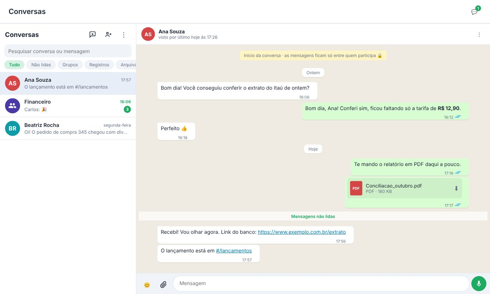

## 1. Para que serve

**Conversas** é o chat da equipe dentro da plataforma, no jeito do WhatsApp:

- conversas **individuais** e **em grupo** com quem é da empresa;
- texto, emoji, fotos, arquivos (PDF, Excel, XML de nota fiscal…) e **mensagens de voz**;
- responder, encaminhar, reagir, editar, apagar e mencionar com **@**;
- a **conversa do registro**: um bate-papo dentro do lançamento, do pagamento antecipado, do pedido de compra, da ordem de produção, do frete e da proposta FIDC;
- as mensagens chegam **na hora**, com **✓✓ lida**, "digitando…", online e aviso no celular e no computador.

O assunto fica registrado junto com o trabalho, e não espalhado em grupos de celular.

## 2. Quem tem acesso

| Perfil | O que faz |
|---|---|
| Todos os perfis da empresa | Conversam com qualquer pessoa da empresa e criam grupos. |
| Administrador do **grupo** | Muda o nome e a descrição, adiciona e remove pessoas, escolhe outros administradores e pode deixar o grupo só para avisos. |

> **Privacidade:** só quem participa da conversa lê as mensagens. O **administrador da empresa não lê** as conversas dos outros. A regra vale no banco de dados, não só na tela.

## 3. A tela

- **No menu:** em **Comunicação › Conversas**.
- **No topo de qualquer tela:** o ícone de balão, com o número de conversas com mensagens não lidas. O número também aparece no título da aba do navegador.
- **Mini-chat:** no computador, o balão do topo abre as Conversas numa janela por cima da tela em que você está, sem sair dela. O botão **⤢** leva para a tela cheia e o **✕** fecha. No celular, o balão abre a tela Conversas.

A tela tem duas partes:

- **À esquerda, a lista de conversas.** As mais recentes ficam em cima e as **fixadas** sempre no topo. Cada conversa mostra a última mensagem, a hora e, em verde, quantas mensagens não lidas tem.
  - Use os filtros **Tudo**, **Não lidas**, **Grupos**, **Registros** e **Arquivadas**.
  - A **busca** procura no nome das conversas e também **dentro das mensagens** (a partir de 2 letras). Clique num resultado para ir direto à mensagem, que pisca em verde.
  - Um **@** verde na conversa avisa que alguém mencionou você.
  - A bolinha verde no círculo da pessoa mostra que ela está online.
- **À direita, a conversa aberta.** No celular aparece uma parte de cada vez; a seta **←** volta para a lista.

## 4. Começar uma conversa

1. Clique no balão com **+** (**Nova conversa**).
2. Procure a pessoa pelo nome ou e-mail e clique nela.

Se já existe uma conversa com a pessoa, ela abre. Não se cria outra.

### 4.1 Criar um grupo

1. Clique no ícone de pessoa com **+** (**Novo grupo**), ou em **Novo grupo** na janela de nova conversa.
2. Dê um **nome** e, se quiser, uma descrição.
3. Marque os participantes e clique em **Criar grupo**.

Quem cria é o administrador do grupo.

## 5. Escrever e enviar

1. Escreva no campo **Mensagem**.
2. Envie com **Enter** ou com o botão verde. **Shift + Enter** quebra a linha. No celular, use o botão verde.
3. O botão 😊 abre os emojis.

Formatação, como no WhatsApp:

| Você escreve | Aparece |
|---|---|
| `*texto*` | **negrito** |
| `_texto_` | *itálico* |
| `~texto~` | riscado |

Endereços de site viram link. Um endereço da plataforma, como `#/lancamentos`, abre a tela.

### 5.1 Fotos e arquivos

Use o **clipe** para escolher os arquivos. Também dá para **arrastar** os arquivos para a conversa ou **colar** uma imagem com Ctrl + V.

- Os arquivos aparecem acima do campo de texto. O que você escrever vai como **legenda**.
- Até **10 arquivos** por mensagem, com até **25 MB** cada.
- Fotos grandes são reduzidas automaticamente, como no WhatsApp.
- Na conversa, clique na foto para ampliar e baixar. Clique no arquivo para abrir (PDF) ou baixar.

### 5.2 Os sinais de envio

| Sinal | Significa |
|---|---|
| 🕓 | Enviando. Sem internet, a mensagem espera e sai sozinha quando a conexão volta. |
| ✓ | Enviada. |
| ✓✓ cinza | Chegou ao aparelho da pessoa (no grupo, de todos). |
| ✓✓ azul | Lida (no grupo, por todos). |
| **!** vermelho | Não foi enviada. Use **Tentar de novo** ou **Descartar**. |

### 5.3 Mensagem de voz

Com o campo de texto vazio, o botão verde vira um **microfone**:

1. Toque no microfone. Na primeira vez, o navegador pede para liberar o microfone.
2. Fale. Aparecem o tempo e "gravando…". Para os outros aparece "gravando áudio…".
3. Toque no botão verde para enviar, ou em 🗑 para descartar. Cada gravação vai até 15 minutos.

Quem recebe toca o áudio na própria conversa e escolhe a velocidade: **1×**, **1,5×** ou **2×**.

### 5.4 Mencionar alguém com @

Num grupo ou na conversa de um registro, digite **@** e escolha a pessoa na lista (setas e Enter, ou clique). O nome aparece destacado.

A pessoa mencionada recebe o aviso **mesmo que tenha silenciado a conversa**.

## 6. O que fazer com uma mensagem

No computador, passe o mouse sobre a mensagem e clique na setinha **⌄** do canto. No celular, **segure** a mensagem. Aparecem as reações rápidas (👍 ❤️ 😂 😮 😢 🙏 e o **+** para outras) e as opções:

| Opção | O que faz |
|---|---|
| **Responder** | A mensagem aparece citada acima da sua resposta. Clicar na citação leva até a mensagem original. |
| **Copiar** | Copia o texto. |
| **Encaminhar** | Manda para uma ou mais conversas, com fotos e arquivos. Aparece "↪ Encaminhada". |
| **Favoritar ⭐** | Guarda a mensagem nas suas **Mensagens favoritas** (menu ⋮ da lista). Só você vê as suas favoritas. |
| **Fixar na conversa 📌** | A mensagem fica numa faixa no topo da conversa, para todos. Clique na faixa para ir até ela, e no ✕ para desafixar. |
| **Dados da mensagem** | Nas suas mensagens: quem já **leu**, quem **recebeu** e quem ainda não recebeu. |
| **Editar** | Nas suas mensagens, até **15 minutos** depois de enviar. Aparece "editada". Atalho: com o campo vazio, a seta **↑** edita a última mensagem que você mandou. |
| **Apagar** | **Apagar para mim** tira a mensagem só da sua tela. **Apagar para todos** (nas suas mensagens, até **48 horas** depois) deixa no lugar "Esta mensagem foi apagada". |

Clique numa reação embaixo da mensagem para ver quem reagiu e para tirar a sua.

> O texto original de uma mensagem editada ou apagada fica guardado no banco de dados para auditoria, sem acesso pela plataforma.

## 7. Conversa do registro

Lançamentos, pagamentos antecipados, pedidos de compra, ordens de produção, fretes e propostas FIDC têm, no topo da janela do registro, dois botões:

- **💬 Conversa:** abre o bate-papo daquele registro (no mini-chat ou na tela Conversas). Cada registro tem uma conversa só. Entra nela quem abre o botão, e qualquer participante pode **adicionar** outras pessoas.
- **↗ Enviar no chat:** manda o registro como **cartão** (título, data, valor e situação) para uma ou mais conversas, com uma mensagem opcional. Clicar no cartão abre o registro na tela certa.

Regras:

- Só abre a conversa do registro quem **consegue ver o registro**. Por exemplo, o perfil compras não abre a conversa de um lançamento.
- Quem não tem acesso ao registro vê o cartão como "Você não tem acesso a este registro".
- Na lista, as conversas de registro ficam no filtro **Registros**. O botão **Abrir registro**, no topo da conversa, abre o registro.

## 8. Opções da conversa (botão ⋮)

- **Silenciar…** por 8 horas, 1 semana ou sempre: sem som e sem aviso no celular. O número fica cinza. **Ativar som** desfaz.
- **Fixar no topo** e **Desafixar**.
- **Arquivar:** a conversa sai da lista e vai para **Arquivadas**. Ela volta sozinha quando chega mensagem nova.
- **Dados do grupo**, **Dados do contato** ou **Dados da conversa** (também abre clicando no nome, no topo da conversa).
- **Mídia, documentos e links:** as fotos, os arquivos e os links que passaram pela conversa, em abas.
- **Exportar conversa (PDF):** a conversa inteira no padrão dos relatórios da plataforma, com data, hora e quem escreveu (os emojis não vão para o PDF).
- **Adicionar pessoa** (conversa de registro) e **Sair do grupo** ou **Sair da conversa**.

## 9. Grupos

Em **Dados do grupo** o administrador do grupo:

- muda o **nome** e a **descrição**;
- marca **Só administradores enviam mensagens**, para grupos de avisos;
- usa **+ Adicionar** para colocar pessoas;
- usa **Tornar admin**, **Tirar admin** e **Remover** em cada participante.

Regras do grupo:

- Quem **entra** num grupo vê as mensagens a partir da entrada.
- Quem **sai** ou é removido continua vendo o que foi dito até a saída, mas não recebe as novas.
- Se o último administrador sair, o participante mais antigo passa a ser o administrador.

## 10. Online, visto por último e "digitando…"

- No topo de uma conversa individual aparece **online** ou **visto por último hoje às 10:32**.
- Quando a outra pessoa está escrevendo, aparece **digitando…** no topo e na lista; num grupo, aparece o nome de quem está digitando.
- Para esconder o seu: no menu **⋮** da lista, desmarque **Mostrar meu "visto por último"**. Como no WhatsApp, quem esconde também **não vê** o dos outros. O "digitando…" continua aparecendo.

O online e o "digitando…" só chegam a quem pode recebê-los: o online, a quem é da empresa; o "digitando…", a quem participa da conversa.

## 11. Avisos no celular e no computador

Os avisos usam a mesma liberação do sino de notificações. Clique no **sino** e em **Ativar avisos neste aparelho**. No iPhone, primeiro adicione a plataforma à Tela de Início.

- Mensagens seguidas da mesma conversa geram **um aviso só**.
- Menção com @ sempre avisa, mesmo com a conversa silenciada.
- Com a plataforma aberta e na frente, não chega aviso, só o som.
- As mensagens não aparecem no sino: ficam só nas Conversas.

## 12. Regras e travas

- Só pessoas da **mesma empresa** conversam entre si.
- As mensagens ficam **guardadas**. Editar vale até 15 minutos e apagar para todos até 48 horas; o original fica guardado para auditoria.
- Os arquivos ficam num armazenamento privado. O link de cada arquivo vale 1 hora e é renovado sozinho.
- Mensagens de até 8.000 caracteres.

## 13. Perguntas frequentes e erros comuns

**Não acho a pessoa na nova conversa.** Ela precisa ser usuária da empresa. Peça ao administrador para convidá-la em **Cadastros › Empresa e usuários**.

**A mensagem ficou com 🕓.** Ela está esperando a internet e sai sozinha quando a conexão voltar.

**Não chega aviso no celular.** Ative os avisos no sino daquele aparelho e confira se a conversa não está silenciada (🔕).

**"Só os administradores podem enviar mensagens neste grupo".** O grupo é de avisos. Fale com um administrador do grupo.

**Toco no microfone e não pede permissão.** O navegador já está com o microfone bloqueado para o site e não pergunta de novo. A plataforma abre uma janela dizendo o motivo e o passo a passo:
- **Computador (Chrome ou Edge):** clique no ícone à esquerda do endereço do site › Microfone › Permitir, e recarregue com F5. Se continuar, no Windows vá em Configurações › Privacidade e segurança › Microfone e libere o acesso para o navegador.
- **iPad ou iPhone (Safari):** toque em "aA" na barra de endereço › Configurações do Site › Microfone › Permitir. Ou Ajustes › Apps › Safari › Microfone.
- **Android (Chrome):** toque no ícone à esquerda do endereço › Permissões › Microfone › Permitir.
- Dentro de outro aplicativo (por exemplo, o navegador embutido do Claude), o microfone não funciona: abra a plataforma direto no navegador.

**O microfone não aparece.** O navegador não grava áudio (alguns navegadores antigos) ou a conversa é só de leitura. No iPhone, use o Safari atualizado.

**"Você não tem acesso a este registro".** O registro é de uma área que o seu perfil não vê. Peça a quem mandou para escrever o que precisa na conversa.

**Não consigo editar a mensagem.** Passaram os 15 minutos. Apague e mande de novo, se precisar.

**Aparece "Reconectando…".** A conexão em tempo real caiu. A plataforma confere as conversas a cada minuto até voltar.

## 14. Histórico de alterações

| Versão | Data | O que mudou |
|---|---|---|
| 1.0 | 29/10/2026 | Primeira versão: conversas individuais e em grupo, emojis, fotos e arquivos, entregue e lida, silenciar, fixar, arquivar, administração do grupo e avisos. |
| 2.0 | 29/10/2026 | Etapa 2: responder, encaminhar, reações, editar e apagar, menções com @, mensagem de voz, busca nas mensagens, mensagem fixada, favoritas, dados da mensagem, mídia e documentos da conversa, exportar em PDF, online / visto por último / digitando, mini-chat e conversa do registro com cartões. |
| 2.1 | 29/10/2026 | Microfone recusado: a plataforma explica o motivo e como liberar no computador, iPad/iPhone e Android. |
| 2.2 | 29/10/2026 | O online e o "digitando…" passam por canais privados: só os recebe quem é da empresa ou da conversa. |
| 2.3 | 29/10/2026 | Imagens das telas, com dados fictícios. |
