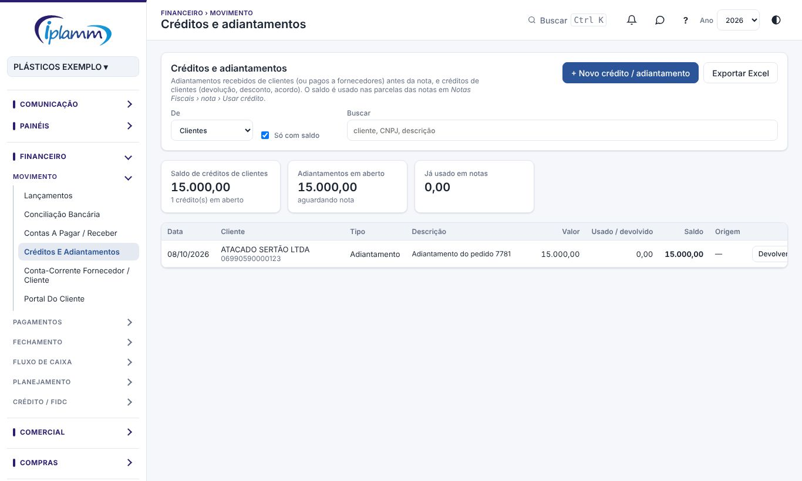
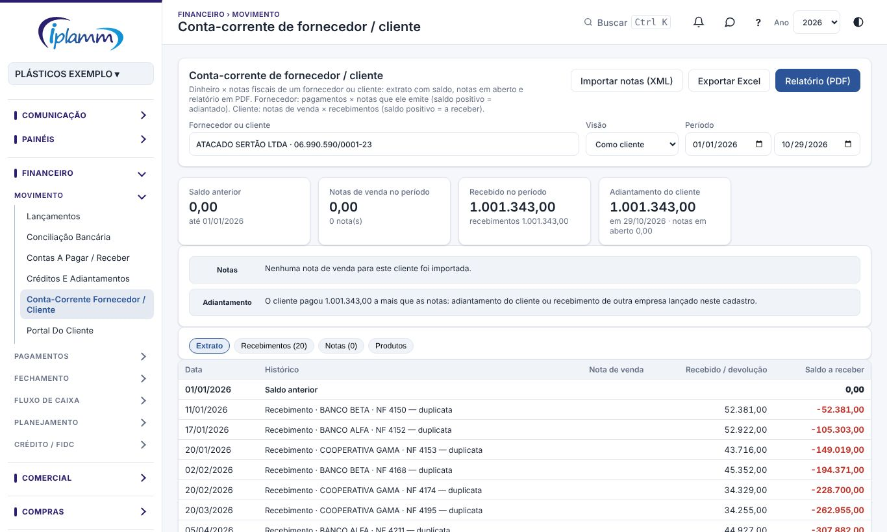

## 1. Para que serve

- **Créditos e adiantamentos** guarda o dinheiro que fica "a abater":
  - adiantamentos pagos a fornecedores antes da nota;
  - adiantamentos recebidos de clientes;
  - créditos de clientes: devolução, desconto, pagamento a maior, acordo.

  O saldo de cada um é usado depois nas parcelas das notas.
- **Conta-corrente fornecedor / cliente** cruza o **dinheiro** com as **notas fiscais** de um fornecedor ou cliente, com o extrato, o saldo, as notas em aberto e o relatório em PDF.
  - **Fornecedor**: pagamentos contra as notas que ele emite. **Saldo positivo** = a IPLAMM pagou adiantado e tem produto ou serviço a receber.
  - **Cliente**: notas de venda contra os recebimentos, os créditos usados e o antecipado no FIDC. **Saldo positivo** = a receber do cliente.

## 2. Quem tem acesso

| Perfil | O que faz |
|---|---|
| Administrador e financeiro | Cadastram, devolvem e cancelam créditos; registram adiantamentos e abatem notas. |
| Diretor e leitura | Consultam e geram o relatório. |

## 3. Créditos e adiantamentos

### 3.1 A tela

Escolha **De** (clientes ou fornecedores) e use a busca. Os indicadores mostram o **saldo de créditos**, os **adiantamentos em aberto** e o que **já foi usado em notas**.

Cada linha mostra a data, o tipo, a descrição, o valor, o que já foi usado ou devolvido, o saldo e a origem.

### 3.2 Novo crédito ou adiantamento

1. Clique em **+ Novo crédito / adiantamento**.
2. Em **De quem**, escolha:
   - **Cliente**: crédito a abater nas notas de venda;
   - **Fornecedor**: adiantamento a abater nas notas de compra.
3. Escolha o **tipo**: adiantamento, pagamento a maior, crédito por devolução, desconto / abatimento, acordo comercial ou outro.
4. Escolha o cliente ou fornecedor e informe a data, o valor e a descrição.
5. Se for adiantamento, ligue o **lançamento** em que o dinheiro entrou ou saiu. Assim ele não aparece como "recebimento sem nota".
6. Clique em **Salvar**.

> **Dica:** os Pagamentos Antecipados viram adiantamento ao fornecedor sozinhos quando o pagamento é confirmado.

### 3.3 Usar o crédito numa nota

O saldo é usado nas parcelas das notas, em **CPD › Notas Fiscais**: abra a nota e clique em **Usar crédito**.

### 3.4 Devolver em dinheiro

Clique em **Devolver** no crédito que tem saldo:

- **Fornecedor**: o fornecedor devolve o valor, e o dinheiro entra na conta.
- **Cliente**: a IPLAMM devolve o valor ao cliente, e o dinheiro sai da conta.

Informe o valor devolvido e ligue o lançamento que já existe ou lance agora (data, conta, plano de contas e descrição). O crédito é baixado.

### 3.5 Cancelar

Crédito que ainda não foi usado pode ser cancelado. Ele deixa de aparecer para uso nas notas.

## 4. Conta-corrente fornecedor / cliente

### 4.1 Abrir

1. Digite o **fornecedor ou cliente** e escolha o **período**.
2. Os indicadores mostram o movimento do período e o saldo. Os **alertas** apontam o que falta resolver, com um botão para cada:
   - **Informar CNPJ**: grava o CNPJ no cadastro, e as notas com esse CNPJ (ou com a mesma raiz) passam a aparecer.
   - **Ligar a este fornecedor**: liga as notas do CNPJ ao cadastro.
   - **Registrar como adiantamento**: transforma pagamentos em adiantamento.
   - **Conciliar automaticamente**: abate as notas com os adiantamentos.
3. Use as abas: **Extrato**, **Pagamentos** (ou **Recebimentos**), **Notas** e **Produtos**.

### 4.2 Registrar pagamentos como adiantamento (fornecedor)

Marque os pagamentos e confirme. Cada um vira um adiantamento ao fornecedor, ligado ao lançamento. O lançamento não muda: a conta, o plano e o valor continuam iguais. Pagamentos já ligados a uma nota não aparecem nessa lista.

### 4.3 Conciliar adiantamentos com as notas

**Conciliar adiantamentos × notas** sugere os abatimentos por ordem de data: o adiantamento mais antigo abate a nota mais antiga. Ajuste o valor de cada abatimento se precisar, informe a **data do abatimento** e clique em **Confirmar conciliação**.

Nada muda no caixa: a nota passa a constar como paga pelo adiantamento. Cada abatimento pode ser desfeito depois, na própria nota.

### 4.4 Relatório e Excel

**Relatório (PDF)** gera a conta-corrente no padrão IPLAMM, com indicadores, pontos de atenção, extrato, notas e produtos. **Exportar Excel** baixa a tabela da aba aberta.

## 5. Regras e travas

- Adiantamento de fornecedor só abate **notas de compra** desse fornecedor (ou do mesmo grupo de CNPJ). Crédito de cliente só abate **notas de venda**.
- O abatimento não mexe no caixa: só liga o dinheiro já pago à nota.
- Crédito já usado não pode ser cancelado; desfaça os usos antes.
- CNPJ tem 14 dígitos.

## 6. Perguntas frequentes e erros comuns

**As notas do fornecedor não aparecem.** O cadastro está sem CNPJ, ou as notas vieram de outro CNPJ. Use **Informar CNPJ** ou **Ligar a este fornecedor**.

**A mensagem diz "Nada a conciliar".** Não há adiantamento com saldo, ou não há nota pendente.

**O pagamento aparece como "recebimento sem nota".** Ligue o lançamento a um adiantamento (item 3.2) ou à nota.

## 7. Histórico de alterações

| Versão | Data | O que mudou |
|---|---|---|
| 1.0 | 28/10/2026 | Primeira versão do manual: créditos e adiantamentos, devolução, conta-corrente de fornecedor e cliente, adiantamentos × notas e relatório. |
| 1.1 | 29/10/2026 | Imagens das telas, com dados fictícios. |
