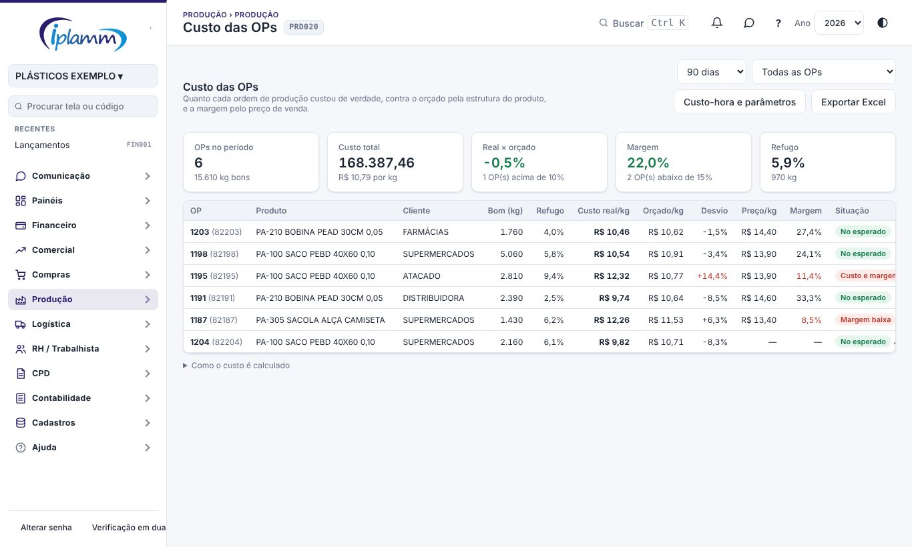
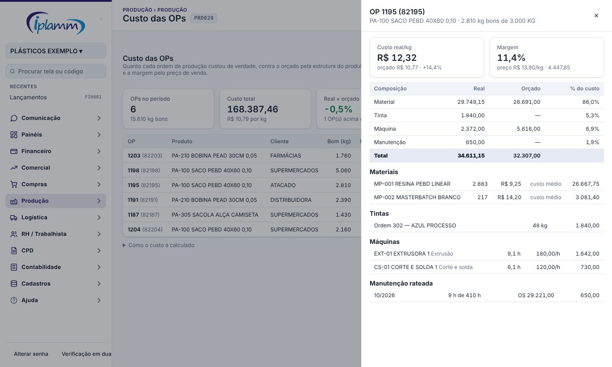
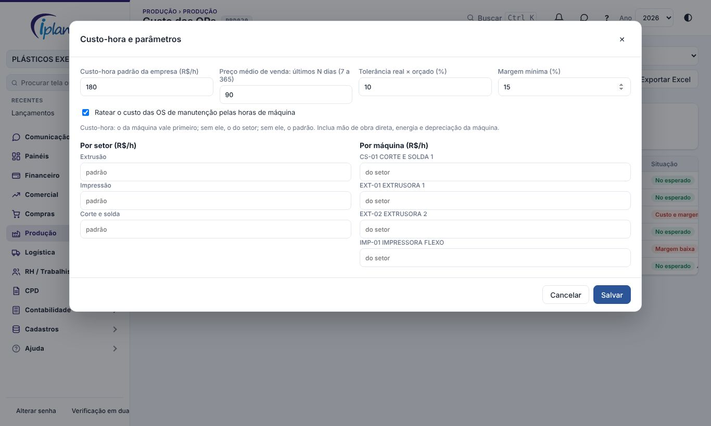

## 1. Para que serve

Mostra quanto cada ordem de produção **custou de verdade** e compara com:

- o **custo orçado** pela estrutura do produto;
- o **preço de venda**, para mostrar a **margem real** de cada OP.

O custo real junta quatro partes:

| Parte | De onde vem |
|---|---|
| Material | Consumos apontados na OP × custo médio do estoque. Sem custo médio, o último preço de compra do de-para. |
| Tinta | Ordens da Casa de Tintas ligadas à OP: custo por kg × (entregue − retorno). |
| Máquina | Horas apontadas × custo-hora da máquina, ou do setor, ou o padrão da empresa. |
| Manutenção | Custo das OS concluídas no mês na máquina (terceiros, peças e horas dos técnicos), dividido pelas horas apontadas na máquina no mês e multiplicado pelas horas da OP. |

## 2. Quem tem acesso

| Perfil | O que faz |
|---|---|
| Administrador e financeiro | Veem a tela, exportam e alteram o custo-hora e os parâmetros. |
| Diretor e leitura | Veem a tela e exportam. |
| Produção, compras e vendas | Não veem a tela. |

## 3. A tela

No alto, escolha o **período**: 30 dias, 90 dias, 6 meses ou 12 meses. As OPs entram pela data de conclusão (ou de emissão, se ainda estão abertas). Só entram OPs com apontamento.

Use o filtro **Mostrar** para ver só:

- as OPs com custo acima do orçado;
- as OPs com margem abaixo da mínima;
- as OPs com dado faltando.

Os cartões mostram:

- quantas OPs e quantos kg bons;
- o **custo total** e o custo por kg;
- **real × orçado**: quanto o custo por kg ficou acima ou abaixo do orçado, ponderado pela quantidade boa;
- a **margem** do período e quantas OPs ficaram abaixo da mínima;
- o **refugo**.

A tabela mostra, por OP:

- a quantidade boa e o refugo;
- o **custo real por kg** e o **orçado por kg**;
- o **desvio**;
- o **preço médio de venda por kg** e a **margem**;
- a **situação**: no esperado, custo acima, margem baixa, ou "custo e margem" (os dois).

O ⚠ indica dado faltando: material sem custo, máquina sem custo-hora, produto sem estrutura, sem venda no período ou sem quantidade boa. Passe o mouse para ver o motivo.

## 4. Detalhe da OP

Clique na OP para abrir o detalhe:

- custo real por kg contra o orçado, e a margem;
- a **composição**: material, tinta, máquina e manutenção, real contra orçado, com a participação de cada parte;
- cada **material** (quantidade, custo unitário e de onde veio o custo), cada **tinta**, cada **máquina** (horas e custo-hora) e o **rateio da manutenção** (horas da OP sobre as horas do mês).

O mesmo detalhe abre na ficha da OP, em Ordens de Produção, no botão **Custo completo da OP**.

## 5. Como é calculado

- **Custo real por kg** = custo real ÷ quantidade boa da última etapa.
- **Orçado** = estrutura do produto × quantidade da OP (com a perda da estrutura) × custo unitário de hoje, mais as horas previstas das etapas × custo-hora. **Orçado por kg** = orçado ÷ quantidade da OP.
- **Desvio** = custo real por kg ÷ orçado por kg − 1. Fica em vermelho acima da tolerância (padrão 10%).
- **Preço** = média das NF-e de venda autorizadas do produto (mesmo código, CFOP de venda) nos 90 dias antes da conclusão.
- **Margem** = (preço × quantidade boa − custo real) ÷ receita.

O custo não inclui despesas de vendas, frete, impostos sobre a venda nem despesas administrativas. É a **margem de contribuição da produção**.

## 6. Custo-hora e parâmetros

Em **Custo-hora e parâmetros** (administrador e financeiro):

- **Custo-hora padrão** da empresa, **por setor** e **por máquina**. Vale o da máquina; sem ele, o do setor; sem ele, o padrão. Inclua mão de obra direta, energia e depreciação.
- **Preço médio de venda**: quantos dias antes da conclusão entram (de 7 a 365, padrão 90).
- **Tolerância** real × orçado (padrão 10%) e **margem mínima** (padrão 15%).
- **Ratear a manutenção**: liga ou desliga o rateio das OS pelas horas de máquina.

**Exportar Excel** baixa todas as OPs do filtro com cada parte do custo.

## 7. Dúvidas frequentes

**O custo de material está zerado.** Não há consumo apontado na OP, ou o material não tem custo médio nem compra no de-para. Aponte os consumos na ficha da OP ou no Terminal.

**O orçado aparece "—".** O produto não tem estrutura. Cadastre a estrutura na ficha do produto.

**A margem aparece "—".** Não houve venda do produto, com o mesmo código, nos dias configurados.

**O custo por kg ficou muito alto numa OP aberta.** O custo já soma tudo o que foi apontado, mas a quantidade boa ainda é parcial. Compare as OPs concluídas.

## 8. Histórico de alterações

| Versão | Data | O que mudou |
|---|---|---|
| 1.0 | 08/11/2026 | Primeira versão: custo real por OP (material, tinta, máquina, manutenção rateada), orçado pela estrutura, desvio, preço médio de venda e margem; detalhe também na ficha da OP; custo-hora por máquina e setor; Excel. |
