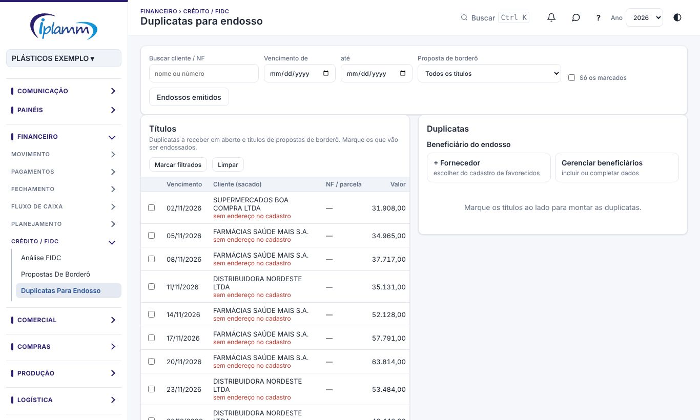

## 1. Para que serve

A tela **Duplicatas para endosso** monta as **duplicatas mercantis** dos títulos a receber e o **endosso** delas para um beneficiário, por exemplo um fornecedor de resina, em garantia do pagamento de uma compra. Os títulos ficam à esquerda e a duplicata é montada em tempo real à direita.

O PDF sai com **uma duplicata por página** (frente e endosso no verso), pronto para assinatura com **certificado digital ICP-Brasil**. A plataforma registra quais títulos foram endossados, para quem e quando.

> **Atenção:** endosso e borderô FIDC são processos diferentes. Cancelar um endosso não mexe em proposta de borderô, e vice-versa.

## 2. Quem tem acesso

O administrador e o financeiro geram e cancelam endossos e cadastram beneficiários. Os demais perfis com a área Financeiro consultam.

## 3. Passo a passo

### 3.1 Escolher os títulos

1. À esquerda ficam as duplicatas a receber em aberto e os títulos das propostas de borderô. Use **Buscar cliente / NF**, **Vencimento de / até** ou escolha uma **Proposta de borderô**.
2. Marque os títulos que vão ser endossados, ou use **Marcar filtrados**.

### 3.2 Escolher o beneficiário

1. Em **Beneficiário do endosso**, escolha um da lista. Os beneficiários podem ser fundos, fornecedores, bancos ou factorings.
2. Para um fornecedor que ainda não está na lista, clique em **+ Fornecedor**, escolha-o no cadastro e complete o que faltar: razão social, CNPJ, inscrição estadual, endereço, município, UF e CEP. Os dados ficam salvos no cadastro de Beneficiários.
3. **Gerenciar beneficiários** inclui ou completa os dados de qualquer beneficiário.

### 3.3 Preencher o endosso

Informe:

- a **data do endosso**;
- a **praça de pagamento** (por exemplo, SAO PAULO/SP);
- a **modalidade**, por exemplo **endosso em garantia** (endosso-caução);
- em **Garantia do pagamento de**, o que está sendo garantido (por exemplo, o pedido de resina).

A **pré-visualização** mostra a duplicata como vai sair. As **verificações** avisam:

- dados faltando do beneficiário ou do emitente;
- títulos já endossados;
- títulos já pagos;
- fundo diferente do da proposta.

### 3.4 Gerar o PDF

Clique em **Gerar PDF**. A plataforma registra o lote e baixa o arquivo para assinar com o certificado digital. Se algum título já teve duplicata gerada, ela pergunta antes de gerar de novo.

### 3.5 Endossos emitidos e cancelamento

**Endossos emitidos** lista os lotes: a data, o beneficiário, a modalidade, a quantidade de duplicatas e o total. Em cada lote:

- **Duplicatas**: gera de novo o PDF.
- **Cancelar lote**: libera os títulos para um novo endosso. O motivo é obrigatório (por exemplo, recusado pelo beneficiário ou desistência da IPLAMM), e o registro continua no histórico.
- **Termo de cancelamento**: se o PDF já foi assinado e entregue, gere o termo para o beneficiário assinar e devolver as duplicatas.

## 4. Regras e travas

- Um título só pode estar em um endosso ativo. Cancele o lote para endossar de novo.
- O cancelamento exige motivo e fica registrado.
- Os dados do emitente vêm do cadastro da empresa; os do sacado vêm da nota fiscal (o endereço é gravado ao importar o XML).

## 5. Perguntas frequentes e erros comuns

**A mensagem diz "Fornecedor não encontrado em Beneficiários".** Cadastre o fornecedor em **Cadastros › Beneficiários** antes, ou escolha outro da lista.

**O endereço do sacado está vazio.** A nota foi lançada à mão. Importe o XML da NF-e para gravar o endereço no cadastro do cliente.

**O beneficiário recusou as duplicatas.** Cancele o lote com o motivo e, se elas já foram entregues assinadas, gere o termo de cancelamento.

## 6. Histórico de alterações

| Versão | Data | O que mudou |
|---|---|---|
| 1.0 | 28/10/2026 | Primeira versão do manual: escolha dos títulos, beneficiário, dados do endosso, PDF para assinatura digital, lotes emitidos, cancelamento e termo. |
| 1.1 | 29/10/2026 | Imagens das telas, com dados fictícios. |
