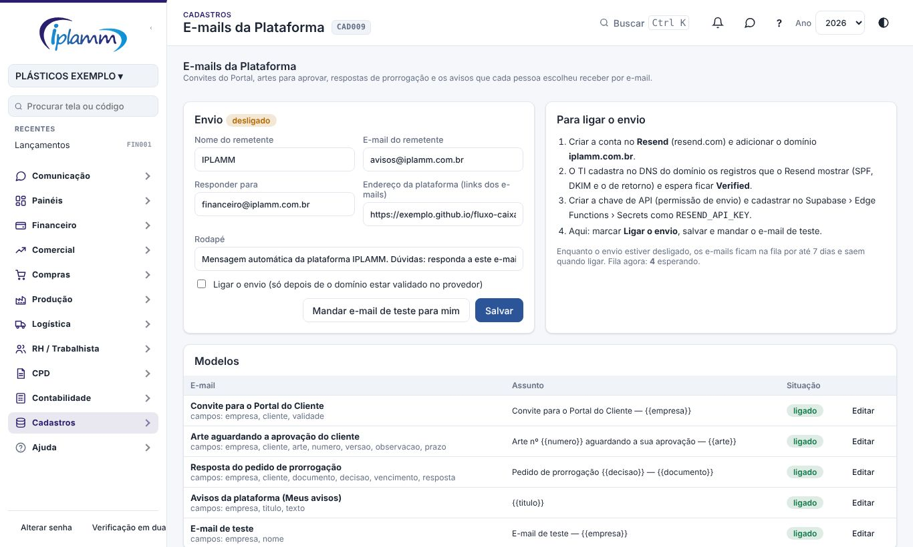
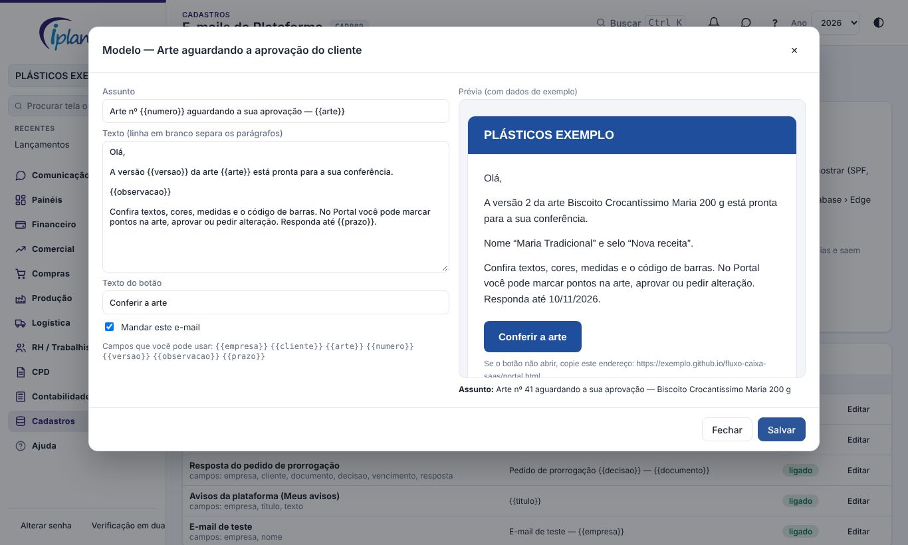
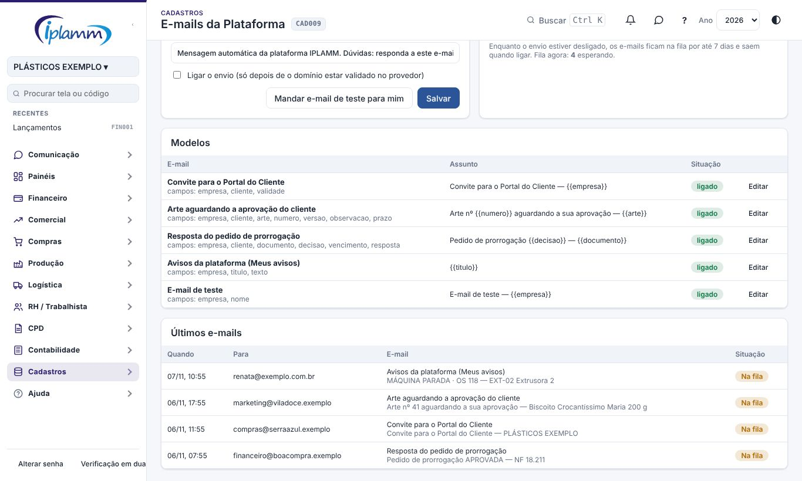

## 1. Para que serve

A plataforma manda e-mails sozinha, do endereço **avisos@iplamm.com.br**:

| E-mail | Para quem | Quando |
|---|---|---|
| Convite para o Portal do Cliente | O e-mail convidado | Ao criar o convite em Financeiro › Portal do Cliente |
| Arte aguardando a sua aprovação | Os usuários do Portal daquele cliente | Ao enviar uma versão da arte ao cliente (Pré-impressão) |
| Resposta do pedido de prorrogação | Quem pediu, no Portal | Ao aprovar ou recusar a prorrogação |
| Avisos da plataforma | A própria pessoa | Nos tipos de aviso em que ela marcou **E-mail** em Meus avisos |
| E-mail de teste | O administrador | Pelo botão da tela |

Cada e-mail traz o botão que abre o ponto certo: o convite, a arte ou o Portal.

## 2. Quem tem acesso

- **Administrador**: configura o remetente, liga o envio, edita os modelos e vê a fila.
- **Os demais perfis**: veem os modelos e escolhem os avisos por e-mail em Meus avisos.

## 3. Passo a passo

### 3.1 Ligar o envio (uma vez só)

O domínio precisa ser validado no provedor de envio (**Resend**). Sem essa validação, os e-mails cairiam no spam ou seriam recusados.

1. Crie a conta em resend.com e adicione o domínio **iplamm.com.br**.
2. O TI cadastra no DNS do domínio os registros que o Resend mostrar: SPF, DKIM e o de retorno. Depois, é só esperar o domínio ficar **Verified**.
3. No Resend, crie uma chave de API com permissão de envio. Cadastre a chave no Supabase, em Edge Functions › Secrets, com o nome `RESEND_API_KEY`.
4. Nesta tela, marque **Ligar o envio**, clique em **Salvar** e depois em **Mandar e-mail de teste para mim**.

Enquanto o envio estiver desligado:

- os e-mails esperam na **fila** por até 7 dias e saem assim que o envio for ligado;
- o convite do Portal continua mostrando o link para copiar e mandar à mão.

### 3.2 Remetente

| Campo | O que é |
|---|---|
| **Nome do remetente** | Aparece na caixa de entrada (ex.: IPLAMM). |
| **E-mail do remetente** | avisos@iplamm.com.br. Precisa ser do domínio validado. |
| **Responder para** | Para onde vai a resposta do cliente (ex.: financeiro@…). Em branco, a resposta volta para o remetente. |
| **Endereço da plataforma** | Usado nos links. É preenchido sozinho com o endereço em que a tela está aberta. |
| **Rodapé** | Texto no fim de cada e-mail. |

### 3.3 Modelos

Clique em **Editar** para mudar o assunto, o texto e o botão de um e-mail. A **prévia**, com dados de exemplo, mostra na hora como fica.

**Como escrever o texto:**
- Use os **campos** entre chaves, como `{{cliente}}` e `{{arte}}`; a tela mostra a lista de cada e-mail.
- Uma linha em branco separa os parágrafos.
- Um parágrafo que fica vazio (por exemplo, a observação em branco) some do e-mail.

**Outras opções:**
- **Mandar este e-mail** desmarcado desliga aquele e-mail. Exemplo: não mandar o convite por e-mail.
- **Voltar ao texto padrão** desfaz as suas mudanças.

### 3.4 Últimos e-mails

Para cada e-mail, a lista mostra quando foi gerado, para quem, o assunto e a situação:

- **Na fila**: esperando o envio. Com o envio ligado, sai em até 1 minuto.
- **Enviado**: o provedor aceitou o e-mail.
- **Erro**: o provedor recusou, e o motivo aparece abaixo. Por exemplo, "domínio não validado".
- **Não enviado**: passou de 7 dias na fila.

## 4. Regras e travas

- Só o administrador liga o envio, edita os modelos e vê a fila.
- O texto vem sempre do banco: quem usa a plataforma não escolhe o destinatário de um e-mail automático.
- O envio tenta até 5 vezes quando o provedor está fora do ar ou no limite de envios. Erro de dados (endereço inválido, domínio não validado) não é repetido.
- Mensagens das Conversas não vão por e-mail.

## 5. Perguntas frequentes e erros comuns

**O teste não chegou.** Veja a situação em **Últimos e-mails**:
- **Na fila** com o envio desligado: ligue o envio.
- **Erro**: o motivo vem do provedor. Os casos mais comuns são o domínio ainda não validado e a chave `RESEND_API_KEY` faltando ou errada.

**Caiu no spam.** Confira com o TI se os registros SPF e DKIM estão como **Verified** no Resend. Também ajuda preencher **Responder para** com uma caixa real.

## 6. Histórico de alterações

| Versão | Data | O que mudou |
|---|---|---|
| 1.0 | 07/11/2026 | Primeira versão: remetente avisos@iplamm.com.br, envio desligado até a validação do domínio, convite do Portal, arte para aprovar, resposta da prorrogação e avisos por e-mail, modelos com prévia, fila com a situação de cada e-mail e e-mail de teste. |
