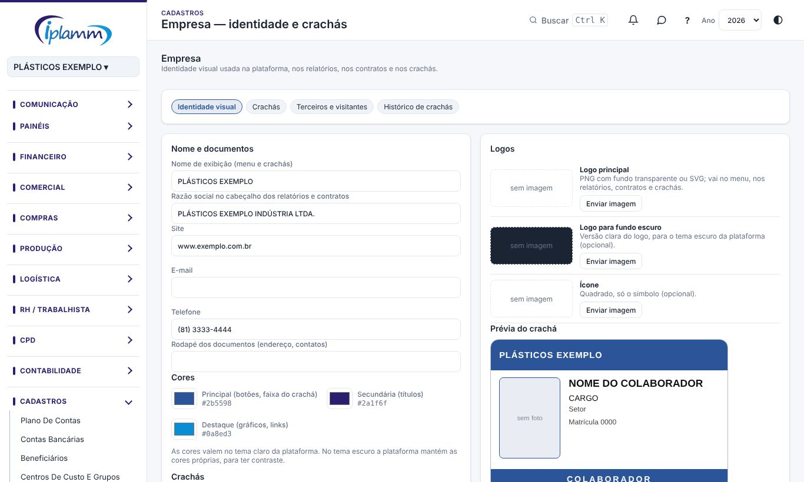
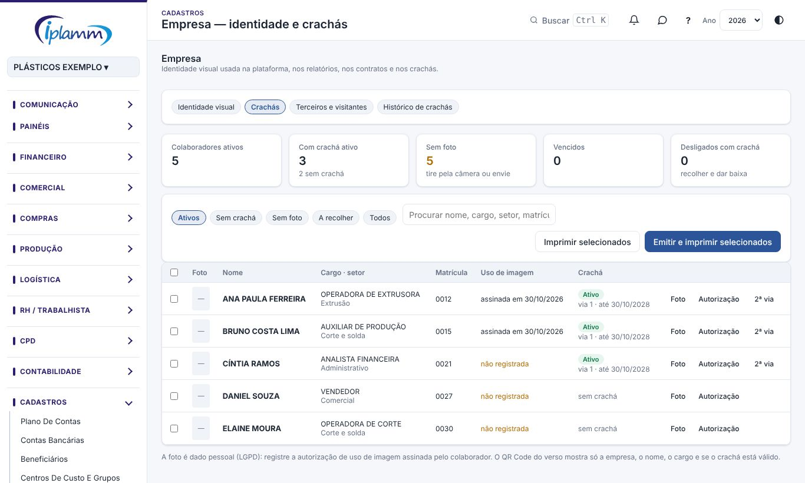
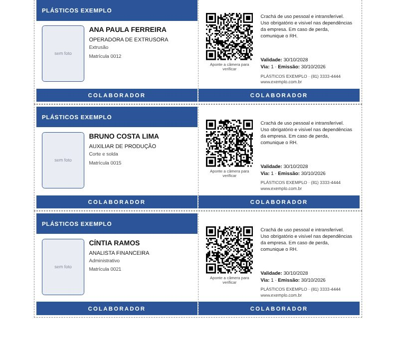

## 1. Para que serve

- **Identidade visual**: o nome, os logos, as cores, os contatos e as unidades da empresa. Valem na plataforma (menu e cores), nos relatórios e contratos (cabeçalho e logo) e nos crachás.
- **Crachás**: crachá de identificação com foto e QR Code para colaboradores, prestadores de serviço e visitantes. Sai em folha A4 para recortar, dobrar e plastificar.

## 2. Quem tem acesso

| Perfil | O que faz |
|---|---|
| Administrador | Altera a identidade visual. |
| Quem tem a área RH e pode editar | Tira as fotos, emite, imprime e dá baixa nos crachás. |
| Demais usuários | Veem a identidade; não veem crachás nem fotos. |

## 3. Identidade visual

1. Abra **Cadastros › Empresa: identidade e crachás**, aba **Identidade visual**.
2. Preencha o **nome de exibição** (aparece no menu e nos crachás) e a **razão social** que vai no cabeçalho dos relatórios e contratos.
3. Escolha as três **cores**: principal (botões e faixa do crachá), secundária e destaque. A prévia do crachá muda na hora.
4. Envie os **logos**: o principal (PNG com fundo transparente ou SVG), a versão para fundo escuro e o ícone. Cada imagem tem até 5 MB.
5. Em **Unidades e endereços**, inclua a matriz e as filiais.
6. Em **Crachás**, informe a validade padrão (em meses) e, se quiser, o texto do verso.
7. Clique em **Salvar identidade**. As cores e o logo passam a valer na plataforma e nos relatórios na mesma hora.

As cores valem no tema claro. No tema escuro a plataforma mantém as cores próprias, para ter contraste.

## 4. Crachás dos colaboradores

A lista vem de **RH › Colaboradores**. Os filtros mostram os ativos, quem está sem crachá, sem foto ou desligado com crachá a recolher.

### 4.1 Tirar a foto

1. Na linha da pessoa, clique em **Foto**.
2. Use **Abrir câmera** (computador ou celular) e **Tirar foto**, ou **Enviar foto** com um arquivo.
3. A plataforma recorta no formato 3 × 4 e reduz o tamanho. Clique em **Salvar foto**.

Rosto de frente, fundo claro, sem boné ou óculos escuros.

### 4.2 Autorização de uso de imagem

A foto é dado pessoal (LGPD). Antes de imprimir, colha a assinatura do colaborador na autorização de uso de imagem e registre a data em **Autorização**. Guarde o documento assinado com o RH.

### 4.3 Emitir e imprimir

1. Marque as pessoas e clique em **Emitir e imprimir selecionados**. Quem já tem crachá ativo não ganha outro: o atual é impresso de novo.
2. A janela de impressão abre com **5 crachás por folha A4**.
3. Imprima em **tamanho real (100%)**, sem "ajustar à página".
4. Recorte na linha tracejada de fora, **dobre na linha do meio** (frente e verso ficam de costas) e plastifique.

Para reimprimir sem emitir de novo, use **Imprimir selecionados**.

### 4.4 Segunda via

Use **2ª via** na linha da pessoa. O crachá anterior fica **cancelado** na hora: quem ler o QR Code dele vê "cancelado".

## 5. Terceiros e visitantes

- **Prestador de serviço**: nome, empresa prestadora, função e validade (padrão de 6 meses; use a data do fim do contrato).
- **Visitante**: nome, de onde vem, motivo e validade (padrão: só o dia).
- A foto é opcional. O CPF ou RG fica só no controle interno; não vai no crachá nem no QR Code.
- Quando a pessoa devolver, clique em **Devolvido**.

## 6. O QR Code do verso

Qualquer celular lê o QR Code e abre uma página de verificação, sem login, que mostra:

- a empresa, o nome, o tipo e o cargo;
- a situação: **válido**, **vencido**, **cancelado**, **devolvido** ou **extraviado**;
- a validade.

O crachá de quem foi **desligado** no RH passa a aparecer como cancelado automaticamente. Confira sempre se a foto do crachá é da pessoa.

## 7. Histórico de crachás

Todos os crachás emitidos, com via, validade, situação e baixa. Use **Devolvido** ou **Extraviado** para dar baixa.

## 8. Regras e travas

- Uma pessoa tem no máximo **um crachá ativo**; a 2ª via cancela a anterior.
- A identidade só é alterada pelo administrador; os crachás e as fotos, só por quem edita o RH.
- Fotos e logos ficam num espaço privado da empresa; outra empresa da plataforma não vê nada.

## 9. Perguntas frequentes e erros comuns

**O crachá saiu menor ou maior.** Na impressão, escolha tamanho real (100%) ou "tamanho original"; desmarque "ajustar à página".

**A câmera não abre.** O navegador precisa da permissão de câmera para o site. Libere no cadeado da barra de endereço ou use **Enviar foto**.

**Desliguei uma pessoa e o crachá continua ativo na lista.** Ele aparece no filtro **A recolher**. Recolha o crachá e dê baixa em **Histórico › Devolvido**. O QR Code já mostra "cancelado".

## 10. Histórico de alterações

| Versão | Data | O que mudou |
|---|---|---|
| 1.0 | 30/10/2026 | Primeira versão: identidade visual (logos, cores, unidades) aplicada na plataforma e nos relatórios; crachás com foto, QR Code de verificação, 2ª via, terceiros e visitantes, impressão em A4. |
