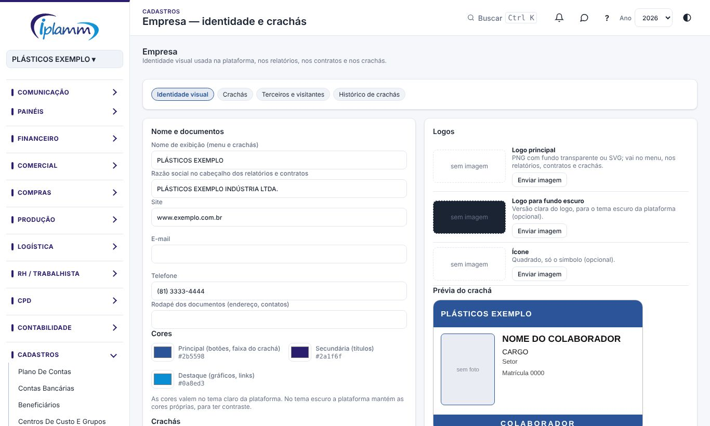
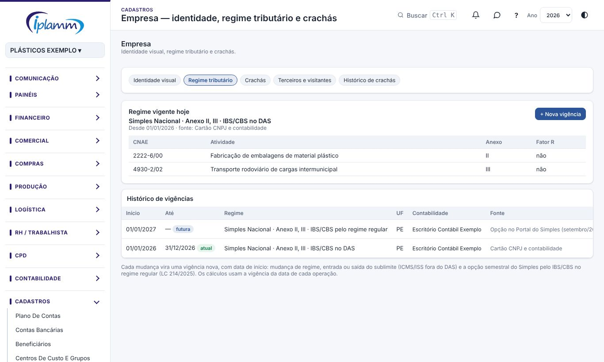
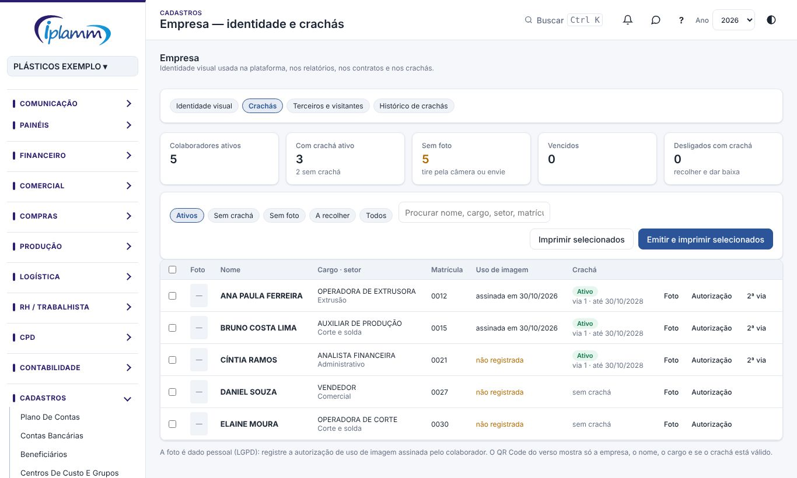
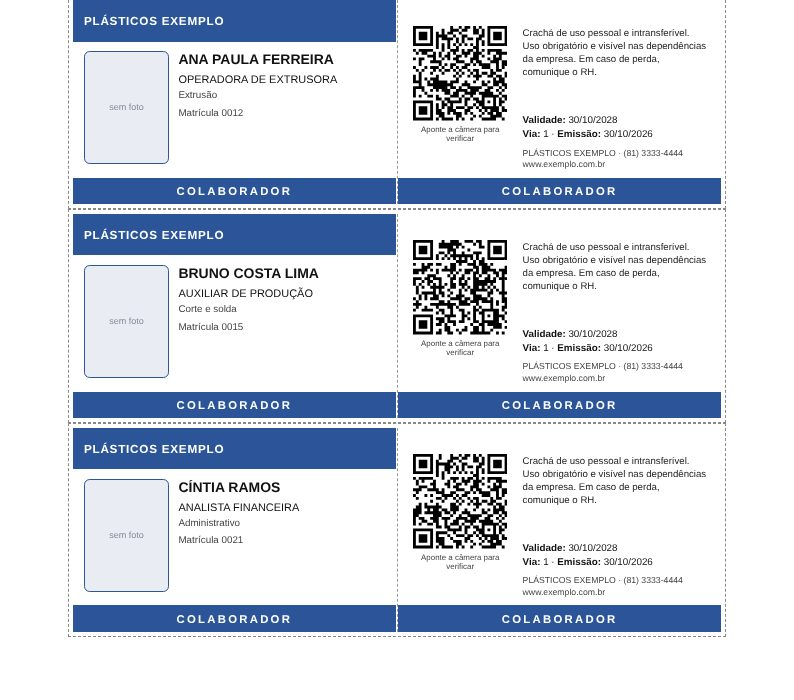

## 1. Para que serve

- **Identidade visual**: o nome, os logos, as cores, os contatos e as unidades da empresa. Valem na plataforma (menu e cores), nos relatórios e contratos (cabeçalho e logo) e nos crachás.
- **Regime tributário**: o regime da empresa (Simples Nacional, MEI, Lucro Presumido ou Lucro Real), com data de início de cada mudança. A apuração de impostos, o simulador da reforma e a conferência de IBS/CBS seguem o regime vigente em cada data.
- **Crachás**: crachá de identificação com foto e QR Code para colaboradores, prestadores de serviço e visitantes. Sai em folha A4 para recortar, dobrar e plastificar.

## 2. Quem tem acesso

| Perfil | O que faz |
|---|---|
| Administrador | Altera a identidade visual e o regime tributário. |
| Quem tem a área RH e pode editar | Tira as fotos, emite, imprime e dá baixa nos crachás. |
| Demais usuários | Veem a identidade e o regime tributário; não veem crachás nem fotos. |

## 3. Identidade visual

1. Abra **Cadastros › Empresa**, aba **Identidade visual**.
2. Preencha o **nome de exibição** (aparece no menu e nos crachás) e a **razão social** que vai no cabeçalho dos relatórios e contratos.
3. Escolha as três **cores**: principal (botões e faixa do crachá), secundária e destaque. A prévia do crachá muda na hora.
4. Envie os **logos**: o principal (PNG com fundo transparente ou SVG), a versão para fundo escuro e o ícone. Cada imagem tem até 5 MB.
5. Em **Unidades e endereços**, inclua a matriz e as filiais.
6. Em **Crachás**, informe a validade padrão (em meses) e, se quiser, o texto do verso.
7. Clique em **Salvar identidade**. As cores e o logo passam a valer na plataforma e nos relatórios na mesma hora.

As cores valem no tema claro. No tema escuro a plataforma mantém as cores próprias, para ter contraste.

## 4. Regime tributário

Na aba **Regime tributário** fica o regime de cada período, com a data de início. O quadro de cima mostra o regime de hoje; a tabela abaixo, o histórico com o início e o fim de cada vigência.

1. Clique em **+ Nova vigência** (só o administrador). A janela já vem com os dados do regime atual, para mudar só o necessário.
2. Escolha o **regime** e o **início da vigência**.
3. No **Lucro Real** ou **Presumido**, informe o PIS/COFINS (no Presumido é sempre cumulativo) e a apuração do IRPJ/CSLL.
4. No **Simples Nacional**, cadastre as **atividades**: CNAE, descrição, **anexo** (I a V) e se depende do **Fator R**. Marque, quando for o caso:
   - **Receita acima do sublimite** (R$ 3,6 milhões): ICMS e ISS passam a ser recolhidos fora do DAS;
   - **IBS e CBS pelo regime regular**: a empresa continua no Simples, mas apura IBS e CBS por débito e crédito, fora do DAS.
5. Informe UF, município (código IBGE), CNAE principal, incentivos, contabilidade e a **fonte** da informação (cartão CNPJ, contabilidade).
6. Clique em **Salvar**. A janela avisa o que falta: sem o anexo, o cálculo do DAS não é possível.

Cada mudança é uma **vigência nova**, e a anterior fica no histórico: troca de regime, entrada ou saída do sublimite e a opção do IBS/CBS, que vale por semestre (janeiro a junho, julho a dezembro). As telas usam a vigência da data de cada operação: uma nota de dezembro segue a regra de dezembro, mesmo que o regime mude em janeiro.

**Onde o regime é usado hoje:**
- **Apuração de impostos › Regras e parâmetros**: mostra o regime do mês e o que a apuração precisa naquele regime.
- **Conferência IBS/CBS**: na empresa do Simples com IBS/CBS no DAS, nota sem o grupo IBS/CBS aparece como informação, e não como erro.
- **Simulador da reforma**: avisa quando o regime não é o Lucro Real, porque a comparação é com o PIS/COFINS não cumulativo.
- **Relatórios**: sem razão social na identidade, o cabeçalho usa o nome da empresa cadastrada.

### 4.1 Criar uma empresa nova

A criação de empresas fica bloqueada para os usuários. Só o administrador da plataforma vê o quadro **Criar nova empresa** na tela de escolha de empresa.

1. Na tela de escolha, preencha o nome, o CNPJ e o **regime tributário**.
2. No Simples, informe também o CNAE principal e o anexo. Informe a UF e o início do uso na plataforma.
3. Clique em **Criar empresa**. Quem cria entra como administrador.

A empresa nasce com o plano de contas modelo. No Simples e no MEI, o grupo **2.08 Tributos** já vem com as contas do Simples: DAS, ICMS-ST/DIFAL, ISS retido, INSS patronal do Anexo IV, IBS/CBS pelo regime regular e parcelamentos. PIS/COFINS e IRPJ/CSLL separados não entram. Os demais dados do regime são completados nesta aba. Os outros usuários entram por convite, em **Empresa e usuários**.

## 5. Crachás dos colaboradores

A lista vem de **RH › Colaboradores**. Os filtros mostram os ativos, quem está sem crachá, sem foto ou desligado com crachá a recolher.

### 5.1 Tirar a foto

1. Na linha da pessoa, clique em **Foto**.
2. Use **Abrir câmera** (computador ou celular) e **Tirar foto**, ou **Enviar foto** com um arquivo.
3. A plataforma recorta no formato 3 × 4 e reduz o tamanho. Clique em **Salvar foto**.

Rosto de frente, fundo claro, sem boné ou óculos escuros.

### 5.2 Autorização de uso de imagem

A foto é dado pessoal (LGPD). Antes de imprimir, colha a assinatura do colaborador na autorização de uso de imagem e registre a data em **Autorização**. Guarde o documento assinado com o RH.

### 5.3 Emitir e imprimir

1. Marque as pessoas e clique em **Emitir e imprimir selecionados**. Quem já tem crachá ativo não ganha outro: o atual é impresso de novo.
2. A janela de impressão abre com **5 crachás por folha A4**.
3. Imprima em **tamanho real (100%)**, sem "ajustar à página".
4. Recorte na linha tracejada de fora, **dobre na linha do meio** (frente e verso ficam de costas) e plastifique.

Para reimprimir sem emitir de novo, use **Imprimir selecionados**.

### 5.4 Segunda via

Use **2ª via** na linha da pessoa. O crachá anterior fica **cancelado** na hora: quem ler o QR Code dele vê "cancelado".

## 6. Terceiros e visitantes

- **Prestador de serviço**: nome, empresa prestadora, função e validade (padrão de 6 meses; use a data do fim do contrato).
- **Visitante**: nome, de onde vem, motivo e validade (padrão: só o dia).
- A foto é opcional. O CPF ou RG fica só no controle interno; não vai no crachá nem no QR Code.
- Quando a pessoa devolver, clique em **Devolvido**.

## 7. O QR Code do verso

Qualquer celular lê o QR Code e abre uma página de verificação, sem login, que mostra:

- a empresa, o nome, o tipo e o cargo;
- a situação: **válido**, **vencido**, **cancelado**, **devolvido** ou **extraviado**;
- a validade.

O crachá de quem foi **desligado** no RH passa a aparecer como cancelado automaticamente. Confira sempre se a foto do crachá é da pessoa.

## 8. Histórico de crachás

Todos os crachás emitidos, com via, validade, situação e baixa. Use **Devolvido** ou **Extraviado** para dar baixa.

## 9. Regras e travas

- Uma pessoa tem no máximo **um crachá ativo**; a 2ª via cancela a anterior.
- A identidade e o regime tributário só são alterados pelo administrador. Cada vigência é única por data de início, e toda alteração fica na auditoria.
- A identidade só é alterada pelo administrador; os crachás e as fotos, só por quem edita o RH.
- Fotos e logos ficam num espaço privado da empresa; outra empresa da plataforma não vê nada.

## 10. Perguntas frequentes e erros comuns

**A apuração diz "Regime tributário não cadastrado".** Cadastre a vigência na aba **Regime tributário**, com início igual ou anterior ao mês que está sendo apurado.

**Não aparece o quadro para criar empresa.** A criação é liberada só para o administrador da plataforma. Peça a ele, ou peça um convite para a empresa que já existe.

**O crachá saiu menor ou maior.** Na impressão, escolha tamanho real (100%) ou "tamanho original"; desmarque "ajustar à página".

**A câmera não abre.** O navegador precisa da permissão de câmera para o site. Libere no cadeado da barra de endereço ou use **Enviar foto**.

**Desliguei uma pessoa e o crachá continua ativo na lista.** Ele aparece no filtro **A recolher**. Recolha o crachá e dê baixa em **Histórico › Devolvido**. O QR Code já mostra "cancelado".

## 11. Histórico de alterações

| Versão | Data | O que mudou |
|---|---|---|
| 1.0 | 30/10/2026 | Primeira versão: identidade visual (logos, cores, unidades) aplicada na plataforma e nos relatórios; crachás com foto, QR Code de verificação, 2ª via, terceiros e visitantes, impressão em A4. |
| 1.1 | 30/10/2026 | Correção: logo em SVG não aparecia na faixa do crachá (prévia e impressão). |
| 1.2 | 04/11/2026 | Nova aba **Regime tributário** (Simples Nacional, MEI, Lucro Presumido e Lucro Real, por vigência, com atividades e anexos do Simples, sublimite e opção do IBS/CBS pelo regime regular) e criação de empresa já com o regime. No Simples, o plano de contas vem com as contas do DAS. |
