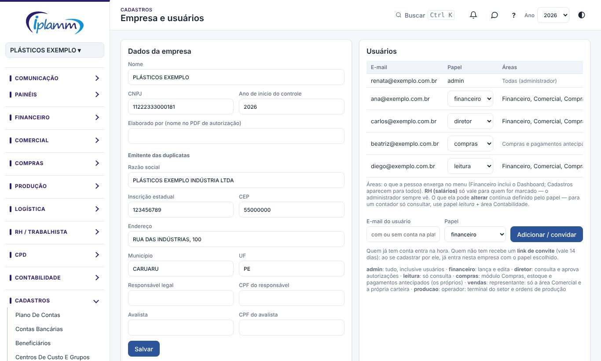
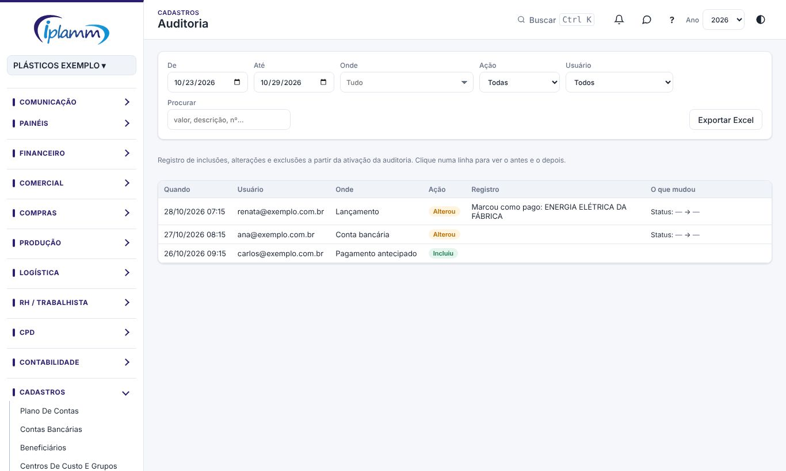

## 1. Para que serve

- **Empresa e usuários**: os dados da empresa, os usuários com o **papel** e as **áreas** de cada um, os convites e a importação de lançamentos por planilha.
- **Auditoria**: o registro de **quem incluiu, alterou ou excluiu**, quando, e o que mudou (antes e depois), com a opção de desfazer.

## 2. Quem tem acesso

| Perfil | O que faz |
|---|---|
| Administrador | Gerencia os usuários, os papéis e as áreas; altera os dados da empresa. |
| Administrador e diretor | Veem a Auditoria e podem desfazer alterações. |

## 3. Dados da empresa

Preencha:

- o nome e o CNPJ;
- o **ano de início do controle**;
- o **Elaborado por**, que é o nome que sai no PDF da Autorização de pagamentos;
- a razão social, a inscrição estadual, o endereço, o município e o CEP;
- o responsável legal e o avalista, com os CPFs (usados nos documentos, como o endosso).

Clique em **Salvar**.

## 4. Usuários

### 4.1 Convidar

1. Informe o **e-mail do usuário** e escolha o **papel**.
2. Clique em **Adicionar / convidar**:
   - quem já tem conta entra na hora;
   - quem não tem recebe um **link de convite**, que vale 14 dias. Ao se cadastrar por ele, a pessoa já entra na empresa com o papel escolhido.
3. Copie o link (**Copiar link**) e mande para a pessoa. A plataforma não envia e-mail.

Convite pendente pode ser **cancelado**; o link deixa de funcionar.

### 4.2 Os papéis

| Papel | O que pode |
|---|---|
| **Administrador** | Tudo, inclusive usuários. |
| **Financeiro** | Lança e edita. |
| **Diretor** | Consulta e aprova (autorizações, pagamentos antecipados, borderôs, pedidos acima da alçada). |
| **Leitura** | Só consulta. |
| **Compras** | Módulo Compras, estoque e os próprios pagamentos antecipados. |
| **Vendas** | Representante: só a área Comercial e a própria carteira. |
| **Produção** | Operador: o Terminal do setor e as Ordens de produção. |

O papel muda na própria lista de usuários. **Remover** tira o acesso.

### 4.3 As áreas

As **áreas** definem o que a pessoa enxerga no menu: Financeiro (inclui os painéis e o Dashboard), Comercial, Compras, Produção, Logística, CPD, Contabilidade e **RH (salários)**. Os Cadastros e a Ajuda aparecem para todos.

- O que a pessoa pode **alterar** continua sendo definido pelo **papel**. Por exemplo, para um contador só consultar, use o papel **leitura** com a área **Contabilidade**.
- **RH (salários)** só vale para quem for marcado; o administrador sempre vê.
- Deixe ao menos uma área marcada. A mudança vale no próximo acesso da pessoa.

## 5. Verificação em duas etapas

A verificação em duas etapas protege a conta mesmo que a senha vaze: ao entrar, além da senha, a plataforma pede um **código de 6 dígitos** do aplicativo autenticador do celular (Google Authenticator, Microsoft Authenticator ou Authy).

### 5.1 Ativar a sua

1. No menu, clique em **Verificação em duas etapas**.
2. Instale o aplicativo autenticador no celular, escolha **adicionar conta** e leia o QR Code. Sem câmera, digite a chave que aparece ao lado do QR Code.
3. Digite o código que aparecer no aplicativo e clique em **Ativar**.

Nos próximos acessos, depois da senha, a plataforma pede o código. Trocou de celular? Desative e ative de novo no aparelho novo.

### 5.2 Exigir para a empresa (administrador)

Em **Dados da empresa › Segurança**, marque **Exigir verificação em duas etapas para administrador, financeiro e diretor**:

- esses perfis só acessam os dados depois de digitar o código. A regra vale no **banco de dados**, não só na tela;
- quem ainda não ativou é obrigado a ativar no próximo acesso;
- os perfis compras, vendas, produção e leitura não são afetados.

> **Atenção:** ative a sua antes de ligar a exigência. A plataforma não deixa ligar sem isso, para você não perder o acesso.

## 6. Importar lançamentos por planilha

1. Clique em **Baixar modelo** para ter o layout.
2. Preencha as colunas (cabeçalho na 1ª linha):
   - **Data**;
   - **Plano de contas**: o código (por exemplo, 2.05.09) ou "2.05.09 - NOME";
   - **Valor**;
   - Descrição, Favorecido, Centro de Custo, Status (Pago ou Em aberto), Conta e Opcional 1 a 4.
3. Escolha o arquivo (Excel ou CSV). A plataforma mostra as linhas válidas, as com erro e os beneficiários novos.
4. Clique em **Importar**. Os beneficiários novos são cadastrados sozinhos.

É o mesmo layout das abas mensais da planilha e do Excel exportado em Lançamentos.

A **importação da base completa** (migração da planilha) só funciona em empresa sem lançamentos.

## 7. Auditoria

1. Filtre por período (**De / Até**), **onde** (tela ou tabela), **ação** (inclusão, alteração ou exclusão) e **usuário**, ou use a busca.
2. Clique numa linha para ver o **antes → depois** de cada campo.
3. **Desfazer** volta a alteração. Quando ela faz parte de uma operação (por exemplo, uma importação), desfazer volta a operação inteira.
4. **Exportar Excel** baixa o registro; **Carregar mais** traz as linhas mais antigas.

Dentro do lançamento, o botão **Histórico** mostra a auditoria só daquele lançamento.

## 8. Regras e travas

- Novos usuários entram **por convite**, direto na empresa e com o papel definido.
- Só o administrador gerencia usuários.
- Com a exigência ligada, administrador, financeiro e diretor só acessam os dados com o código do autenticador.
- A auditoria grava tudo a partir da sua ativação; o banco também restringe a leitura ao administrador e ao diretor.

## 9. Perguntas frequentes e erros comuns

**A pessoa não recebeu o convite.** A plataforma não envia e-mail. Copie o link e mande você mesmo.

**A pessoa não vê uma área no menu.** Marque a área no usuário dela. Vale no próximo acesso.

**Perdi o celular com o autenticador.** Peça ao administrador do Supabase para remover o fator da sua conta (Authentication › Users) e ative de novo.

**Alguém alterou um lançamento por engano.** Abra a Auditoria, encontre a alteração e use **Desfazer**, ou peça ao administrador ou ao diretor.

## 10. Histórico de alterações

| Versão | Data | O que mudou |
|---|---|---|
| 1.0 | 28/10/2026 | Primeira versão do manual: dados da empresa, convites, papéis, áreas, importação por planilha e auditoria. |
| 1.1 | 28/10/2026 | Verificação em duas etapas: ativar a sua e exigir para administrador, financeiro e diretor. |
| 1.2 | 29/10/2026 | Imagens das telas, com dados fictícios. |
