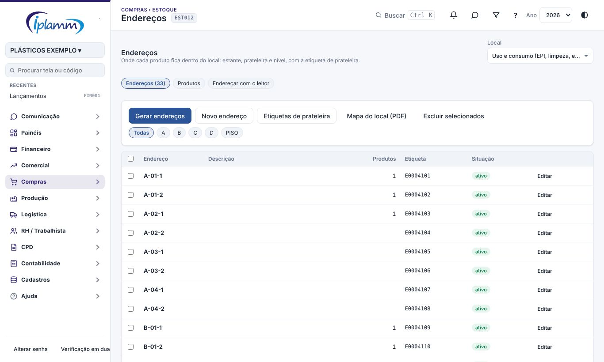
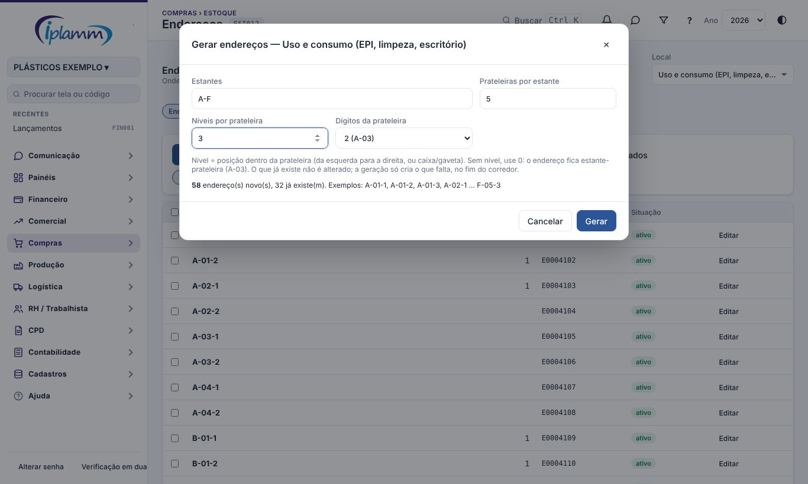
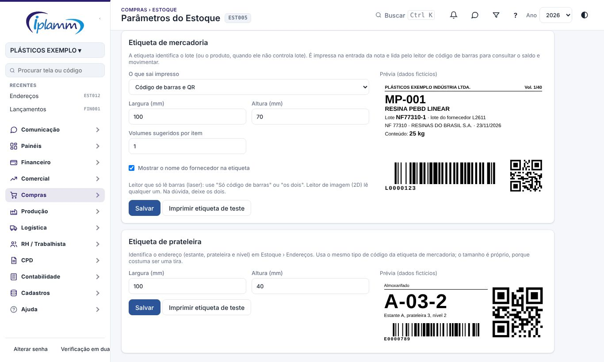
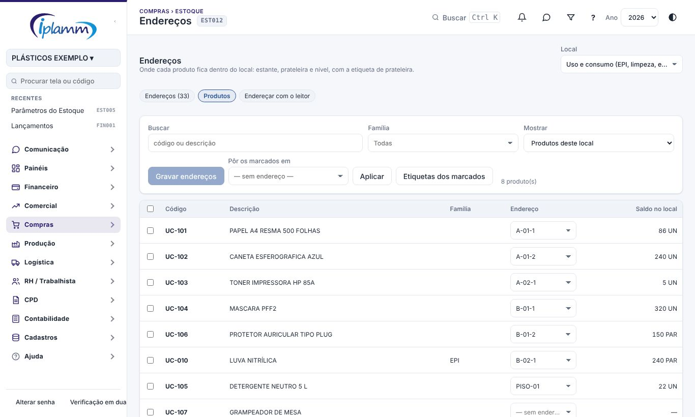
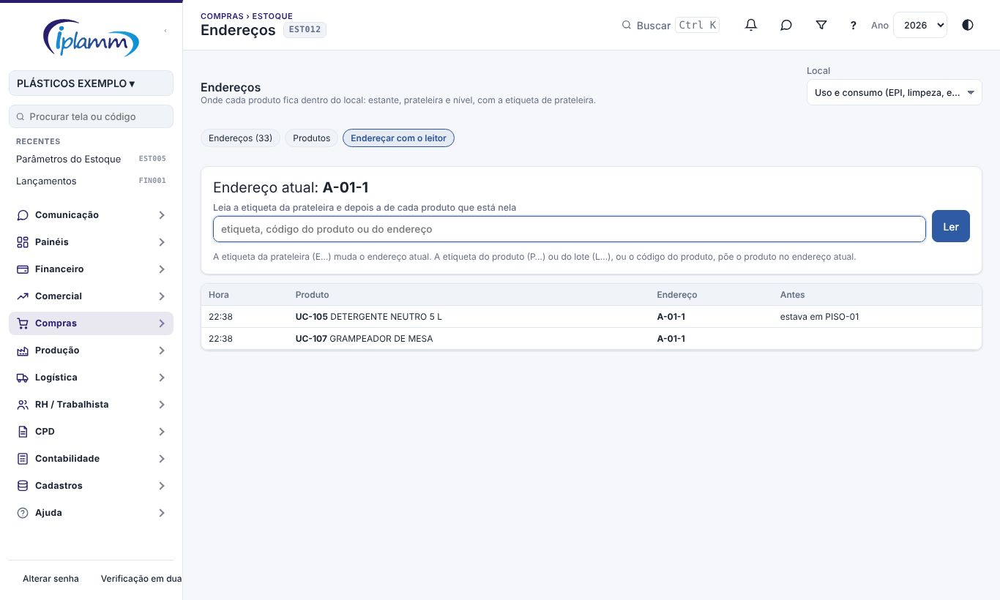

## 1. Para que serve

O local diz **em que almoxarifado** o produto está. O endereço diz **em que ponto dele**: estante, prateleira e nível.

> Exemplo: a luva de malha fica no Almoxarifado, estante **B**, prateleira **02**, nível **1**. O endereço é **B-02-1**.

Com os endereços:

- cada prateleira ganha uma **etiqueta de prateleira**, lida pelo mesmo leitor da etiqueta de mercadoria;
- cada produto tem o seu **endereço padrão** em cada local;
- a **guia de contagem** do inventário geral e a **lista de entrega** da requisição saem **na ordem do corredor**;
- as **etiquetas de mercadoria** saem **em lote**, já com o endereço impresso.

Serve para a reorganização do almoxarifado: gerar os endereços, colar as etiquetas nas prateleiras, arrumar os produtos e registrar onde cada um ficou, de preferência durante a contagem do dia 01.

## 2. Quem tem acesso

| O que | Quem |
|---|---|
| Ver os endereços e o endereço de cada produto | Quem consulta o estoque |
| Gerar, alterar e excluir endereços | Administrador, Financeiro, Diretor, Compras e Produção |
| Endereçar produtos (na tela, com o leitor ou na contagem) | Os mesmos perfis acima |
| Tamanho da etiqueta de prateleira | Administrador e Diretor |

O endereço não mostra saldo. Por isso quem conta no inventário geral pode ler e gravar endereços sem ver a quantidade do sistema.

## 3. A tela

O menu é **Compras › Estoque › Endereços**. No alto, escolha o **local**. Locais que não controlam saldo não recebem endereços.

A tela tem três abas:

- **Endereços**: os endereços do local, com quantos produtos estão em cada um, o código da etiqueta e a situação.
- **Produtos**: os produtos do local, com o endereço de cada um.
- **Endereçar com o leitor**: ler a prateleira e depois os produtos.

Na aba Endereços, os botões da linha das estantes filtram uma estante só (por exemplo, para imprimir as etiquetas da estante B).

## 4. Gerar os endereços

Use **Gerar endereços** e informe:

| Campo | Como preencher |
|---|---|
| Estantes | Intervalo de letras (A-F), de números (1-12), uma lista (A, B, C) ou uma mistura (A-D, P) |
| Prateleiras por estante | De 1 a 99, contadas de baixo para cima ou de cima para baixo, como a equipe preferir |
| Níveis por prateleira | De 0 a 20. Nível é a posição na prateleira (da esquerda para a direita, caixa ou gaveta). Sem nível, use 0 |
| Dígitos da prateleira | 2 dá A-03; 1 dá A-3 |

A prévia mostra quantos endereços serão criados e os primeiros códigos. Gerar de novo não altera nada que já existe: cria só o que falta, no fim do corredor. Para acrescentar a estante G, por exemplo, gere só "G".

**Um endereço avulso.** Use **Novo endereço** para o que não é estante: piso, paletes, gaiola de inflamáveis. Por exemplo, estante **PISO**, prateleira **01**.

**Editar.** Em cada linha, **Editar** muda a descrição, a ordem no corredor e a situação. Endereço com produto não pode ser desativado nem excluído: mude os produtos de endereço antes.

**Ordem do corredor.** É a sequência em que se anda pelo local. A geração já segue estante, prateleira e nível. Se o corredor faz outro caminho (por exemplo, a estante D fica logo na entrada), ajuste a ordem em Editar: o número menor vem primeiro.

## 5. Imprimir as etiquetas de prateleira

Marque os endereços (ou nenhum, para todos os da estante mostrada) e use **Etiquetas de prateleira**. A etiqueta traz o endereço em letra grande, o local e o código de barras e o QR do código E… da etiqueta.

O tamanho fica em **Estoque › Parâmetros › Etiquetas**, no quadro **Etiqueta de prateleira**. O padrão é 100 × 40 mm. O tipo de código (barras, QR ou os dois) é o mesmo da etiqueta de mercadoria.

O código da etiqueta não muda nunca, mesmo que o endereço seja renomeado: a etiqueta colada continua valendo.

**Mapa do local (PDF).** Lista cada endereço com o que deve estar nele e, no fim, os produtos com saldo no local que ainda não têm endereço. Serve para a arrumação e para conferir as prateleiras.

## 6. Endereçar os produtos em lote

Na aba **Produtos** aparecem os produtos do local: os que têm saldo nele, os que têm este local como local padrão (no produto ou na família) e os que já têm endereço aqui.

- **Mostrar**: só os produtos deste local, só os deste local **sem endereço**, ou **todos os produtos** (para endereçar o que ainda não tem saldo aqui).
- **Endereço**: escolha na lista de cada linha. A linha alterada fica marcada até você usar **Gravar endereços**.
- **Pôr os marcados em**: marque vários produtos, escolha o endereço e use **Aplicar**. Depois, **Gravar endereços**.
- **— sem endereço —** tira o produto do endereço.

Cada produto tem um endereço padrão por local. O mesmo produto pode ter um endereço no Almoxarifado e outro na Matéria-prima.

**Etiquetas em lote.** Marque os produtos e use **Etiquetas dos marcados**. A janela é a mesma da etiqueta da nota: informe os volumes de cada item. Produto com lote sai com uma etiqueta por lote que tem saldo no local; sem lote, sai a etiqueta do produto. A etiqueta já traz o endereço. São no máximo 600 etiquetas por vez.

## 7. Endereçar com o leitor

É o jeito mais rápido na arrumação: em frente à prateleira, com o leitor ou a câmera do celular.

1. Leia a **etiqueta da prateleira**. O endereço aparece em letra grande no alto.
2. Leia a **etiqueta de cada produto** que está nela (P… do produto ou L… do lote), ou digite o código do produto.
3. Passe para a próxima prateleira e leia a etiqueta dela.

A lista embaixo mostra o que foi endereçado e, quando o produto mudou de lugar, onde estava antes. Ler a etiqueta de prateleira de outro local avisa para trocar o local no alto da tela.

**Fora desta tela.** A etiqueta de prateleira lida em qualquer tela abre o endereço: o que deve estar nele e o saldo de cada produto no local. O botão **Endereçar aqui** abre esta aba já com o endereço escolhido.

## 8. Na contagem do inventário geral

Na tela de contagem (Inventário Geral), quem conta pode registrar o endereço junto com a quantidade:

1. Leia a etiqueta da prateleira. Aparece "Endereço atual".
2. Conte os itens da prateleira normalmente. Cada item registrado fica também nesse endereço.
3. Use **Parar** para voltar a contar sem gravar endereço.

O endereço é opcional e não altera a contagem cega: quem conta continua sem ver o saldo. Sem internet, o endereço fica guardado no aparelho junto com a quantidade e é enviado depois.

A lista da contagem e a **guia cega** impressa saem na ordem do corredor, com a coluna Endereço. O que não tem endereço vem no fim, por descrição.

## 9. Na entrega do almoxarifado

Na entrega da requisição de material, o endereço aparece ao lado do local de onde sai cada item ("Almoxarifado (86) · A-01-1"), e os itens vêm na ordem do corredor.

## 10. Roteiro sugerido para a reorganização

1. Gere os endereços de cada local e imprima as etiquetas de prateleira. Cole antes do dia 01.
2. Imprima em lote as etiquetas de mercadoria dos produtos que ainda não têm.
3. No inventário geral, quem conta lê a prateleira antes de contar o que está nela. Assim a contagem já registra o endereço novo.
4. Depois da contagem, use **Mostrar: deste local e sem endereço** e o **Mapa do local** para achar o que ficou sem lugar.

## 11. Regras

- Código do endereço: letras, números, ponto e hífen, até 20 caracteres. Estante, prateleira e nível: até 6 letras ou números cada.
- Um endereço não se repete no mesmo local. No máximo 3.000 endereços por geração.
- Um endereço padrão por produto e local.
- Endereço inativo não recebe produto. Endereço com produto não é desativado nem excluído.
- A etiqueta de prateleira (E…) é única e não muda.
- O endereço não interfere em saldo, custo nem movimento.

## 12. Dúvidas comuns

**O produto está em duas prateleiras. E agora?** O endereço padrão é um só. Use o lugar principal e deixe o excedente no endereço PISO (ou em outro endereço avulso), como reserva.

**Mudei o produto de prateleira.** Leia a nova prateleira e depois o produto, na aba do leitor. A lista mostra onde ele estava.

**A guia ainda saiu sem endereço.** Só sai na ordem do corredor o que já tem endereço. Os outros produtos vêm no fim.

**Posso renomear a estante?** Sim, em Editar, endereço por endereço. A etiqueta colada continua valendo, porque o código E… não muda, mas o texto impresso fica antigo: reimprima.

## 13. Histórico de versões

| Versão | Data | O que mudou |
|---|---|---|
| 1.0 | 22/11/2026 | Primeira versão: endereços por estante, prateleira e nível, geração em massa, etiqueta de prateleira com tamanho próprio, endereço padrão do produto, endereçamento em lote e com o leitor, etiquetas de mercadoria em lote, guia de contagem e lista de entrega na ordem do corredor (SQL 193). |
