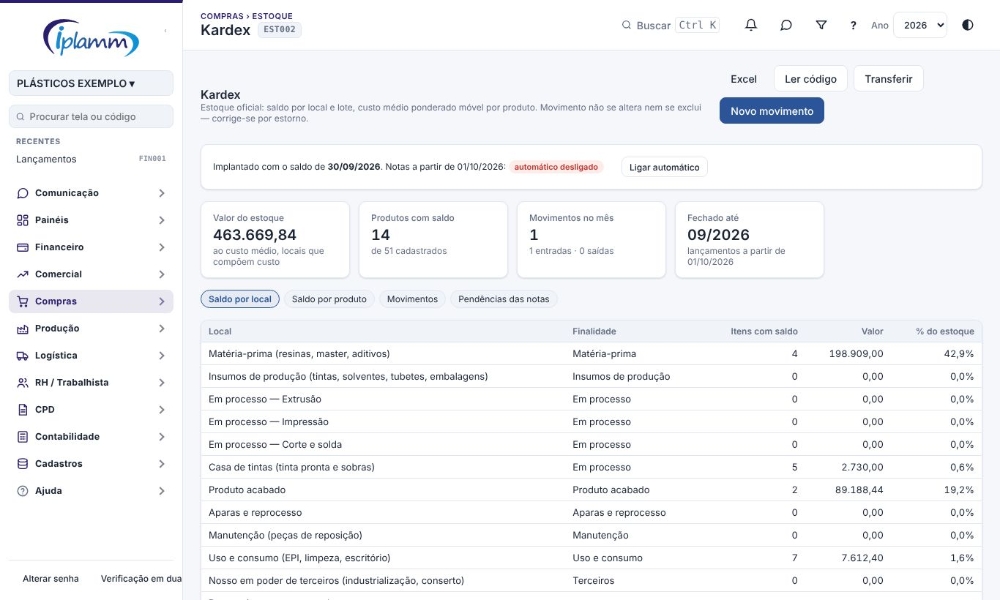
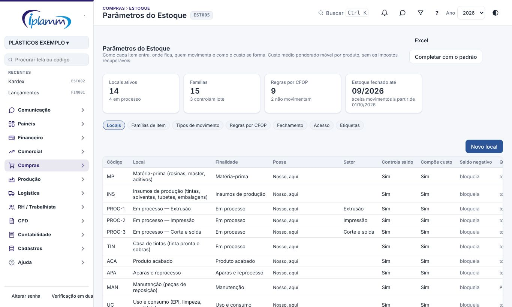
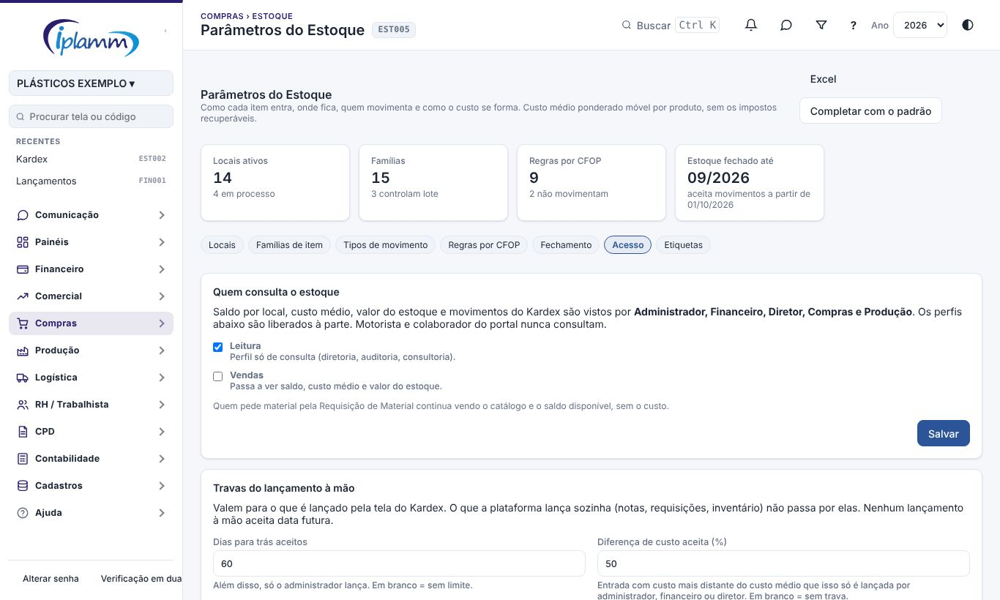

## 1. Para que serve

A plataforma passa a ser o **estoque oficial** da empresa. Duas telas:

- **Kardex**: o saldo de cada produto **por local e por lote**, o **custo médio ponderado móvel** e todos os movimentos (entradas, saídas, transferências, ajustes e estornos).
- **Parâmetros do Estoque**: as regras que decidem onde cada item fica e como o custo se forma:
  - **locais** (as partições do estoque);
  - **famílias de item**;
  - **tipos de movimento**;
  - **regras por CFOP**;
  - **fechamento do mês**.

> Exemplo: a resina entra em **Matéria-prima**, vai para **Em processo — Extrusão** e vira bobina ou fio. A luva vai para **Uso e consumo**. A peça de reposição vai para **Manutenção**.

## 2. Quem tem acesso

| Perfil | O que faz |
|---|---|
| Administrador e financeiro | Alteram os parâmetros, fecham o mês, recalculam o custo e lançam movimentos. Só o administrador reabre um mês fechado. |
| Diretor, compras e produção | Consultam e lançam movimentos e transferências nos locais liberados para o perfil deles. |
| Leitura | Consulta, enquanto estiver liberado em **Parâmetros › Acesso** (4.6). |
| Vendas | Só consulta se o administrador liberar em **Parâmetros › Acesso**. |
| Motorista e colaborador do portal | Não consultam saldo, custo nem movimentos. |

## 3. Kardex

### 3.1 Ler o saldo

Os indicadores mostram:

- o **valor do estoque**, ao custo médio. Só entram os locais que compõem custo; material de terceiros fica de fora;
- os **produtos com saldo**;
- os **movimentos do mês**;
- até quando o estoque está **fechado**.

Há três visões:

- **Saldo por local**: o valor de cada local e a % do total. Clique no local para ver os produtos dele.
- **Saldo por produto**: a quantidade, o custo médio, o valor, os locais e os lotes de cada produto.
- **Movimentos**: os movimentos da empresa no período escolhido em **De** e **Até**. A tela abre no mês corrente. Um período com mais de 2.000 movimentos mostra os 2.000 mais recentes e avisa para reduzir o período.

Clique no produto para abrir o **kardex do produto**. Ele mostra:

- o saldo por local e lote, com o lote do fornecedor;
- cada movimento, com o saldo no local e o custo médio depois dele. Aparecem os 200 movimentos mais recentes; **Carregar mais antigos** traz os anteriores.

### 3.2 Lançar um movimento

1. Clique em **Novo movimento**.
2. Escolha o **tipo de movimento**: por exemplo, compra, requisição para a produção, requisição interna ou perda. A lista mostra só os tipos que o seu perfil pode lançar à mão (veja 4.3). De início, **saldo inicial**, **ajuste de inventário** e **perda** são do financeiro e do diretor; **compra**, **requisição interna** e os tipos de nota fiscal, de quem compra; **produção**, **apara** e **requisição para a produção**, da produção. O administrador lança todos.
3. Informe a **data**, o **produto**, o **local** e a **quantidade**. O local já vem preenchido: primeiro o do tipo de movimento; depois o local padrão do produto.
4. Se o produto controla lote, informe o **lote**. Um lote novo é criado na hora, com o **lote do fornecedor**.
5. Nas entradas que formam custo (compra, produção e saldo inicial), informe o **custo unitário**, sem os impostos recuperáveis.
6. Clique em **Lançar**.

As demais entradas e todas as saídas usam o **custo médio do momento**. O saldo do local aparece embaixo do formulário antes de lançar.

O lançamento à mão passa pelas **travas** definidas em Parâmetros › Acesso (4.6): não aceita data futura, tem um limite de dias para trás, exige o documento nas entradas que formam custo e barra o custo muito diferente do custo médio do produto. Quando o produto ainda não tem custo médio, o primeiro custo lançado à mão é confirmado por administrador, financeiro ou diretor.

Uma **saída com data antiga** só entra se o saldo do local não ficar negativo em nenhum dia dali em diante. A transferência segue o mesmo limite de dias para trás.

O movimento fica gravado com o usuário que lançou, a data e a hora. Estorno, transferência e movimento de nota fiscal não podem ser lançados por aqui: cada um tem o seu caminho (3.3, 3.4 e a entrada automática pelas notas).

### 3.3 Transferir entre locais

**Transferir** move o produto de um local para outro: por exemplo, da **Quarentena** para a **Matéria-prima** depois da liberação da qualidade. A transferência sai da origem e entra no destino ao custo médio, sem mudar o custo nem o total do produto.

### 3.4 Estornar

O movimento **não se altera nem se exclui**. Para corrigir:

1. Abra o kardex do produto.
2. Clique no movimento errado.
3. Informe a **data** e o **motivo** e clique em **Estornar**.

O estorno lança o movimento inverso ao mesmo custo; o original fica no histórico. Numa **transferência**, estornar qualquer uma das duas linhas desfaz a transferência inteira: a saída da origem e a entrada no destino. Cada movimento só pode ser estornado uma vez, e um estorno não se estorna: lance o movimento de novo.

Regras do estorno:

- o **motivo** é obrigatório;
- a data fica entre a data do movimento e hoje;
- quem não pode lançar o tipo também não o estorna;
- movimento de **nota fiscal** só é estornado por administrador, financeiro ou diretor;
- saída de **Requisição de Material** só é estornada por quem atende o almoxarifado. A quantidade volta para a requisição, que deixa de constar como entregue;
- movimento lançado por outro documento (pesagem de tinta, peça de ordem de serviço, aditivo da recuperadora) não se estorna pelo Kardex: desfaça pelo documento, para ele e o estoque ficarem iguais.

Depois, lance o movimento certo.

### 3.5 Recalcular

Quando entra um movimento com data anterior a outro já lançado do mesmo produto, a plataforma **recalcula sozinha** o custo médio, os saldos e o "saldo no local" das linhas, em ordem de data, assim que o lançamento é gravado. Não é preciso fazer nada.

O botão **Recalcular** (administrador e financeiro) continua disponível para refazer a conta a pedido. Nos dois casos o recálculo parte do saldo do último **mês fechado** e refaz só o período aberto: o que está fechado não muda.

## 4. Parâmetros do Estoque

A empresa já nasce com uma configuração padrão. **Completar com o padrão** cria o que estiver faltando dela e não muda o que já foi ajustado.

### 4.1 Locais

Cada local tem:

- **finalidade**: matéria-prima, insumos, em processo, acabado, aparas, manutenção, uso e consumo, terceiros ou quarentena;
- **posse**: nosso, aqui; nosso, em poder de terceiros (industrialização, conserto); ou de terceiros, em nosso poder;
- **setor da produção**, para os locais em processo (um por setor);
- **controla saldo**;
- **compõe custo**: desligado, o local não entra no valor do estoque nem no custo médio;
- **saldo negativo**: o padrão é bloquear;
- **quem movimenta**: com nenhum perfil marcado, todos os que movimentam estoque podem; o administrador sempre pode;
- **conta contábil**.

### 4.2 Famílias de item

A família define:

- o **tipo do item no SPED** (00 revenda, 01 matéria-prima, 02 embalagem, 03 em processo, 04 acabado, 05 subproduto, 06 intermediário, 07 uso e consumo, 08 imobilizado, 09 serviço, 10 outros insumos, 99 outras);
- o **local padrão de entrada**;
- se o item **controla lote**: a resina pelo lote do fornecedor, a bobina pelo número;
- a **conta do plano** na compra.

Todo produto tem família. No cadastro, ela vem da classificação do produto e pode ser trocada em **Produtos › Editar › Classificação no estoque**. Trocar a família leva junto o tipo SPED e o local padrão.

### 4.3 Tipos de movimento

Cada tipo de movimento tem:

- o **sentido**: entrada, saída ou transferência;
- os **locais padrão** de origem e de destino;
- se **forma custo**;
- se **gera financeiro**;
- o **documento** exigido: nota, ordem de produção, requisição ou inventário;
- **quem lança à mão**: os perfis que podem lançar o tipo pela tela do Kardex. Sem nenhum perfil marcado, todos os que movimentam o estoque podem. O administrador sempre pode. Os lançamentos feitos pela plataforma (notas, requisições de material, inventário) não dependem deste campo.

Os tipos marcados **sistema** são usados pela plataforma: podem ser desativados, mas não excluídos.

Depois que um tipo tem movimentos, o **sentido** e o **forma custo** dele não mudam mais. O mesmo vale para a **posse**, o **compõe custo** e o **controla saldo** de um local com movimentos. Para mudar, crie outro tipo ou outro local.

### 4.4 Regras por CFOP

As regras dizem o que cada item de NF-e faz no estoque:

- o **CFOP**, completo (5101) ou só o final (x101, que vale para 5101, 6101 e 7101);
- para qual **família** ou **tipo de item** a regra vale (opcional);
- o **tipo de movimento**, ou **não movimenta**;
- o **local**. Sem local, a entrada vai para o local padrão do produto.

O CFOP completo vale mais que o final. A regra de uma família vale mais que a de qualquer item. No empate, vale a menor prioridade.

> As notas só movimentam o estoque sozinhas depois que o estoque é implantado e o automático é ligado, na tela Implantação do Estoque. Revise as regras antes.

### 4.5 Fechamento do Mês

**Fechar o mês** trava o estoque: nenhum movimento com data até o fim do mês fechado é aceito. Fechar um mês fecha também os anteriores. As correções entram por estorno, com data do mês aberto. Só o administrador reabre.

Ao fechar, a plataforma guarda a **posição do estoque** no último dia do mês: quantidade e valor de cada produto em cada local. Na lista de meses fechados, **Posição do estoque** mostra o total por local e por produto, com exportação para Excel. É o inventário de fim de mês. Reabrir o mês apaga a posição, que é guardada de novo no próximo fechamento.

### 4.6 Acesso

A aba **Acesso** define quem consulta saldo por local, custo médio, valor do estoque e movimentos.

- **Administrador, Financeiro, Diretor, Compras e Produção** sempre consultam.
- **Leitura** vem ligado e **Vendas** vem desligado; só o administrador muda.
- **Motorista** e **colaborador do portal** nunca consultam, nem pelas telas de reposição, inventário e implantação.
- Em empresa com a verificação em duas etapas obrigatória, administrador, financeiro e diretor só consultam e movimentam o estoque depois de passar por ela.

Quem pede material pela Requisição de Material continua vendo o catálogo e o saldo disponível, sem o custo.

A mesma aba traz as **travas do lançamento à mão**, que só o administrador altera:

| Trava | Padrão | O que faz |
|---|---|---|
| Dias para trás aceitos | 60 | Data mais antiga que isso só é lançada pelo administrador. Em branco, não há limite |
| Diferença de custo aceita | 50% | Entrada com custo mais distante do custo médio que isso só é lançada por administrador, financeiro ou diretor. Em branco, não há trava |
| Exigir o documento | Ligado | Compra, produção e saldo inicial lançados à mão só entram com o número da nota, da ordem ou do inventário |

As travas valem para o que é lançado pela tela. O que a plataforma lança sozinha (notas, requisições, inventário) não passa por elas.

## 5. Regras e travas

- O banco calcula o custo e o saldo; ninguém digita o custo de uma saída.
- O saldo negativo é bloqueado nos locais que não o permitem.
- O produto que controla lote exige o lote.
- O sinal da quantidade segue o tipo: entrada soma e saída subtrai.
- Movimento não se altera nem se exclui: só por estorno, e cada movimento só pode ser estornado uma vez.
- Mês fechado não aceita movimento, e o recálculo não altera o que está em mês fechado.
- A entrada que forma custo (compra, produção, saldo inicial) só é lançada com o custo unitário informado.
- Numa transferência, a saída e a entrada usam o mesmo custo. Não se transfere entre um local que compõe o custo e outro que não compõe: isso mudaria o valor do estoque sem um tipo de baixa.
- O produto de um lote não muda. Bloquear e liberar lote é da Qualidade.
- Só se fecha um mês que já terminou. Fechar e reabrir ficam na trilha de auditoria. O fechamento espera os lançamentos em andamento, para a posição guardada bater com o Kardex.
- No recálculo, o estorno acompanha o custo do movimento que ele desfaz.
- O lote só aceita produto da mesma empresa; lote com movimentos só tem o código corrigido por administrador ou financeiro.
- O lote informado precisa ser do mesmo produto.
- Cada tipo de movimento só é lançado à mão pelos perfis definidos em **Parâmetros › Tipos de movimento**.
- **Recalcular** só alcança produto da própria empresa.
- A nota cancelada nunca é barrada pelo estoque: se o material já saiu e o estorno não cabe, o caso aparece nas pendências do estoque para tratar.
- Mudanças em locais, famílias, tipos de movimento e regras por CFOP ficam na trilha de auditoria, com quem mudou e o valor anterior.
- O custo não inclui os impostos recuperáveis (veja **Parâmetros de custo** em Posição de estoque).
- **Qualidade**:
  - material no local **Quarentena (QUA)** ou **Reprovado (REP)** só sai pela decisão da inspeção ou pela disposição da não conformidade;
  - **lote bloqueado** pela qualidade não sai de nenhum local;
  - a entrada pela nota de um produto com plano de recebimento vai para a Quarentena, e não para o local padrão.

  Os detalhes estão no manual Qualidade.

## 6. Perguntas frequentes e erros comuns

**"Saldo insuficiente de … em …".** O local não tem a quantidade. Confira se o material está em outro local (transfira) ou se falta lançar uma entrada.

**"O estoque de MM/AAAA está fechado".** Lance com data do mês aberto ou peça ao administrador para reabrir.

**"Seu perfil não movimenta o local …".** O local é restrito a alguns perfis em **Parâmetros › Locais**.

**O custo médio ficou estranho depois de uma entrada com data antiga.** Use **Recalcular** no kardex do produto.

**"Material em quarentena aguardando a inspeção da qualidade" ou "Lote … bloqueado pela qualidade".** O material está esperando a qualidade. Peça a inspeção em Qualidade › Inspeções. Para lote bloqueado, veja Qualidade › Não Conformidades e Bloqueios.

## 7. Histórico de alterações

| Versão | Data | O que mudou |
|---|---|---|
| 1.0 | 31/10/2026 | Primeira versão: kardex por local e lote com custo médio ponderado móvel, movimento manual, transferência, estorno, recálculo, locais, famílias, tipos de movimento, regras por CFOP e fechamento do mês. |
| 1.1 | 05/11/2026 | Nomes das telas iguais aos do menu, com o código da tela no cabeçalho. |
| 1.2 | 29/10/2026 | Imagens das telas, com dados fictícios. |
| 1.3 | 07/11/2026 | Travas da qualidade: quarentena e reprovado só saem pela qualidade, lote bloqueado não sai, entrada com plano de recebimento vai para a quarentena. |
| 1.4 | 21/11/2026 | Quem lança cada tipo de movimento à mão passa a ser parâmetro (saldo inicial e ajuste de inventário restritos por padrão). Estorno de transferência desfaz as duas pernas de uma vez. Lote conferido contra o produto. Trilha de auditoria nos parâmetros. Nota cancelada sem saldo para estornar vira pendência. |
| 1.5 | 21/11/2026 | Movimentos por período (De e Até). Kardex do produto em páginas de 200 movimentos. Movimento com data antiga recalcula sozinho; o recálculo respeita o mês fechado. Nova aba Acesso: quem consulta saldo, custo e movimentos. Entrada que forma custo exige o custo. |
| 1.6 | 22/11/2026 | Travas do lançamento à mão (data futura, limite de dias, documento, diferença de custo). Compra, produção e tipos de nota restritos por perfil. Estorno com motivo, data e perfil conferidos, ligado à requisição de origem. Parâmetros estruturais congelados depois do primeiro movimento. Posição do estoque guardada no fechamento. |
| 1.7 | 22/11/2026 | Perda e requisição direta restritas por perfil. Primeiro custo de um produto confirmado por administrador, financeiro ou diretor. Saída com data antiga não deixa saldo negativo em nenhum dia. Estorno de movimento de outro documento é feito pelo documento. Só se fecha mês terminado. |
