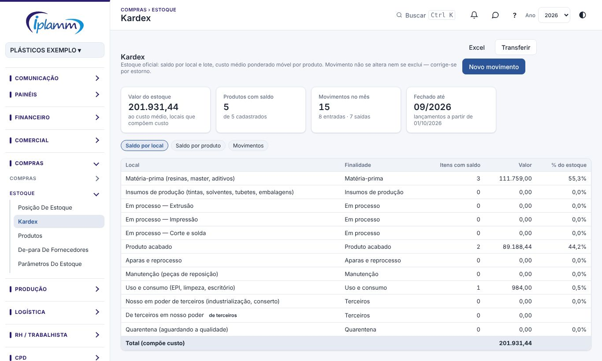
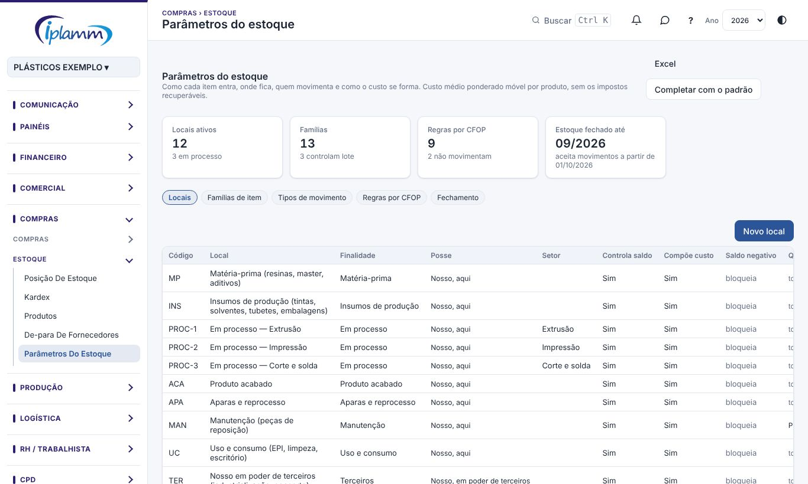

## 1. Para que serve

A plataforma passa a ser o **estoque oficial** da empresa. Duas telas:

- **Kardex**: o saldo de cada produto **por local e por lote**, o **custo médio ponderado móvel** e todos os movimentos (entradas, saídas, transferências, ajustes e estornos).
- **Parâmetros do estoque**: as regras que decidem onde cada item fica e como o custo se forma:
  - **locais** (as partições do estoque);
  - **famílias de item**;
  - **tipos de movimento**;
  - **regras por CFOP**;
  - **fechamento do mês**.

> Exemplo: a resina entra em **Matéria-prima**, vai para **Em processo — Extrusão** e vira bobina ou fio. A luva vai para **Uso e consumo**. A peça de reposição vai para **Manutenção**.

## 2. Quem tem acesso

| Perfil | O que faz |
|---|---|
| Administrador e financeiro | Alteram os parâmetros, fecham o mês, recalculam o custo e lançam movimentos. Só o administrador reabre um mês fechado. |
| Diretor, compras e produção | Consultam e lançam movimentos e transferências nos locais liberados para o perfil deles. |
| Leitura | Consulta. |

## 3. Kardex

### 3.1 Ler o saldo

Os indicadores mostram:

- o **valor do estoque**, ao custo médio. Só entram os locais que compõem custo; material de terceiros fica de fora;
- os **produtos com saldo**;
- os **movimentos do mês**;
- até quando o estoque está **fechado**.

Há três visões:

- **Saldo por local**: o valor de cada local e a % do total. Clique no local para ver os produtos dele.
- **Saldo por produto**: a quantidade, o custo médio, o valor, os locais e os lotes de cada produto.
- **Movimentos**: os últimos 500 movimentos da empresa.

Clique no produto para abrir o **kardex do produto**. Ele mostra:

- o saldo por local e lote, com o lote do fornecedor;
- cada movimento, com o saldo no local e o custo médio depois dele.

### 3.2 Lançar um movimento

1. Clique em **Novo movimento**.
2. Escolha o **tipo de movimento**: por exemplo, compra, requisição para a produção, requisição interna, perda ou ajuste de inventário.
3. Informe a **data**, o **produto**, o **local** e a **quantidade**. O local já vem preenchido: primeiro o do tipo de movimento; depois o local padrão do produto.
4. Se o produto controla lote, informe o **lote**. Um lote novo é criado na hora, com o **lote do fornecedor**.
5. Nas entradas que formam custo (compra, produção e saldo inicial), informe o **custo unitário**, sem os impostos recuperáveis.
6. Clique em **Lançar**.

As demais entradas e todas as saídas usam o **custo médio do momento**. O saldo do local aparece embaixo do formulário antes de lançar.

### 3.3 Transferir entre locais

**Transferir** move o produto de um local para outro: por exemplo, da **Quarentena** para a **Matéria-prima** depois da liberação da qualidade. A transferência sai da origem e entra no destino ao custo médio, sem mudar o custo nem o total do produto.

### 3.4 Estornar

O movimento **não se altera nem se exclui**. Para corrigir:

1. Abra o kardex do produto.
2. Clique no movimento errado.
3. Informe a **data** e o **motivo** e clique em **Estornar**.

O estorno lança o movimento inverso ao mesmo custo; o original fica no histórico. Numa transferência, estorne as duas pernas. Depois, lance o movimento certo.

### 3.5 Recalcular

**Recalcular** (administrador e financeiro) refaz o custo médio e os saldos do produto em ordem de data. Use depois de lançar um movimento com data anterior a outros já lançados.

## 4. Parâmetros do estoque

A empresa já nasce com uma configuração padrão. **Completar com o padrão** cria o que estiver faltando dela e não muda o que já foi ajustado.

### 4.1 Locais

Cada local tem:

- **finalidade**: matéria-prima, insumos, em processo, acabado, aparas, manutenção, uso e consumo, terceiros ou quarentena;
- **posse**: nosso, aqui; nosso, em poder de terceiros (industrialização, conserto); ou de terceiros, em nosso poder;
- **setor da produção**, para os locais em processo (um por setor);
- **controla saldo**;
- **compõe custo**: desligado, o local não entra no valor do estoque nem no custo médio;
- **saldo negativo**: o padrão é bloquear;
- **quem movimenta**: com nenhum perfil marcado, todos os que movimentam estoque podem; o administrador sempre pode;
- **conta contábil**.

### 4.2 Famílias de item

A família define:

- o **tipo do item no SPED** (00 revenda, 01 matéria-prima, 02 embalagem, 03 em processo, 04 acabado, 05 subproduto, 06 intermediário, 07 uso e consumo, 08 imobilizado, 09 serviço, 10 outros insumos, 99 outras);
- o **local padrão de entrada**;
- se o item **controla lote**: a resina pelo lote do fornecedor, a bobina pelo número;
- a **conta do plano** na compra.

Todo produto tem família. No cadastro, ela vem da classificação do produto e pode ser trocada em **Produtos › Editar › Classificação no estoque**. Trocar a família leva junto o tipo SPED e o local padrão.

### 4.3 Tipos de movimento

Cada tipo de movimento tem:

- o **sentido**: entrada, saída ou transferência;
- os **locais padrão** de origem e de destino;
- se **forma custo**;
- se **gera financeiro**;
- o **documento** exigido: nota, ordem de produção, requisição ou inventário.

Os tipos marcados **sistema** são usados pela plataforma: podem ser desativados, mas não excluídos.

### 4.4 Regras por CFOP

As regras dizem o que cada item de NF-e faz no estoque:

- o **CFOP**, completo (5101) ou só o final (x101, que vale para 5101, 6101 e 7101);
- para qual **família** ou **tipo de item** a regra vale (opcional);
- o **tipo de movimento**, ou **não movimenta**;
- o **local**. Sem local, a entrada vai para o local padrão do produto.

O CFOP completo vale mais que o final. A regra de uma família vale mais que a de qualquer item. No empate, vale a menor prioridade.

> Os movimentos automáticos pelas notas de entrada e de saída entram na próxima etapa. Revise as regras antes.

### 4.5 Fechamento do mês

**Fechar o mês** trava o estoque: nenhum movimento com data até o fim do mês fechado é aceito. Fechar um mês fecha também os anteriores. As correções entram por estorno, com data do mês aberto. Só o administrador reabre.

## 5. Regras e travas

- O banco calcula o custo e o saldo; ninguém digita o custo de uma saída.
- O saldo negativo é bloqueado nos locais que não o permitem.
- O produto que controla lote exige o lote.
- O sinal da quantidade segue o tipo: entrada soma e saída subtrai.
- Movimento não se altera nem se exclui: só por estorno, e cada movimento só pode ser estornado uma vez.
- Mês fechado não aceita movimento.
- O custo não inclui os impostos recuperáveis (veja **Parâmetros de custo** em Posição de estoque).

## 6. Perguntas frequentes e erros comuns

**"Saldo insuficiente de … em …".** O local não tem a quantidade. Confira se o material está em outro local (transfira) ou se falta lançar uma entrada.

**"O estoque de MM/AAAA está fechado".** Lance com data do mês aberto ou peça ao administrador para reabrir.

**"Seu perfil não movimenta o local …".** O local é restrito a alguns perfis em **Parâmetros › Locais**.

**O custo médio ficou estranho depois de uma entrada com data antiga.** Use **Recalcular** no kardex do produto.

## 7. Histórico de alterações

| Versão | Data | O que mudou |
|---|---|---|
| 1.0 | 31/10/2026 | Primeira versão: kardex por local e lote com custo médio ponderado móvel, movimento manual, transferência, estorno, recálculo, locais, famílias, tipos de movimento, regras por CFOP e fechamento do mês. |
