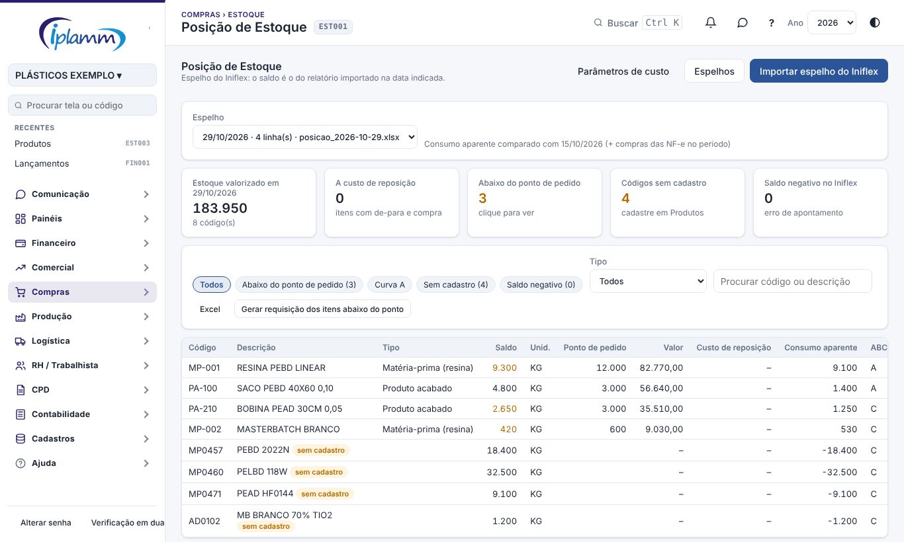
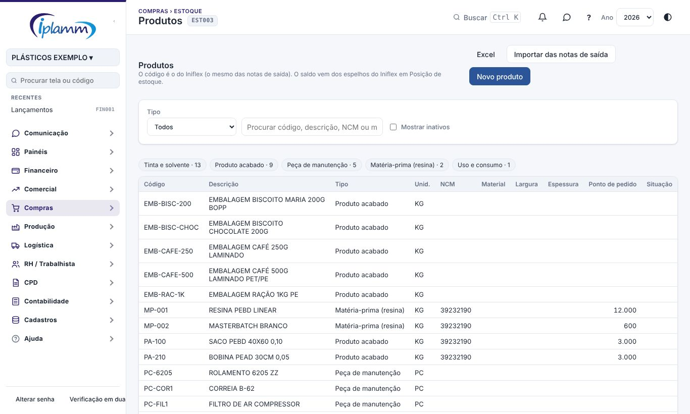
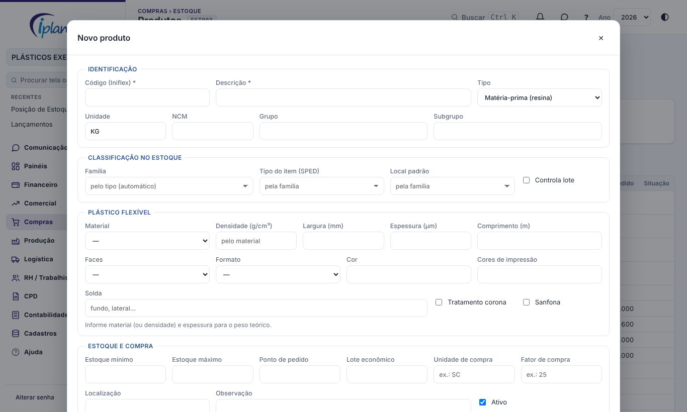
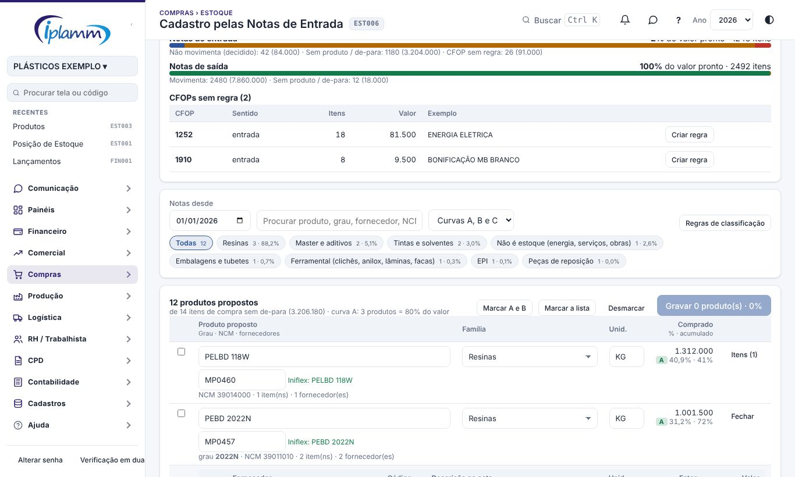
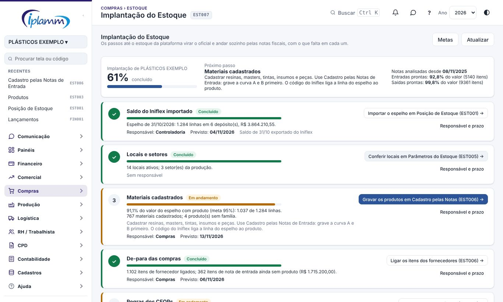

## 1. Para que serve

- **Posição de Estoque**: o **espelho do estoque do Iniflex**, importado por arquivo. Mostra o valor a custo de reposição, a curva ABC e o que está abaixo do ponto de pedido, e gera a requisição de compra automática.
- **Produtos**: o cadastro dos produtos e insumos, com:
  - os atributos de plástico flexível e os parâmetros de estoque;
  - os códigos dos fornecedores;
  - a estrutura do produto, com o custo teórico;
  - as compras pelas NF-e e a posição no Iniflex.
- **De-para de Fornecedores**: liga cada código de item que aparece nas notas de entrada (CNPJ do fornecedor + código dele) a um produto do cadastro. Com o de-para, a plataforma calcula o custo de compra e casa o recebimento sozinha.

> O estoque oficial passa a ser o da plataforma: o **Kardex**, com saldo por local e lote e custo médio (veja o manual **Kardex e parâmetros do estoque**). O espelho do Iniflex serve para a implantação e a conferência.

## 2. Quem tem acesso

| Perfil | O que faz |
|---|---|
| Administrador, diretor e financeiro | Importam e excluem espelhos, definem os parâmetros de custo, cadastram produtos e fazem o de-para. |
| Compras | Consulta a posição, gera a requisição automática e cadastra e edita produtos. |

## 3. Posição de Estoque

### 3.1 Importar o espelho do Iniflex

1. No Iniflex, exporte o relatório de **saldo de estoque** em Excel ou CSV, com uma linha por produto e depósito.
2. Clique em **Importar espelho do Iniflex**, escolha o arquivo e informe a data em **Posição em**.
3. Confira a prévia das 8 primeiras linhas e ligue as **colunas do arquivo**: código, descrição, depósito, unidade, quantidade, custo unitário e valor total.
4. Clique em **Importar**. Nada é gravado antes disso.

**Espelhos** lista os espelhos importados. Excluir um espelho tira as linhas dele da plataforma; o Iniflex não muda.

### 3.2 Ler a posição

Os indicadores mostram:

- o valor **a custo de reposição**: a quantidade × o último custo líquido de compra (pelas NF-e de entrada e pelo de-para);
- quantos itens estão **abaixo do ponto de pedido**;
- os **códigos sem cadastro**;
- os itens com **saldo negativo no Iniflex**.

Filtre por **Todos**, **Abaixo do ponto de pedido**, **Curva A**, **Sem cadastro** e **Saldo negativo**. **Excel** baixa a lista.

### 3.3 Gerar a requisição automática

**Gerar requisição dos itens abaixo do ponto** cria uma requisição de compra com esses itens. A quantidade é o lote econômico; ou o necessário até o estoque máximo; ou até o ponto de pedido. A requisição segue o fluxo normal de Compras (veja o manual de Compras).

### 3.4 Parâmetros de custo

Em **Parâmetros de custo**, marque os impostos **recuperáveis** (que geram crédito).

> **Custo líquido** = produtos + frete + outras despesas − desconto + ST − os impostos recuperáveis.

Confirme com a contabilidade quais impostos marcar.

## 4. Produtos

### 4.1 Cadastrar

1. Clique em **Novo produto**.
2. O formulário tem quatro seções. Em **Identificação**, preencha o **tipo**, o **código (Iniflex)** e a **descrição** (obrigatórios), a unidade, o NCM, o grupo e o subgrupo.
3. Em **Plástico flexível**, informe o material, a largura, a espessura, as faces, a cor e a solda.
4. Em **Classificação no estoque**, confira a **família**, o **tipo do item no SPED**, o **local padrão** e se o item **controla lote**. Deixados em branco, vêm da família, e a família vem do tipo do produto.
5. Em **Estoque e compra**, informe o estoque mínimo e o máximo, o ponto de pedido, o lote econômico, a **unidade de compra**, o **Fator de compra** (quantas unidades de estoque vêm em 1 unidade de compra; ex.: 1 SC = 25 KG), a localização e a observação.
6. Clique em **Salvar**.

**Importar das notas de saída** cadastra de uma vez os códigos vendidos nas NF-e de saída que ainda não estão no cadastro. Eles entram como produto acabado (família Produto acabado, tipo 04 no SPED e local Produto acabado), com a descrição, a unidade e o NCM da nota mais recente. Desmarque o que não for produto (sucata, serviço) e clique em **Cadastrar marcados**.

### 4.2 A ficha do produto

Clique no produto para ver:

- o **estoque no Iniflex**, por depósito;
- os **fornecedores**: o código dele na nota, o fator, o último custo e a última compra;
- a **estrutura**: os componentes que o produto consome, com a quantidade e a perda %, e o custo teórico. Use **+ Componente** para incluir;
- as **compras nos últimos 12 meses**, pelas NF-e de entrada.

## 5. De-para de Fornecedores

1. Escolha **Notas desde** e, se quiser, o **fornecedor**.
2. A lista mostra os itens das notas de entrada **sem de-para**: o fornecedor, o código e a descrição no fornecedor, a unidade, o NCM, as notas, o total comprado, a última compra e a **sugestão** de produto.
3. Para cada item, escolha:
   - **Ligar a produto existente**: escolha o produto e informe o **fator**, que diz quantas unidades do produto há em 1 unidade da nota (por exemplo, uma caixa com 1.000 unidades = fator 1000);
   - **Criar produto novo**: com código, descrição, tipo e unidade.
4. **Criar produtos dos marcados** faz em lote: cria um insumo para cada item marcado sem sugestão e liga à sugestão os que têm.

> Se o item já tem código no Iniflex, use o código do Iniflex: é ele que liga o produto ao espelho do estoque.

### 5.1 Cadastro pelas Notas de Entrada (em massa)

Use esta tela para cadastrar de uma vez os produtos e os de-paras de todos os itens de compra. É o caminho para a implantação do estoque, porque sem de-para as notas de entrada não movimentam nada.

1. **Antes, importe o relatório de saldo do Iniflex** em Posição de Estoque. Assim cada produto novo nasce com o **código do Iniflex**, sugerido pelo espelho, e o saldo inicial se liga sozinho na implantação.
2. Abra **Estoque › Cadastro pelas Notas de Entrada** e escolha **Notas desde**.
3. No topo, a **prontidão das notas** mostra, sem gravar nada, o que cada item das notas de entrada e de saída faria hoje no estoque: movimenta, não movimenta (já decidido), sem produto, CFOP sem regra ou produto sem local. Use **Criar regra** nos CFOPs que ainda não têm regra (por exemplo, 1252, energia elétrica: "não movimenta").
4. A lista mostra os **produtos propostos**:
   - o **mesmo material de fornecedores diferentes vira um produto só**, pelo grau (ex.: "PEBD 2022N SC 25KG" e "POLIETILENO BAIXA DENSIDADE 2022N");
   - a **família** vem das regras de classificação: resinas, master, tintas, embalagens, ferramental, peças, EPI, limpeza, escritório, uso e consumo, imobilizado ou **não é estoque**;
   - a **unidade** e o **fator** vêm da nota: saco de 25 kg → fator 25; big bag de 1.250 kg → 1.250; tonelada → 1.000;
   - a **curva ABC** mostra onde está o valor: poucos produtos (curva A) somam 80% de tudo o que foi comprado.
5. Confira cada linha: descrição, código, família e unidade. Em **Itens** você vê os itens de cada fornecedor e pode ajustar o fator ou desmarcar um item.
6. Marque os produtos (**Marcar A e B** marca os de maior valor) e clique em **Gravar**. A plataforma cria os produtos e os de-paras de uma vez, com o último custo da nota.
7. Os itens que **não são estoque** (energia, serviços, material de obra) ficam ligados a um produto genérico que não movimenta. Assim a nota não fica pendente.
8. Em **Regras de classificação**, ajuste a ordem, os NCMs, as palavras e o valor mínimo de cada família. Ao salvar, a lista é reclassificada.

> A família **Imobilizado** é uma sugestão para máquinas e móveis de valor unitário a partir de R$ 1.200. Confira se é bem do ativo (vai para Contabilidade › Ativo Imobilizado › A imobilizar) ou peça de reposição.

## 6. Implantação do Estoque

A tela **Implantação do Estoque** acompanha os passos até o estoque da plataforma virar o oficial e andar sozinho pelas notas fiscais. A situação de cada passo é calculada com os números do banco, na hora em que a tela abre (ou em **Atualizar**).

No alto ficam:

- o **percentual concluído** da empresa;
- o **próximo passo**, com o que fazer;
- quanto das **entradas** e das **saídas** dos últimos meses já está pronto para movimentar o estoque.

Os nove passos:

| Passo | Concluído quando | Onde fazer |
|---|---|---|
| 1. Saldo do Iniflex importado | Há um espelho importado. | Posição de Estoque (EST001) |
| 2. Locais e setores | Há locais ativos e todo setor da produção tem um local "em processo". | Parâmetros do Estoque (EST005) |
| 3. Materiais cadastrados | O valor do espelho ligado a produtos atinge a meta (padrão 95%). | Cadastro pelas Notas de Entrada (EST006) |
| 4. De-para das compras | O valor das entradas com produto atinge a meta (padrão 90%). | Cadastro pelas Notas de Entrada (EST006) |
| 5. Regras dos CFOPs | Nenhum CFOP das notas fica sem regra. | Cadastro pelas Notas de Entrada (EST006) |
| 6. Vendas prontas | O valor das saídas prontas atinge a meta (padrão 98%). | Produtos (EST003) |
| 7. Saldo inicial implantado | O saldo foi implantado no Kardex. Fica liberado quando os passos 1, 3, 4 e 5 estão concluídos. | Kardex (EST002) |
| 8. Automático e pendências | O automático está ligado e não há pendência aberta. | Kardex (EST002) |
| 9. Primeiro mês fechado | Há ao menos um mês do estoque fechado. | Kardex (EST002) |

Cada passo mostra:

- a **situação**: concluído, em andamento, a fazer ou aguardando o passo anterior;
- a **barra** de quanto falta;
- os **números**: linhas do espelho ligadas, itens sem produto, CFOPs sem regra, pendências;
- **o que fazer**, enquanto não estiver concluído;
- o botão para a **tela onde fazer** (o do próximo passo fica destacado).

Em **Responsável e prazo** (administrador e financeiro), informe quem faz o passo, a data prevista e uma observação. Passo com data vencida e não concluído aparece como **atrasado**. Marque **Este passo não se aplica** quando a empresa não precisar dele (por exemplo, uma transportadora sem estoque de materiais).

Os **CFOPs sem regra** aparecem numa tabela no fim da tela, com o número de itens, o valor e um exemplo de produto.

Em **Metas**, ajuste:

- o percentual do valor do espelho que precisa estar cadastrado;
- o percentual do valor das entradas com produto (de-para);
- o percentual do valor das saídas prontas;
- quantos meses de notas entram na análise (padrão 12).

## 7. Regras e travas

- O código e a descrição são obrigatórios no produto.
- O custo de reposição só existe para itens com de-para.
- A requisição automática só inclui itens com quantidade a comprar definida (lote econômico ou estoque máximo).
- No cadastro em massa, um código já usado por outro produto é recusado, e o mesmo código não pode ir para dois produtos na mesma gravação. Um de-para que já existe não é duplicado.
- Trocar o código de um produto para o do Iniflex liga na hora as linhas do espelho com esse código.
- A prontidão das notas não grava nada: é uma simulação com as regras de hoje.

## 8. Perguntas frequentes e erros comuns

**O valor do estoque está zerado num item.** O item não tem de-para nem custo no Iniflex. Faça o de-para.

**A mensagem diz "Nenhum item com quantidade a comprar".** Defina o lote econômico ou o estoque máximo nos produtos.

**Importei o espelho errado.** Exclua em **Espelhos** e importe de novo.

## 9. Histórico de alterações

| Versão | Data | O que mudou |
|---|---|---|
| 1.0 | 28/10/2026 | Primeira versão do manual: espelho do Iniflex, curva ABC, ponto de pedido, requisição automática, parâmetros de custo, cadastro de produtos com estrutura e de-para de fornecedores. |
| 1.1 | 29/10/2026 | Imagens das telas, com dados fictícios. |
| 1.2 | 31/10/2026 | Nova figura: posição de estoque com o ponto de pedido. |
| 1.3 | 31/10/2026 | Estoque oficial na plataforma (Kardex). Produto com família, tipo do item no SPED, local padrão e controle de lote; o cadastro pelas notas de saída já entra classificado. |
| 1.4 | 05/11/2026 | Nomes das telas iguais aos do menu, com o código. Novo produto em quatro seções; o rótulo "Fator (1 un. de compra = ? un.)" passou a **Fator de compra**. Figuras refeitas. |
| 1.5 | 07/11/2026 | Nova tela Cadastro pelas Notas de Entrada: prontidão das notas para o estoque, produtos propostos por família com curva ABC, o mesmo material de fornecedores diferentes num produto só, fator pela embalagem, código do Iniflex pelo espelho, regras de classificação editáveis e criação de regra de CFOP. |
| 1.6 | 08/11/2026 | Nova tela Implantação do Estoque (EST007): os nove passos até o estoque oficial, com a situação calculada, o próximo passo, responsável, prazo, metas ajustáveis e os CFOPs sem regra. |
