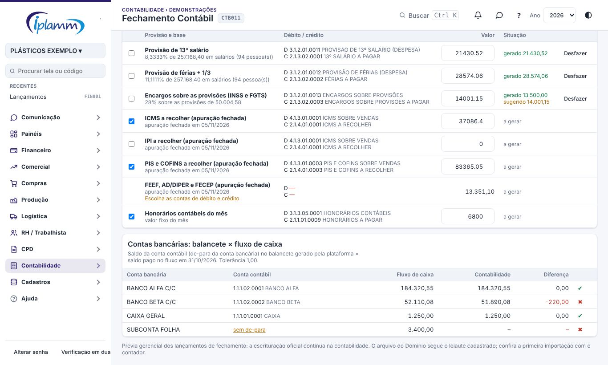
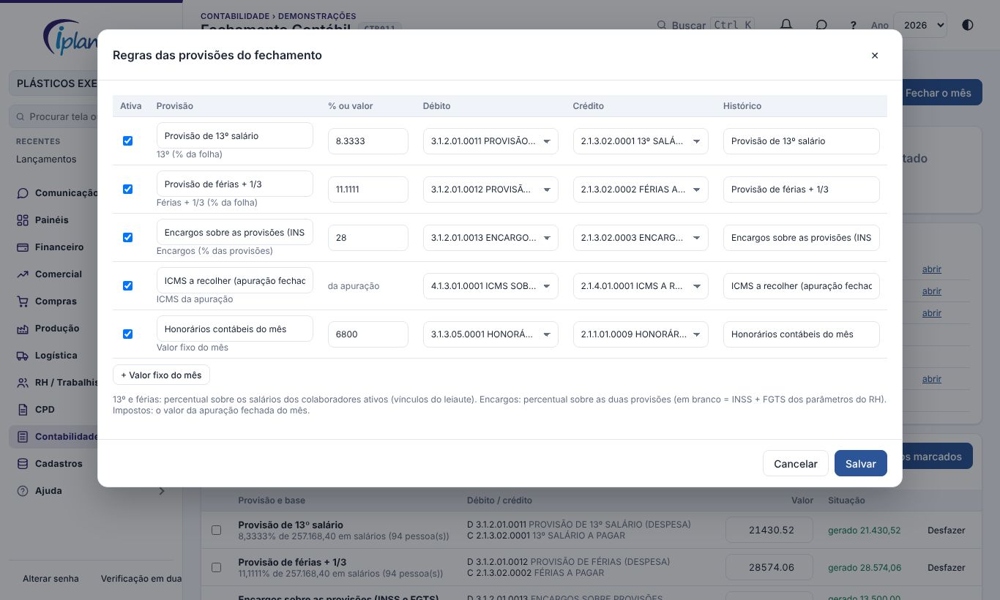
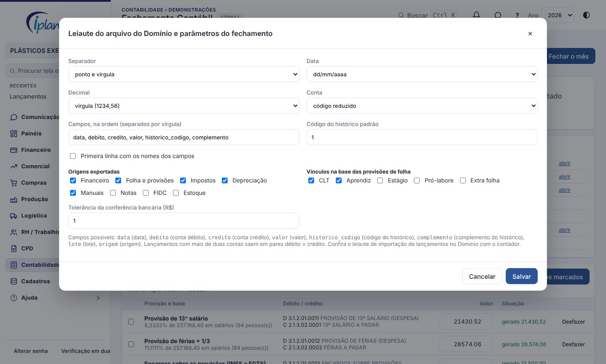

## 1. Para que serve

Reúne numa tela o fechamento contábil do mês:

- um **checklist** do que precisa estar pronto;
- as **provisões sugeridas** (13º, férias, encargos, impostos da apuração e valores fixos), que viram lançamentos contábeis com um clique;
- a **conferência das contas bancárias** do balancete contra o saldo do fluxo de caixa;
- o **arquivo para o Domínio** com os lançamentos contábeis do mês, no leiaute cadastrado;
- o **fechamento do mês**, que trava as provisões.

Veem a tela o administrador, o diretor e o financeiro. Geram e fecham o administrador e o financeiro; só o administrador muda as regras e reabre o mês.

## 2. A tela

Escolha o **mês**. No topo: situação do mês contábil, quantas etapas do checklist estão concluídas, os lançamentos contábeis do mês por origem, o total das provisões sugeridas e se o arquivo do Domínio já foi exportado.

O **checklist** confere sozinho:

| Etapa | Quando fica verde |
|---|---|
| Lançamentos do financeiro gerados | há lançamentos contábeis de origem financeira no mês (gerados em Balancete) |
| Depreciação do mês | a depreciação foi gerada no Imobilizado |
| Apuração de impostos fechada | o mês está fechado em CPD › Fiscal › Apuração de Impostos |
| Provisões geradas | não sobrou provisão com valor a gerar |
| Contas bancárias conferidas | todas as contas batem dentro da tolerância |
| Balancete da contabilidade importado | há balancete importado terminando no último dia do mês |
| Lançamentos fechando | nenhum lançamento com débito diferente do crédito |

## 3. Provisões e lançamentos sugeridos

Cada linha é uma regra (seção 5) com a **base** do cálculo, as contas de **débito** e **crédito** e o **valor** sugerido:

| Provisão | Cálculo |
|---|---|
| 13º salário | percentual (padrão 8,3333%) sobre os salários dos colaboradores ativos no fim do mês |
| Férias + 1/3 | percentual (padrão 11,1111%) sobre a mesma base |
| Encargos | percentual sobre as duas provisões; em branco, INSS + FGTS dos parâmetros do RH |
| ICMS, IPI, PIS/COFINS, FEEF/AD-DIPER/FECEP | o valor a recolher da apuração de impostos **fechada** do mês |
| Valor fixo | o valor cadastrado (ex.: honorários do contador) |

O valor pode ser **ajustado** antes de gerar. Marque as linhas e clique em **Gerar os marcados**: cada uma vira um lançamento contábil no último dia do mês, com o histórico da regra. Gerar de novo **substitui** o lançamento anterior da mesma regra; **Desfazer** apaga. Quando o valor gerado difere do sugerido, a linha mostra os dois.

Linhas com aviso (sem contas, apuração aberta, ninguém na base) não podem ser geradas até resolver.

## 4. Conferência dos bancos e fechamento

A tabela **Contas bancárias: balancete × fluxo de caixa** compara, para cada conta bancária, o saldo pago no fluxo no último dia do mês com o saldo da conta contábil ligada a ela no **De-para** (mais a conta de saldo negativo, se houver). Usa o **balancete importado** da contabilidade; sem ele, o balancete gerado pela plataforma. Conta sem de-para aparece com o link para cadastrar.

**Fechar o mês** mostra o que ainda está pendente e grava o fechamento (as pendências vão para a observação). Com o mês fechado, as provisões não podem ser geradas nem desfeitas. Só o administrador **reabre**.

## 5. Regras das provisões (administrador)

Em **Regras**: ativar ou desativar cada provisão, mudar o nome, o percentual ou o valor fixo, escolher as contas de débito e crédito (contas analíticas do plano) e o histórico. **+ Valor fixo do mês** cria uma provisão de valor fixo.

## 6. Arquivo para o Domínio

**Arquivo para o Domínio** baixa um .txt com os lançamentos contábeis do mês das origens marcadas no leiaute. Lançamentos com mais de duas contas saem em pares débito × crédito. A data da exportação fica registrada.

Em **Leiaute do Domínio** (administrador): separador, formato da data, separador decimal, conta pelo **código reduzido** ou pela **classificação**, campos e ordem (`data`, `debito`, `credito`, `valor`, `historico_codigo`, `complemento`, `lote`, `origem`), código do histórico padrão, linha de cabeçalho, origens exportadas. No mesmo lugar ficam os **vínculos** que entram na base das provisões de folha e a **tolerância** da conferência bancária.

> Confira o leiaute de importação de lançamentos do Domínio com o contador na primeira vez. Contas sem código reduzido saem em branco; a tela avisa antes de baixar.

## 7. Problemas comuns

**A provisão de 13º está zerada.** Não há colaborador ativo dos vínculos marcados no leiaute, ou os salários estão em branco em RH › Colaboradores.

**O ICMS não aparece.** A apuração de impostos do mês ainda está aberta.

**Banco com diferença.** Veja se o extrato está todo conciliado no fluxo e se o balancete importado é o do mês certo. Diferenças de centavos são cobertas pela tolerância.

**O Domínio recusou o arquivo.** Ajuste o leiaute (separador, data, decimal ou campos) com o contador e baixe de novo.

## 8. Histórico de alterações

| Versão | Data | O que mudou |
|---|---|---|
| 1.0 | 08/11/2026 | Primeira versão: checklist, provisões sugeridas com geração dos lançamentos, conferência dos bancos, fechamento do mês e arquivo do Domínio com leiaute configurável (melhoria 9.3). |
