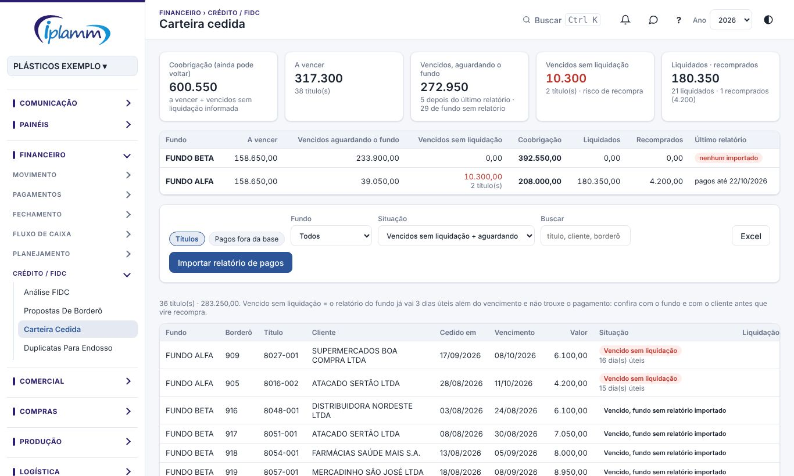

## 1. Para que serve

Um título vendido ao fundo tem dois momentos:

1. **A cessão.** Quando a proposta de borderô é aprovada, o título fica **Pago** na conta do fundo. Entram o deságio, as tarifas, a recompra descontada e o líquido que vai para o banco. É o dinheiro que a empresa recebe.
2. **A liquidação.** No vencimento, o cliente paga o **fundo**. Só então o título deixa de ser risco da empresa. A cessão é com coobrigação: se o cliente não paga, a empresa recompra.

A **Carteira cedida** controla esse segundo momento. Ela lê o relatório de títulos pagos que cada fundo envia e mostra, título a título, o que já foi liquidado, o que foi recomprado e o que venceu sem pagamento informado.

A liquidação **não gera lançamento**: o dinheiro foi para o fundo, e a receita já entrou na cessão.

## 2. Quem tem acesso

Todos os usuários da empresa consultam. O administrador e o financeiro importam os relatórios dos fundos.

## 3. O painel

1. Abra **Financeiro › Crédito / FIDC › Carteira cedida**.
2. Os indicadores mostram:
   - **Coobrigação**: tudo o que ainda pode voltar como recompra (a vencer + vencidos sem liquidação informada);
   - **A vencer**;
   - **Vencidos, aguardando o fundo**: venceram depois do último relatório importado, ou o fundo ainda não tem relatório na plataforma;
   - **Vencidos sem liquidação**: o relatório do fundo já vai mais de 3 dias úteis além do vencimento e não trouxe o pagamento. É o **risco de recompra**;
   - **Liquidados** e **recomprados**.
3. A tabela por fundo mostra as mesmas colunas e a data do **último relatório** importado. Clique no fundo para filtrar a lista.
4. Na lista, filtre por fundo e situação e busque por título, cliente ou borderô. **Excel** baixa a lista.
5. A aba **Pagos fora da base** lista os títulos que o fundo informou, mas cujo borderô não está na plataforma: borderôs de 2025, cheques e notas de crédito. Ficam só para consulta.

## 4. Importar o relatório de pagos do fundo

1. Tire no site do fundo o relatório de títulos pagos. Pode ser o ano inteiro.
   - **Negocial:** Consulta de títulos pagos, PDF "PAGOS - ANALÍTICO".
   - **Contato:** Títulos Liquidados (CONTROLE FIDC), em PDF.
2. Clique em **Importar relatório de pagos**, escolha o **fundo** e o arquivo.
3. A plataforma mostra:
   - o período e o total pago;
   - quanto foi **pago pelo cliente** (normal ou depósito);
   - quanto foi **recomprado**;
   - quantos títulos foram **ligados à base FIDC** (mesmo título e borderô) e quantos ficaram fora da base;
   - os **novos** e os que já estavam importados;
   - os títulos com valor diferente do borderô.
4. Clique em **Importar**. Reimportar o mesmo relatório atualiza as linhas, sem duplicar.

> **Fundos:** os leitores da **Negocial** e da **Contato** estão prontos. Os da FS e da Vector entram quando chegarem os exemplos dos relatórios de cada um.

Como a plataforma entende cada tipo de baixa:

| Fundo | No relatório | Na plataforma |
|---|---|---|
| Negocial | NORMAL | Pago pelo cliente |
| Negocial | DEPÓSITO SACADO | Depósito do cliente |
| Negocial | RECOMPRA | Recomprado |
| Contato | LIQ BANCO BOLETO, PGTO EM CARTORIO | Pago pelo cliente |
| Contato | PGTO BORDERO TITULO, BAIXA NAO COMISSIONADO | Recomprado (descontado num borderô) |
| Contato | Documento com o CNPJ da empresa (NC…, acordos) | Recomprado; cada pagamento parcial fica separado, pela data |

O relatório da Contato não traz o borderô: o título é ligado pela nota e parcela, na cessão mais recente antes do pagamento.

## 5. O que fazer com os vencidos sem liquidação

- Confira com o fundo se o título foi pago e importe o relatório mais recente.
- Se o cliente pagou à empresa por engano, o valor tem que ser repassado ao fundo.
- Se o cliente não pagou, cobre antes que o fundo peça a recompra.
- Os vencidos sem liquidação aparecem no **Decision Center**. Fundos sem relatório importado não entram no alerta.

## 6. Perguntas frequentes e erros comuns

**O fundo todo aparece como "vencido, fundo sem relatório importado".** Ainda não há relatório daquele fundo na plataforma. Importe o relatório de pagos.

**"Ainda não há leitor para o relatório deste fundo."** Envie um exemplo do relatório para incluirmos a leitura.

**Um título pago aparece como vencido sem liquidação.** Veja se o relatório importado cobre a data do pagamento e se o título e o borderô do fundo batem com os do borderô original.

## 7. Histórico de alterações

| Versão | Data | O que mudou |
|---|---|---|
| 1.0 | 30/10/2026 | Primeira versão: carteira cedida por fundo, situação de cada título, importação do relatório de pagos da Negocial e alerta no Decision Center (SQL 073). |
| 1.1 | 30/10/2026 | Leitor do relatório de títulos liquidados da Contato; tabela dos tipos de baixa de cada fundo. |
