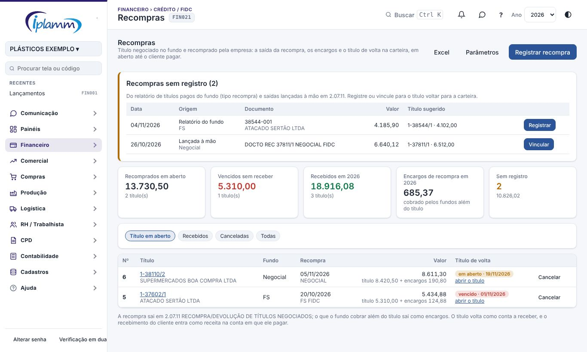
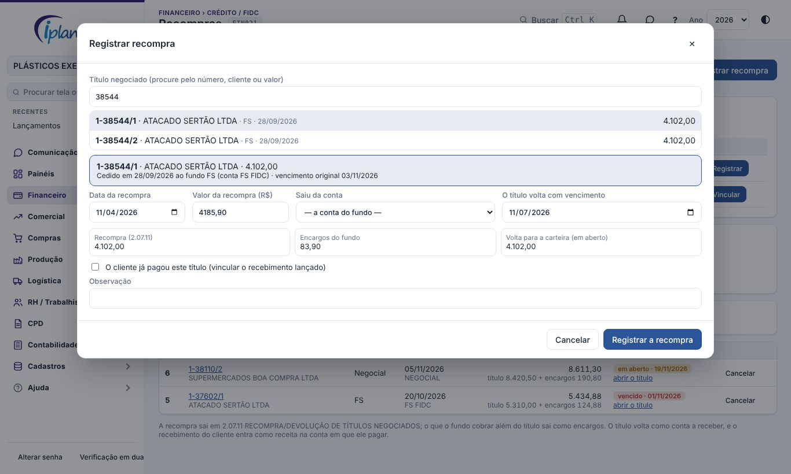

## 1. Para que serve

Quando o cliente não paga um título cedido ao fundo, a empresa **recompra** esse título. A tela registra a recompra de uma vez, sem lançamento manual:

1. **A saída da recompra**: sai da conta escolhida (normalmente a do fundo), em **2.07.11 RECOMPRA/DEVOLUÇÃO DE TÍTULOS NEGOCIADOS**, no valor do título.
2. **Os encargos**: o que o fundo cobrou além do título (juros e mora) sai como despesa em **2.07.08 JUROS DE FOMENTO FUNDOS** (o plano pode mudar nos Parâmetros).
3. **O título de volta na carteira**: o mesmo título volta como conta a receber **em aberto**, com o mesmo cliente, valor e plano. Quando o cliente pagar, a baixa vale **em qualquer conta** (banco, VExpenses, Caixa).

Exemplo — o caso que motivou a tela (1-34724/1, recomprado na Negocial):

| Etapa | Valor | Onde fica |
|---|---|---|
| Título cedido ao fundo | 3.186,08 | Receita na conta NEGOCIAL |
| Recompra (o fundo cobrou 3.256,17) | 3.186,08 | Saída em 2.07.11 na NEGOCIAL |
| Encargos (a diferença) | 70,09 | Saída em 2.07.08 |
| Título de volta | 3.186,08 | Em aberto, até o cliente pagar |

## 2. Quem tem acesso

- **Administrador e financeiro**: registram, vinculam e cancelam.
- **Os demais membros**: só consultam.

## 3. Passo a passo

**Recompras sem registro.** Aparecem no topo da tela e vêm de duas fontes:

- **Relatório do fundo**: o título veio como RECOMPRA no relatório de títulos pagos (Carteira Cedida). Clique em **Registrar**: a data, o valor e o título sugerido já vêm preenchidos.
- **Lançada à mão**: existe uma saída em 2.07.11 que ainda não está ligada a nenhum título. Clique em **Vincular**: nada é lançado de novo, só fica o vínculo com o título original.

**Indicadores:**

- recomprados em aberto;
- vencidos sem receber;
- recebidos no ano;
- encargos de recompra no ano;
- pendências sem registro.

### 3.1 Registrar uma recompra

1. Clique em **Registrar recompra** e procure o título pelo número, pelo cliente ou pelo valor. A lista mostra só os **títulos cedidos**, isto é, os recebimentos pagos na conta de um fundo.
2. Preencha:
   - a **data**;
   - o **valor da recompra**, que é o valor cobrado pelo fundo;
   - a **conta** de onde saiu o dinheiro. Em branco, vale a conta do fundo.
3. Escolha o **vencimento** do título reaberto.

Os quadros de baixo mostram como fica: a recompra, os encargos e o valor que volta para a carteira.

Se o cliente **já pagou** o título, marque **O cliente já pagou** e escolha o recebimento lançado. Esse recebimento fica vinculado e o título não é reaberto. Era o caso da Mastercola, paga direto na VExpenses.

### 3.2 Acompanhar

Use os filtros **Título em aberto**, **Recebidos**, **Canceladas** e **Todas**. Para cada recompra, a lista mostra:

- o título original;
- o fundo e a data da recompra;
- o valor da recompra, com os encargos;
- a situação do título de volta: em aberto, vencido ou recebido (com a data e a conta).

Os links abrem o lançamento original e o título reaberto.

### 3.3 Cancelar

**Cancelar** pede o motivo e apaga os lançamentos que a recompra criou: a saída, os encargos e o título reaberto. Numa recompra vinculada, só o vínculo é desfeito.

## 4. Regras e travas

- Só um **título cedido** pode ser recomprado: recebimento **pago** na conta de um **fundo** (cadastrado em Análise FIDC). Um recebimento comum é recusado.
- Um título tem **uma** recompra ativa.
- Não dá para cancelar se o título reaberto já foi recebido (estorne o recebimento antes), nem se algum lançamento estiver conciliado.
- A **Central de Decisões** (regra 22) avisa quando há:
  - título recomprado vencido sem receber;
  - recompra sem registro.

## 5. Perguntas frequentes e erros comuns

**"Este recebimento não está na conta de um fundo".** O título não foi lançado na conta do fundo, ou o fundo está sem conta cadastrada em Análise FIDC › Fundos.

**O fundo descontou a recompra de um borderô novo.** Continue informando a recompra no campo **Recompras** da proposta, como antes. Depois, use **Vincular** a partir das pendências: a saída em 2.07.11 que a proposta gerou aparece lá.

**Por que a receita aparece duas vezes?** É a convenção do fluxo de caixa: a receita entra na cessão e entra de novo quando o cliente paga. A recompra em 2.07.11 é a saída que equilibra essa conta.

## 6. Histórico de alterações

| Versão | Data | O que mudou |
|---|---|---|
| 1.0 | 07/11/2026 | Primeira versão: registrar a recompra com saída, encargos e título de volta em aberto, vincular recompra lançada à mão e recebimento já feito, pendências do relatório do fundo e de 2.07.11, cancelar, parâmetros e Central de Decisões. |
