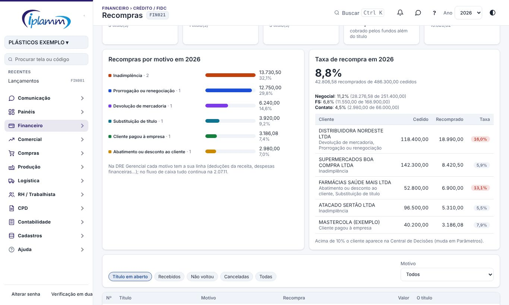
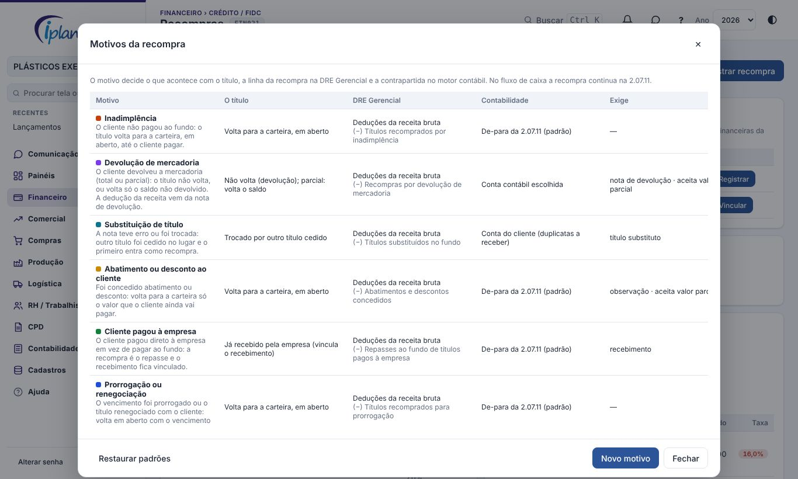
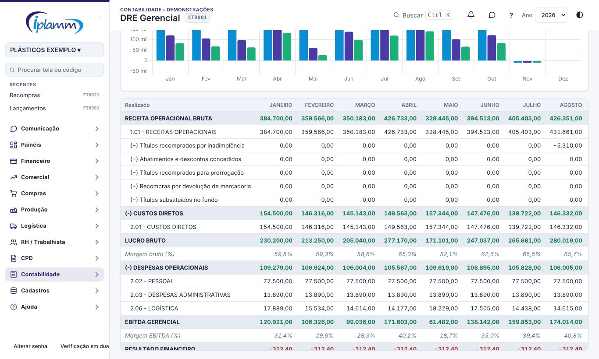

## 1. Para que serve

Quando um título cedido ao fundo precisa voltar, a empresa **recompra** esse título. Os casos são vários:

- o cliente não pagou;
- a mercadoria foi devolvida;
- a nota teve erro e outro título foi cedido no lugar;
- foi dado um abatimento ao cliente;
- o cliente pagou direto à empresa.

A tela registra tudo de uma vez, sem lançamento manual. Cada recompra tem um **motivo**, que é o que decide o que acontece com ela.

1. **A saída da recompra**: sai da conta escolhida (normalmente a do fundo), em **2.07.11 RECOMPRA/DEVOLUÇÃO DE TÍTULOS NEGOCIADOS**, no valor do título. No **fluxo de caixa** tudo continua nessa conta.
2. **Os encargos**: o que o fundo cobrou além do título sai como despesa em **2.07.08 JUROS DE FOMENTO FUNDOS**.
3. **O título**, conforme o motivo: volta para a carteira **em aberto** (a baixa depois vale em qualquer conta), não volta (devolução), volta só o saldo, fica trocado pelo título novo, ou fica ligado ao recebimento já feito.
4. **A DRE e a contabilidade**: o motivo decide em que linha a recompra aparece na **DRE Gerencial** e qual conta contábil o motor usa.

| Motivo (padrão) | O título | DRE Gerencial | O que vincula |
|---|---|---|---|
| Inadimplência | Volta em aberto, inteiro | Deduções da receita | — |
| Devolução de mercadoria | Não volta, ou volta só o saldo não devolvido | Deduções da receita | Nota de devolução e, se houver, a reclamação na Qualidade (RNC) |
| Substituição de título | Fica trocado pelo título cedido no lugar | Deduções da receita | O título novo |
| Abatimento ou desconto | Volta o valor que o cliente ainda vai pagar | Deduções da receita | Observação |
| Cliente pagou à empresa | Já recebido | Deduções da receita | O recebimento |
| Prorrogação ou renegociação | Volta em aberto com vencimento novo | Deduções da receita | — |
| Erro do fundo ou duplicidade | Não volta | Fora da DRE | Observação |
| Outros | Você escolhe | Deduções da receita | Observação |

**Por que deduções da receita?** No regime de caixa, a cessão ao fundo já entrou como receita. Quando o cliente paga o título reaberto, ou quando o título novo é cedido, a receita entra de novo. A recompra desfaz a primeira entrada. Antes ela aparecia como despesa financeira e inflava o resultado financeiro.

A **devolução** é deduzida pela nota de devolução, e a recompra é só o pagamento ao fundo. Por isso a nota fica vinculada: para conferir e não deduzir duas vezes.

## 2. Quem tem acesso

- **Administrador e financeiro**: registram, vinculam, trocam o motivo, cancelam e configuram os motivos e os parâmetros.
- **Os demais membros**: só consultam.

## 3. Passo a passo

**Recompras sem registro.** No topo da tela aparecem as recompras que ainda não têm registro, de duas fontes:

- **Relatório do fundo**: o título veio como RECOMPRA no relatório de títulos pagos (Carteira Cedida). Clique em **Registrar**: a data, o valor e o título sugerido já vêm preenchidos.
- **Lançada à mão**: existe uma saída em 2.07.11 que ainda não está ligada a nenhum título. Clique em **Vincular**: nada é lançado de novo, só fica o vínculo e o motivo.

Enquanto não tem registro, a recompra fica nas **despesas financeiras** da DRE, porque não se sabe o motivo.

**Indicadores:**

- recomprados em aberto;
- vencidos sem receber;
- recebidos no ano;
- encargos no ano;
- pendências sem registro.

### 3.1 Registrar uma recompra

1. Clique em **Registrar recompra** e procure o título pelo número, pelo cliente ou pelo valor. A lista mostra só os títulos cedidos, isto é, os recebimentos pagos na conta de um fundo.
2. Escolha o **motivo**. Embaixo aparece quando usar cada um, e a tela muda conforme o motivo:
   - **Devolução**: escolha a **nota de devolução**. As notas do cliente vêm primeiro, marcadas com ★. Se a reclamação foi aberta na Qualidade, escolha a **RNC**. Na devolução parcial, informe o **saldo não devolvido que volta**. Ao escolher a nota, a tela já sugere esse saldo: título menos nota.
   - **Substituição**: procure e escolha o **título cedido no lugar**.
   - **Abatimento**: informe quanto **volta para a carteira** e descreva o acordo na observação.
   - **Cliente pagou à empresa**: escolha o **recebimento** já lançado. Foi o caso da Mastercola, paga na VExpenses.
3. Preencha:
   - a **data**;
   - o **valor da recompra**, que é o valor cobrado pelo fundo;
   - a **conta** de onde saiu o dinheiro. Em branco, vale a conta do fundo;
   - o **vencimento** do título que volta.
4. Os quadros de baixo mostram como fica: a recompra (com a linha da DRE), os encargos e o que volta para a carteira.

### 3.2 Acompanhar, trocar o motivo e cancelar

- **Filtros**: Título em aberto, Recebidos, Não voltou (devolução, substituição, erro do fundo), Canceladas e Todas, além do filtro por **motivo**.
- **Na lista**: o motivo, a nota de devolução, a RNC e a situação do título.
- **Motivo**: troca o motivo de uma recompra já registrada. Os lançamentos não mudam, só a linha da DRE e a contrapartida contábil. A troca só vale entre motivos que tratam o título do mesmo jeito. Por exemplo, devolução total e inadimplência não trocam entre si: nesse caso, cancele e registre de novo.
- **Cancelar**: pede a justificativa e apaga os lançamentos que a recompra criou. Numa recompra vinculada, só o vínculo é desfeito.

### 3.3 Recompras por motivo e taxa de recompra

- **Por motivo**: quanto foi recomprado no ano em cada motivo e a participação de cada um.
- **Taxa de recompra**: o valor recomprado dividido pelo valor cedido no ano, no total, por **fundo** e por **cliente**, com os motivos de cada cliente. É o número que o fundo acompanha para definir a taxa. Por cliente, mostra a quem vale a pena continuar cedendo títulos.
- **Limite de alerta**: o cliente acima do limite (padrão 10%, ajustável em Parâmetros) aparece em vermelho e na Central de Decisões.

## 4. Motivos: configurar

O botão **Motivos** lista os motivos. **Editar** e **Novo motivo** abrem a configuração:

- **O que acontece com o título**: volta em aberto · não volta (devolução; parcial = volta o saldo) · trocado por outro título · já recebido · não volta (ajuste com o fundo).
- **Linha na DRE Gerencial** e o **nome da linha**: deduções da receita bruta · despesas financeiras · movimentos não operacionais · fora da DRE.
- **Contrapartida contábil da recompra**:
  - **de-para da 2.07.11**, o padrão de hoje, que vai para "(−) Duplicatas descontadas";
  - **conta do cliente**, ou seja, duplicatas a receber;
  - uma **conta contábil escolhida**, por exemplo uma conta de devolução de vendas.
- **Exigências**: aceita valor parcial · exige nota de devolução · exige título substituto · exige observação · ativo.

**Restaurar padrões** cria de novo os motivos padrão que faltarem e não altera os seus. Um motivo já usado não pode ser excluído: desmarque **Ativo**.

### 4.1 Na DRE Gerencial

Na **DRE Gerencial**, a recompra sai da conta 2.07.11, nas despesas financeiras, e entra na linha do motivo. O texto acima da tabela avisa quanto ficou **fora da DRE**. O mesmo vale para o Dashboard Executivo, o Dashboard e o Fechamento do Mês.

Os **encargos** continuam nas despesas financeiras (2.07.08). O **fluxo de caixa** não muda.

## 5. Regras e travas

- Só um **título cedido** pode ser recomprado: um recebimento **pago** na conta de um **fundo** (cadastrado em Análise FIDC). Cada título tem **uma** recompra ativa.
- O motivo precisa estar **ativo**. O registro é recusado sem o que o motivo exige: nota de devolução, título substituto, recebimento ou observação.
- **Valor que volta para a carteira**:
  - no motivo que devolve o título inteiro, ele é igual ao valor do título;
  - no motivo parcial, fica entre zero e o valor do título;
  - na devolução, é o saldo não devolvido, menor que o título (zero é devolução total).
- Não dá para cancelar se o título reaberto já foi recebido (estorne o recebimento antes), nem se algum lançamento estiver conciliado.
- A **Central de Decisões** (regra 22) avisa quando há:
  - título recomprado vencido sem receber;
  - recompra sem registro;
  - cliente com taxa de recompra acima do limite.

## 6. Perguntas frequentes e erros comuns

**A dedução da devolução aparece duas vezes?** Não deve. A recompra é o pagamento ao fundo, e a dedução da venda vem da nota de devolução. Confira na DRE Contábil, com a conta configurada no motivo, junto com a contabilidade.

**"O motivo X trata o título de outro jeito".** A troca de motivo só vale entre motivos com a mesma ação sobre o título. Cancele e registre de novo com o motivo certo.

**"Este recebimento não está na conta de um fundo".** O título não foi lançado na conta do fundo, ou o fundo está sem conta cadastrada em Análise FIDC › Fundos.

**O fundo descontou a recompra de um borderô novo.** Continue informando a recompra no campo **Recompras** da proposta, como antes. Depois, use **Vincular** a partir das pendências e escolha o motivo.

## 7. Histórico de alterações

| Versão | Data | O que mudou |
|---|---|---|
| 1.0 | 07/11/2026 | Primeira versão: registrar a recompra com saída, encargos e título de volta em aberto, vincular recompra lançada à mão e recebimento já feito, pendências do relatório do fundo e de 2.07.11, cancelar, parâmetros e Central de Decisões. |
| 1.1 | 07/11/2026 | Motivos configuráveis (o que acontece com o título, a linha na DRE Gerencial e a contrapartida contábil), devolução total e parcial com nota e RNC, substituição por outro título, troca de motivo, painel por motivo e taxa de recompra por fundo e cliente com alerta na Central de Decisões. |
