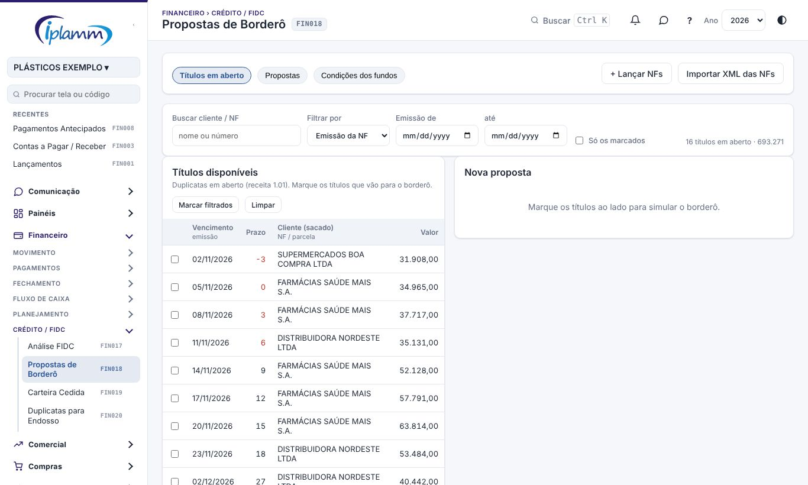
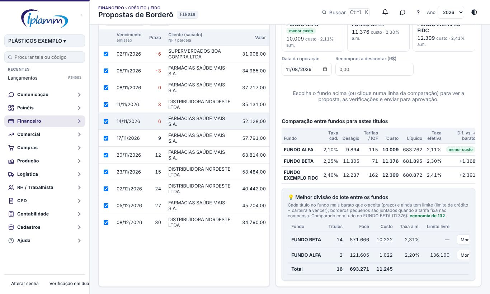
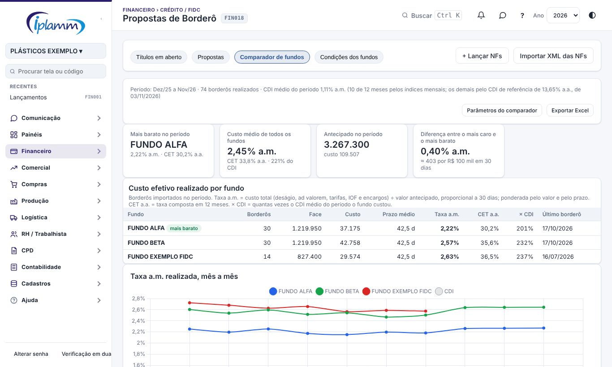
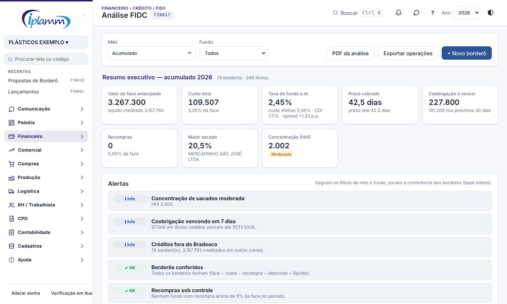

## 1. Para que serve

As duas telas cobrem a antecipação de recebíveis com os fundos (FIDC):

- **Propostas de Borderô**: a IPLAMM monta e simula o borderô **na plataforma**. Ela escolhe os títulos a receber e o fundo, compara o custo entre os fundos, confere as verificações e envia ao **diretor**, que aprova ou rejeita. A proposta aprovada é o **registro oficial** da operação. O borderô enviado pelo fundo entra depois **só para comparação**.
- **Análise FIDC**: o resumo das operações com os fundos. Mostra o custo, a taxa a.m. contra o CDI, a coobrigação a vencer, as recompras, a concentração de sacados e os alertas, com o PDF da análise.

## 2. Quem tem acesso

| Perfil | O que faz |
|---|---|
| Administrador e financeiro | Montam, simulam, editam e enviam propostas; cadastram as condições dos fundos; registram e comparam borderôs. |
| Diretor (e administrador) | Aprova ou rejeita as propostas enviadas. |
| Leitura | Consulta. |

## 3. Propostas de Borderô

### 3.1 Escolher os títulos

1. Na aba **Títulos em aberto**, estão as duplicatas em aberto (receita 1.01). Use **Buscar cliente / NF** e os filtros de vencimento.
2. Marque os títulos que vão para o borderô, ou use **Marcar filtrados**. Para a lista caber ao lado do painel da proposta, a **emissão** aparece na 2ª linha do vencimento e a **NF / parcela** na 2ª linha do cliente.
3. Se a nota ainda não estiver nos títulos, use **+ Lançar NFs** ou **Importar XML das NFs**.

Também dá para chegar aqui marcando os títulos em **Contas a Pagar / Receber › A receber › Montar borderô FIDC**.

### 3.2 Simular e escolher o fundo

1. Informe a **data da operação**.
2. A **Comparação entre fundos** mostra, para os títulos marcados e para cada fundo: o deságio, as tarifas e o IOF, o custo, o líquido, a taxa efetiva e a diferença para o mais barato.
3. Escolha o fundo. Logo abaixo da comparação, a plataforma calcula a **melhor divisão do lote** entre os fundos (seção 3.2.1).
4. Confira as **Verificações**: limite de crédito, limite por sacado, títulos de prazo muito curto, títulos vencidos. Confira também os sacados, os prazos e os vencimentos.
5. Escreva uma **observação para o diretor**, se quiser, e clique em **Salvar rascunho** ou **Enviar**.

#### 3.2.1 Melhor divisão do lote entre os fundos

Com dois ou mais títulos e dois ou mais fundos ativos, a plataforma monta a divisão mais barata:

1. Cada título vai para o fundo de **menor custo** que o aceita (prazo mínimo e máximo do fundo) e que ainda tem **limite livre** (limite de crédito − carteira a vencer no fundo). Os maiores títulos são alocados primeiro.
2. Depois, ela tenta **juntar borderôs**: se levar todos os títulos de um fundo para outro já usado sai mais barato (as tarifas fixas de TED e assinatura pesam), junta.
3. O custo de cada fundo é o da **simulação completa** (condições por grupo de sacados, tarifas, IOF).

A divisão é comparada com o lote inteiro no **melhor fundo que aceita tudo e tem limite**. Ela só é sugerida quando a economia passa do mínimo dos **Parâmetros do comparador** (padrão R$ 200). Caso contrário, a tela diz qual fundo é o melhor para o lote inteiro e por que o mais barato da tabela não serve, quando for o caso (sem limite livre ou prazo fora da faixa).

Em cada linha, **Montar** deixa marcados só os títulos daquele fundo, com o fundo já escolhido. Envie a proposta e volte para os demais títulos. Títulos que nenhum fundo aceita aparecem em vermelho.

> **Condições por grupo de sacados:** quando o fundo cobra taxas diferentes por sacado (por exemplo, a FS com o Grupo Total e com os demais), cada título usa a condição do seu sacado. Títulos de condições diferentes **nunca vão no mesmo borderô**: a proposta é dividida em uma por condição.

### 3.3 Acompanhar as propostas

Na aba **Propostas**, filtre por status, fundo e mês. Ao abrir uma proposta:

- **Rascunho**: **Editar**, **Excluir** e **Enviar para aprovação**.
- **Pendente**: **Cancelar envio** (volta a rascunho). O diretor vê **Aprovar operação** e **Rejeitar** (com motivo).
- **PDF para aprovação**: gera a proposta no padrão IPLAMM, com a comparação, as verificações, os títulos e os campos de assinatura.
- **Duplicatas para Endosso**: abre a tela de endosso com os títulos da proposta.

### 3.4 Aprovação

Quando o diretor aprova, a operação é registrada na base FIDC e os títulos passam a **Pago na conta do fundo**. Proposta rejeitada volta com o motivo e pode ser editada e enviada de novo.

A operação entra na base com o **número do borderô do fundo** quando a proposta foi ajustada ou comparada ao borderô. Sem o borderô do fundo, ela entra como **P** mais o número da proposta (ex.: P412).

> Na FS, o número do borderô é o do termo aditivo seguido do contrato: **000008/000002** é o termo 8 do contrato 2, vigente desde 21/10/2026. Os borderôs do contrato 1 ficam só com o termo (ex.: 001226).

### 3.5 Comparar com o borderô original

Na proposta aprovada, clique em **Comparar com borderô original**. Escolha o borderô do fundo já registrado na base FIDC, ou leia o arquivo enviado pelo fundo (.htm ou .pdf).

A tela mostra a proposta e o borderô lado a lado: os títulos aceitos, os da proposta que ficaram fora e os que vieram no borderô sem estar na proposta. O registro oficial continua sendo a proposta aprovada.

Se a operação dessa proposta ainda estiver como **P** mais o número, ela passa a levar o número do borderô do fundo, junto com os títulos.

Na lista de propostas, a coluna **Borderô** mostra sempre o número do fundo, com uma marca:

| Marca | Quer dizer |
|---|---|
| base FIDC | O borderô foi registrado primeiro na base FIDC e a proposta veio dele. |
| conferido (verde) | Proposta montada aqui e comparada com o arquivo do fundo, sem diferença. |
| conferido (laranja) | Comparada com o arquivo do fundo, com diferenças: abra a proposta para ver. |
| ajustado | Valores ajustados ao borderô do fundo antes da aprovação. |

### 3.6 Condições dos fundos

Na aba **Condições dos fundos**, cadastre cada fundo:

- nome (igual ao dos borderôs), conta do fundo e conta de crédito do líquido;
- cálculo do deságio e taxa a.m.;
- ad valorem, tarifas (TED, assinatura, boleto, consulta Serasa) e IOF;
- dias de compensação e prazo mínimo e máximo;
- limite de crédito e limite por sacado.

Em **Condições por grupo de sacados**, cadastre as taxas diferentes por grupo de CNPJ raiz, com a vigência.

**Prazo cobrado** = prazo real + dias de compensação, rolando para o próximo dia útil.

### 3.7 Comparador de fundos

A aba **Comparador de fundos** mostra quanto cada fundo **realmente custou**, a partir dos borderôs da base FIDC no período (padrão: 12 meses).

- **Indicadores:**
  - o fundo mais barato no período;
  - o custo médio de todos os fundos, em vezes o CDI;
  - o total antecipado;
  - a diferença entre o mais caro e o mais barato. Ex.: 0,40% a.m. ≈ R$ 400 a cada R$ 100 mil por 30 dias.
- **Custo efetivo realizado por fundo:**
  - borderôs, face, custo e prazo médio;
  - **taxa a.m.**: o custo total (deságio, ad valorem, tarifas, IOF e encargos) dividido pelo valor antecipado (face − custo), proporcional a 30 dias e ponderado pelo valor e pelo prazo de cada borderô;
  - **CET a.a.**: a taxa composta em 12 meses;
  - **× CDI**: quantas vezes o CDI médio do período o fundo custou.
- **Taxa a.m. realizada, mês a mês:** uma linha por fundo e a linha do CDI. O CDI de cada mês vem dos **índices mensais** da Análise FIDC; o mês sem índice usa o CDI de referência dos parâmetros.
- **Curva por prazo:** a taxa realizada por faixa do prazo médio do borderô, com o mais barato de cada faixa em destaque. Ela mostra, por exemplo, que um fundo é melhor para prazos curtos e outro para longos.
- **Tabela de preço atual:** o custo, hoje, de um título de R$ 10.000 em cada prazo, pelas condições cadastradas. Fundo que não aceita o prazo aparece como "não aceita".

**Parâmetros do comparador** (administrador e financeiro):

- o **CDI de referência** (% a.a.) e a data em que foi atualizado. A tela avisa quando o valor tem mais de 45 dias;
- o período de análise (3 a 36 meses);
- as faixas de prazo;
- se a divisão respeita o limite livre dos fundos;
- a economia mínima para sugerir dividir o lote.

**Exportar Excel** baixa o resumo por fundo com a série mensal.

## 4. Análise FIDC

1. Escolha o **mês** e o **fundo**.
2. O **Resumo executivo** mostra o valor de face antecipado, o custo total, a taxa do fundo a.m., o prazo cobrado, a coobrigação a vencer, as recompras, o maior sacado e a concentração (HHI).
3. Os **Alertas** apontam:
   - borderôs que não fecham;
   - taxa do mês acima da média do ano;
   - recompra acima de 5% da face;
   - sacado acima de 30% do volume;
   - taxa acima de CDI + 2 p.p.;
   - coobrigação vencendo em 7 dias.
4. Os gráficos e tabelas detalham a taxa contra o CDI, a coobrigação por prazo e por semana, o cedido por mês, a participação dos sacados, a composição do custo e o custo de oportunidade (o que se economizaria no fundo mais barato). Mostram também a conciliação dos borderôs com o fluxo de caixa.
5. **PDF da análise** gera o relatório no padrão IPLAMM. **Exportar operações** baixa a base em Excel.

**+ Novo borderô** registra um borderô à mão: fundo, data, nº do borderô, conta de crédito, quantidade de títulos, prazos e valores.

## 5. Regras e travas

- Só o **diretor** (ou o administrador) aprova ou rejeita propostas.
- Proposta aprovada não muda de valor nem de fundo.
- Um título só pode estar em uma proposta ativa (rascunho ou pendente).
- Títulos de condições diferentes vão em borderôs separados.
- **Endosso e borderô são processos diferentes**: mexer num não altera o outro.

## 6. Perguntas frequentes e erros comuns

**O título não aparece em Títulos em aberto.** Ele não é receita 1.01 em aberto, ou já está em outra proposta.

**A mensagem diz "não pode virar …: deixe só títulos de uma condição".** Na edição, a proposta tem títulos de grupos de sacados diferentes. Separe em duas propostas.

**O fundo mais barato da tabela não aparece na divisão sugerida.** Ele não tem limite livre (limite de crédito − carteira a vencer) para os títulos, ou não aceita o prazo deles. Confira em Condições dos fundos.

**O comparador não mostra um fundo.** Ele não tem borderô realizado no período. Aumente o período nos Parâmetros do comparador ou importe os borderôs na Análise FIDC.

**A taxa simulada não bate com o borderô do fundo.** Confira as condições do fundo (taxa, dias de compensação e tarifas) na aba Condições dos fundos e compare usando **Comparar com borderô original**.

## 7. Conversa sobre o registro

No topo da janela da proposta ficam dois botões das **Conversas**:

- **💬 Conversa** abre o bate-papo da equipe sobre este registro. Cada registro tem uma conversa só, e só entra quem consegue ver o registro.
- **↗ Enviar no chat** manda o registro como cartão numa conversa. Quem recebe clica no cartão e abre o registro.

Veja o manual **Conversas** para os detalhes.

## 8. Histórico de alterações

| Versão | Data | O que mudou |
|---|---|---|
| 1.0 | 28/10/2026 | Primeira versão do manual: propostas de borderô (simulação, comparação entre fundos, verificações, aprovação, comparação com o borderô original e condições dos fundos) e análise FIDC. |
| 1.1 | 29/10/2026 | Botões **💬 Conversa** e **↗ Enviar no chat** da proposta (Conversas, etapa 2). |
| 1.2 | 29/10/2026 | Imagens das telas, com dados fictícios. |
| 1.3 | 31/10/2026 | Nova figura: análise fidc: custo e prazo por fundo. |
| 1.4 | 05/11/2026 | Nomes das telas iguais aos do menu, com o código. Títulos disponíveis com a emissão e a NF / parcela na 2ª linha. Figuras refeitas. |
| 1.5 | 08/11/2026 | Melhor divisão do lote entre os fundos com limite livre, prazo aceito e junção de borderôs (Montar). Aba Comparador de fundos: custo efetivo realizado, CET, × CDI, série mensal, curva por prazo, tabela de preço atual e parâmetros. |
| 1.6 | 13/11/2026 | Número do borderô no padrão do fundo (FS: termo/contrato) na lista, na comparação e na operação aprovada; marcas base FIDC, conferido e ajustado. |
