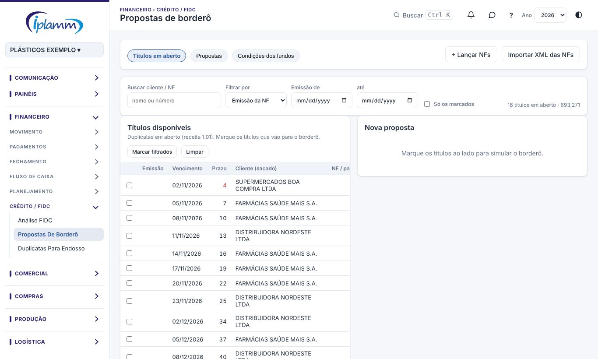

## 1. Para que serve

As duas telas cobrem a antecipação de recebíveis com os fundos (FIDC):

- **Propostas de borderô**: a IPLAMM monta e simula o borderô **na plataforma**. Ela escolhe os títulos a receber e o fundo, compara o custo entre os fundos, confere as verificações e envia ao **diretor**, que aprova ou rejeita. A proposta aprovada é o **registro oficial** da operação. O borderô enviado pelo fundo entra depois **só para comparação**.
- **Análise FIDC**: o resumo das operações com os fundos. Mostra o custo, a taxa a.m. contra o CDI, a coobrigação a vencer, as recompras, a concentração de sacados e os alertas, com o PDF da análise.

## 2. Quem tem acesso

| Perfil | O que faz |
|---|---|
| Administrador e financeiro | Montam, simulam, editam e enviam propostas; cadastram as condições dos fundos; registram e comparam borderôs. |
| Diretor (e administrador) | Aprova ou rejeita as propostas enviadas. |
| Leitura | Consulta. |

## 3. Propostas de borderô

### 3.1 Escolher os títulos

1. Na aba **Títulos em aberto**, estão as duplicatas em aberto (receita 1.01). Use **Buscar cliente / NF** e os filtros de vencimento.
2. Marque os títulos que vão para o borderô, ou use **Marcar filtrados**.
3. Se a nota ainda não estiver nos títulos, use **+ Lançar NFs** ou **Importar XML das NFs**.

Também dá para chegar aqui marcando os títulos em **Contas a pagar / receber › A receber › Montar borderô FIDC**.

### 3.2 Simular e escolher o fundo

1. Informe a **data da operação**.
2. A **Comparação entre fundos** mostra, para os títulos marcados e para cada fundo: o deságio, as tarifas e o IOF, o custo, o líquido, a taxa efetiva e a diferença para o mais barato.
3. Escolha o fundo. A plataforma avisa quando seria mais barato dividir os títulos entre os fundos, cada título no mais barato.
4. Confira as **Verificações**: limite de crédito, limite por sacado, títulos de prazo muito curto, títulos vencidos. Confira também os sacados, os prazos e os vencimentos.
5. Escreva uma **observação para o diretor**, se quiser, e clique em **Salvar rascunho** ou **Enviar**.

> **Condições por grupo de sacados:** quando o fundo cobra taxas diferentes por sacado (por exemplo, a FS com o Grupo Total e com os demais), cada título usa a condição do seu sacado. Títulos de condições diferentes **nunca vão no mesmo borderô**: a proposta é dividida em uma por condição.

### 3.3 Acompanhar as propostas

Na aba **Propostas**, filtre por status, fundo e mês. Ao abrir uma proposta:

- **Rascunho**: **Editar**, **Excluir** e **Enviar para aprovação**.
- **Pendente**: **Cancelar envio** (volta a rascunho). O diretor vê **Aprovar operação** e **Rejeitar** (com motivo).
- **PDF para aprovação**: gera a proposta no padrão IPLAMM, com a comparação, as verificações, os títulos e os campos de assinatura.
- **Duplicatas para endosso**: abre a tela de endosso com os títulos da proposta.

### 3.4 Aprovação

Quando o diretor aprova, a operação é registrada na base FIDC e os títulos passam a **Pago na conta do fundo**. Proposta rejeitada volta com o motivo e pode ser editada e enviada de novo.

### 3.5 Comparar com o borderô original

Na proposta aprovada, clique em **Comparar com borderô original**. Escolha o borderô do fundo já registrado na base FIDC, ou leia o arquivo enviado pelo fundo (.htm ou .pdf).

A tela mostra a proposta e o borderô lado a lado: os títulos aceitos, os da proposta que ficaram fora e os que vieram no borderô sem estar na proposta. O borderô serve só de conferência: o registro oficial continua sendo a proposta aprovada.

### 3.6 Condições dos fundos

Na aba **Condições dos fundos**, cadastre cada fundo:

- nome (igual ao dos borderôs), conta do fundo e conta de crédito do líquido;
- cálculo do deságio e taxa a.m.;
- ad valorem, tarifas (TED, assinatura, boleto, consulta Serasa) e IOF;
- dias de compensação e prazo mínimo e máximo;
- limite de crédito e limite por sacado.

Em **Condições por grupo de sacados**, cadastre as taxas diferentes por grupo de CNPJ raiz, com a vigência.

**Prazo cobrado** = prazo real + dias de compensação, rolando para o próximo dia útil.

## 4. Análise FIDC

1. Escolha o **mês** e o **fundo**.
2. O **Resumo executivo** mostra o valor de face antecipado, o custo total, a taxa do fundo a.m., o prazo cobrado, a coobrigação a vencer, as recompras, o maior sacado e a concentração (HHI).
3. Os **Alertas** apontam:
   - borderôs que não fecham;
   - taxa do mês acima da média do ano;
   - recompra acima de 5% da face;
   - sacado acima de 30% do volume;
   - taxa acima de CDI + 2 p.p.;
   - coobrigação vencendo em 7 dias.
4. Os gráficos e tabelas detalham a taxa contra o CDI, a coobrigação por prazo e por semana, o cedido por mês, a participação dos sacados, a composição do custo e o custo de oportunidade (o que se economizaria no fundo mais barato). Mostram também a conciliação dos borderôs com o fluxo de caixa.
5. **PDF da análise** gera o relatório no padrão IPLAMM. **Exportar operações** baixa a base em Excel.

**+ Novo borderô** registra um borderô à mão: fundo, data, nº do borderô, conta de crédito, quantidade de títulos, prazos e valores.

## 5. Regras e travas

- Só o **diretor** (ou o administrador) aprova ou rejeita propostas.
- Proposta aprovada não muda de valor nem de fundo.
- Um título só pode estar em uma proposta ativa (rascunho ou pendente).
- Títulos de condições diferentes vão em borderôs separados.
- **Endosso e borderô são processos diferentes**: mexer num não altera o outro.

## 6. Perguntas frequentes e erros comuns

**O título não aparece em Títulos em aberto.** Ele não é receita 1.01 em aberto, ou já está em outra proposta.

**A mensagem diz "não pode virar …: deixe só títulos de uma condição".** Na edição, a proposta tem títulos de grupos de sacados diferentes. Separe em duas propostas.

**A taxa simulada não bate com o borderô do fundo.** Confira as condições do fundo (taxa, dias de compensação e tarifas) na aba Condições dos fundos e compare usando **Comparar com borderô original**.

## 7. Conversa sobre o registro

No topo da janela da proposta ficam dois botões das **Conversas**:

- **💬 Conversa** abre o bate-papo da equipe sobre este registro. Cada registro tem uma conversa só, e só entra quem consegue ver o registro.
- **↗ Enviar no chat** manda o registro como cartão numa conversa. Quem recebe clica no cartão e abre o registro.

Veja o manual **Conversas** para os detalhes.

## 8. Histórico de alterações

| Versão | Data | O que mudou |
|---|---|---|
| 1.0 | 28/10/2026 | Primeira versão do manual: propostas de borderô (simulação, comparação entre fundos, verificações, aprovação, comparação com o borderô original e condições dos fundos) e análise FIDC. |
| 1.1 | 29/10/2026 | Botões **💬 Conversa** e **↗ Enviar no chat** da proposta (Conversas, etapa 2). |
| 1.2 | 29/10/2026 | Imagens das telas, com dados fictícios. |
