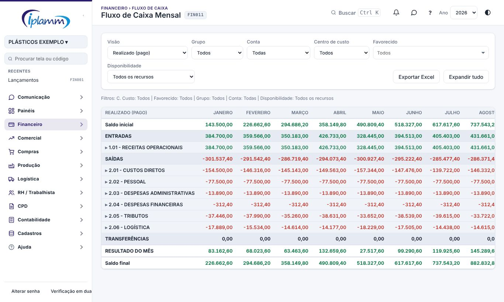
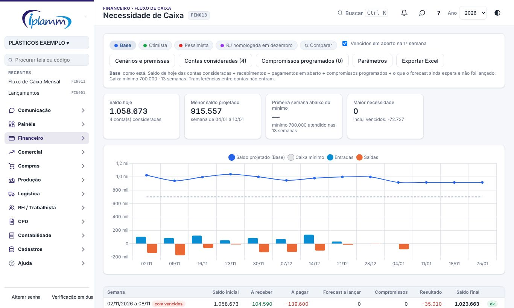
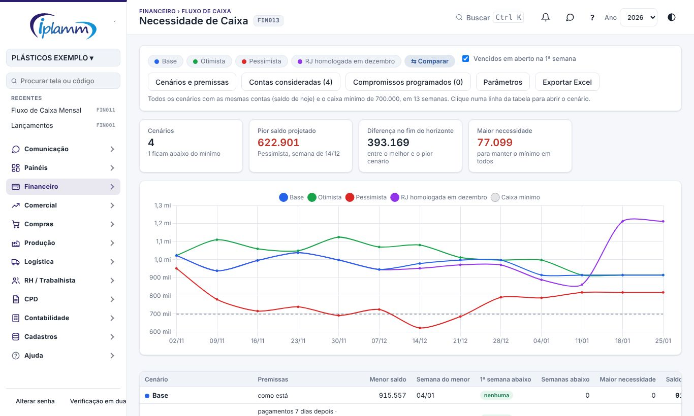
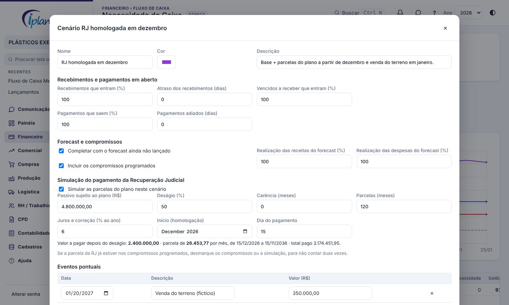

## 1. Para que serve

Três telas mostram o dinheiro da empresa no tempo:

- **Fluxo de Caixa Mensal**: entradas, saídas e transferências por mês do ano, por classificação e por conta do plano.
- **Fluxo de Caixa Diário**: o mesmo, dia a dia, num mês, com o saldo de cada dia.
- **Necessidade de Caixa**: a projeção das **próximas semanas** (13 por padrão) a partir do saldo de hoje, por **cenário** (base, otimista, pessimista e personalizados). Ela mostra em que semana o caixa fica abaixo do mínimo e quanto falta, e simula o pagamento da Recuperação Judicial.

## 2. Quem tem acesso

Quem tem a área Financeiro consulta e exporta. Só o administrador e o financeiro cadastram **compromissos programados**. O administrador, o diretor e o financeiro alteram os **cenários**, as **premissas** e os **parâmetros**.

## 3. Fluxo de Caixa Mensal e Diário

### 3.1 Filtros

- **Visão**:
  - **Realizado (pago)**: só o que já foi pago;
  - **Projetado (pago + em aberto)**: inclui os títulos em aberto.
- **Grupo**, **conta**, **centro de custo** e **favorecido**.
- **Disponibilidade**:
  - todos os recursos;
  - só as contas com recursos disponíveis;
  - só as contas com recursos bloqueados (por exemplo, bloqueio judicial).

O ano vem do seletor **Ano** no topo da plataforma. No diário, escolha também o **mês**.

### 3.2 Ler a tabela

As linhas seguem o plano de contas: **ENTRADAS**, **SAÍDAS** e **TRANSFERÊNCIAS**, cada uma com as classificações. Clique numa classificação para abrir as contas dela, ou use **Expandir tudo**.

No mensal, as colunas são os meses, o **TOTAL** e a **Part.** (participação de cada linha no total). No diário, o quadro **Saldo diário** mostra o saldo final de cada dia, e os indicadores mostram o saldo final, as entradas e as saídas do mês.

**Exportar Excel** baixa a tabela como está na tela.

## 4. Necessidade de Caixa

### 4.1 Como a projeção é feita

A projeção cobre as **próximas 13 semanas**. O horizonte pode ir de 4 a 26 semanas em **Parâmetros**. Para cada semana:

> **Saldo final** = saldo inicial + recebimentos em aberto − pagamentos em aberto + compromissos programados + o forecast ainda não lançado + as simulações do cenário.

As transferências entre contas não entram. Cada parcela é ajustada pelas **premissas do cenário** escolhido (seção 4.2).

### 4.2 Cenários

No topo da tela ficam os cenários. Clique num cenário para ver a projeção dele.

| Cenário | Premissas padrão |
|---|---|
| **Base** | Como está: títulos em aberto no vencimento, forecast e compromissos. |
| **Otimista** | Recebe tudo no prazo. Receitas do forecast 5% acima e despesas 3% abaixo. |
| **Pessimista** | 8% dos recebimentos não entram e os outros atrasam 15 dias. Metade dos vencidos não entra. Receitas do forecast 15% abaixo e despesas 3% acima. |
| **Personalizados** | Criados pela empresa para simular uma decisão. Ex.: "RJ homologada em março", "Perda do cliente X". |

Clique em **⇆ Comparar** para ver todos os cenários juntos:

- um gráfico com uma linha por cenário e a linha do caixa mínimo;
- uma tabela com o menor saldo de cada cenário, a primeira semana abaixo do mínimo, quantas semanas ficam abaixo, a maior necessidade e o saldo no fim;
- o saldo de cada semana em cada cenário.

Clique numa linha da tabela para abrir o cenário.

### 4.3 Premissas de um cenário

Para ajustar as premissas, clique em **Cenários e premissas** e depois em **Editar**. Isso pode ser feito pelo administrador, pelo diretor e pelo financeiro. **+ Novo cenário** cria um cenário personalizado; **Duplicar** parte de um cenário que já existe.

| Premissa | O que faz |
|---|---|
| Recebimentos que entram (%) | Parte dos títulos a receber, ainda no prazo, que entra. 92% equivale a uma inadimplência de 8%. |
| Atraso dos recebimentos (dias) | Empurra os recebimentos para a frente. |
| Vencidos a receber que entram (%) | Parte dos títulos já vencidos que entra na 1ª semana. |
| Pagamentos que saem (%) | Parte dos pagamentos em aberto que sai. |
| Pagamentos adiados (dias) | Empurra os pagamentos para a frente, por exemplo numa negociação com fornecedores. |
| Forecast e compromissos | Liga ou desliga cada um. Também define a realização das **receitas** e das **despesas** do forecast, em %. |
| Simulação da Recuperação Judicial | Calcula as parcelas do plano. Veja a seção 4.4. |
| Eventos pontuais | Entradas ou saídas de uma data só. Ex.: venda de um imóvel, aporte, multa. Valor positivo entra e negativo sai. |

Os três cenários padrão já vêm prontos e podem ser ajustados. **Restaurar padrão** volta às premissas originais. Só os cenários personalizados podem ser excluídos.

### 4.4 Simulação do pagamento da Recuperação Judicial

Marque **Simular as parcelas do plano neste cenário** e informe:

- o **passivo** sujeito ao plano;
- o **deságio**;
- a **carência**;
- o número de **parcelas** mensais;
- os **juros e a correção** ao ano;
- o **mês de início** (homologação);
- o **dia** do pagamento.

A plataforma mostra na hora:

- o valor a pagar depois do deságio;
- a parcela;
- a primeira e a última data;
- o total pago.

Com juros, a parcela segue a **tabela Price**, e os juros da carência entram no saldo. Sem juros, as parcelas são iguais.

As parcelas aparecem na coluna **Simulações** da tabela e no detalhe da semana.

> Se a parcela da RJ já estiver nos **compromissos programados**, desmarque os compromissos ou a simulação. Assim ela não é contada duas vezes.

### 4.5 Parâmetros e o alerta de caixa mínimo

Clique em **Parâmetros** para ajustar. Esses parâmetros valem para a **empresa toda**, e não só para o seu navegador:

- o **caixa mínimo**;
- o **horizonte**;
- o **cenário que dispara o alerta** (padrão: Base);
- se **avisa** ou não;
- a **janela do aviso**: avisa só se a falta for nas próximas N semanas (padrão: 4);
- **quem recebe** o aviso (padrão: administrador, diretor e financeiro).

**Contas consideradas** marca as contas cujo dinheiro está disponível. O bloqueio judicial vem desmarcado.

Quando o cenário do alerta fica abaixo do mínimo dentro da janela, as pessoas escolhidas recebem o aviso **"Caixa abaixo do mínimo"**:

- o aviso sai **uma vez por semana crítica**;
- sai de novo se a falta piorar mais de 20%;
- o cálculo é feito ao abrir a Necessidade de Caixa, a Minha Manhã ou a Central de Decisões.

A Central de Decisões, a Minha Manhã e os painéis usam o mesmo cenário, o mesmo mínimo e as mesmas contas.

### 4.6 Os indicadores e a tabela

Os indicadores mostram:

- o **saldo hoje**;
- o **menor saldo projetado**;
- a **primeira semana abaixo do mínimo**;
- a **maior necessidade** (quanto falta para o mínimo).

A tabela traz, por semana:

- saldo inicial;
- a receber;
- a pagar;
- forecast a lançar;
- compromissos;
- simulações, quando o cenário tem alguma;
- resultado;
- saldo final.

Clique numa semana para ver os lançamentos dela. **Exportar Excel** baixa o cenário aberto ou, no modo Comparar, todos os cenários.

### 4.7 Compromissos programados

São valores que se repetem todo mês e ainda não estão lançados, por exemplo a parcela de um acordo.

1. Clique em **Compromissos programados** e depois em **+ Novo compromisso**.
2. Informe:
   - a descrição;
   - o tipo (entrada ou saída);
   - o **valor mensal**;
   - o **dia do mês**;
   - o início e, se houver, o fim.
3. Clique em **Salvar**.

O compromisso entra na projeção no dia informado de cada mês, entre o início e o fim. Pode ser editado, desativado ou excluído.

### 4.8 Quando falta caixa

A plataforma sugere títulos a receber para antecipar. **Montar borderô com esses títulos** leva para **Propostas de Borderô** com eles já marcados.

## 5. Regras e travas

- Os relatórios de caixa só contam lançamentos **com conta bancária**.
- O fluxo mensal e o diário seguem o sinal do plano de contas: entradas somam e saídas subtraem.
- A Necessidade de caixa não grava nada nos lançamentos. Os compromissos programados, os cenários e os parâmetros ficam em cadastros à parte. As alterações ficam na Auditoria.
- A simulação da RJ e os eventos pontuais só existem dentro do cenário. Não viram lançamento nem compromisso.

## 6. Perguntas frequentes e erros comuns

**O total do mês não bate com o extrato.** Use a visão **Realizado (pago)** e confira se todos os lançamentos têm conta. A Conferência do dia mostra em que dia a diferença aparece.

**A projeção conta um dinheiro que está bloqueado.** Desmarque a conta em **Contas consideradas**.

**A projeção está com valores em dobro.** O forecast pode estar repetindo o que já foi lançado. Desmarque **Completar com o forecast** nas premissas do cenário para ver só o que está lançado. A parcela da RJ também pode estar nos compromissos e na simulação ao mesmo tempo.

**O otimista e a base saem iguais.** O otimista mexe no forecast. Sem forecast lançado para os meses do horizonte, as premissas dele não mudam nada. Ajuste outras premissas, por exemplo os pagamentos adiados.

**Não recebi o aviso de caixa mínimo.** Confira em **Parâmetros**:

- se o aviso está ligado;
- se o seu perfil está entre os que recebem;
- se a falta está dentro da janela do aviso.

O aviso de uma mesma semana só se repete se a falta piorar mais de 20%.

## 7. Histórico de alterações

| Versão | Data | O que mudou |
|---|---|---|
| 1.0 | 28/10/2026 | Primeira versão do manual: fluxo mensal e diário, necessidade de caixa de 13 semanas, caixa mínimo, forecast, contas consideradas e compromissos programados. |
| 1.1 | 29/10/2026 | Imagens das telas, com dados fictícios. |
| 1.2 | 05/11/2026 | Nomes das telas iguais aos do menu, com o código da tela no cabeçalho. |
| 1.3 | 08/11/2026 | Cenários de caixa: base, otimista, pessimista e personalizados, com premissas editáveis, comparação, simulação do pagamento da RJ e eventos pontuais. Parâmetros da empresa (mínimo, horizonte, contas, cenário do alerta) e aviso de caixa mínimo projetado. |
