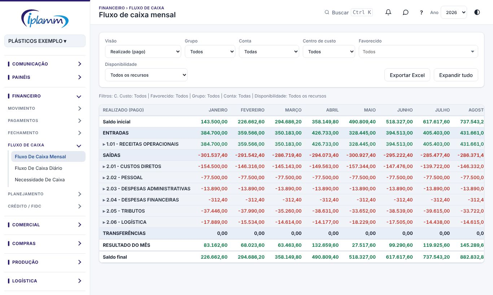
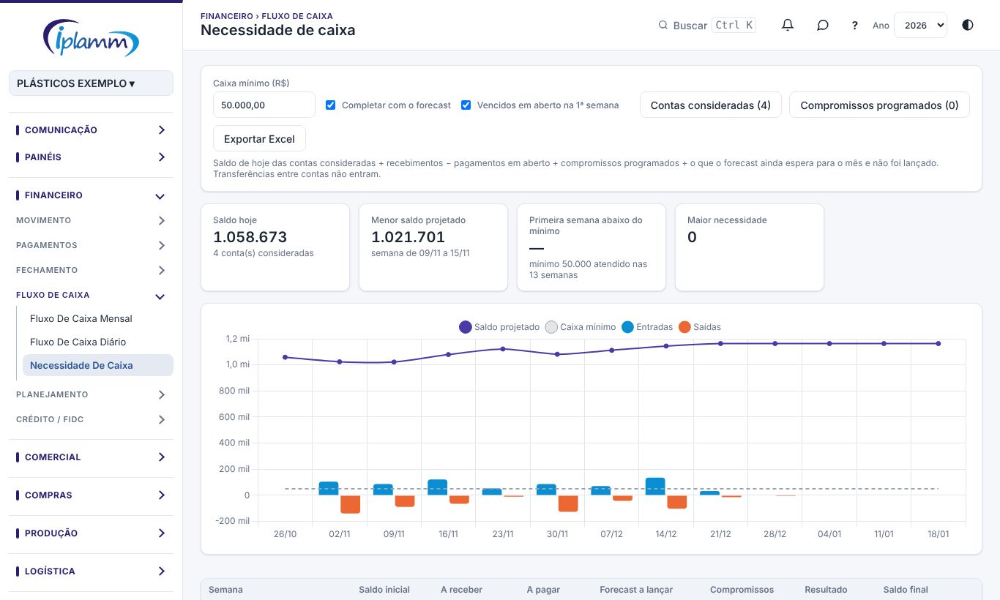

## 1. Para que serve

Três telas mostram o dinheiro da empresa no tempo:

- **Fluxo de caixa mensal**: entradas, saídas e transferências por mês do ano, por classificação e por conta do plano.
- **Fluxo de caixa diário**: o mesmo, dia a dia, num mês, com o saldo de cada dia.
- **Necessidade de caixa**: a projeção das **próximas 13 semanas** a partir do saldo de hoje. Ela mostra em que semana o caixa fica abaixo do mínimo e quanto falta.

## 2. Quem tem acesso

Quem tem a área Financeiro consulta e exporta. Só o administrador e o financeiro cadastram **compromissos programados**.

## 3. Fluxo de caixa mensal e diário

### 3.1 Filtros

- **Visão**:
  - **Realizado (pago)**: só o que já foi pago;
  - **Projetado (pago + em aberto)**: inclui os títulos em aberto.
- **Grupo**, **conta**, **centro de custo** e **favorecido**.
- **Disponibilidade**:
  - todos os recursos;
  - só as contas com recursos disponíveis;
  - só as contas com recursos bloqueados (por exemplo, bloqueio judicial).

O ano vem do seletor **Ano** no topo da plataforma. No diário, escolha também o **mês**.

### 3.2 Ler a tabela

As linhas seguem o plano de contas: **ENTRADAS**, **SAÍDAS** e **TRANSFERÊNCIAS**, cada uma com as classificações. Clique numa classificação para abrir as contas dela, ou use **Expandir tudo**.

No mensal, as colunas são os meses, o **TOTAL** e a **Part.** (participação de cada linha no total). No diário, o quadro **Saldo diário** mostra o saldo final de cada dia, e os indicadores mostram o saldo final, as entradas e as saídas do mês.

**Exportar Excel** baixa a tabela como está na tela.

## 4. Necessidade de caixa

### 4.1 Como a projeção é feita

Para cada uma das 13 semanas:

> **Saldo final** = saldo inicial + recebimentos em aberto − pagamentos em aberto + compromissos programados (+ o forecast ainda não lançado, se marcado).

As transferências entre contas não entram.

### 4.2 Ajustar a projeção

- **Caixa mínimo (R$)**: o valor que a empresa não quer furar. As semanas abaixo dele ficam marcadas.
- **Completar com o forecast**: soma o que o forecast do orçamento ainda espera e não foi lançado, espalhado pelos dias que faltam do mês.
- **Vencidos em aberto na 1ª semana**: joga os títulos vencidos e não pagos na primeira semana.
- **Contas consideradas**: marque as contas cujo dinheiro está disponível. O bloqueio judicial vem desmarcado.

A plataforma guarda essas escolhas no seu navegador.

### 4.3 Os indicadores e a tabela

Os indicadores mostram o **saldo hoje**, o **menor saldo projetado**, a **primeira semana abaixo do mínimo** e a **maior necessidade** (quanto falta para o mínimo).

A tabela traz, por semana: saldo inicial, a receber, a pagar, forecast a lançar, compromissos, resultado e saldo final. Clique numa semana para ver os lançamentos dela.

### 4.4 Compromissos programados

São valores que se repetem todo mês e ainda não estão lançados, por exemplo a parcela de um acordo.

1. Clique em **Compromissos programados** e depois em **+ Novo compromisso**.
2. Informe a descrição, o tipo (entrada ou saída), o **valor mensal**, o **dia do mês**, o início e, se houver, o fim.
3. Clique em **Salvar**.

O compromisso entra na projeção no dia informado de cada mês, entre o início e o fim. Pode ser editado, desativado ou excluído.

### 4.5 Quando falta caixa

A plataforma sugere títulos a receber para antecipar. **Montar borderô com esses títulos** leva para **Propostas de borderô** com eles já marcados.

## 5. Regras e travas

- Os relatórios de caixa só contam lançamentos **com conta bancária**.
- O fluxo mensal e o diário seguem o sinal do plano de contas: entradas somam e saídas subtraem.
- A Necessidade de caixa não grava nada nos lançamentos. Os compromissos programados ficam num cadastro à parte.

## 6. Perguntas frequentes e erros comuns

**O total do mês não bate com o extrato.** Use a visão **Realizado (pago)** e confira se todos os lançamentos têm conta. A Conferência do dia mostra em que dia a diferença aparece.

**A projeção conta um dinheiro que está bloqueado.** Desmarque a conta em **Contas consideradas**.

**A projeção está com valores em dobro.** O forecast pode estar repetindo o que já foi lançado. Desmarque **Completar com o forecast** para ver só o que está lançado.

## 7. Histórico de alterações

| Versão | Data | O que mudou |
|---|---|---|
| 1.0 | 28/10/2026 | Primeira versão do manual: fluxo mensal e diário, necessidade de caixa de 13 semanas, caixa mínimo, forecast, contas consideradas e compromissos programados. |
| 1.1 | 29/10/2026 | Imagens das telas, com dados fictícios. |
