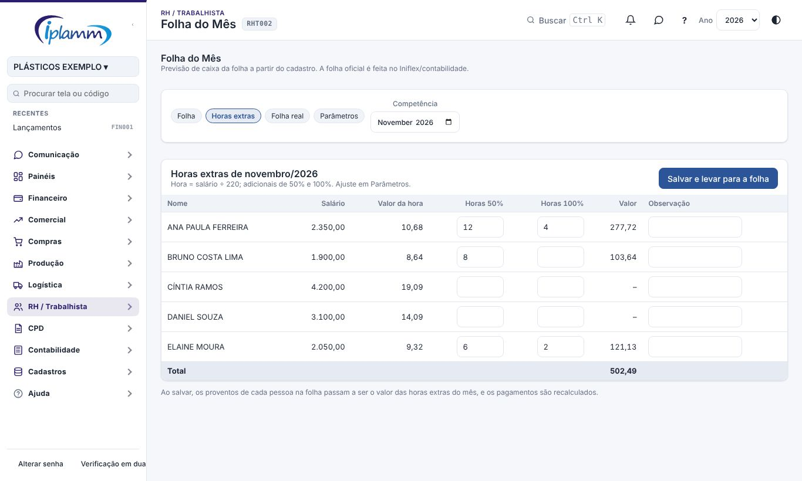
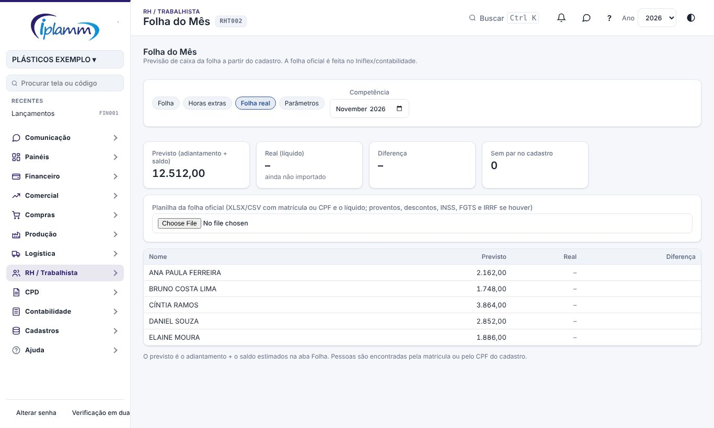
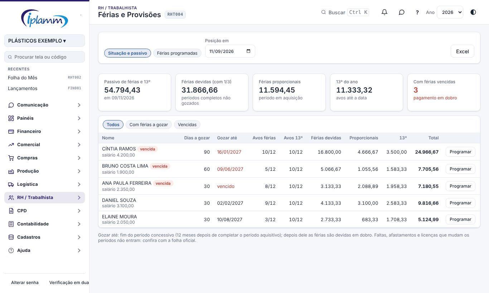
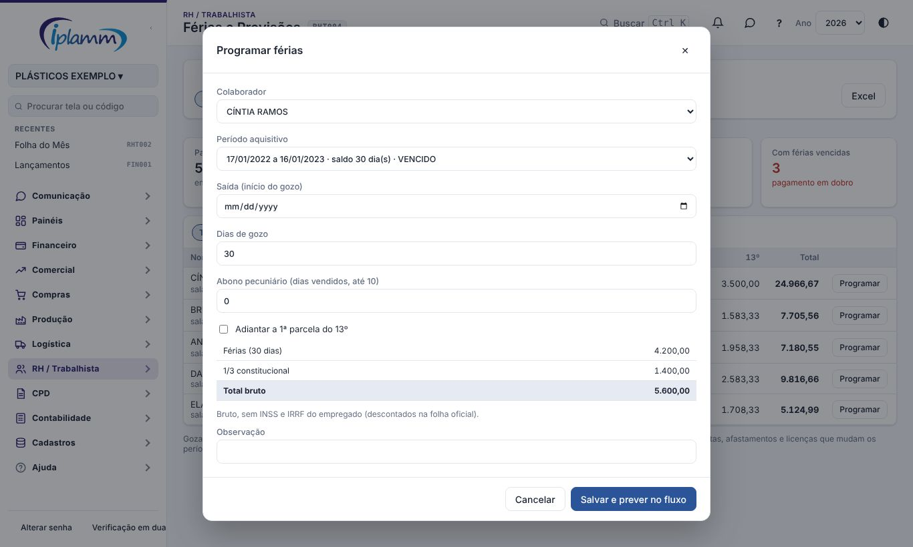
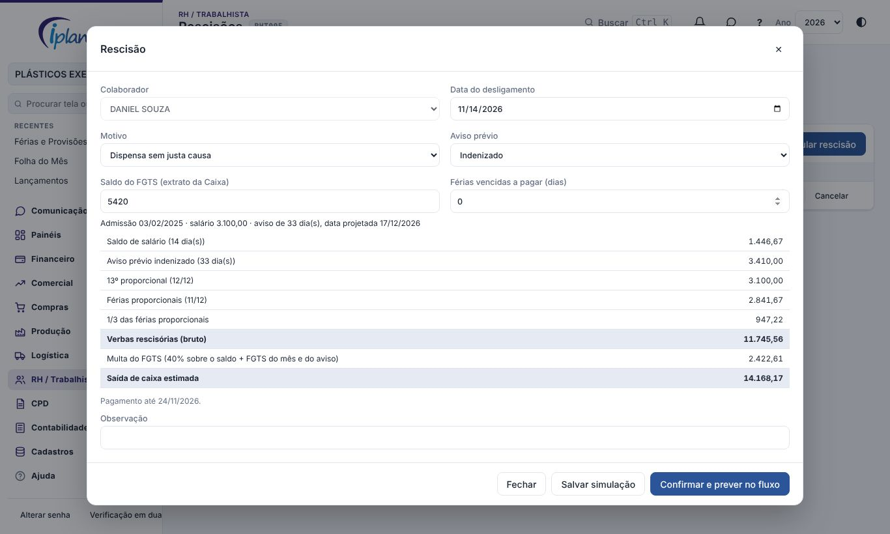

## 1. Para que serve

Completa a previsão da folha no fluxo de caixa com o que antes ficava fora dela:

| Onde | O que faz |
|---|---|
| Folha do Mês › Horas extras | calcula as horas extras do mês e leva para os proventos da folha |
| Folha do Mês › Folha real | importa a planilha da folha oficial, compara com o previsto e corrige os pagamentos em aberto |
| Férias e Provisões | períodos aquisitivos de cada pessoa, férias vencidas e a vencer, passivo de férias e 13º, programação das férias com a previsão do pagamento |
| Rescisões | simula as verbas e a multa do FGTS, confirma o desligamento e prevê os pagamentos |

Os cálculos são **estimativas brutas para o caixa**: INSS e IRRF do empregado, pensões e o TRCT oficial continuam com a folha oficial (Iniflex/contabilidade). Usam quem tem acesso ao RH.

## 2. Horas extras

Na **Folha do Mês**, aba **Horas extras**, escolha a competência e digite, por pessoa, as horas com o adicional 1 (padrão 50%) e com o adicional 2 (padrão 100%). A tela mostra o valor da hora (salário ÷ divisor, padrão 220) e o total, com o reflexo no DSR se estiver configurado.

**Salvar e levar para a folha** grava as horas e põe o valor nos **proventos** de cada pessoa na folha do mês; o saldo e as guias são recalculados. Se a folha já tinha a previsão lançada, clique em **Lançar previsão** na aba Folha para atualizar o fluxo.

## 3. Folha real

Na aba **Folha real**, escolha a planilha da folha oficial (XLSX ou CSV) com a **matrícula ou o CPF** e o **líquido**; proventos, descontos, INSS, FGTS e IRRF entram se houver as colunas. A tela mostra, pessoa a pessoa, o **previsto** (adiantamento + saldo) × o **real**, e as linhas da planilha que não acharam ninguém na folha.

**Gravar a folha real** guarda o real. Com a opção marcada, o **saldo** passa a ser o líquido real menos o adiantamento, e as guias de **INSS, FGTS e IRRF** passam a ser as do real; as previsões ainda em aberto no fluxo são atualizadas.

## 4. Férias e provisões

Em **RH › Férias e Provisões**, aba **Situação e passivo**, na data escolhida em **Posição em**:

- **Dias a gozar** e **Gozar até**: saldo dos períodos aquisitivos completos e o fim do período concessivo (12 meses depois). Passou dele, a linha fica **vencida** (férias em dobro);
- **Avos** de férias do período em aquisição e de 13º no ano (mês com 15 dias ou mais conta 1/12);
- o **passivo**: férias devidas com 1/3, férias proporcionais com 1/3 e 13º proporcional, por pessoa e no total.

Os filtros mostram quem tem férias a gozar e quem está com férias vencidas. **Excel** baixa a tabela.

## 5. Programar férias

**Programar** (na linha da pessoa ou em **Férias programadas › Programar férias**): período aquisitivo (com o saldo de dias), data de saída, dias de gozo (5 a 30), abono pecuniário (até 10 dias, e gozo + abono até 30) e, se quiser, a 1ª parcela do 13º junto.

O cálculo mostra férias, 1/3, abono com 1/3, 13º e o total; o **pagamento** é 2 dias antes da saída (parâmetro). **Salvar e prever no fluxo** grava e lança a previsão (Em aberto) com o plano de férias dos parâmetros.

Na aba **Férias programadas**: **Editar** refaz o cálculo e a previsão; **Paga** registra o pagamento; **Cancelar** tira a previsão em aberto do fluxo.

## 6. Rescisões

Em **RH › Rescisões**, **Simular rescisão**: colaborador, data do desligamento, motivo, aviso prévio, saldo do FGTS (extrato da Caixa) e dias de férias vencidas (preenchido pelos períodos, pode ajustar).

| Motivo | Verbas consideradas |
|---|---|
| Dispensa sem justa causa | saldo de salário, aviso prévio indenizado (30 dias + 3 por ano completo, até 90), 13º e férias proporcionais pela data projetada do aviso, férias vencidas, 1/3, multa de 40% do FGTS |
| Acordo (art. 484-A) | o mesmo, com metade do aviso indenizado e multa de 20% |
| Pedido de demissão / término de contrato | saldo de salário, 13º e férias proporcionais, férias vencidas, 1/3 |
| Justa causa | saldo de salário e férias vencidas com 1/3 |

A multa do FGTS é calculada sobre o saldo informado mais o FGTS do mês e do aviso. O pagamento é em até 10 dias do desligamento (parâmetro).

- **Salvar simulação** só guarda.
- **Confirmar e prever no fluxo** marca o colaborador como **desligado** (com a data) e lança duas previsões: as verbas (plano de rescisões) e a multa do FGTS (plano do FGTS).
- **Cancelar** tira as previsões em aberto e, se estava confirmada, volta o colaborador para ativo.
- **Paga** registra o pagamento; depois disso a rescisão não muda.

## 7. Parâmetros

Na **Folha do Mês › Parâmetros**, além dos da folha: divisor de horas, os dois adicionais das horas extras, reflexo no DSR, dias de antecedência do pagamento das férias, prazo da rescisão, multa do FGTS (sem justa causa e acordo), dias do aviso prévio (base, por ano e máximo) e os planos de contas de **férias** e **rescisões**.

## 8. Problemas comuns

**Pessoa fora do passivo.** Falta a data de admissão no cadastro, ou o vínculo não é CLT/aprendiz.

**Período aquisitivo errado.** Faltas, afastamentos e licenças mudam os períodos e não estão na plataforma: confira com a folha oficial e ajuste os dias.

**Linha da folha real sem par.** A matrícula ou o CPF da planilha não bate com o cadastro.

**"Escolha o plano de contas da previsão".** Informe o plano de férias ou de rescisões (ou de salários) nos parâmetros.

## 9. Histórico de alterações

| Versão | Data | O que mudou |
|---|---|---|
| 1.0 | 08/11/2026 | Primeira versão: horas extras, folha real × prevista, férias e passivo, programação de férias e rescisões com previsão no fluxo (melhoria 8.1). |
