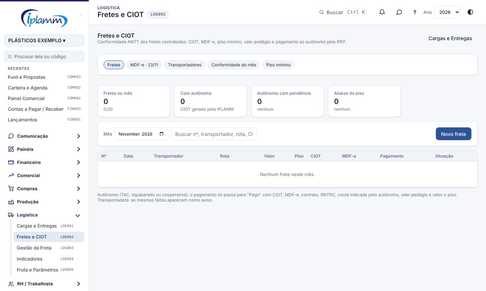
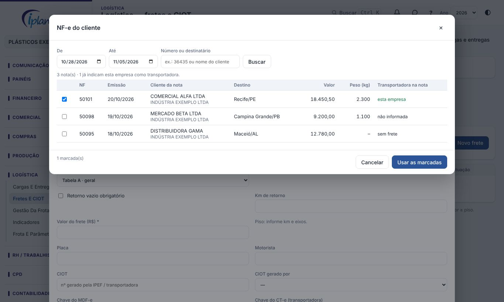
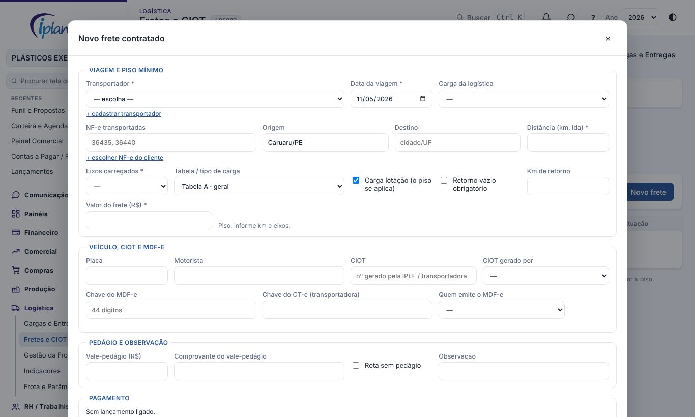
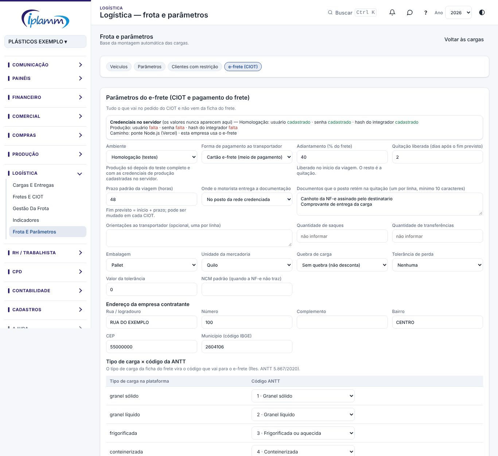
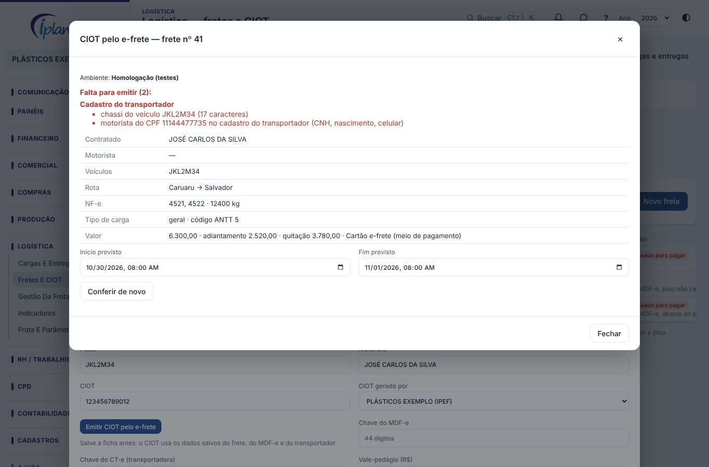

## 1. Para que serve

A tela **Fretes e CIOT** registra cada frete contratado pela IPLAMM e confere se ele segue as regras da ANTT:

- **CIOT**: código da operação de transporte.
- **MDF-e**: manifesto da carga.
- **Piso mínimo do frete**: valor mínimo da tabela da ANTT.
- **Vale-pedágio**.
- **Pagamento**: ao autônomo, pela IPEF e na conta indicada por ele.

O registro de cada frete é a **ficha do frete**. A tela também guarda o cadastro dos **transportadores**, mostra a **conformidade do mês** e gera o relatório para a diretoria.

> **Por que importa:** desde maio de 2026 a ANTT exige CIOT em toda operação de transporte. Quem contrata autônomo gera o CIOT pela IPEF e paga por ela. Frete abaixo do piso pode gerar multa alta ao contratante. A partir de 23/11/2026 a SEFAZ recusa MDF-e sem CIOT.

## 2. Quem tem acesso

| Perfil | O que faz |
|---|---|
| Administrador, diretor e financeiro | Cadastram e editam fretes, transportadores e coeficientes; programam e ligam pagamentos; dispensam lançamentos. |
| Demais perfis com a área Logística | Consultam tudo, sem editar. |

## 3. As abas

- **Fretes**: os fretes do mês, com os indicadores (fretes no mês, com autônomo, autônomo com pendência, abaixo do piso).
- **MDF-e · 23/11**: o painel de prontidão para a regra do CIOT no MDF-e. Mostra quantos dias faltam, as viagens com MDF-e da IPLAMM, quantas estão prontas para emitir e quantas estão sem CIOT. Também mostra o que a empresa ainda precisa configurar.
- **Transportadores**: o cadastro de autônomos, transportadoras e cooperativas.
- **Conformidade do mês**: o resumo do mês, os fretes pagos sem ficha e o relatório para imprimir.
- **Piso mínimo**: os coeficientes da tabela da ANTT usados no cálculo.

## 4. Passo a passo

### 4.1 Cadastrar um transportador

1. Na aba **Transportadores**, clique em **Cadastrar**.
2. Preencha o **nome / razão social** e o **CPF / CNPJ**. O tipo é sugerido pelo documento: CPF vira autônomo e CNPJ vira transportadora.
3. Confira o **tipo**:
   - **Autônomo (TAC)**: pessoa física com RNTRC.
   - **Autônomo equiparado**: empresa com até 3 veículos no RNTRC (consulte o RNTRC na ANTT).
   - **Transportadora (ETC)**.
   - **Cooperativa (CTC)**.
4. Informe o **RNTRC** e a validade dele, e o **favorecido no cadastro** usado nos pagamentos.
5. Em **Veículos**, escreva uma linha por veículo, no formato `placa;eixos;tipo` (por exemplo `ABC1D23;5;carreta`).
6. Em **Conta para pagamento do frete**, informe banco, agência, conta ou Pix, o **titular** e de quem é a conta: do próprio autônomo, do cônjuge ou companheiro(a), ou de parente até 2º grau.
7. Informe a **IPEF usada** e a validade do contrato, e clique em **Salvar**.
8. Abra o transportador de novo e anexe o **contrato** em **Contrato e documentos**, com o tipo "Contrato".

> **Começando do zero:** o botão **Trazer dos fretes pagos em 2026** lista quem já recebeu no plano de fretes (2.06.01) e ainda não está cadastrado. Marque e clique em **Cadastrar marcados**. Depois complete o RNTRC, a conta e o contrato de cada um.

### 4.2 Criar a ficha de um frete

1. Na aba **Fretes**, clique em **Novo frete**.
2. Escolha o **transportador**. Se ele não existir, use **+ cadastrar transportador**.
3. Informe a **data da viagem**, a **carga da logística** (se houver), as **NF-e transportadas**, a origem e o destino.
4. Informe a **distância (km, ida)** e os **eixos carregados**, e marque se é **carga lotação** e se há **retorno vazio obrigatório** (com os km de retorno).
5. Informe o **valor do frete**. Logo abaixo, a ficha mostra o **piso mínimo** e se o frete está acima ou abaixo dele.
6. Preencha a placa, o motorista, o **CIOT** (e quem o gerou: a IPLAMM pela IPEF ou a transportadora), a **chave do MDF-e** (44 dígitos), a **chave do CT-e** e o **vale-pedágio**, ou marque **Rota sem pedágio**.
7. Clique em **Salvar**.
8. Abra a ficha de novo e anexe os documentos: CIOT, MDF-e, CT-e, vale-pedágio, contrato e comprovantes.

A ficha mostra na hora o que falta. Para autônomo aparece **Pagamento travado (autônomo): falta ...**; para transportadora, **Avisos: falta ...**.

#### NF-e do cliente (transportadora do grupo)

Quando a empresa é a **transportadora** e o cliente também usa a plataforma (por exemplo, a KRATOS levando as cargas da IPLAMM), não é preciso importar de novo as notas do cliente. Elas já estão na empresa do cliente.

1. O **administrador do cliente** autoriza a transportadora a usar as NF-e de saída no transporte. A autorização da IPLAMM para a KRATOS já está feita.
2. Na ficha do frete da transportadora, clique em **+ escolher NF-e do cliente**, logo abaixo de **NF-e transportadas**.
3. Escolha o período (a plataforma sugere 7 dias antes da viagem até o dia seguinte) e, se quiser, o número ou o nome do destinatário. Clique em **Buscar**.
4. As notas que já trazem a transportadora no campo **Transportadora** da NF-e vêm primeiro e já marcadas. As outras mostram "não informada" ou "sem frete": confira pelo destino e pela data.
5. Clique em **Usar as marcadas**. Os números entram em **NF-e transportadas** e, se o destino estiver vazio, ele é preenchido.

No **MDF-e**, o botão **Buscar NF-e** também acha essas notas pelo número, com a chave, o destino, o peso e o valor.

> **Importante:** as notas do cliente **não** entram no faturamento nem nos impostos da transportadora. A receita da transportadora é o documento que ela emite (CT-e ou NFS-e). A transportadora vê só o que o transporte precisa; as notas canceladas ficam de fora. O cliente pode desligar a autorização a qualquer momento.

> **Dica:** peça ao faturamento do cliente para informar a transportadora na NF-e (grupo **Transportador**). Assim as notas aparecem marcadas sozinhas.

### 4.3 Pagar o frete

Na ficha salva há dois botões:

- **Programar pagamento**: cria o lançamento **Em aberto** no plano de fretes, que entra no fluxo de caixa e na autorização de pagamentos.
- **Ligar a lançamento**: para quando o pagamento já foi lançado. A janela mostra os lançamentos de frete de 45 dias antes ou depois da viagem que ainda não têm ficha, com os do mesmo favorecido e valor mais próximo no topo.

> **Autônomo:** o pagamento deve sair pela **IPEF que gerou o CIOT**, na conta indicada pelo autônomo. Nunca pague autônomo pelo caixa, em dinheiro ou por Pix direto ao motorista.

### 4.4 Conferir o mês

1. Na aba **Conformidade do mês**, escolha o **mês**.
2. A primeira tabela resume os fretes com ficha, por tipo de transportador: sem CIOT, sem MDF-e, abaixo do piso e com pendência.
3. A lista **Fretes pagos sem ficha** mostra os lançamentos do plano de fretes sem ficha, com alertas como "pago pelo caixa", "pessoa física / autônomo?" e "sem favorecido". Para cada um:
   - **Criar ficha**: abre a ficha já com a data, o valor e o lançamento ligado.
   - **Dispensar**: para o que não precisa de ficha. Escolha o **motivo** (relação encerrada, contratado por terceiro com CT-e em nome da IPLAMM, não é frete rodoviário, ou outro) e escreva a **justificativa**. O lançamento não muda; só sai dos alertas, com registro de quem dispensou e quando. Os dispensados ficam em **Dispensados com justificativa** e podem ser desfeitos.
4. Clique em **Relatório (imprimir)** para gerar o relatório de conformidade do mês no padrão IPLAMM.

### 4.5 Atualizar o piso mínimo

A aba **Piso mínimo** já vem com a tabela completa da ANTT em vigor: **Portaria SUROC nº 22/2026** (DOU de 29/09/2026), vigente desde **30/09/2026**, com diesel S10 a R$ 7,33. São as Tabelas A, B, C e D, os 12 tipos de carga e de 2 a 9 eixos. Empresa nova já nasce com essa tabela.

Use os filtros do topo para achar o coeficiente: **tabela**, **tipo de carga** e **só vigentes**. Desmarque **só vigentes** para ver as tabelas antigas, marcadas como *(histórico)*.

| Tabela | Quando usar |
|---|---|
| A | Carga lotação com o veículo completo (caminhão ou composição). É a mais comum. |
| B | Contratação só do veículo automotor (cavalo). Não tem 2 e 3 eixos. |
| C | Carga lotação de alto desempenho (exige contrato e frota dedicada). |
| D | Só o veículo automotor, em alto desempenho. Não tem 2 e 3 eixos. |

Na ficha do frete, escolha a **tabela e o tipo de carga** certos. O piso muda bastante: carga frigorificada ou perigosa tem piso maior que carga geral.

Quando a ANTT reajustar a tabela, clique em **Incluir coeficiente**. Informe a tabela, o tipo de carga, os eixos, o **CCD** (R$/km), o **CC** (R$), a **vigência** e a fonte.

Inclua sempre uma linha nova com a nova vigência, sem apagar a antiga. Cada frete usa a vigência mais recente até a data dele, e os fretes antigos continuam calculados pela tabela da época.

> **Atenção:** confira os valores na calculadora oficial da ANTT antes de fechar um frete perto do piso. O e-frete recusa o CIOT de carga lotação abaixo do piso.

### 4.6 Preparar o MDF-e da viagem

O MDF-e (manifesto da carga) é emitido por quem faz o transporte:

- **Transportadora com CT-e**: ela emite o MDF-e e gera o CIOT. Na ficha do frete, escolha **Quem emite o MDF-e = Transportadora** e anote a chave do MDF-e quando ela mandar.
- **IPLAMM (carga própria)**: a IPLAMM emite o MDF-e. Se o veículo for de terceiro (autônomo ou transportadora contratada sem CT-e), o **CIOT é obrigatório no MDF-e**. A partir de **23/11/2026** a SEFAZ recusa o MDF-e sem CIOT (rejeição 684).

Para deixar o MDF-e da IPLAMM pronto:

1. Na ficha do frete, escolha **Quem emite o MDF-e = IPLAMM**, informe os números das NF-e e clique em **Salvar**.
2. Clique em **Dados do MDF-e**. A janela tem uma lista no topo: em vermelho, o que falta para emitir; em amarelo, o que é recomendado.
3. Clique em **Buscar NF-e**. A plataforma lê o XML das notas importadas e preenche:
   - as chaves de acesso;
   - os municípios de descarga;
   - o peso bruto e o valor da carga;
   - o produto predominante e o município de carregamento.
   Para incluir uma nota que não foi importada, cole a chave de 44 dígitos no município de descarga.
4. Confira o **veículo**: placa, tara, UF, tipo de rodado e carroceria. Inclua as carretas em **+ Reboque**. Os dados ficam guardados no transportador e voltam no próximo frete com a mesma placa.
5. Informe o **motorista** e o **CPF dele**.
6. Informe o **CIOT** (12 dígitos, gerado pela IPEF) e o CPF/CNPJ de quem gerou. Quando a IPLAMM gera, vem o CNPJ da IPLAMM.
7. Para autônomo, informe o **pagamento do frete**: pela IPEF (CNPJ da IPEF), por Pix ou por conta bancária do autônomo; à vista ou a prazo, com as parcelas.
8. Informe o **seguro da carga** e, se houver pedágio, o CNPJ do fornecedor do vale-pedágio.
9. Clique em **Salvar**. Com tudo completo, o frete aparece como **Pronto para emitir** no painel MDF-e · 23/11.

**Resumo para impressão**: gera uma folha com todos os dados no formato do MDF-e. Use enquanto a emissão pela plataforma não estiver ligada: emita no sistema emissor atual a partir dela.

**Pedido do CIOT**: quando a IPLAMM contrata um autônomo, a lista do topo também mostra o que falta para pedir o CIOT à IPEF: RNTRC, motorista com CPF, origem e destino com código IBGE, peso, natureza da carga, km, valor acima do piso e de quem é a conta indicada. Quando a IPEF for ligada à plataforma, o pedido sai daqui.

**XML (teste)**: baixa o XML do MDF-e no leiaute oficial 3.00, em homologação (série 999) e sem assinatura. Serve para conferir os dados com o emissor que for contratado; não vale como documento. O endereço do emitente vem da NF-e própria mais recente.

**Padrões do MDF-e**: seguradora, apólice, IPEF, produto, carregamento e responsável pelo CIOT se repetem em quase toda viagem. Grave uma vez em **Salvar como padrão** (na janela do MDF-e) ou em **Padrões do MDF-e** (no painel). Os próximos fretes já vêm preenchidos, e dá para mudar em cada frete.

### 4.7 Emitir o CIOT pelo e-frete

Quando a empresa usa o e-frete, o CIOT sai da própria ficha do frete. Antes da primeira emissão:

1. Em **Logística › Frota e parâmetros › e-frete (CIOT)**, o administrador confere os parâmetros: ambiente, forma de pagamento ao transportador, % de adiantamento, prazo da quitação, documentos que o posto retém, embalagem, quebra de carga, endereço da empresa e o **tipo de carga × código da ANTT**. Nada disso fica fixo no sistema: tudo se ajusta nessa tela.
2. O quadro do topo mostra se as **credenciais** do e-frete estão cadastradas no servidor (homologação e produção). Os valores nunca aparecem na tela.
3. No **cadastro do transportador**, preencha o endereço, os **motoristas** (CPF;nome;CNH;nascimento;celular, um por linha) e, em cada veículo, o **RENAVAM** e o **chassi** (placa;eixos;tipo;renavam;chassi).

Para emitir:

1. Salve a ficha do frete e preencha os **Dados do MDF-e** (veículo, condutor, carregamento, descarga e **Buscar NF-e**).
2. Clique em **Emitir CIOT pelo e-frete**. A plataforma confere tudo e mostra o que falta, separado por onde corrigir: cadastro do transportador, ficha do frete ou parâmetros.
3. Confira o resumo (contratado, motorista, veículos, rota, NF-e, tipo de carga, valor, adiantamento e quitação) e ajuste o **início** e o **fim previstos** da viagem. O início não pode ser antes de agora.
4. Clique em **Emitir CIOT**. A plataforma cadastra o proprietário, o veículo e o motorista no e-frete, emite o CIOT, grava o número no frete e guarda o **PDF** nos anexos.

Depois de emitido, o mesmo botão abre o **PDF do CIOT** e o **Cancelar CIOT** (com motivo). Na carga lotação o CIOT não pode ser corrigido: cancele (e o MDF-e, se já emitido) e emita de novo.

> **Atenção:** no ambiente **Produção** cada CIOT é real e o pagamento pelo e-frete é cobrado. Use **Homologação** para testar. Os impostos retidos do autônomo (INSS, SEST/SENAT e IRRF) ainda vão zerados no CIOT: confira com a contabilidade antes da produção.

## 5. Regras e travas

- **Piso mínimo** = km × CCD + CC. Com retorno vazio obrigatório, soma 0,92 × CCD × km de retorno. Vale só para **carga lotação**; o pedágio é pago à parte, pelo vale-pedágio.
- **Autônomo** (TAC, equiparado ou cooperativa): o lançamento **não pode ser baixado como pago** enquanto houver pendência. É uma trava do sistema. Precisa ter:
  - CIOT;
  - MDF-e;
  - contrato anexado e dentro da validade;
  - RNTRC válido;
  - conta indicada pelo autônomo;
  - vale-pedágio (ou rota sem pedágio);
  - valor igual ou maior que o piso.
- **Transportadora**: as mesmas faltas aparecem como **aviso**, sem travar o pagamento. O CIOT e o MDF-e são gerados por ela; peça os números e anexe.
- A chave do MDF-e tem **44 dígitos**.
- **CIOT no MDF-e**: obrigatório quando a IPLAMM emite o MDF-e com veículo de terceiro. O CIOT tem 12 dígitos e o RNTRC tem 8.
- As chaves de NF-e são conferidas pelo dígito verificador. Uma chave não entra duas vezes no mesmo manifesto.
- Frete já pago não pode ser cancelado pela ficha.

## 6. Perguntas frequentes e erros comuns

**O piso não aparece.** Informe os km e os eixos e confira se **Carga lotação** está marcada. Se aparecer "sem coeficiente para esses eixos", inclua o coeficiente na aba Piso mínimo.

**Não consigo baixar o pagamento do autônomo.** Abra a ficha do frete e veja a linha **Pagamento travado**: ela diz o que falta.

**O frete foi contratado pelo fornecedor e o CT-e veio em nome da IPLAMM.** Na Conformidade do mês, use **Dispensar** com o motivo "Contratado por terceiro" e escreva a justificativa.

**Lancei uma despesa que não é frete no plano de fretes.** Dispense com o motivo "Não é frete rodoviário" e peça ao financeiro para reclassificar o lançamento.

**Cancelei um frete e o lançamento continua no fluxo.** O cancelamento não apaga o lançamento programado. Exclua o lançamento em Lançamentos, se for o caso.

**O Buscar NF-e diz que não encontrou as notas.** As notas precisam estar importadas (com XML) em CPD › Notas fiscais. Confira os números na ficha do frete, ou cole a chave de 44 dígitos no município de descarga.

**O painel diz que falta a IPEF contratada.** Depois de contratar a IPEF, grave o CNPJ dela em **Padrões do MDF-e**.

## 7. Conversa sobre o registro

No topo da janela do frete ficam dois botões das **Conversas**:

- **💬 Conversa** abre o bate-papo da equipe sobre este registro. Cada registro tem uma conversa só, e só entra quem consegue ver o registro.
- **↗ Enviar no chat** manda o registro como cartão numa conversa. Quem recebe clica no cartão e abre o registro.

Veja o manual **Conversas** para os detalhes.

## 8. Histórico de alterações

| Versão | Data | O que mudou |
|---|---|---|
| 1.0 | 28/10/2026 | Primeira versão do manual: transportadores, ficha do frete, piso mínimo, pagamento com trava para autônomo, conformidade do mês com dispensa justificada e relatório. |
| 1.1 | 29/10/2026 | Botões **💬 Conversa** e **↗ Enviar no chat** do frete (Conversas, etapa 2). |
| 1.2 | 29/10/2026 | Preparo do MDF-e com CIOT (NT 2026.001): campo **Quem emite o MDF-e**, janela **Dados do MDF-e** com busca das NF-e, painel **MDF-e · 23/11**, padrões do MDF-e e resumo para impressão. |
| 1.3 | 29/10/2026 | Conferência do pedido de CIOT à IPEF na janela do MDF-e e botão **XML (teste)** com o XML do MDF-e no leiaute 3.00, conferido contra os esquemas oficiais. |
| 1.4 | 29/10/2026 | Imagens das telas, com dados fictícios. |
| 1.5 | 04/11/2026 | Tabela completa da ANTT (Portaria SUROC nº 22/2026: Tabelas A a D, 12 tipos de carga) carregada no piso mínimo, com filtros por tabela, tipo de carga e só vigentes. |
| 1.6 | 04/11/2026 | **NF-e do cliente**: a transportadora do grupo escolhe as NF-e do cliente na ficha do frete e no MDF-e, sem importar de novo (autorização IPLAMM → KRATOS). |
| 1.7 | 04/11/2026 | **CIOT pelo e-frete** na ficha do frete (conferência, emissão, PDF e cancelamento) e **parâmetros do e-frete** em Frota e parâmetros; motoristas, endereço, RENAVAM e chassi no cadastro do transportador. |
