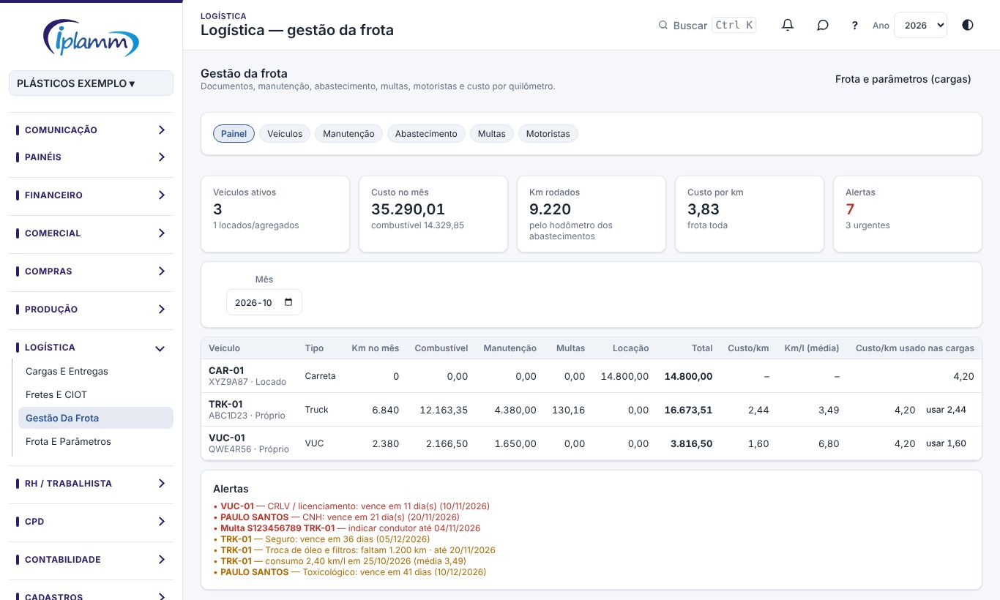
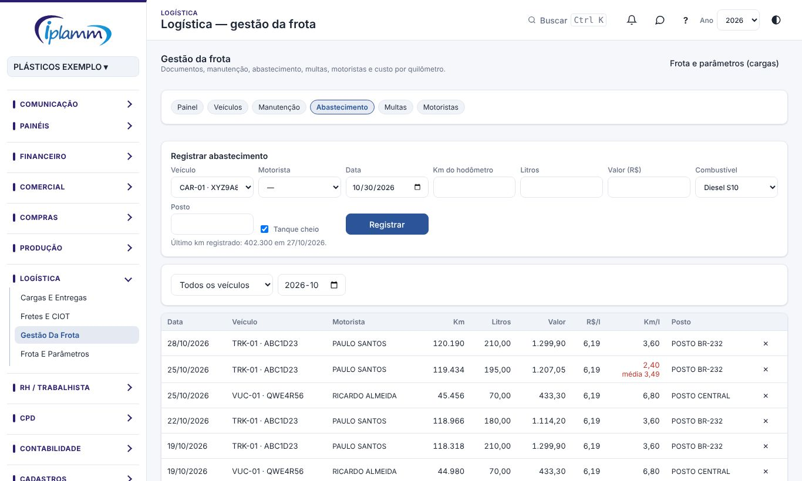
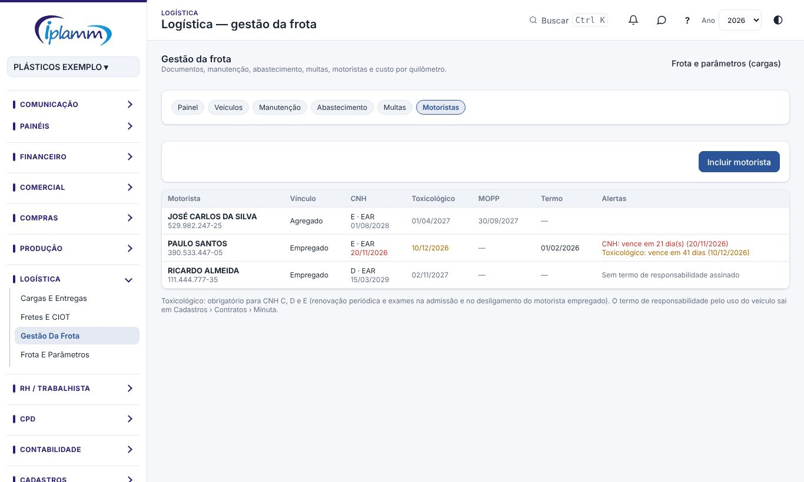

## 1. Para que serve

Controlar tudo o que envolve os veículos e quem dirige:

- **documentos** dos veículos com validade (licenciamento, IPVA, seguro, tacógrafo, AET);
- **manutenção** preventiva por km ou por tempo e as corretivas, com a conta a pagar no fluxo;
- **abastecimento** com o consumo (km/l) e o aviso de consumo fora da média;
- **multas** com o prazo para indicar o condutor e o desconto em folha;
- **motoristas** com CNH, exame toxicológico, MOPP e termo de responsabilidade;
- **custo por veículo** no mês e o custo por km usado na montagem das cargas.

## 2. Quem tem acesso

Quem edita a logística: **administrador, financeiro e diretor**. Os demais perfis não veem a gestão da frota nem os dados dos motoristas. Os contratos de locação ligados aos veículos aparecem só para administradores.

## 3. Painel

1. Abra **Logística › Gestão da frota**.
2. Escolha o **mês**. Para cada veículo: km rodados (pelo hodômetro dos abastecimentos), combustível, manutenção, multas, locação (do contrato), total, custo por km e consumo médio.
3. A coluna **Custo/km usado nas cargas** mostra o valor que a montagem de cargas usa hoje. Clique em **usar** para trocar pelo custo real do mês.
4. Em **Alertas**: documentos vencendo em até 60 dias, preventivas no limite, CNH, toxicológico e MOPP vencendo, consumo fora da média e multas com prazo de indicação perto. Os mesmos alertas aparecem no **Decision Center**.

## 4. Veículos: documentos e preventivas

1. Na aba **Veículos**, clique no veículo.
2. Complete a identificação: marca e modelo, anos, RENAVAM, chassi e **propriedade** (próprio, locado ou agregado). Para locado e agregado, escolha o **contrato**: o valor mensal entra no custo do veículo.
3. Em **Documentos**, inclua cada documento com número, seguradora ou órgão, validade, valor e o arquivo (PDF ou foto).
4. Em **Manutenção preventiva**, cadastre os serviços com intervalo em **km**, em **meses** ou nos dois (vale o que vencer primeiro), com a última execução.
5. Capacidade, baú e parâmetros da montagem de cargas continuam em **Frota e parâmetros**.

## 5. Abastecimento

1. Na aba **Abastecimento**, preencha veículo, motorista, data, **km do hodômetro**, litros, valor, combustível e posto. Marque **Tanque cheio** quando completar o tanque.
2. A plataforma lembra o último veículo, motorista, combustível e posto, para agilizar a digitação.
3. O km atual do veículo é atualizado sozinho. Se o km digitado for menor que o último, a plataforma pergunta antes de gravar.
4. **Km/l** pelo método do tanque cheio: distância entre dois abastecimentos com tanque cheio ÷ litros colocados nesse intervalo (inclusive os parciais). Em vermelho, os trechos 15% piores que a média do veículo: pode ser vazamento, desvio de combustível, defeito ou erro de digitação.

## 6. Manutenção

1. Na aba **Manutenção**, clique em **Registrar manutenção**.
2. Escolha o veículo, o tipo e, se for preventiva, o **plano atendido**: a última execução do plano é atualizada sozinha.
3. Informe data, km, oficina (beneficiário cadastrado ou nome), serviço, valor e a nota.
4. Em **Conta a pagar no fluxo**, deixe marcado **Gerar lançamento em aberto**, escolha o vencimento e a conta do plano. O lançamento entra no fluxo e na autorização de pagamentos. A conta do plano escolhida fica lembrada para a próxima vez.

## 7. Multas

1. Na aba **Multas**, clique em **Registrar multa** e preencha veículo, condutor, data, auto, órgão, infração, código, pontos, valor, vencimento e o **prazo para indicar o condutor** (está na notificação).
2. **Indique o condutor dentro do prazo**: sem indicação, a empresa recebe outra multa por não identificar o infrator. O motorista assina o formulário de identificação do condutor.
3. Mude a **situação** conforme o andamento: indicar condutor, condutor indicado, em recurso, a pagar, paga, descontada em folha ou cancelada.
4. Marque **Descontar do motorista em folha** quando houver termo de responsabilidade assinado (art. 462, § 1º, da CLT) e a culpa do motorista.
5. A multa gera a conta a pagar no fluxo, como a manutenção.

## 8. Motoristas

1. Na aba **Motoristas**, clique em **Incluir motorista**. Se ele for empregado, escolha o **colaborador do RH**: nome e CPF vêm preenchidos.
2. Informe CNH (número, categoria, validade e se tem EAR), exame **toxicológico** (data e validade: a plataforma sugere 2 anos e 6 meses depois do exame; confira no laudo), **MOPP** (produtos perigosos, quando houver) e a data do **termo de responsabilidade** assinado.
3. Alertas: CNH, toxicológico e MOPP vencendo em até 60 dias; toxicológico não cadastrado para CNH C, D ou E; empregado sem termo de responsabilidade.
4. O **termo de responsabilidade pelo uso do veículo** sai em **Cadastros › Contratos**, na ficha do contrato, em **Minuta para assinatura**.

## 9. Dúvidas frequentes

**O km/l não aparece.** O cálculo precisa de dois abastecimentos com **tanque cheio** no mesmo veículo. Abastecimentos parciais entram no trecho seguinte.

**O custo por km do mês está alto.** Veja se faltou digitar abastecimentos (o km do mês sai do hodômetro) ou se houve uma manutenção grande no mês.

**Quero ver os contratos de locação.** Só administradores veem os contratos; os demais veem o custo da locação já somado no painel.

## 10. Histórico de alterações

| Versão | Data | O que mudou |
|---|---|---|
| 1.0 | 30/10/2026 | Primeira versão: painel de custos, documentos dos veículos, preventivas, manutenção e multas com conta a pagar, abastecimento com km/l e motoristas com CNH, toxicológico e MOPP. |
