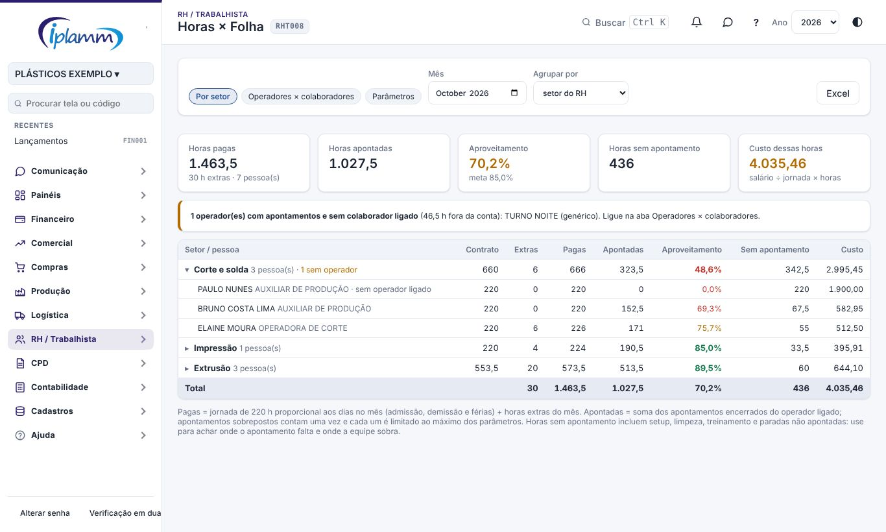
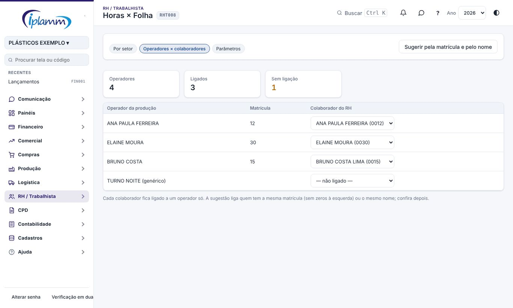

## 1. Para que serve

Compara, no mês, as **horas pagas** a cada pessoa da produção com as **horas que ela apontou** nas ordens de produção, por **setor** e por **pessoa**. Mostra o **aproveitamento** (apontadas ÷ pagas), as **horas sem apontamento** e o **custo** delas.

Serve para achar onde o apontamento está faltando (gente trabalhando sem apontar) e onde a equipe está maior do que a produção pede. Como mostra salários, só o administrador e quem tem a área **RH** liberada usam a tela.

## 2. Por setor

Escolha o **mês** e se agrupa pelo **setor do RH** (cadastro do colaborador) ou pelo **setor da produção** (onde a pessoa mais apontou).

| Coluna | O que é |
|---|---|
| Contrato | jornada do mês (padrão 220 h) proporcional aos dias em que a pessoa esteve na empresa, menos os dias de férias |
| Extras | horas extras do mês (Folha do Mês › Horas extras) |
| Pagas | contrato + extras |
| Apontadas | soma dos apontamentos encerrados do operador ligado à pessoa |
| Aproveitamento | apontadas ÷ pagas, em verde na meta, amarelo até 15 pontos abaixo e vermelho abaixo disso |
| Sem apontamento | pagas − apontadas |
| Custo | salário ÷ jornada × horas sem apontamento |

Clique no setor para ver as pessoas. O aviso amarelo no topo lista os **operadores com apontamentos e sem colaborador ligado**: essas horas ficam fora da conta. **Excel** baixa a tabela.

Como as horas apontadas são contadas:

- dois apontamentos do mesmo operador ao mesmo tempo (duas máquinas) contam **uma vez**;
- cada apontamento é limitado ao **máximo** dos parâmetros (padrão 12 h), para que um apontamento esquecido aberto não infle a conta;
- apontamentos ainda abertos não entram.

## 3. Operadores × colaboradores

Cada operador da produção é ligado a um colaborador do RH. **Sugerir pela matrícula e pelo nome** liga sozinho quem tem a mesma matrícula (sem os zeros à esquerda) ou o mesmo nome; o resto se escolhe na lista. Um colaborador fica ligado a um operador só.

## 4. Parâmetros

- **Jornada do mês** (horas), **limite de um apontamento** (horas) e **meta de aproveitamento** (%);
- **descontar os dias de férias** das horas pagas;
- **setores do RH na comparação**: com nenhum marcado, entram só as pessoas que têm operador ligado; marcando, entram todas as pessoas desses setores (quem não aponta aparece com zero).

## 5. Como ler

Aproveitamento baixo pode ser: apontamento faltando (operador que não aponta setup, limpeza ou troca), operador genérico sem ligação, gente de apoio no setor produtivo, ou equipe acima da carga. Afastamentos e faltas não estão nas horas pagas da plataforma: confira com a folha oficial antes de concluir.

## 6. Histórico de alterações

| Versão | Data | O que mudou |
|---|---|---|
| 1.0 | 08/11/2026 | Primeira versão: horas pagas × apontadas por setor e por pessoa, aproveitamento, custo das horas sem apontamento, ligação operador × colaborador e parâmetros (melhoria 8.3). |
