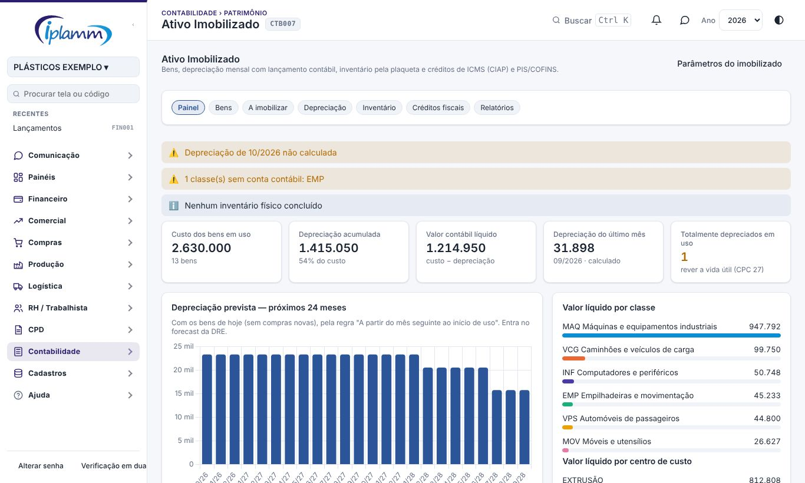
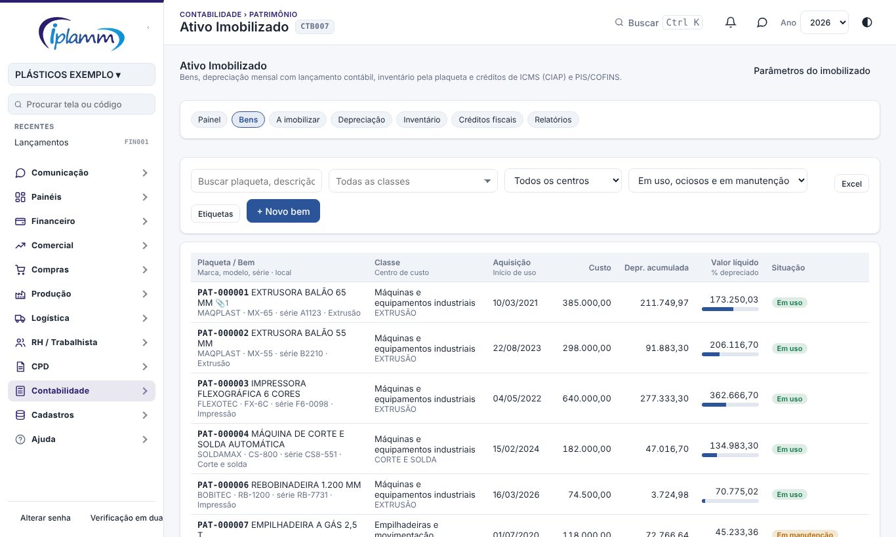
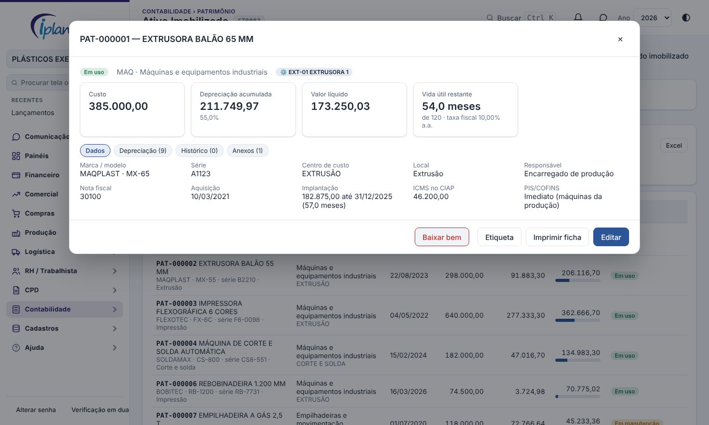
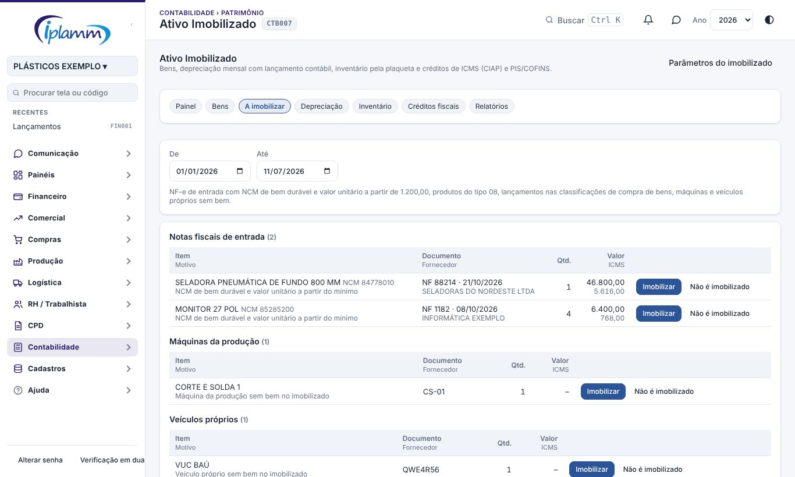
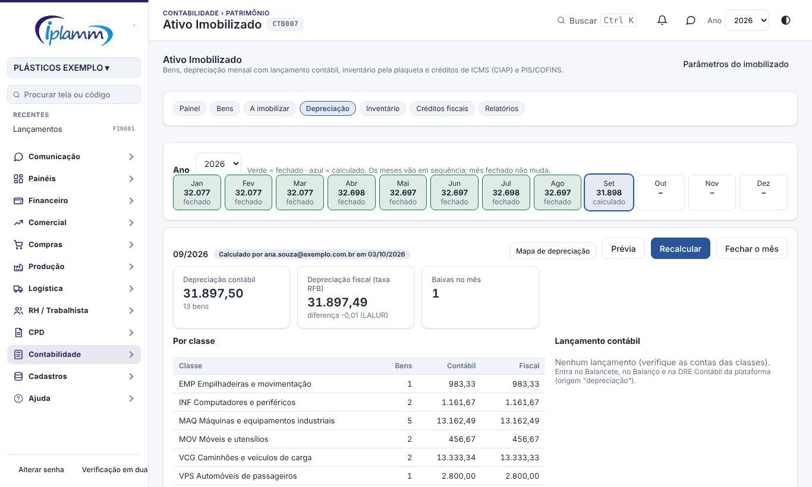
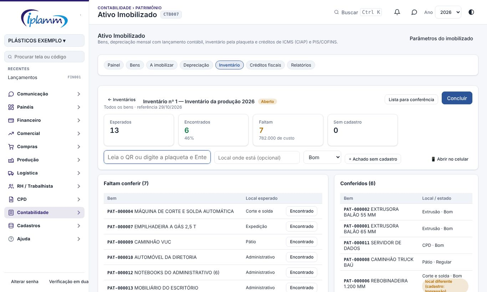
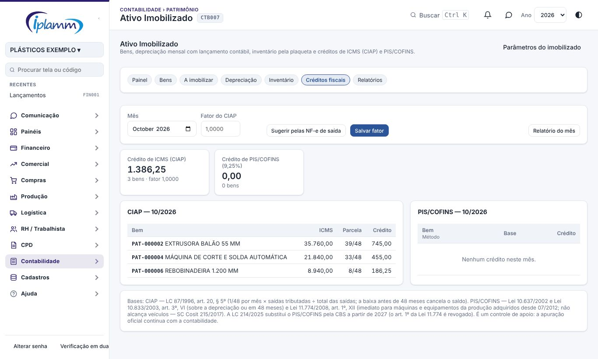
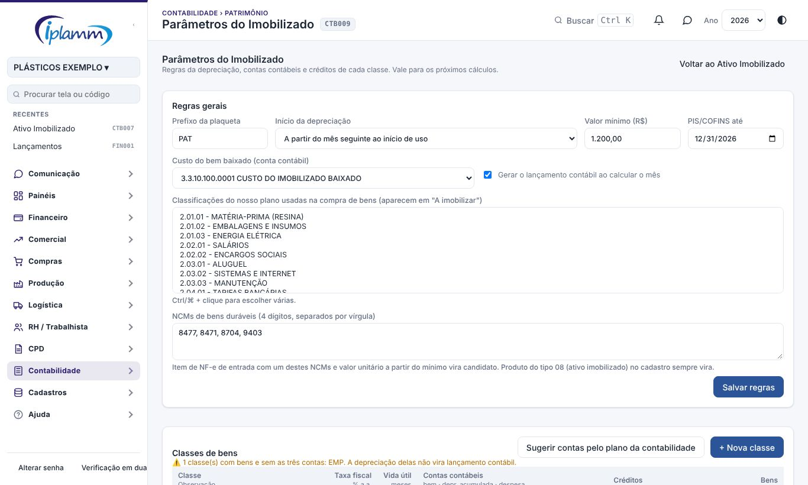

## 1. Para que serve

Controlar o patrimônio da empresa, do cadastro à baixa do bem:

- **bens** com plaqueta, classe, centro de custo, local, responsável, nota fiscal, máquina ou veículo ligado e anexos (nota, foto, laudo);
- **depreciação mês a mês**, gravada e com o **lançamento contábil** automático, que entra no Balancete, no Balanço e na DRE Contábil;
- **fechamento do mês**: depois de fechado, o valor dos bens depreciados não muda;
- **baixa** por venda, sucata, perda ou doação, com o lançamento contábil e o termo de baixa;
- **compras a imobilizar**, encontradas nas notas de entrada, nos lançamentos, nas máquinas e nos veículos;
- **inventário físico** pela plaqueta com QR, lida pelo celular;
- **créditos fiscais**: ICMS pelo CIAP e PIS/COFINS;
- **relatórios**: razão auxiliar, quadro de movimentação, mapa de depreciação, conferência com a contabilidade, bens totalmente depreciados e baixas.

## 2. Quem tem acesso

- **Ver**: quem tem acesso à área Contabilidade.
- **Cadastrar, calcular, fechar, baixar e fazer inventário**: administrador e financeiro.
- **Reabrir um mês fechado**: só o administrador.

## 3. Painel

1. Abra **Contabilidade › Patrimônio › Ativo Imobilizado**.
2. No topo ficam os avisos: mês anterior sem depreciação calculada, classe sem conta contábil e inventário físico com mais de 12 meses.
3. Os indicadores mostram o custo dos bens em uso, a depreciação acumulada, o valor contábil líquido, a depreciação do último mês e os bens **totalmente depreciados ainda em uso**.
4. O gráfico mostra a **depreciação prevista dos próximos 24 meses** com os bens de hoje. Use esse número no forecast da DRE.
5. O **grau de depreciação por classe** mostra quanto do custo já foi depreciado. Uma classe perto de 100% indica parque antigo e necessidade de reinvestimento.

## 4. Bens

### 4.1 Lista e cadastro

1. Na aba **Bens**, filtre por classe, centro de custo e situação, ou busque pela plaqueta, descrição, série ou local. A busca do topo (Ctrl K) também encontra os bens.
2. Clique em **+ Novo bem** e preencha:
   - **Identificação**: descrição, classe, situação, marca, modelo, série e NCM. A plaqueta é criada sozinha (prefixo + número, ex.: PAT-000015).
   - **Onde está**: centro de custo, local e responsável. Se o bem for parte de outro (um motor, uma melhoria), escolha o **bem principal**. Se for uma máquina da produção ou um veículo da frota, faça a ligação.
   - **Aquisição e depreciação**: fornecedor, nota fiscal, data de aquisição, **início de uso** (quando o bem ficou pronto para usar), custo, valor residual, vida útil em meses e taxa fiscal. Ao escolher a classe, a vida útil e a taxa vêm dela. A quota mensal aproximada aparece ao lado.
   - **Créditos fiscais**: ICMS que vai para o CIAP, método do PIS/COFINS e base, se forem diferentes da classe.
   - **Implantação**: só para bem que já vinha sendo depreciado antes da plataforma. Informe até quando já foi depreciado (último dia de um mês), a depreciação acumulada e os meses já depreciados, como estão no razão da contabilidade.
3. Clique em **Salvar**.
4. Use **Etiquetas** para imprimir as plaquetas com QR (folha A4, 3 × 8) dos bens filtrados. **Excel** exporta a lista com todas as colunas.

### 4.2 Ficha do bem

1. Clique no bem para abrir a ficha. No topo ficam o custo, a depreciação acumulada, o valor líquido e a vida útil restante.
2. **Dados**: tudo o que foi cadastrado, inclusive a implantação e os componentes ligados.
3. **Depreciação**: mês a mês, com a fração do mês, a quota, a acumulada, o valor líquido e a quota fiscal. Os 12 meses seguintes aparecem como **previsto**.
4. **Histórico**: cadastro, transferências de centro de custo, local ou responsável, revisões de vida útil, mudanças de situação, baixas e inventários. Tudo é registrado sozinho, com data e usuário.
5. **Anexos**: envie a nota fiscal, fotos, laudos e documentos (PDF ou imagem).
6. Botões: **Editar**, **Etiqueta**, **Imprimir ficha** e **Baixar bem**.

### 4.3 Baixa do bem

1. Na ficha, clique em **Baixar bem**.
2. Informe a data, o tipo (venda, sucata, perda, doação ou outro), o valor da venda (se houver) e o motivo.
3. Clique em **Baixar**. O **termo de baixa** abre para imprimir e assinar.
4. Calcule (ou recalcule) a depreciação do mês da baixa. É nesse cálculo que sai o lançamento contábil da baixa:
   - crédito do custo do bem;
   - débito da depreciação acumulada;
   - débito do **custo do bem baixado**, pelo valor líquido.
5. A receita da venda entra pelo financeiro, no lançamento do recebimento.
6. Para corrigir, use **Desfazer baixa** na ficha, informando o motivo. Isso só é possível enquanto o mês da baixa estiver aberto.

## 5. A imobilizar

A aba lista o que provavelmente é bem e ainda não está cadastrado:

- itens de **NF-e de entrada** com NCM de bem durável e valor unitário a partir do mínimo (R$ 1.200, por padrão);
- itens ligados a um **produto do tipo 08** (ativo imobilizado);
- **lançamentos pagos** nas classificações de compra de bens escolhidas nos parâmetros;
- **máquinas da produção** e **veículos próprios** que ainda não têm bem.

Passos:

1. Escolha o período.
2. Clique em **Imobilizar**. O formulário abre preenchido com a classe sugerida, o fornecedor, a nota, a data e o **custo sugerido**:
   - o ICMS que vai para o CIAP sai do custo;
   - o PIS/COFINS sai do custo, quando a classe tem crédito.

   A conta fica na observação do bem.
3. Se a nota tiver mais de uma unidade, deixe marcado **Cadastrar N bens** para criar um bem por unidade, com o custo dividido.
4. Se não for bem (peça de reposição, material de consumo), clique em **Não é imobilizado** e diga o motivo. O item sai da lista.

## 6. Depreciação mensal

1. Na aba **Depreciação**, escolha o ano. Os meses fechados ficam em verde e os calculados em azul.
2. Clique no mês e em **Prévia** para conferir sem gravar: total contábil, total fiscal (taxa da Receita), diferença (para o LALUR), baixas e o resumo por classe.
3. Clique em **Calcular e lançar**. A plataforma grava a depreciação de cada bem e gera o lançamento contábil no último dia do mês: débito na despesa de depreciação e crédito na depreciação acumulada, por conta.
4. Se aparecer **classe sem contas contábeis**, ligue as contas em Parâmetros do Imobilizado e recalcule.
5. Confira e clique em **Fechar o mês**. Os meses são fechados em sequência.
6. Use **Mapa de depreciação** para o relatório do mês por classe, por centro de custo e bem a bem.

Como a quota é calculada (método linear):

> quota do mês = (custo − residual − depreciação acumulada) ÷ (vida útil − meses já depreciados) × fração do mês

- A **fração do mês** segue a regra escolhida nos parâmetros. Por padrão, o bem começa a depreciar no mês seguinte ao início de uso. Também dá para usar o mês cheio ou o proporcional aos dias.
- O **último mês** leva o que faltar, e a depreciação nunca passa do custo.
- **Revisar a vida útil** (Editar) vale dos próximos meses em diante, sem mexer no passado.
- O bem ocioso ou em manutenção continua depreciando. O terreno não deprecia.

## 7. Inventário físico

1. Imprima e cole as **etiquetas** (aba Bens › Etiquetas).
2. Na aba **Inventário**, clique em **+ Novo inventário**. Dê uma descrição e a data de referência, e escolha o escopo (classe, centro de custo ou local, ou todos os bens).
3. Para conferir, leia o QR ou digite a plaqueta e tecle Enter. Antes, informe o local onde você está e o estado do bem. Um leitor de código USB também funciona nesse campo.
4. No celular, use **Abrir no celular** ou a tela **Inventário Patrimonial**:
   - toque em **Ler QR pela câmera** e aponte para a etiqueta;
   - ou abra o QR com a câmera do próprio celular: a tela abre já mostrando o bem;
   - confira e toque em **Encontrado**.
5. Achou um bem sem plaqueta? Use **+ Achado sem cadastro**.
6. Acompanhe **Faltam conferir** e **Conferidos**. O bem achado em outro local aparece com o aviso **local diferente**.
7. Clique em **Concluir**. Sai o **termo do inventário**, para assinar, com:
   - o resumo;
   - os não encontrados, com o custo e o valor líquido;
   - os encontrados em outro local;
   - os achados sem cadastro.

   O resultado entra no histórico de cada bem encontrado.
8. Providências: localizar ou baixar (como perda) os não encontrados, atualizar o local e cadastrar os achados.

## 8. Créditos fiscais

1. Na aba **Créditos fiscais**, escolha o mês.
2. **CIAP (ICMS)**: 1/48 do ICMS de cada bem por mês, desde o mês de entrada, multiplicado pelo **fator** do mês (saídas tributadas ÷ total das saídas). A baixa antes de 48 meses encerra o crédito.
3. Clique em **Sugerir pelas NF-e de saída** para calcular o fator com as notas de saída importadas do mês (remessas e retornos ficam de fora). Confira com a apuração e clique em **Salvar fator**.
4. **PIS/COFINS (9,25%)**, conforme o método da classe ou do bem:
   - **imediato**: no mês da aquisição;
   - **em 48 meses**: 1/48 por mês;
   - **sobre a depreciação**: sobre a quota de depreciação do mês.
5. **Relatório do mês** gera o PDF para a contabilidade.

## 9. Relatórios

Na aba **Relatórios**, escolha a data de posição e o período:

- **Razão auxiliar do imobilizado**: bem a bem, por classe, com o custo, a depreciação acumulada e o valor líquido na data.
- **Quadro de movimentação**: por classe, o saldo inicial, as adições, as baixas, a depreciação e o saldo final. É o quadro da nota explicativa do imobilizado (CPC 27).
- **Mapa de depreciação do mês**: contábil × fiscal, por classe, por centro de custo e bem a bem.
- **Conferência com a contabilidade**: custo e depreciação acumulada do controle × saldo das contas contábeis na data (balancete da plataforma).
- **Totalmente depreciados ainda em uso**: bens para rever a vida útil.
- **Baixas do período**: valor líquido, valor da venda e resultado (ganho ou perda).

## 10. Parâmetros do Imobilizado

1. Abra **Contabilidade › Patrimônio › Parâmetros do Imobilizado**.
2. Em **Regras gerais**, defina:
   - o prefixo da plaqueta;
   - o início da depreciação;
   - o valor mínimo para imobilizar (RIR/2018, art. 313: até R$ 1.200 pode ir direto para despesa);
   - até quando há PIS/COFINS (a CBS substitui em 2027);
   - a conta contábil do **custo do bem baixado**;
   - se a plataforma gera o lançamento contábil;
   - as classificações do nosso plano usadas na compra de bens;
   - os NCMs de bens duráveis.
3. Na primeira vez, clique em **Criar as classes de partida**. São 11 classes, com as taxas fiscais do Anexo III da IN RFB 1.700/2017:
   - terrenos (não deprecia) e edificações (4% a.a.);
   - instalações e máquinas e equipamentos (10% a.a.);
   - empilhadeiras (10% a.a.);
   - caminhões (25% a.a.) e automóveis (20% a.a.);
   - informática (20% a.a.);
   - móveis (10% a.a.);
   - ferramentas, clichês e cilindros (20% a.a.);
   - softwares (amortização em 5 anos).
4. Clique em **Sugerir contas pelo plano da contabilidade**. A plataforma propõe, pelo nome, a conta do bem, a da depreciação acumulada e a da despesa de cada classe. Desmarque o que não servir e aplique.
5. Clique numa classe para ajustar a taxa fiscal, a vida útil contábil, o residual, as contas, o crédito de PIS/COFINS e o CIAP.

A **taxa fiscal** vai para a depreciação fiscal e para o LALUR. A **vida útil** é a estimativa da empresa (CPC 27) e deve ser revista ao menos no fim de cada exercício. Confirme as classes e os créditos com a contabilidade.

## 11. Regras e travas

- Os meses são calculados em sequência: depois do primeiro cálculo, um mês só é calculado com o anterior calculado.
- Recalcular um mês aberto refaz a depreciação e o lançamento contábil daquele mês, sem duplicar nada.
- Mês fechado não é recalculado. Os meses são fechados em ordem, e só o administrador reabre (do último para trás).
- Bem depreciado em mês fechado não muda o custo, a classe, o residual, o início de uso nem a implantação. A vida útil pode ser revista.
- A baixa é feita só pelo botão **Baixar bem**. Não dá para baixar em mês fechado, nem com depreciação calculada depois da data da baixa.
- O inventário concluído não recebe mais conferências.
- A depreciação e as baixas não alteram os lançamentos do financeiro. A compra do bem continua entrando pelo financeiro e pelas notas.

## 12. Perguntas frequentes

**O bem foi comprado em 2020 e já estava sendo depreciado. Começo do zero?** Não. Use a **Implantação** no cadastro: depreciado até 31/12/2025, a acumulada e os meses já depreciados, como estão no razão da contabilidade. A plataforma deprecia o saldo nos meses que faltam.

**A depreciação fiscal é diferente da contábil. Está errado?** Não necessariamente. A fiscal usa a taxa da Receita (Anexo III) e a contábil usa a vida útil estimada pela empresa. A diferença vai para o LALUR/LACS; o mapa de depreciação mostra o valor.

**Comprei uma máquina com crédito imediato de PIS/COFINS. O custo é o valor da nota?** O ICMS do CIAP e o PIS/COFINS recuperáveis saem do custo. Ao imobilizar pela aba **A imobilizar**, o custo sugerido já vem com essa conta, que fica escrita na observação.

**Uma classe aparece sem conta contábil.** Ligue as três contas da classe (bem, depreciação acumulada e despesa) em Parâmetros do Imobilizado e recalcule o mês. Sem as contas, a depreciação é gravada mas não vira lançamento contábil.

**A conferência com a contabilidade mostra diferença.** As causas mais comuns são:

- bem não cadastrado;
- compra lançada em outra conta;
- baixa sem o cálculo do mês;
- saldo de abertura da contabilidade desatualizado.

**Posso ler o QR sem a tela aberta?** Sim. A câmera do celular abre o endereço gravado no QR, e a tela Inventário Patrimonial já mostra o bem (é preciso estar conectado à plataforma).

## 13. Histórico de alterações

| Versão | Data | O que mudou |
|---|---|---|
| 1.0 | 07/11/2026 | Primeira versão. Inclui bens, implantação de bens antigos, depreciação mensal com lançamento contábil e fechamento, baixa, compras a imobilizar, inventário com QR, CIAP e PIS/COFINS, relatórios e parâmetros. |
