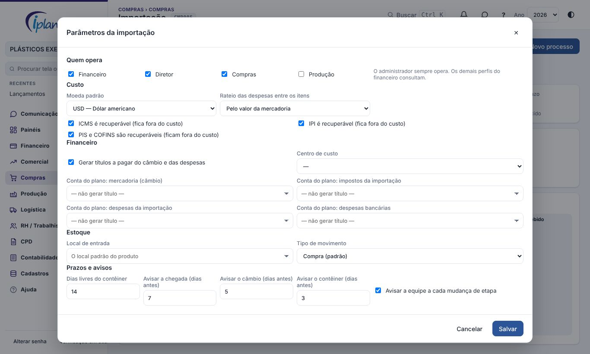
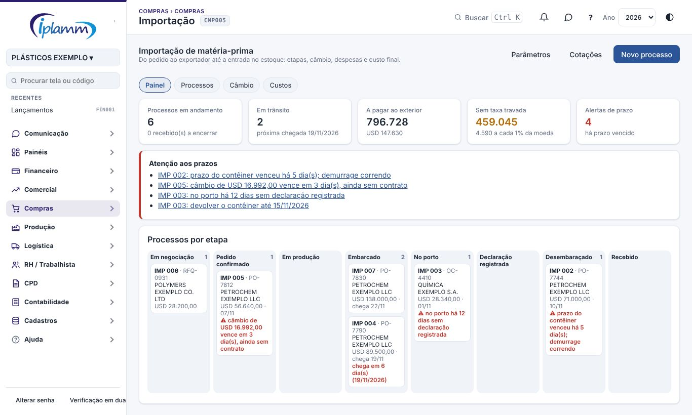
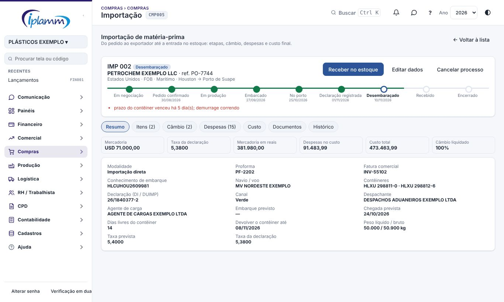
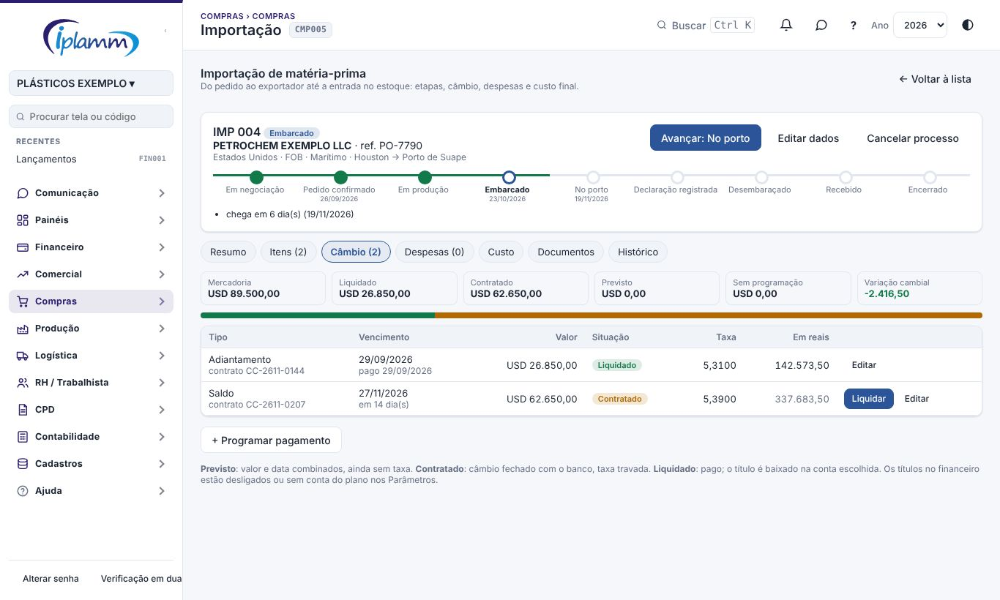
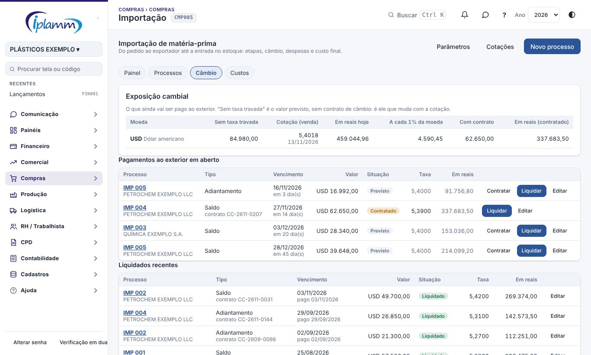
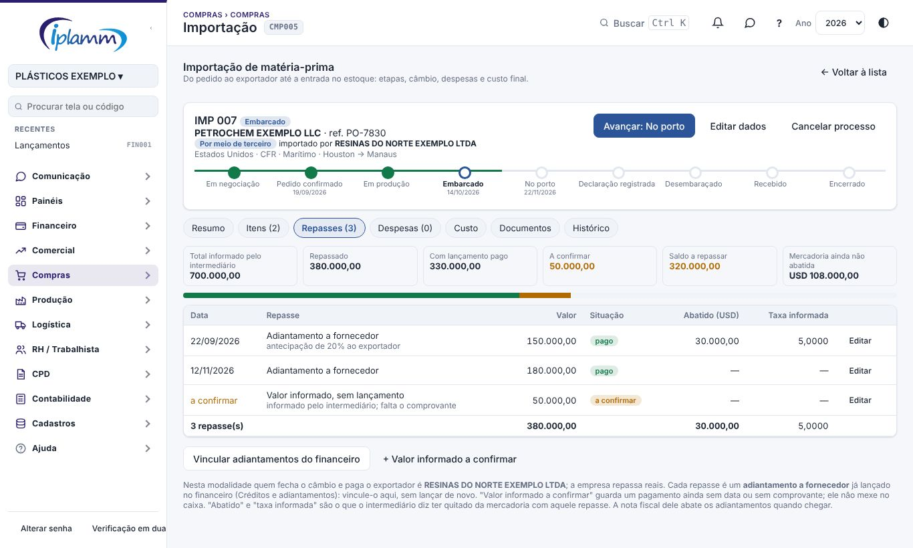
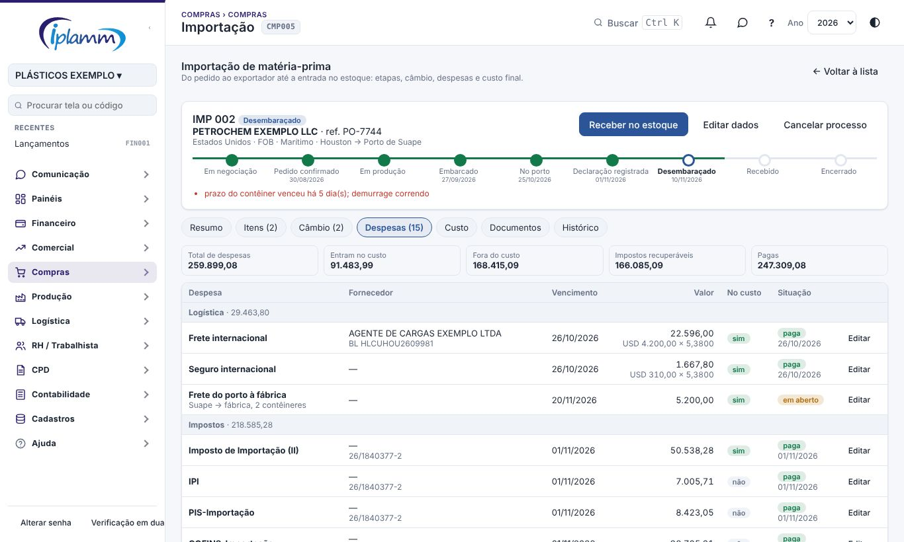
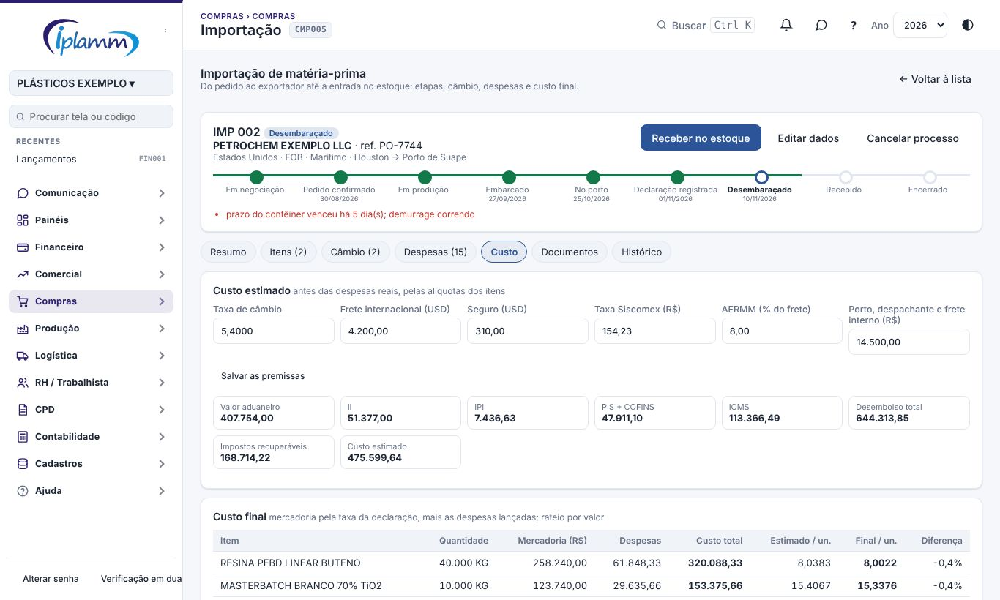
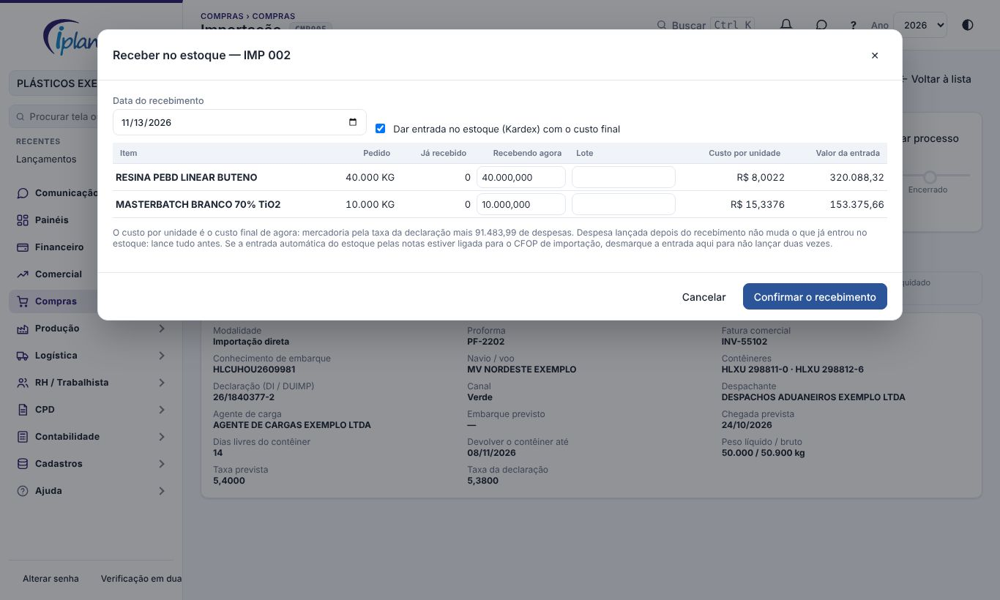

## 1. Para que serve

A tela acompanha a compra de matéria-prima do exterior, do pedido ao exportador até a entrada no estoque. Cada importação é um **processo**, e nele ficam juntos:

- as **etapas** (negociação, pedido, produção, embarque, porto, declaração, desembaraço, recebimento e encerramento), com a data de cada uma;
- o **câmbio**: o que se paga ao exportador em moeda estrangeira, da previsão à liquidação;
- as **despesas e os impostos** da nacionalização;
- o **custo final** de cada item, com tudo o que foi gasto para trazer a mercadoria;
- os **documentos** e o **recebimento**, que dá entrada no estoque com esse custo.

A tela não substitui o despachante nem o sistema da Receita: ela registra o que aconteceu e faz as contas. Os impostos pagos são os do extrato da declaração.

## 2. Quem tem acesso

| Perfil | O que faz |
|---|---|
| Administrador | Tudo, inclusive os Parâmetros |
| Financeiro, Diretor e Compras (ou os perfis marcados nos Parâmetros) | Abre e conduz os processos, lança câmbio e despesas, recebe |
| Demais perfis do financeiro | Consultam |

A liquidação do câmbio e o pagamento de despesa pedem a conta bancária; quem não enxerga as contas (perfil Compras) deixa esse passo para o financeiro.

## 3. Antes de começar: Parâmetros

Em **Parâmetros** (só o administrador):

1. **Quem opera**, além do administrador.
2. **Custo**: a moeda padrão, se as despesas são divididas entre os itens pelo valor ou pelo peso, e quais impostos são **recuperáveis**. Imposto recuperável fica fora do custo. Confirme com a contabilidade o que a empresa recupera.
3. **Financeiro**: se o câmbio e as despesas viram títulos a pagar, e em quais contas do plano (mercadoria, impostos, despesas e despesas bancárias). Sem a conta do plano, o título daquele tipo não é criado.
4. **Estoque**: o local e o tipo de movimento da entrada. Em branco, vale o local padrão do produto e o movimento de compra.
5. **Prazos e avisos**: dias livres do contêiner e com quantos dias de antecedência a tela alerta a chegada, o câmbio e a devolução do contêiner.

Cadastre também o exportador, o despachante e o agente de carga em Cadastros › Beneficiários, e a matéria-prima em Estoque › Produtos.

## 4. Visão geral da tela

1. **Indicadores**: processos em andamento, em trânsito, total a pagar ao exterior, parte ainda sem taxa travada e alertas de prazo.
2. **Atenção aos prazos**: o que está vencido ou vencendo. Clicar abre o processo.
3. **Processos por etapa**: cada cartão é um processo, na coluna da etapa em que está.

As outras abas:

| Aba | O que mostra |
|---|---|
| Processos | A lista, com filtro, busca e Excel |
| Câmbio | A exposição cambial e todos os pagamentos ao exterior (item 6.2) |
| Custos | O custo de cada processo e o custo por item, processo a processo |

## 5. Abrir e acompanhar um processo

1. Clique em **Novo processo**. Informe o exportador, a referência, o Incoterm, a moeda, a taxa prevista, o transporte e as datas previstas.
2. Na aba **Itens**, inclua a matéria-prima: produto do estoque, NCM, quantidade, preço na moeda do processo e as alíquotas. Ligue cada item a um produto do estoque; sem isso, o recebimento só registra a quantidade.
3. A cada passo, clique em **Avançar**. A tela pede a data e o que aquela etapa precisa:

| Etapa | O que a tela pede |
|---|---|
| Pedido confirmado | Embarque previsto |
| Embarcado | Conhecimento de embarque, navio, contêineres e chegada prevista |
| No porto | Data da chegada; começa a contar o prazo do contêiner |
| Declaração registrada | Número da DI ou DUIMP, **taxa de câmbio da declaração** e canal |
| Desembaraçado | Data da liberação |
| Recebido | Feito pelo botão **Receber no estoque** (item 9) |
| Encerrado | Só com tudo recebido |

4. **Editar dados** corrige qualquer informação, inclusive as datas das etapas já cumpridas.
5. Em **Documentos**, anexe proforma, fatura, romaneio, conhecimento, declaração, contratos de câmbio e nota. A faixa no alto mostra o que ainda falta.
6. **Histórico** mostra cada etapa e quantos dias levou.

**Cancelar processo** pede o motivo. **Excluir** só existe enquanto o processo está em negociação e sem pagamento.

## 6. Câmbio

### 6.1 Pagamentos de um processo

Na aba **Câmbio** do processo, cada pagamento ao exportador passa por três situações:

| Situação | O que significa | O que acontece no financeiro |
|---|---|---|
| Previsto | Valor e data combinados, ainda sem taxa | Título em aberto pela taxa prevista (ou pela última cotação) |
| Contratado | Câmbio fechado com o banco: taxa travada | O título passa a valer pela taxa contratada |
| Liquidado | Pago | O título é baixado na conta escolhida, na data do pagamento |

1. **+ Programar pagamento**: tipo (adiantamento, parcela ou saldo), valor e vencimento. A tela sugere o que falta programar.
2. **Contratar**: taxa, data, número do contrato e banco.
3. **Liquidar**: data, conta e, se for diferente de valor × taxa, o valor em reais debitado.

A barra mostra quanto da mercadoria está liquidado, contratado e previsto. **Variação cambial** é a diferença entre o que foi pago e o valor da mercadoria pela taxa da declaração: positiva é perda. Ela é resultado financeiro e não entra no custo.

### 6.2 Exposição cambial

A aba **Câmbio** da tela soma todos os processos:

- **Sem taxa travada**: o que está só previsto. É esse valor que muda com a cotação.
- **A cada 1% da moeda**: quanto o desembolso em reais sobe ou desce se a moeda variar 1%.
- **Com contrato**: o que já tem taxa.

Em **Cotações**, o botão **Buscar no Banco Central** grava a PTAX do dólar e do euro. As outras moedas são digitadas.

### 6.3 Importação por meio de terceiro: repasses

Use quando **outra empresa faz a importação** (um parceiro, uma trading ou um industrializador): ela fecha o câmbio, paga o exportador e os tributos, e a sua empresa **repassa reais** a ela. Nesse caso não há câmbio próprio para controlar; o que importa é quanto já foi repassado e quanto falta.

1. Ao abrir o processo, escolha **Quem importa: Por meio de terceiro**, o **Intermediário (importador)** e, se ele já informou, o **Total informado por ele (R$)**. O exportador, a proforma e os itens são preenchidos normalmente.
2. No processo, a aba **Câmbio** dá lugar à aba **Repasses**.
3. **Vincular adiantamentos do financeiro**: a tela lista os adiantamentos a esse fornecedor que já estão em Financeiro › Créditos e adiantamentos e ainda não pertencem a nenhum processo. Marque os desta importação. Nada é lançado de novo no caixa.
4. **+ Valor informado a confirmar**: guarda um pagamento que alguém informou e que ainda não tem data ou comprovante. Não mexe no caixa. Quando o adiantamento for lançado no financeiro, exclua este registro e vincule o lançamento.
5. Em cada repasse, **Editar** permite anotar quanto da mercadoria o intermediário abateu com aquele valor (na moeda do processo) e a taxa que ele informou.

| Indicador | O que mostra |
|---|---|
| Total informado pelo intermediário | O valor total da operação que ele passou, em reais |
| Repassado | Tudo o que está na lista, pago ou não |
| Com lançamento pago | Repasses com adiantamento pago no financeiro |
| A confirmar | Valores informados sem lançamento, ou com lançamento ainda em aberto |
| Saldo a repassar | Total informado menos o repassado |
| Mercadoria ainda não abatida | Valor dos itens menos o que o intermediário diz ter abatido, na moeda do processo |

Quando a nota fiscal do intermediário chegar, ela abate os adiantamentos em **Notas Fiscais › Pagamentos × Notas**, como em qualquer compra com pagamento antecipado.

## 7. Despesas e impostos

1. **Lançar os impostos da declaração**: digite de uma vez II, IPI, PIS, COFINS, ICMS, Siscomex e AFRMM, pelo extrato da declaração.
2. **+ Lançar despesa**: frete internacional, seguro, capatazia, armazenagem, despachante, frete interno, demurrage, despesa bancária e outras. Se a despesa nasceu em moeda estrangeira, informe o valor e a taxa: a tela converte.
3. Em cada despesa, **Entra no custo da mercadoria** decide se ela compõe o custo. Imposto recuperável, despesa bancária, multa e demurrage nascem fora; você pode mudar.
4. **Vale para**: deixe "Todos os itens" para ratear, ou escolha um item quando a despesa é só dele.
5. Marque **Já foi paga** com a data e a conta; em aberto, a despesa fica como título a pagar no vencimento.

## 8. Custo

A aba **Custo** tem dois cálculos.

**Custo estimado**, para decidir a compra antes de embarcar. Usa as alíquotas dos itens e as premissas do quadro (taxa, frete, seguro, Siscomex, AFRMM e despesas locais):

| Parcela | Como é calculada |
|---|---|
| Valor aduaneiro | (mercadoria + frete + seguro) × taxa |
| II | Valor aduaneiro × alíquota |
| IPI | (valor aduaneiro + II) × alíquota |
| PIS e COFINS | Valor aduaneiro × alíquota |
| ICMS | "Por dentro", sobre valor aduaneiro + II + IPI + PIS + COFINS + Siscomex + AFRMM |
| Custo estimado | Desembolso total menos os impostos recuperáveis |

**Custo final**, com o que realmente aconteceu:

- mercadoria pela **taxa da declaração** (enquanto ela não existe, pela prevista);
- mais as despesas marcadas como "entra no custo", rateadas pelo valor ou pelo peso; a despesa de um item só vai inteira para ele.

A coluna **Diferença** compara o final com o estimado. **Custo ÷ mercadoria** mostra quanto a nacionalização acrescenta: 1,24 quer dizer que cada R$ 1,00 de mercadoria chega custando R$ 1,24.

A base do ICMS na importação muda de estado para estado e conforme benefícios fiscais. O estimado é uma referência; confirme a regra com a contabilidade.

## 9. Receber no estoque

Com o processo desembaraçado:

1. Clique em **Receber no estoque**.
2. Confira a quantidade de cada item (pode receber em partes) e informe o lote.
3. Deixe marcado **Dar entrada no estoque** para lançar no Kardex com o custo final. O custo médio do produto é recalculado.
4. Confirme. Com tudo recebido, o processo passa para **Recebido**.

Lance todas as despesas **antes** de receber: a que entra depois não muda o custo que já foi para o estoque, e a aba Custo avisa quando isso acontece.

Se a empresa usa a entrada automática do estoque pelas notas e tem regra para o CFOP de importação, desmarque a entrada aqui, para não lançar duas vezes.

Depois de liquidar o câmbio e pagar as despesas, **Avançar: Encerrado** fecha o processo. Processo encerrado não aceita alteração; **Reabrir** volta para Recebido.

## 10. Regras e travas

- Cada mudança de etapa grava a data, entra no histórico e avisa a equipe (tipo de aviso "Importação").
- Para registrar a declaração, a tela exige o número e a taxa de câmbio.
- Só processo desembaraçado é recebido; sem taxa de câmbio não há recebimento.
- Câmbio liquidado e despesa paga não são excluídos: desfaça o pagamento antes.
- Processo com pagamento ou recebimento não é excluído, só cancelado.
- Título já baixado direto no financeiro não é alterado pela tela.
- A Central de Decisões (regra 29) mostra câmbio vencido ou a vencer sem contrato, chegada atrasada, contêiner a devolver, embarque não confirmado e carga parada no porto há mais de 5 dias.
- Processo por meio de terceiro exige o intermediário e não aceita pagamento de câmbio; importação direta não aceita repasse.
- Um adiantamento só pode estar em um processo. Só entram adiantamentos do intermediário do processo.
- Com repasse lançado, a modalidade e o intermediário do processo não mudam: exclua os repasses antes.
- Desvincular um repasse não apaga o adiantamento do financeiro.
- Tudo fica na Auditoria.

## 11. Perguntas frequentes e erros comuns

**O título do câmbio não apareceu no financeiro.** Falta a conta do plano da mercadoria nos Parâmetros, ou ainda não há nenhuma taxa (prevista, contratada ou cotação). Informe a taxa prevista no processo ou grave a cotação.

**O valor do título mudou.** Ele acompanha o câmbio: taxa prevista, depois a contratada, depois o valor liquidado.

**"Só processo desembaraçado pode ser recebido".** Avance as etapas até Desembaraçado.

**"O estoque desta empresa não está configurado".** Falta o local de matéria-prima ou o movimento de compra em Estoque › Parâmetros. Enquanto isso, receba sem marcar a entrada no estoque.

**O item diz "sem produto do estoque".** Edite o item e ligue ao produto. Sem isso, o recebimento não lança no Kardex.

**Lancei uma despesa depois de receber.** Ela aparece no custo do processo, mas não no estoque. Para corrigir o estoque, faça o ajuste de custo no Kardex.

**O ICMS entrou no custo e não devia (ou o contrário).** Mude "Entra no custo" na despesa e confira os impostos recuperáveis nos Parâmetros.

**O Banco Central não devolveu a cotação.** Em feriado ou antes do fechamento do dia não há PTAX nova. Digite a cotação na mesma janela.

**"Nenhum adiantamento livre para este fornecedor".** O pagamento ainda não foi lançado como adiantamento a esse fornecedor, ou já está em outro processo. Lance em Créditos e adiantamentos (ou em Pagamentos Antecipados) e volte.

**O total informado não bate com a proforma.** O total em reais inclui câmbio, tributos e despesas do intermediário. Peça a ele a memória de cálculo e compare a "Mercadoria ainda não abatida" com o saldo em moeda que ele informa.

**Preço CIF ou CFR.** O frete (e o seguro, no CIF) já está no preço do exportador: não lance de novo como despesa.

## 12. Histórico de alterações

| Versão | Data | O que mudou |
|---|---|---|
| 1.1 | 13/11/2026 | Importação por meio de terceiro: intermediário, total informado e aba Repasses, ligada aos adiantamentos a fornecedor do financeiro. |
| 1.0 | 13/11/2026 | Primeira versão: processo com etapas, itens, câmbio com títulos no financeiro e exposição cambial, despesas e impostos, custo estimado e final, documentos, recebimento com entrada no estoque, parâmetros e alertas. |
